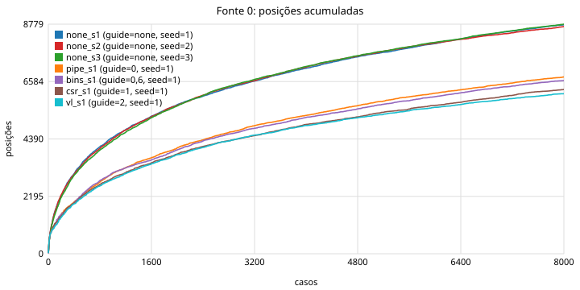
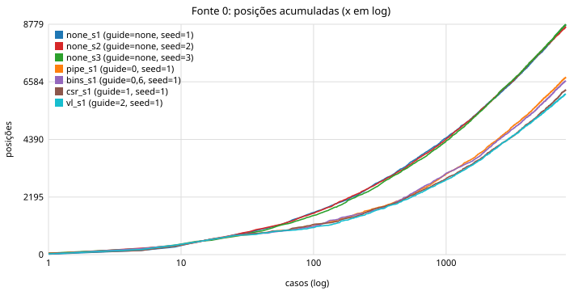

# Relatório: comportamento do mapa e das fontes de feedback no RS5

Data: 2026-10-22. Branch `cov-tests`. Dados brutos e gráficos em
[riscof/fuzzer/results/2026-10-22-fontes/](riscof/fuzzer/results/2026-10-22-fontes/)
(`report_main.md` para as 7 execuções principais, `report_cost.md` para as de custo, scripts
`run_exp.sh` e `run_cost.sh` para repetir). As fontes estão descritas em
[riscof/fuzzer/FONTES.md](riscof/fuzzer/FONTES.md); o plano que este relatório responde é o
[plano_feedback.md](plano_feedback.md) (experimentos X0 a X5).

## Resumo

- A infraestrutura funciona de ponta a ponta: sondas no RTL via `bind` (sem editar o RS5), modelos
  Python das fontes, mapa segmentado com buckets e raridade, fontes ligáveis por linha de comando,
  log por caso e relatório automático. **56 000 casos rodaram sem um único `mismatch`** depois de
  mascarar as leituras de `mstatus`/`mie`.
- **A fonte 0 (arestas do pipeline) não satura em 8000 casos.** Com o gerador atual ela acumula
  ~8700 arestas por semente, continua achando ~50 novas a cada 200 casos no fim, e a estimativa
  Chao1 diz que o gerador alcança ~11 500 (76% vistas). A união de 3 sementes dá 11 492.
- **As outras fontes saturam cedo:** a cobertura de linha do Verilator (fonte 2) chega a 99% das
  suas 1065 posições em ~250 casos; os bins (fonte 6) param em 31 de 64 antes do caso 1000; as
  transições de CSR (fonte 1) chegam a ~345 e crescem devagar.
- **Guiar o gerador atual piora a fonte 0.** Com `--guide 0` o fuzzer achou 6761 arestas contra
  8755 sem guia: 80% dos casos são mutações de um pai, e uma mutação traz em média 0,5 aresta nova
  contra 2,3 de um programa aleatório novo. O corpus admitiu 39% dos casos (a novidade é abundante
  demais para filtrar). Guiar pela fonte 1 aumentou a própria fonte 1 em 54% (530 contra 345), com
  88 transições que nenhuma outra execução viu.
- **Custo:** as sondas do RTL custam ~1 ms por caso (5% da simulação sem cobertura). A
  instrumentação de cobertura do Verilator triplica o tempo de simulação (18,5 ms para 54,9 ms).
- **Qualidade do mapa:** 0 posições instáveis em 160 casos calibrados; 5–8% das posições da
  fonte 0 sofreram colisão de hash dentro de um caso, compatível com 8700–12 000 chaves em 65 536
  posições; a região deve crescer para 2^18.
- **Bins:** 23 dos 64 discriminam (1–90% dos casos); 5 acertam em todo caso por causa do prólogo e
  epílogo do template; 26 estão em zero porque o gerador não produz traps nem interrupções.

## 1. O que foi construído

| Componente | Arquivo | Papel |
|---|---|---|
| Sondas | `riscof/fuzz_cov.sv` | `fuzz_pipe_probe` (fontes 0, 6, 7) e `fuzz_csr_probe` (fonte 1), ligadas ao RS5 por `bind` no `riscof_tb.sv`; contadores de 8 bits por região, chave original da primeira ocorrência, flag de colisão; `+FUZZ_COV`/`+FUZZ_SRC` ligam a gravação em tempo de execução |
| Modelos das fontes | `riscof/fuzzer/feedback.py` | tabelas de campos espelhadas do `.sv`, decodificação de chave em texto, `FeedbackMap` (virgin bits, frequência), `FeedbackConfig` (`record`/`guide`/pesos/`schedule`) |
| Fuzzer | `riscof/fuzzer/fuzz.py`, `runner.py` | fontes ligáveis, energia por raridade, calibração (caso rodado duas vezes), `cases.jsonl.gz` e `feedback_map.json` |
| Gerador | `riscof/fuzzer/generator.py` | `SimpleGenerator`: programa = lista de blocos (alu, mem, muldiv, branch, loop, jump, csr, mix) com semente própria; corpus e 6 operadores de mutação; sem traps |
| Relatório | `riscof/fuzzer/feedback_report.py` | saturação, colisões, estabilidade, bins, escalares, sobreposição entre fontes e entre execuções, gerador; gráficos em SVG |
| Sanidade | `riscof/fuzzer/probe_check.py` | 9 trechos escritos à mão com as arestas, bins e transições esperadas (X0) |
| Documentação | `riscof/fuzzer/FONTES.md`, `README.md` | o que cada fonte observa e como ligar |
| Ajustes | `sim/RS5Debug.sv`, `riscof/riscof_tb.sv`, `rs5/riscof_rs5.py`, `coverage.py` | trace do RS5Debug só com `+TRACE` (antes era gravado em todo caso); pontos das sondas e do trace excluídos da fonte 2 |

Configuração do core em todos os experimentos: `RV32IMU_Zicsr_Zihpm`, `BRANCHPRED=1`,
`FORWARDING=1`, `IQUEUE_SIZE=2`, **`DELAY_CYCLES=2`** (a memória de dados responde com 2 ciclos de
`stall`). Com isso 1150 das 8755 arestas da semente 1 envolvem `stall`.

## 2. Execuções

| Execução | `--guide` | Casos | Status | Tempo | O que responde |
|---|---|---|---|---|---|
| `none_s1`, `none_s2`, `none_s3` | nenhuma (controle) | 3 × 8000 | 24 000 pass | 87 s cada, 12 jobs | X1 saturação, X3 estabilidade (`--calibrate 50` na s1), X4 bins, X5 colisões |
| `pipe_s1` | 0 | 8000 | pass | 87 s | guia por arestas |
| `bins_s1` | 0,6 (peso 3 nos bins) | 8000 | pass | 87 s | guia por arestas + bins |
| `csr_s1` | 1 | 8000 | pass | 87 s | guia estilo ProcessorFuzz |
| `vl_s1` | 2 | 8000 | pass | 87 s | guia por linha do Verilator |
| `cost_*` | nenhuma | 6 × 600 | pass | | X2 custo por fonte, mesmos programas (semente 9) |

Todas gravam todas as fontes. Programas: 3 a 8 blocos, 82 linhas em média, 340 ciclos e 233
instruções por caso, CPI 1,44.

## 3. X0: as sondas medem o que dizem medir

`probe_check.py` roda 9 trechos (load-uso, store seguido de load, div seguido de uso, div seguido
de div, cadeia de mul, laço, desvio para a frente tomado, jalr, CSR) e confere 33 expectativas de
bins, arestas e transições: **todas atendidas**. Exemplo do que a sonda devolve para
`lw x5; add x6, x5, x1`:

```
[x=load fq=2 m/r=res/-] --1c(1)--> [x=bubble hz dec_hz=rs1 ...]        bolha de hazard
[x=bubble hz ...]       --1c(1)--> [x=alu fwd=ret/rf ...]              operando vindo do retire
bins: hazard_x_op, stall_and_hazard
```

E para um `div` (35 ciclos de hold): `[div=init] -1c-> [div=calc] -32c(32-127)-> [div=sign] -1c-> [x=alu fwd=ex/ex]`.
A duração na aresta faz o div inteiro virar 4 arestas, como previsto no plano.

Duas coisas que a sonda mostrou e que eu não sabia:

- O multiplicador reseta em `ALBL`, não em `IDLE` (`mul.sv`), e percorre `ALBL → ALBH → AHBL → AHBH`
  nos 3 primeiros ciclos depois do reset sem instrução nenhuma. Inofensivo (`hold_o` depende de
  `enable_i`), mas aparece como 3 arestas em todo caso.
- `mip.MTIP` está em 1 desde o reset (o `mtimecmp` do testbench reseta em 0), então toda
  transição da fonte 1 carrega `ip=t`. Se o gerador ligar `mstatus.MIE` com `MTIE`, a interrupção
  dispara no mesmo instante.

## 4. X1: saturação por fonte

Posições acumuladas (semente 1, sem guia) e em quantos casos a fonte chega a 50/90/99% do total:

| Fonte | Total em 8000 casos | 50% | 90% | 99% | Última posição nova | Novas por 200 casos: início / meio / fim |
|---|---|---|---|---|---|---|
| 0 arestas | 8755 | 953 | 5626 | 7685 | caso 7995 | 2216 / 105 / 47 |
| 1 CSR | 345 | 1127 | 5004 | 6843 | 7487 | 76 / 4 / 0 |
| 2 Verilator | 1065 (+111 pontos das sondas e 56 do trace, excluídos desde então) | 2 | 45 | 232 | 459 | 1160 / 0 / 0 |
| 6 bins | 31 de 64 | 11 | 99 | 365 | 365 | 29 / 0 / 0 |



Leitura:

- **Fonte 0 não saturou.** As três sementes concordam (8686–8779 arestas; Jaccard 0,66–0,68
  entre pares; união 11 492; interseção 6337). O estimador Chao1 (f1²/2f2 sobre as frequências)
  dá 11 200–11 500 arestas alcançáveis por este gerador, ou seja, cada semente viu 76–78%. A curva em
  escala logarítmica é uma reta: a novidade cai como uma lei de potência, não exponencialmente.
  Isso muda a decisão do plano: com este gerador, **novidade pura ainda tem o que guiar**, e a
  raridade só faz diferença depois de dezenas de milhares de casos.
- 28% das arestas foram vistas em um único caso. São as raras, onde a energia por raridade atuaria.
- **Fonte 2 satura em ~250 casos.** É o resultado esperado do `report.md` anterior e do Encarsia:
  a métrica estrutural fica plana muito antes do espaço de comportamentos. Guiar por ela
  (`vl_s1`) degenera em geração aleatória com corpus, e deu o pior resultado na fonte 0 (6121).
- **Fonte 6 satura em ~400–900 casos** com 31 bins; os outros 33 dependem de traps/IRQ (seção 7).
- **Fonte 1 cresce devagar** (4 novas por 200 casos no meio) porque o estado de CSR quase não
  muda sem traps: as 345 transições são leituras e escritas de CSR em modo M, diferenciadas pelo
  grupo do CSR, por `MPIE`/`MPP` depois de `csrw mstatus` e pelo contexto do pipeline.

## 5. Guia × sem guia (o resultado mais importante)

| Execução | guide | Fonte 0 | Fonte 1 | Fonte 2 (núcleo) | Fonte 6 | Corpus | Casos aleatórios / mutados |
|---|---|---|---|---|---|---|---|
| none_s1 | – | **8755** | 345 | 1065 | 31 | – | 8000 / 0 |
| pipe_s1 | 0 | 6761 | 260 | 1065 | 31 | 3102 | 1621 / 6379 |
| bins_s1 | 0,6 | 6622 | 276 | 1065 | 31 | 3087 | 1612 / 6388 |
| csr_s1 | 1 | 6281 | **530** | 1065 | 31 | 551 | 1627 / 6373 |
| vl_s1 | 2 | 6121 | 260 | 1065 | 31 | 443 | 1639 / 6361 |



Novidade na fonte 0 por caso, segundo a origem do caso (`pipe_s1`):

| Origem | Casos | Arestas novas por caso | Casos admitidos no corpus |
|---|---|---|---|
| programa aleatório novo | 1621 | **2,32** | 73% |
| mutação `swap` | 913 | 0,84 | 43% |
| mutação `insert` | 917 | 0,64 | 40% |
| mutação `point` (troca um bloco) | 1839 | 0,56 | 38% |
| mutação `splice` | 918 | 0,38 | 29% |
| mutação `delete` | 876 | 0,23 | 15% |
| mutação `data` (só valores iniciais) | 916 | 0,06 | 5% |

Conclusões:

1. **Com este gerador, mutar é pior que gerar do zero.** Uma mutação preserva a maioria dos
   blocos do pai; o espaço de arestas é dominado por combinações de blocos vizinhos, e um programa
   novo traz 4 vezes mais arestas novas que a melhor mutação. Os 80% de casos mutados explicam os
   2000 arestas a menos das execuções guiadas. Isto não contradiz o plano: diz que a parte "AFL" do
   esquema (corpus + mutação) precisa de operadores que mudem mais (vários blocos de uma vez,
   recombinação em nível de instrução) ou de `--mutate-p` bem menor enquanto a fonte 0 não satura.
2. **A regra de novidade é permissiva demais para a fonte 0 hoje:** 39% dos casos entram no
   corpus. Com um corpus de 3000 programas, a energia por raridade dilui. Um critério mais seletivo
   (só posições novas, não buckets; ou um limiar de score) é necessário antes da ablação.
3. **Guiar pela própria fonte funciona quando a fonte é esparsa:** `csr_s1` achou 530 transições
   de CSR (88 exclusivas), porque os poucos casos com novidade em CSR viram pais e as mutações
   `splice`/`swap` as recombinam (0,15 transição nova por `splice`, contra 0,05 de um programa
   aleatório). É o mesmo mecanismo que vai importar para traps e interrupções.
4. Guiar pela fonte 2 (`vl_s1`) não acrescenta nada depois do caso 250 e, por manter 80% de
   mutações, perde na fonte 0. É a versão local do Insight 2 do Encarsia.
5. A fonte 6 não se beneficiou de peso 3 (`bins_s1`): os 31 bins alcançáveis já são atingidos
   nos primeiros 400 casos por qualquer execução; não há o que guiar sem novos geradores.

## 6. X2, X3, X5: custo, estabilidade e colisões

Custo por caso (600 casos, mesmos programas, 8 jobs, trace desligado):

| Build | `--record` | Simulação RS5 (ms) | Leitura das fontes (ms) | Casos/s |
|---|---|---|---|---|
| sem cobertura do Verilator | nada | **18,5** | 0 | 176 |
| sem cobertura | 0,1,6,7 (sondas) | 19,5 (+5%) | 0,4 | 171 |
| com cobertura | nada | 54,9 (3,0×) | 0 | 97 |
| com cobertura | 2 | 54,9 | 3,1 | 93 |
| com cobertura | todas | 56,0 | 3,4 | 91 |

Compilação do programa (gcc) custa 18,5 ms e o Sail 7,7 ms, constantes. Ou seja: **as sondas do
RTL custam 1 ms por caso; a instrumentação `--coverage` do Verilator custa 36 ms**. Para a
ablação, a variante com fonte 2 deve usar um build próprio e as outras o build sem cobertura, ou o
orçamento em tempo de relógio pune a fonte 2 em 3×. Antes da correção do trace, cada caso ainda
gravava 31 KB de `riscof_tb.dut.debug.log` (6 ms a mais); o `bind` do `RS5Debug` ignora o
`generate` em volta dele no Verilator, por isso o interruptor virou o plusarg `+TRACE`.

Estabilidade (X3): 160 casos rodados duas vezes, **0 posições instáveis** em todas as fontes.
O modelo é determinístico; a calibração pode ficar desligada.

Colisões (X5): posições da fonte 0 que receberam duas chaves diferentes no mesmo caso:

| Execução | Posições | Com colisão | % |
|---|---|---|---|
| none_s1 | 8755 | 475 | 5,4% |
| pipe_s1 | 6761 | 431 | 6,4% |
| vl_s1 | 6121 | 508 | 8,3% |

É o esperado para 8700–12 000 chaves em 65 536 posições (aniversário: k²/2N ≈ 600–1100 pares).
Decisão: `EDGE_BITS` de 16 para 18 (262 144 posições, 2 MB de contadores por simulação, 4× menos
colisões). A fonte 1 teve 0 a 28 colisões em 4096 posições.

## 7. X4: bins

Taxa de acerto nos 8000 casos sem guia (semente 1):


| Classe | Quantos | Quais |
|---|---|---|
| > 90% (não discriminam) | 5 | `fq_full`, `fwd_mixed_sources`, `stall_and_jump`, `stall_and_fwd`, `bp_confirmed`: todos acertados pelo prólogo (`la x31`) e pelo epílogo (dump de 30 `sw` + laço do `tohost`) do template, não pelo corpo do programa |
| 1–90% (feedback útil) | 23 | `hazard_mem` 58%, `hazard_x_op` 60%, `stall_and_hazard` 62%, `bp_rollback` 50%, `hold_after_hold` 45%, `fwd_memret_in_hold` 46%, `div_by_zero` 26%, `csrw_mie` 16%, `stall_in_hold` 5%, `hazard_bubble_in_hold` 1%, `jal_taken_unacked` 4%… |
| < 1% (raros, bons alvos) | 3 | `lock_rs1_unused` 0,2%, `hazard_x_system` 0,5%, `div_overflow` 0,08% |
| 0% e dependentes do gerador | 26 | 12 de interrupção (`irq_x_*`, `irq_blocked_by_hold`, `irq_pending_in_stall`), 12 de trap (`exc_*`, `mret`, `ecall_*`, `illegal_*`, `misaligned_ldst`, `ebreak`, `csrw_mstatus_irq_pending`), mais `hazard_x_load` e `hazard_x_jalr` (o gerador nunca usa o destino de um load como base de outro load ou de um jalr) |
| 0% e provavelmente inalcançáveis | 3 | `fq_full_jump`, `rollback_no_valid_fetch`, `fwd_exec_in_hold` (o execute só habilita a escrita no último ciclo do hold) |
| impossíveis por construção (sanidade) | 2 | `killed_in_hold`, `stall_and_irq_ack`: confirmados em 0 |

O bin `jal_taken_unacked`, que eu tinha marcado como impossível, acerta em 3,8% dos casos: um
JAL previsto como tomado cujo fetch não deu `bp_ack` (porque ainda estava redirecionando) é
resolvido pelo execute. É um caminho real do `fetch.sv` que a lista de bins não previa.

Decisões: qualificar os bins (e as arestas) com a região do corpo do programa, para tirar o
template da conta; os 26 bins em zero são a lista de trabalho do gerador (tratador de trap,
`ecall`, instrução ilegal, acesso desalinhado, timer).

## 8. Fonte 1 e escalares

Fonte 1: 345 transições, todas `csr_r`/`csr_w` em M. As mais frequentes são `csr_w mscratch`
(3121 casos) e `csr_r mhpmcounter` (2756). As escritas em `mstatus` aparecem como transições de
estado (`mpie=0 mpp=3 → mpie=1 mpp=0`), e a leitura seguinte carrega o estado novo: a fonte
distingue "ler mcycle com MPIE=0" de "ler mcycle com MPIE=1", que é exatamente a granularidade
do ProcessorFuzz. Sem traps, o estado só muda por escrita explícita.

Escalares (máximo por caso, semente 1): `hold_run_max` 35 (um `div`), `hazard_run_max` 36 (uma
bolha de hazard congelada durante um hold de div, o caso `hazard_bubble_in_hold`),
`fq_full_run_max` 36 (a fila do fetch fica cheia durante todo hold), `stall_run_max` 2
(`DELAY_CYCLES`), `killed_run_max` 3 (profundidade do descarte em um salto), `irq_wait_max` 0.
A fila do fetch chega a cheia em 100% dos casos: com `IQUEUE_SIZE=2` qualquer hold a enche.

## 9. Sobreposição entre fontes

Dos casos que trouxeram novidade na fonte A, fração que também trouxe na fonte B (`none_s1`):

| A \ B | fonte 0 | fonte 1 | fonte 2 | fonte 6 |
|---|---|---|---|---|
| fonte 0 (3436 casos) | – | 4% | 4% | 0% |
| fonte 1 (200 casos) | 64% | – | 12% | 2% |
| fonte 2 (126 casos) | 99% | 19% | – | 10% |
| fonte 6 (16 casos) | 100% | 25% | 81% | – |

Toda novidade da fonte 2 e dos bins vem acompanhada de novidade na fonte 0; o inverso não vale
(96% dos casos novos para a fonte 0 não dizem nada às outras). A fonte 1 é a única com sinal
parcialmente próprio (36% dos seus casos novos não são novos na fonte 0): as transições de CSR
dependem do estado de `mstatus`, que o snapshot do pipeline só vê pelo bit `mie`.

## 10. O que muda no plano

1. **Gerador antes de feedback, de novo.** Os 26 bins em zero, a fonte 1 presa em modo M e o
   resultado "aleatório > mutado" dizem que o próximo ganho está no gerador: tratador de trap,
   operadores de trap/IRQ, e mutações que alterem mais de um bloco. O ganho da guia só apareceu na
   fonte esparsa (CSR), que é o regime em que traps e interrupções vão estar.
2. **Critério de admissão mais seletivo** na fonte 0 (posição nova, não bucket; ou limiar de
   score), e `--mutate-p` dinâmico: baixo enquanto a taxa de novidade dos aleatórios for maior que
   a dos mutados, alto depois. O log já tem os dados para calibrar isso.
3. **Mapa da fonte 0 com 2^18 posições**; manter o detector de colisão.
4. **Qualificar sondas e bins pela região do corpo** (PC entre o fim do prólogo e o início do
   dump), para que o template não polua 5 bins e as arestas mais frequentes.
5. **Builds separados na ablação:** fonte 2 só na variante que a usa; a simulação sem cobertura
   é 3× mais rápida e as sondas custam 5%.
6. **Calibração desligada** por padrão (0 instabilidade), ligada só quando `DELAY_CYCLES` ou a
   configuração mudar.
7. O ponto de partida da ablação com mutantes continua válido: as 7 execuções levam 90 s cada
   com 12 cores; 8000 casos por (variante, mutante, semente) são baratos.

## 11. Como repetir

```sh
source riscof/fuzzer/env.sh
cd riscof
python3 fuzzer/probe_check.py --work-dir <dir com obj_dir>          # X0
bash fuzzer/results/2026-10-22-fontes/run_exp.sh                     # 7 execuções + custo (ajustar EXP)
python3 fuzzer/feedback_report.py <dirs...> -o <saída>               # relatório
```
