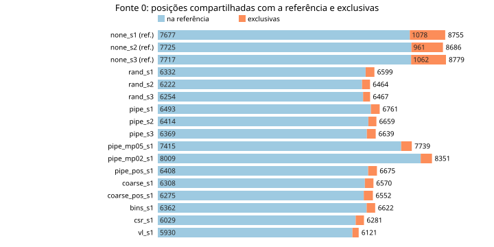
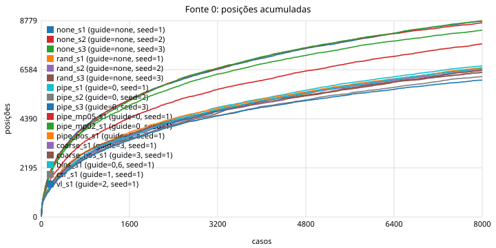
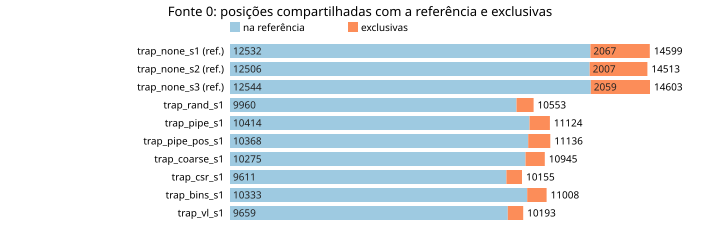
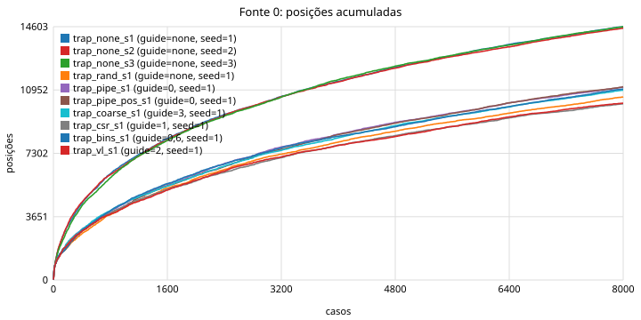
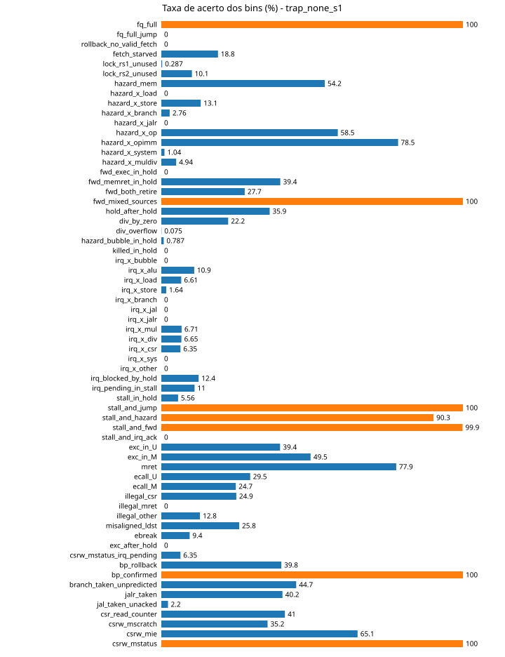

# Relatório 2: mutador × sinal, e o gerador com traps

Data: 2026-10-23. Branch `cov-tests`. Continua o [relatorio_fontes.md](relatorio_fontes.md), que
terminou com a pergunta: "guiar pela fonte 0 rendeu menos arestas que o aleatório; é o mutador que
é ruim, o sinal que é ruim, ou o sinal que está sendo usado errado?". Dados brutos, tabelas
completas e todos os gráficos em
[riscof/fuzzer/results/2026-10-23-exp2/](riscof/fuzzer/results/2026-10-23-exp2/)
(`A/report_A.md` e `B/report_B.md` são os relatórios automáticos; `analyze2.txt` tem as
comparações por semente; `run_exp2.sh` repete tudo).

## Resumo

- **O sinal ajuda, pouco; a mutação custa muito.** Com o mesmo mutador e a mesma taxa de mutação,
  escolher pais pelo sinal da fonte 0 rende 2,7% mais arestas que escolher pais ao acaso
  (6686 ± 53 contra 6510 ± 63, três sementes cada, todas as três `pipe` acima das três `rand`). Mas
  gerar programas do zero rende 8740 ± 39. Cada caso mutado em vez de sorteado custa ~0,3 aresta.
- **A regra de admissão não é a alavanca.** Admitir só posições novas, ou decidir com o snapshot
  grosso de 20 bits (fonte 3), muda o tamanho do corpus de 3100 para 394 pais e não muda o
  resultado (6552 a 6675 arestas, dentro do ruído).
- **O gerador com traps abriu o espaço:** 14 572 ± 42 arestas (+67%), 662 transições de CSR
  (+92%), 49 bins de 64 (eram 31). Com esse gerador, a vantagem do sinal sobre o corpus aleatório
  sobe para 5,4% (11 124 contra 10 553), e as rodadas guiadas descobrem 2 a 3 vezes mais arestas
  exclusivas.
- **Um bug natural do RS5 apareceu**: quando a interrupção de timer é aceita no mesmo ciclo em que
  uma instrução de CSR termina, a escrita dessa instrução se perde. Reproduzido com teste dirigido
  (`probe_check.py --irq-race`). Todas as 354 divergências contra o Sail em 80 000 casos com traps
  têm essa causa; nenhuma rodada sem bloco `irq` divergiu.
- **Primeira métrica de bug, de graça:** a rodada guiada por transições de CSR disparou esse bug em
  131 casos, contra 25 a 33 das rodadas sem guia, e chegou ao décimo disparo no caso 756 contra
  2400 a 3400. A guia por arestas de pipeline não ajudou a dispará-lo.

## 1. Gráfico pedido: arestas que só a rodada guiada alcançou



Cada barra é uma rodada de 8000 programas. A parte azul são as arestas da fonte 0 que também
aparecem na **referência**: a união das três rodadas aleatórias sem feedback (24 000 programas).
A parte laranja são as arestas que nenhum programa da referência atingiu. Para as três rodadas que
formam a referência, a comparação é com a união das outras duas (16 000 programas).

| Rodada | Arestas | Exclusivas | % |
|---|---|---|---|
| `none_s1`, `none_s2`, `none_s3` (sem feedback) | 8686–8779 | 961–1078 | 11–12% |
| `rand_s1..s3` (corpus = todos, pais uniformes) | 6464–6599 | 213–267 | 3,3–4,0% |
| `pipe_s1..s3` (guia pela fonte 0) | 6639–6761 | 245–270 | 3,7–4,1% |
| `pipe_mp05_s1`, `pipe_mp02_s1` (mutação 0,5 e 0,2) | 7739, 8351 | 324, 342 | 4,2% |
| `coarse_s1`, `pipe_pos_s1`, `coarse_pos_s1` | 6552–6675 | 262–277 | 4,0–4,2% |

O número do relatório anterior (268 exclusivas de `pipe_s1`) está na quarta barra. A leitura é
que **uma semente aleatória diferente alcança quatro vezes mais arestas exclusivas (~1000) do que
qualquer rodada guiada (~260)**, e o corpus aleatório alcança o mesmo tanto que o guiado. As
exclusivas das guiadas não são estados profundos que o sinal destravou; são o que sobra de rodar
programas diferentes.

## 2. Experimento 1: o mutador

Três grupos com três sementes cada, gerador congelado, 8000 casos:

| Grupo | O que decide os pais | Arestas (fonte 0) | Exclusivas vs referência |
|---|---|---|---|
| `none` | não há pais: todo caso é sorteado do zero | **8740 ± 39** | 961–1078 |
| `rand` | todo caso que passa vira pai; pai sorteado uniformemente; 80% dos casos são mutações | 6510 ± 63 | 213–267 |
| `pipe` | só casos com novidade na fonte 0 viram pais; pai sorteado por raridade; 80% mutações | 6686 ± 53 | 245–270 |

E a taxa de mutação, com guia pela fonte 0 (semente 1):

| `--mutate-p` | Casos aleatórios / mutados | Arestas | Arestas novas por caso aleatório / mutado |
|---|---|---|---|
| 0,8 | 1621 / 6379 | 6761 | 2,32 / 0,56 |
| 0,5 | 4006 / 3994 | 7739 | – |
| 0,2 | 6404 / 1596 | 8351 | 1,23 / 0,37 |
| 0 (`none_s1`) | 8000 / 0 | 8755 | 1,09 / – |



Conclusões:

1. **`pipe` > `rand` em todas as três sementes** (menor `pipe` 6639 > maior `rand` 6599). A
   seleção de pais pelo sinal contribui, mas com 176 arestas (2,7%) a contribuição é uma ordem de
   grandeza menor que o custo da mutação (2050 arestas, 23%).
2. **A perda é linear na taxa de mutação.** De 0,8 para 0,2 recupera 1600 das 2000 arestas perdidas.
   Mesmo com 20% de mutação ainda fica abaixo do aleatório puro: neste espaço, qualquer mutação
   deste mutador é uma troca ruim.
3. Por operador, a novidade por caso cai de 2,3 (programa novo) para 0,8 (`swap`), 0,6
   (`insert`, `point`), 0,4 (`splice`), 0,2 (`delete`) e 0,06 (`data`). Operadores que preservam
   mais do pai rendem menos. O que o mutador precisaria: operadores que mudem vários blocos, ou que
   recombinem no nível de instrução. `data` (só valores iniciais) não serve para a fonte 0.

A resposta à pergunta do relatório anterior: **o sinal da fonte 0 carrega informação útil para
escolher pais, mas o mutador atual desperdiça mais do que o sinal recupera.** O espaço de arestas
deste gerador é raso: programas novos acham arestas novas mais rápido que vizinhos de programas
bons.

## 3. Experimento 2: a regra de admissão e o snapshot grosso

| Rodada | O que muda | Corpus final | Arestas (fonte 0) | Arestas grossas (fonte 3) |
|---|---|---|---|---|
| `pipe_s1` | admissão por posição ou bucket novo na fonte 0 (padrão) | 3102 | 6761 | – |
| `pipe_pos_s1` | só posição nova conta | 2600 | 6675 | 648 |
| `coarse_s1` | decide com a fonte 3 (snapshot de 20 bits, só eventos) | 657 | 6570 | 658 |
| `coarse_pos_s1` | fonte 3, só posição nova | 394 | 6552 | 678 |
| `rand_s1` | referência: todos os casos no corpus | 8000 | 6599 | 641 |

O corpus encolheu oito vezes e nada mudou: nem a fonte 0, nem a própria fonte 3. A hipótese "o
sinal é fino demais e por isso a admissão não filtra" não se sustenta. Com corpus de 394 ou de
8000 pais, o fator que decide quantas arestas aparecem é a fração de casos sorteados do zero.

## 4. Experimento 3: o gerador com traps

O template ganhou um tratador de trap (registra `mcause`/`mepc` num buffer dentro da assinatura,
pula a instrução, limpa `MTIE` em interrupções, sempre volta em M) e o gerador ganhou os blocos
`trap` (ecall, ebreak, instrução ilegal, escrita em CSR só de leitura, load/store/jalr
desalinhados), `irq` (timer, via `mie.MTIE` e `mstatus.MIE`; `MTIP` está em 1 desde o reset nos
dois modelos) e `umode` (entra em U por `mret`, roda operações sem CSR, volta por `ecall`). Antes
dos experimentos, 13 trechos escritos à mão passaram com os mesmos traps e o mesmo estado no RS5 e
no Sail (`probe_check.py --traps`). Duas leituras tiveram de sair por não serem portáveis: `mepc`
depois de interrupção (depende de onde ela foi aceita) e `mtval` de instrução ilegal (o RS5 grava a
instrução, o Sail grava 0; a spec permite os dois).

| Rodada | guia | Fonte 0 | Fonte 1 | Fonte 3 | Bins | Exclusivas f0 | Mismatches |
|---|---|---|---|---|---|---|---|
| `trap_none_s1..s3` | – | **14 572 ± 42** | 662 ± 13 | 1905 ± 12 | 49 | 2007–2067 | 25–33 |
| `trap_rand_s1` | corpus = todos | 10 553 | 552 | 1614 | 49 | 593 | 14 |
| `trap_pipe_s1` | 0 | 11 124 | 513 | 1688 | 49 | 710 | 27 |
| `trap_pipe_pos_s1` | 0, só posições | 11 136 | 526 | 1697 | 49 | 768 | 17 |
| `trap_coarse_s1` | 3 | 10 945 | 581 | 1715 | 49 | 670 | 34 |
| `trap_csr_s1` | 1 | 10 155 | **812** | 1638 | 49 | 544 | **131** |
| `trap_bins_s1` | 0,6 | 11 008 | 560 | 1685 | 49 | 675 | 24 |
| `trap_vl_s1` | 2 | 10 193 | 498 | 1640 | 49 | 534 | 19 |





O que mudou com traps:

- O espaço cresceu 67% e continua longe de saturar: cada semente sem guia acha ~2050 arestas que as
  outras duas não acham (14%, contra 12% antes), e as arestas novas por programa aleatório subiram
  de 2,3 para 3,8.
- **A vantagem do sinal dobrou:** `trap_pipe` − `trap_rand` = 571 arestas (5,4%, uma semente), e
  as guiadas alcançam 670–770 exclusivas contra 593 do corpus aleatório. A direção é a prevista:
  quanto mais raro o estado novo, mais a escolha de pais importa. Ainda assim, mutação continua
  perdendo para geração do zero por 3400 arestas.
- Fonte 1 guiando a si mesma: 812 contra 662, com 95 transições que nenhuma outra rodada viu. É o
  mesmo efeito do relatório anterior, agora com um espaço de CSR de verdade (exceções em U e M,
  `mret`, interrupções com e sem hold).
- Bins: 49 de 64. Os 15 em zero: 2 impossíveis por construção (`killed_in_hold`,
  `stall_and_irq_ack`), 3 provavelmente inalcançáveis (`fq_full_jump`, `rollback_no_valid_fetch`,
  `fwd_exec_in_hold`), 2 que o gerador não produz (`hazard_x_load`, `hazard_x_jalr`), 6 de
  interrupção sobre classes específicas (`irq_x_bubble`, `_branch`, `_jal`, `_jalr`, `_sys`,
  `_other`), e `illegal_mret` (mret em U; o bloco `umode` não emite `mret`) e `exc_after_hold`
  (exceção logo depois de um hold; o gerador não encadeia div e trap).



## 5. O bug natural: interrupção aceita no ciclo em que uma instrução de CSR termina

Nenhum dos 80 000 casos sem traps da onda A divergiu do Sail. Com traps, 354 de 80 000 casos
divergiram, todos com um bloco `irq`. Classificação pelas diferenças na assinatura:

| Classe | Casos | Sintoma |
|---|---|---|
| A | 172 | um registrador que recebeu `mstatus & 0x88` vale `0x88` no RS5 e `0x80` no Sail: o RS5 ficou com `MIE=1` depois do `csrci mstatus, 8` |
| B | 129 | o RS5 registrou uma interrupção a mais que o Sail (consequência de A: um `csrrs mie` posterior religa `MTIE` com `MIE` ainda em 1) |
| B2 | 35 | B junto com A |
| C, D, E | 18 | propagação de A por aritmética, ou o destino de uma instrução de CSR não escrito no RS5 |

Teste dirigido (`probe_check.py --irq-race`), com `csrs mie, MTIE; csrsi mstatus, 8; <n instruções>;
csrci mstatus, 8` e leitura de `mstatus & 0x88` no fim:

| Entre ligar e desligar `MIE` | Interrupções RS5 / Sail | `mstatus & 0x88` RS5 / Sail |
|---|---|---|
| nada | 1 / 0 | 0x00 / 0x00 |
| 1 `addi` | 1 / 1 | **0x88 / 0x80** |
| 1 `lw` | 1 / 1 | **0x88 / 0x80** |
| 2 ou 3 `addi` | 1 / 1 | 0x80 / 0x80 |
| 1 `div` | 1 / 1 | 0x80 / 0x80 |

Interpretação a partir do RTL: `interrupt_pending` sai registrado do `CSRBank` um ciclo depois do
`csrsi`; com uma instrução no meio, a interrupção é aceita quando o `csrci` está no execute. O
`execute.sv` trata a instrução como concluída (`mepc` aponta para a seguinte), mas no `CSRBank.sv`
a atualização de `mstatus` pelo trap tem prioridade sobre a escrita da instrução no mesmo ciclo
(`if (raise_exception_i || interrupt_ack_i) ... else if (write_enable_i ...)`), então a escrita do
`csrci` some. Com `div`, o hold adia a aceitação e o problema não aparece. Com zero instruções, os
dois modelos divergem de outro jeito (o Sail não aceita a interrupção) e isso merece uma olhada
separada no Sail. Pela seção 8 do `pesquisa.md`, este é um bug novo, não listado.

Uma observação sobre métricas: este bug só é disparado por um padrão de duas instruções, e a rodada
que mais o disparou foi a guiada por transições de CSR, porque o corpus dela se encheu de blocos
`irq` e `csr` vizinhos:

| Rodada | Casos que dispararam | Primeiro | Décimo |
|---|---|---|---|
| `trap_none_s1..s3` | 25, 30, 33 | caso 51, 313, 22 | 3388, 2424, 2984 |
| `trap_csr_s1` | **131** | 114 | **756** |
| `trap_coarse_s1` | 34 | 174 | 1776 |
| `trap_pipe_s1` | 27 | 172 | 2982 |
| `trap_rand_s1` | 14 | 405 | 5517 |

A guia por arestas de pipeline (a fonte "funcional de microarquitetura") não ajudou a disparar o
bug; a guia por CSR ajudou quatro vezes. É uma amostra de um só bug, mas é exatamente a medição que
a ablação com mutantes vai fazer, e já mostra que "mais arestas" e "mais bugs" podem apontar para
fontes diferentes, como o Encarsia argumenta.

## 6. O que fica decidido

1. **O mutador é o gargalo**, não o sinal. Próximo passo no gerador: operadores que mudem vários
   blocos ou recombinem instruções, e `--mutate-p` adaptativo (baixo enquanto a novidade dos casos
   aleatórios superar a dos mutados). O log já tem os dados para a adaptação.
2. **A admissão pode ficar como está** (`--score buckets`); a fonte 3 não precisa guiar, mas fica
   como medida barata.
3. **O gerador com traps é o novo padrão** dos experimentos. Os 7 bins alcançáveis em zero viram
   alvos: encadear `div` com `trap`, `mret` dentro de `umode`, interrupção sobre `branch`/`jal`/`jalr`.
4. **O bug da interrupção** entra como "bug 0" da ablação, com tempo até a primeira detecção já
   medido para 10 variantes. Vale reportar aos mantenedores do RS5 com o teste dirigido.
5. Para a ablação: `trap_csr` sugere que a métrica de bugs vai separar fontes que a métrica de
   arestas não separa. Por isso cada variante precisa de 3 sementes e de bugs de classes diferentes
   (hazard, forwarding, hold, trap), como o plano já previa.

## 7. Como repetir

```sh
source riscof/fuzzer/env.sh && cd riscof
python3 fuzzer/probe_check.py --work-dir <dir com obj_dir> --traps      # 13 trechos com traps
python3 fuzzer/probe_check.py --work-dir <dir com obj_dir> --irq-race   # a corrida
bash fuzzer/results/2026-10-23-exp2/run_exp2.sh                          # 20 rodadas (ajustar EXP/MODEL)
python3 fuzzer/feedback_report.py <rodadas...> -o <saída> --baseline none_s1,none_s2,none_s3
python3 fuzzer/results/2026-10-23-exp2/analyze2.py <exp1> <exp2>
```
