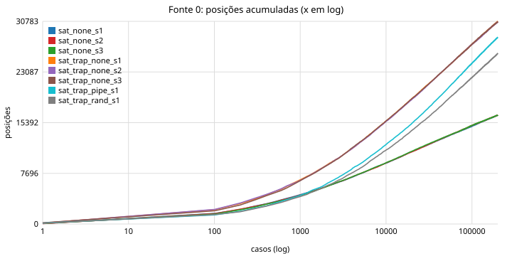
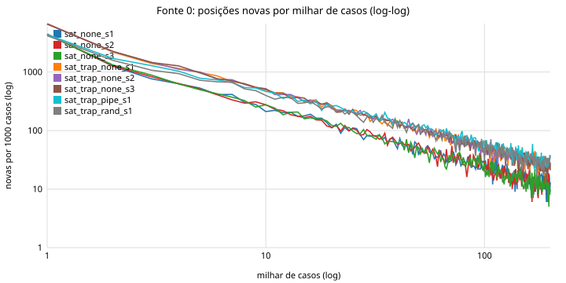
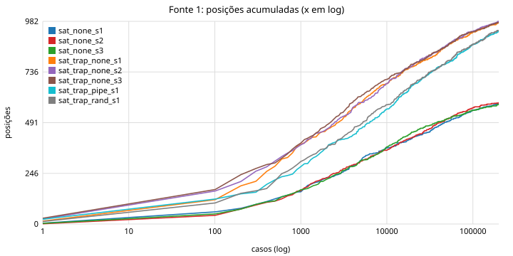

# Relatório 3: saturação das fontes em rodadas longas

Data: 2026-10-29. Branch `cov-tests`. Continua o [relatorio_fontes_2.md](relatorio_fontes_2.md).
Pergunta: com 8000 casos a fonte 0 (arestas do pipeline) e a fonte 1 (transições de CSR) ainda
cresciam; **elas saturam? Em quantos casos? E o que isso muda no projeto?** Dados, tabelas e
gráficos em [riscof/fuzzer/results/2026-10-29-saturacao/](riscof/fuzzer/results/2026-10-29-saturacao/)
(`saturation.md` é o relatório automático de `saturation_report.py`; `run_sat.sh` repete tudo).

## Resumo

- Oito rodadas de **200 000 casos** (25 vezes as anteriores), modelo sem cobertura do Verilator,
  57 minutos cada com 7 jobs numa máquina compartilhada. Três sementes sem feedback para cada
  gerador, mais uma rodada guiada pela fonte 0 e uma com corpus aleatório, ambas com traps.
- **A fonte 1 (CSR) satura:** 584 transições sem traps e ~980 com traps, com 96% do total
  estimado visto e 2 a 6 novas por 10 000 casos no fim. É um espaço de mil posições; metade sai em
  2500 casos e 90% em 57 000.
- **A fonte 0 não satura em 200 000 casos, mas está na cauda:** 16 500 arestas sem traps e 30 750
  com traps, três sementes a menos de 0,3% uma da outra. O estimador Chao1 dá ~18 500 e ~35 300
  alcançáveis (90% e 87% vistas). A taxa cai como lei de potência: 6700 novas no primeiro milhar,
  25 no milhar do meio, 250 nos últimos 10 000. **90% do alcançável aparece em ~100 000 casos; os
  10% restantes custam mais que tudo antes.**
- **A fonte 3 (eventos, 20 bits) satura em ~2800** com traps e 860 sem. Toda a diferença entre
  2800 e 35 000 são refinamentos de um mesmo evento: origem do forwarding, nível da fila, sub-estado
  de mul/div. As arestas raras são 150% forwarding e 42% modo U; não são comportamentos profundos.
- **Bins: 49 de 64 em 1000 casos e nunca mais nada.** Os 15 em zero ficam em zero por 600 000 casos:
  são inalcançáveis por este gerador, e só um gerador novo os alcança.
- **A guia passa a valer na cauda.** Em 8000 casos a rodada guiada estava 24% abaixo do aleatório;
  em 200 000, 8% abaixo, com taxa de novidade residual **maior** que a do aleatório (295 contra
  252 por 10 000) e **1199 arestas que nenhum dos 600 000 programas aleatórios atingiu**, contra 435
  do corpus aleatório com a mesma taxa de mutação. É a primeira evidência de que a seleção de pais
  pelo sinal leva a lugares que o sorteio não leva; ela aparece só depois de ~100 000 casos.
- O bug da interrupção dispara em 0,38% dos casos aleatórios (750 a 790 por rodada), sempre a
  partir do caso ~50. Para a ablação ele é um bug "fácil"; mutantes mais difíceis serão necessários.

## 1. Números

Fonte 0, arestas finas do pipeline:

| Rodada | 8 000 | 50 000 | 100 000 | 200 000 | Chao1 | Vistas | Novas nos últimos 10 000 | Casos até 50% / 90% |
|---|---|---|---|---|---|---|---|---|
| `sat_none_s1..s3` (sem traps) | 8755 | 13 203 | 14 849 | **16 531 ± 13** | 18 500 | 90% | 103–133 | 6500 / 98 000 |
| `sat_trap_none_s1..s3` | 14 602 | 23 650 | 27 306 | **30 736 ± 40** | 35 260 | 87% | 238–253 | 9500 / 108 000 |
| `sat_trap_pipe_s1` (guia 0) | 11 085 | 20 318 | 24 410 | 28 373 | 29 285 | 97% | 295 | 16 000 / 121 000 |
| `sat_trap_rand_s1` (corpus = todos) | 10 347 | 18 691 | 22 233 | 25 920 | 28 644 | 90% | 308 | 15 400 / 122 000 |

Chao1 = posições vistas + f1² / (2 f2), onde f1 e f2 são as posições vistas em exatamente 1 e 2
casos. A união das três sementes com traps dá 35 771, em cima da estimativa. Chao1 é um limite
inferior: em log-log a taxa de novidade é uma reta de declive próximo de -1, o que significa que o
acumulado cresce com o **logaritmo** do número de casos. Cada duplicação do orçamento rende um
número quase constante de arestas: 3656 de 50 000 para 100 000 e 3477 de 100 000 para 200 000
com traps; 1646 e 1682 sem traps. No sentido estrito a fonte 0 não satura; no sentido prático,
dobrar a máquina compra 10% a mais.





As outras fontes, sem feedback, três sementes:

| Fonte | Sem traps | Com traps | Vistas/Chao1 | 50% / 90% (com traps) | Novas nos últimos 10 000 |
|---|---|---|---|---|---|
| 1 transições de CSR | 584 ± 3 | 978 ± 3 | 96% | 2500 / 57 000 | 2–6 |
| 3 arestas grossas (eventos) | 858 ± 2 | 2826 ± 4 | 93–98% | 1800 / 65 000 | 10–13 |
| 6 bins | 31 | 49 | 100% | 3 / 50 | 0 desde o caso ~1000 |



Entre sementes (200 000 casos cada): as três rodadas com traps compartilham 26 000 das 30 700
arestas (Jaccard 0,81) e cada uma tem ~1750 exclusivas (5,8%). Em 8000 casos eram 14% exclusivas.
A fonte 1 tem Jaccard 0,93 e 17 exclusivas por semente.

## 2. O que as arestas que faltam são

Das 4905 arestas vistas uma só vez na rodada com traps (semente 1): 150% envolvem forwarding
(os dois operandos), 42% modo U, 18% hazard, 17% stall, 14% exceção; 0% têm três eventos juntos.
Exemplos:

```
[x=mul fwd=rf/ex mul=AHBL fq=3 U] --1c--> [x=div fwd=rf/mem fq=2 U]
[x=alu fq=2] --1c--> [x=load fwd=mem/rf dec_hz=rs1 exc fq=2]
[x=div fwd=ret/mem dec_hz=rs2 stall fq=1] --1c--> [x=div fwd=rf/mem dec_hz=rs2 stall fq=2]
```

São combinações de campos independentes (de onde veio cada operando × quão cheia está a fila ×
que classe está em execute × modo), não sequências que exijam uma precondição. A fonte 3, que
apaga esses campos, satura em 2800: esse é o número de **eventos** distintos que o gerador produz.
Os outros 32 000 são a multiplicidade com que cada evento ocorre.

## 3. O que isso significa para o projeto

**1. "Saturação" é uma propriedade do gerador, não do core.** Os totais (18 500, 35 300, 1000,
2800, 49) são o que *este* gerador consegue produzir no RS5. Três sementes concordam em 0,3%. Um
gerador novo muda todos eles: foi o que aconteceu entre o relatório 1 e o 2 (traps dobraram a
fonte 0). Os 15 bins em zero depois de 600 000 casos confirmam o limite: interrupção sobre
desvio/`jal`/`jalr`/`sys`, `mret` em U, exceção logo após hold, load como base de load, fila cheia
no salto. Nenhuma quantidade de casos nem de feedback alcança isso; só operadores novos.

**2. O orçamento decide a conclusão sobre feedback.** Com 8000 casos, mutação custa 24% e o
sinal parece inútil. Com 200 000, a rodada guiada tem mais novidade residual que a aleatória e
alcança 1199 arestas que 600 000 programas aleatórios não alcançaram. A transição acontece onde
o aleatório entra na cauda, por volta de 100 000 casos (uma hora de máquina). Para o TCC: a
ablação com mutantes precisa reportar **curvas** de tempo até detecção, ou pelo menos três
orçamentos (10 000, 50 000, 200 000), porque um ponto só escolhe a resposta. A métrica "arestas
em 24 h" do Encarsia está no regime da cauda; a nossa de 8000 casos estava no regime inicial.

**3. Guia só compensa onde a novidade é rara.** Na fonte 1 (1000 posições) e nos bins (49) não há
o que guiar depois de 50 000 casos: todo caso aleatório já repete. Na fonte 0, a guia só faz
diferença para as ~5000 arestas vistas uma vez. Isso sugere que o feedback deve ser medido em
**arestas raras alcançadas**, não em total, e que a energia por raridade é o mecanismo certo: a
rodada guiada terminou com 1576 arestas vistas uma vez contra 4905 da aleatória, ou seja, ela
revisitou o que era raro.

**4. A fonte 0 é fina demais como métrica de progresso.** 2800 eventos explicam o comportamento;
as 35 000 arestas finas são boas para guiar (dão resolução para distinguir pais) e ruins para
reportar (o número cresce sem o comportamento mudar). Proposta: guiar pela fonte 0, reportar
cobertura como fração de Chao1 por fonte, e usar a fonte 3 como "cobertura funcional" com
denominador estável (~2800).

**5. O bug natural vira calibração da ablação.** Em 0,38% dos casos aleatórios, primeira detecção
no caso ~50 em todas as rodadas sem guia. Qualquer fonte "acha" esse bug em segundos; ele serve
para validar o pipeline da ablação, não para separar fontes. Os mutantes do plano precisam de
taxas de disparo bem menores (abaixo de 0,01%) para que a escolha de pais importe. A rodada com
corpus aleatório disparou o bug na metade da taxa (327): como os casos que divergem não entram no
corpus, um corpus de "todos os que passam" fica enviesado contra o padrão que dispara; o corpus
por novidade preserva a taxa (820) porque as arestas de `irq_ack` são novidade.

**6. Custos e limites práticos.** 200 000 casos por rodada são 57 minutos com 7 jobs numa máquina
dividida; o modelo sem cobertura do Verilator foi essencial (3× mais rápido). Com 2^16 posições na
fonte 0 e 30 000 arestas vistas, as colisões passam de 5%: o mapa precisa ir para 2^18 antes da
próxima rodada longa. Os logs sem `hits` por caso (`--no-log-hits`) foram suficientes para toda a
análise.

## 4. Próximos passos que saem daqui

1. Mapa da fonte 0 com 2^18 posições.
2. Operadores de gerador para os 15 bins em zero (ou declará-los inalcançáveis um a um).
3. Na ablação: três orçamentos ou curvas completas; métrica de arestas raras além do total;
   cobertura como fração de Chao1; mutantes com taxa de disparo < 0,01%.
4. `--mutate-p` adaptativo: 0 enquanto a novidade do aleatório superar a da mutação, subindo
   conforme a taxa do aleatório cai. Os dados de 200 000 casos dão a curva para calibrar.

## 5. Como repetir

```sh
source riscof/fuzzer/env.sh && cd riscof
bash fuzzer/results/2026-10-29-saturacao/run_sat.sh      # 8 rodadas de 200k (ajustar EXP e MODEL)
python3 fuzzer/saturation_report.py <rodadas...> -o <saída>
```
