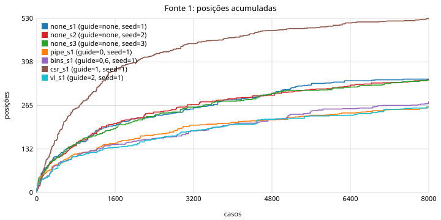
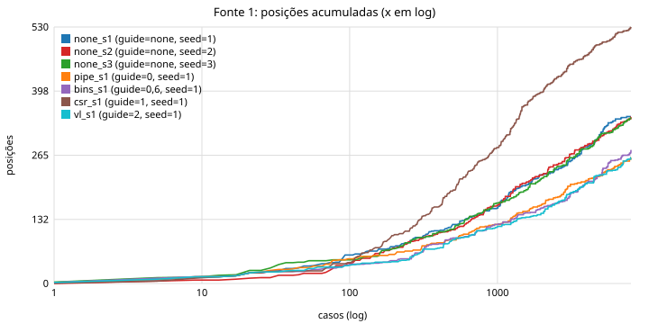
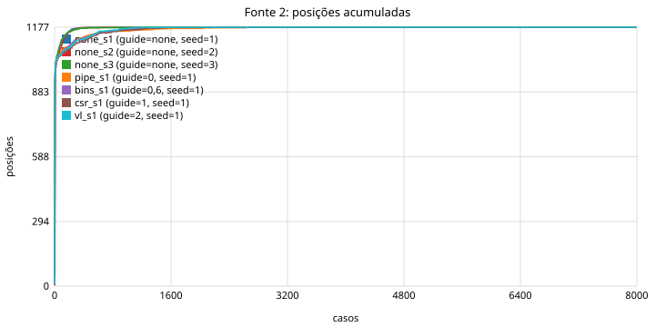
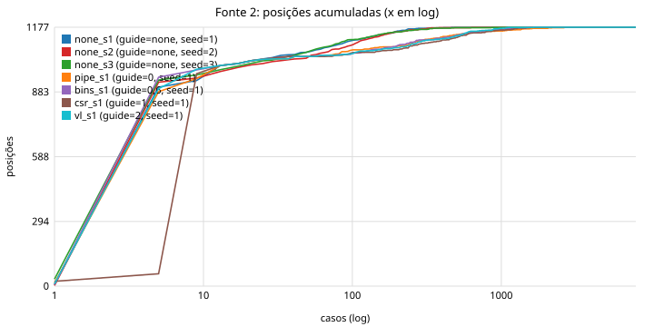
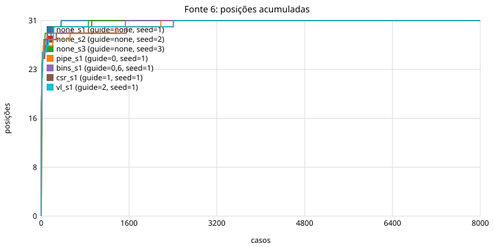
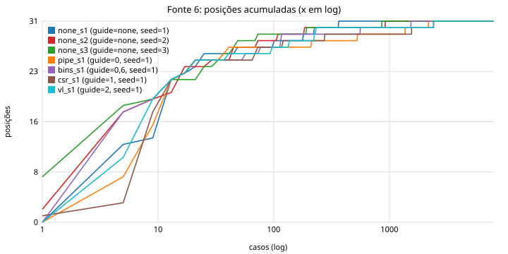

# Relatório das fontes de feedback

Gerado por `feedback_report.py` a partir de 6 execução(ões). Fontes: ver `FONTES.md`.

## 1. Execuções

| execução | guide | record | schedule | seed | casos | status | tempo (s) | casos/s | core |
|---|---|---|---|---|---|---|---|---|---|
| cost_cov_none | none |  | rarity | 9 | 600 | pass=600 | 6.2 | 97.10 | DELAY=2 IQ=2 |
| cost_cov_rtl | none | 0,1,6,7 | rarity | 9 | 600 | pass=600 | 6.3 | 95.65 | DELAY=2 IQ=2 |
| cost_cov_vl | none | 2 | rarity | 9 | 600 | pass=600 | 6.5 | 92.94 | DELAY=2 IQ=2 |
| cost_cov_all | none | 0,1,2,6,7 | rarity | 9 | 600 | pass=600 | 6.6 | 91.35 | DELAY=2 IQ=2 |
| cost_nocov_none | none |  | rarity | 9 | 600 | pass=600 | 3.4 | 175.75 | DELAY=2 IQ=2 |
| cost_nocov_rtl | none | 0,1,6,7 | rarity | 9 | 600 | pass=600 | 3.5 | 171.48 | DELAY=2 IQ=2 |

| execução | compile ms (média/mediana) | dut ms | sail ms | leitura ms | ciclos/caso | instr/caso | CPI |
|---|---|---|---|---|---|---|---|
| cost_cov_none | 18.6 / 18.5 | 54.9 / 54.6 | 7.7 / 7.7 | 0.0 / 0.0 | 337.3 | 232.3 | 1.44 |
| cost_cov_rtl | 18.6 / 18.4 | 55.9 / 55.7 | 7.8 / 7.8 | 0.4 / 0.4 | 337.3 | 232.3 | 1.44 |
| cost_cov_vl | 18.5 / 18.3 | 54.9 / 54.7 | 7.8 / 7.7 | 3.1 / 3.0 | 337.3 | 232.3 | 1.44 |
| cost_cov_all | 18.7 / 18.5 | 56.0 / 55.7 | 7.8 / 7.8 | 3.4 / 3.3 | 337.3 | 232.3 | 1.44 |
| cost_nocov_none | 18.4 / 18.1 | 18.5 / 18.4 | 7.5 / 7.5 | 0.0 / 0.0 | 337.3 | 232.3 | 1.44 |
| cost_nocov_rtl | 18.4 / 18.1 | 19.5 / 19.5 | 7.5 / 7.4 | 0.4 / 0.4 | 337.3 | 232.3 | 1.44 |

## 2. Posições por fonte no fim da execução

| execução | fonte 0 (pipe_edges) | fonte 1 (csr_trans) | fonte 2 (verilator) | fonte 6 (bins) |
|---|---|---|---|---|
| cost_cov_none | 0 pos / 0 buckets | 0 pos / 0 buckets | 0 pos / 0 buckets | 0 pos / 0 buckets |
| cost_cov_rtl | 3547 pos / 5032 buckets | 128 pos / 181 buckets | 0 pos / 0 buckets | 30 pos / 120 buckets |
| cost_cov_vl | 0 pos / 0 buckets | 0 pos / 0 buckets | 1008 pos / 2231 buckets | 0 pos / 0 buckets |
| cost_cov_all | 3547 pos / 5032 buckets | 128 pos / 181 buckets | 1008 pos / 2231 buckets | 30 pos / 120 buckets |
| cost_nocov_none | 0 pos / 0 buckets | 0 pos / 0 buckets | 0 pos / 0 buckets | 0 pos / 0 buckets |
| cost_nocov_rtl | 3547 pos / 5032 buckets | 128 pos / 181 buckets | 0 pos / 0 buckets | 30 pos / 120 buckets |

Posições atingidas **por caso** (média / mín / máx), ou seja, quantas posições um programa típico toca:

| execução | fonte 0 | fonte 1 | fonte 2 | fonte 6 |
|---|---|---|---|---|
| cost_cov_none | - | - | - | - |
| cost_cov_rtl | 86 / 33 / 156 | 2 / 0 / 9 | - | 12 / 6 / 19 |
| cost_cov_vl | - | - | 709 / 663 / 753 | - |
| cost_cov_all | 86 / 33 / 156 | 2 / 0 / 9 | 709 / 663 / 753 | 12 / 6 / 19 |
| cost_nocov_none | - | - | - | - |
| cost_nocov_rtl | 86 / 33 / 156 | 2 / 0 / 9 | - | 12 / 6 / 19 |

## 3. Saturação: posições novas ao longo dos casos

Casos necessários para atingir 50%, 90% e 99% das posições finais, último caso que trouxe posição nova, e taxa de novidade (posições novas por janela de 100 casos) no início, no meio e no fim.

### Fonte 0 (pipe_edges)

| execução | total | 50% | 90% | 99% | última nova | novas/janela início | meio | fim | % achado nos últimos 20% dos casos |
|---|---|---|---|---|---|---|---|---|---|
| cost_cov_rtl | 3547 | 147 | 474 | 592 | 600 | 1442 | 379 | 277 | 9.39% |
| cost_cov_all | 3547 | 147 | 474 | 592 | 600 | 1442 | 379 | 277 | 9.39% |
| cost_nocov_rtl | 3547 | 147 | 474 | 592 | 600 | 1442 | 379 | 277 | 9.39% |

### Fonte 1 (csr_trans)

| execução | total | 50% | 90% | 99% | última nova | novas/janela início | meio | fim | % achado nos últimos 20% dos casos |
|---|---|---|---|---|---|---|---|---|---|
| cost_cov_rtl | 128 | 150 | 469 | 552 | 558 | 48 | 20 | 7 | 8.59% |
| cost_cov_all | 128 | 150 | 469 | 552 | 558 | 48 | 20 | 7 | 8.59% |
| cost_nocov_rtl | 128 | 150 | 469 | 552 | 558 | 48 | 20 | 7 | 8.59% |

### Fonte 2 (verilator)

| execução | total | 50% | 90% | 99% | última nova | novas/janela início | meio | fim | % achado nos últimos 20% dos casos |
|---|---|---|---|---|---|---|---|---|---|
| cost_cov_vl | 1008 | 3 | 62 | 255 | 517 | 945 | 5 | 2 | 0.20% |
| cost_cov_all | 1008 | 4 | 62 | 255 | 517 | 945 | 5 | 2 | 0.20% |

### Fonte 6 (bins)

| execução | total | 50% | 90% | 99% | última nova | novas/janela início | meio | fim | % achado nos últimos 20% dos casos |
|---|---|---|---|---|---|---|---|---|---|
| cost_cov_rtl | 30 | 3 | 77 | 194 | 194 | 28 | 0 | 0 | 0.00% |
| cost_cov_all | 30 | 4 | 77 | 194 | 194 | 28 | 0 | 0 | 0.00% |
| cost_nocov_rtl | 30 | 4 | 77 | 194 | 194 | 28 | 0 | 0 | 0.00% |

## 4. Colisões de hash e estabilidade

| execução | colisões fonte 0 (posições com 2+ chaves) | colisões fonte 1 | estabilidade |
|---|---|---|---|
| cost_cov_none | 0 (0.00% das posições) | 0 | sem calibração |
| cost_cov_rtl | 38 (1.07% das posições) | 0 | sem calibração |
| cost_cov_vl | 0 (0.00% das posições) | 0 | sem calibração |
| cost_cov_all | 38 (1.07% das posições) | 0 | sem calibração |
| cost_nocov_none | 0 (0.00% das posições) | 0 | sem calibração |
| cost_nocov_rtl | 38 (1.07% das posições) | 0 | sem calibração |

Colisão = uma posição do mapa que, dentro de um mesmo caso, recebeu duas chaves originais diferentes (medido na sonda, coluna `colidiu`). Instável = posição cuja contagem mudou entre duas execuções do mesmo binário.

## 5. Fonte 0 em detalhe: estados, durações e raridade

### cost_cov_none

- arestas (posições): **0**; snapshots distintos: **0**; arestas por snapshot: 0.0
- raridade: 0 arestas vistas em 1 caso só (0.0%), 0 em 2–9 casos, 0 em 10+ casos
- estimativa Chao1 do total alcançável por este gerador: **inf** arestas (observadas 0, 0%)
- distribuição da duração do estado de origem: 
- snapshots por classe em execute: 

Arestas mais comuns (freq = casos em que apareceu):

| freq | aresta |
|---|---|

Exemplos de arestas vistas uma única vez (caso que as descobriu):

| caso | aresta |
|---|---|

### cost_cov_rtl

- arestas (posições): **3547**; snapshots distintos: **949**; arestas por snapshot: 3.7
- raridade: 1448 arestas vistas em 1 caso só (40.8%), 1449 em 2–9 casos, 650 em 10+ casos
- estimativa Chao1 do total alcançável por este gerador: **5521** arestas (observadas 3547, 64%)
- distribuição da duração do estado de origem: 1: 3222, 2: 172, 3: 85, 4-7: 53, 8-15: 9, 16-31: 3, 32-127: 3
- snapshots por classe em execute: alu: 191, load: 124, div: 121, branch: 118, bubble: 90, mul: 80, csr: 78, store: 76, jal: 53, jalr: 17, other: 1

Arestas mais comuns (freq = casos em que apareceu):

| freq | aresta |
|---|---|
| 600 | `[x=store bp_take fq=1 m/r=res/res] --1c(1)--> [x=jal bpt jumping stall fq=0 m/r=-/res]` |
| 600 | `[x=alu fwd=ex/mem fq=1 m/r=res/-] --1c(1)--> [x=store bp_take fq=1 m/r=res/res]` |
| 600 | `[x=store fq=3 m/r=-/-] --1c(1)--> [x=store fq=2 m/r=-/-]` |
| 600 | `[x=alu fwd=mem/ex fq=1 m/r=res/res] --1c(1)--> [x=alu fq=1 m/r=res/res]` |
| 600 | `[x=alu fwd=ex/rf mul=AHBH fq=1 m/r=-/-] --1c(1)--> [x=alu fwd=ex/rf fq=1 m/r=res/-]` |
| 600 | `[x=alu fwd=ex/rf fq=1 m/r=res/res] --2c(2)--> [x=alu fwd=mem/rf fq=1 m/r=res/res]` |

Exemplos de arestas vistas uma única vez (caso que as descobriu):

| caso | aresta |
|---|---|
| 597 | `[x=csr fq=2 m/r=-/res] --1c(1)--> [x=branch fq=2 m/r=res/-]` |
| 597 | `[x=branch bpt fwd=rf/ret jumping rollback fq=2 m/r=res/res] --1c(1)--> [x=div fwd=rf/ret fq=2 m/r=-/res]` |
| 597 | `[x=div fwd=rf/ret fq=2 m/r=-/res] --1c(1)--> [x=div fq=2 m/r=-/-]` |
| 597 | `[x=load fq=1 m/r=res/-] --1c(1)--> [x=load fwd=rf/ex dec_hz=rs2 stall fq=1 m/r=load/res]` |
| 598 | `[x=div fwd=ret/rf fq=2 m/r=-/load] --1c(1)--> [x=div div=init fq=3 m/r=-/-]` |
| 598 | `[x=bubble hz fwd=rf/ret fq=3 m/r=load/load] --1c(1)--> [x=div fwd=ret/rf fq=2 m/r=-/load]` |
| 598 | `[x=div fq=3 m/r=-/res] --1c(1)--> [x=mul fwd=mem/rf fq=2 m/r=res/-]` |
| 599 | `[x=alu fwd=rf/mem fq=2 m/r=res/-] --1c(1)--> [x=div bp_take fq=2 m/r=res/res]` |

### cost_cov_vl

- arestas (posições): **0**; snapshots distintos: **0**; arestas por snapshot: 0.0
- raridade: 0 arestas vistas em 1 caso só (0.0%), 0 em 2–9 casos, 0 em 10+ casos
- estimativa Chao1 do total alcançável por este gerador: **inf** arestas (observadas 0, 0%)
- distribuição da duração do estado de origem: 
- snapshots por classe em execute: 

Arestas mais comuns (freq = casos em que apareceu):

| freq | aresta |
|---|---|

Exemplos de arestas vistas uma única vez (caso que as descobriu):

| caso | aresta |
|---|---|

### cost_cov_all

- arestas (posições): **3547**; snapshots distintos: **949**; arestas por snapshot: 3.7
- raridade: 1448 arestas vistas em 1 caso só (40.8%), 1449 em 2–9 casos, 650 em 10+ casos
- estimativa Chao1 do total alcançável por este gerador: **5521** arestas (observadas 3547, 64%)
- distribuição da duração do estado de origem: 1: 3222, 2: 172, 3: 85, 4-7: 53, 8-15: 9, 16-31: 3, 32-127: 3
- snapshots por classe em execute: alu: 191, load: 124, div: 121, branch: 118, bubble: 90, mul: 80, csr: 78, store: 76, jal: 53, jalr: 17, other: 1

Arestas mais comuns (freq = casos em que apareceu):

| freq | aresta |
|---|---|
| 600 | `[x=store bp_take fq=1 m/r=res/res] --1c(1)--> [x=jal bpt jumping stall fq=0 m/r=-/res]` |
| 600 | `[x=alu fwd=ex/mem fq=1 m/r=res/-] --1c(1)--> [x=store bp_take fq=1 m/r=res/res]` |
| 600 | `[x=store fq=3 m/r=-/-] --1c(1)--> [x=store fq=2 m/r=-/-]` |
| 600 | `[x=alu fwd=mem/ex fq=1 m/r=res/res] --1c(1)--> [x=alu fq=1 m/r=res/res]` |
| 600 | `[x=alu fwd=ex/rf mul=AHBH fq=1 m/r=-/-] --1c(1)--> [x=alu fwd=ex/rf fq=1 m/r=res/-]` |
| 600 | `[x=alu fwd=ex/rf fq=1 m/r=res/res] --2c(2)--> [x=alu fwd=mem/rf fq=1 m/r=res/res]` |

Exemplos de arestas vistas uma única vez (caso que as descobriu):

| caso | aresta |
|---|---|
| 597 | `[x=csr fq=2 m/r=-/res] --1c(1)--> [x=branch fq=2 m/r=res/-]` |
| 597 | `[x=branch bpt fwd=rf/ret jumping rollback fq=2 m/r=res/res] --1c(1)--> [x=div fwd=rf/ret fq=2 m/r=-/res]` |
| 597 | `[x=div fwd=rf/ret fq=2 m/r=-/res] --1c(1)--> [x=div fq=2 m/r=-/-]` |
| 597 | `[x=load fq=1 m/r=res/-] --1c(1)--> [x=load fwd=rf/ex dec_hz=rs2 stall fq=1 m/r=load/res]` |
| 598 | `[x=div fwd=ret/rf fq=2 m/r=-/load] --1c(1)--> [x=div div=init fq=3 m/r=-/-]` |
| 598 | `[x=bubble hz fwd=rf/ret fq=3 m/r=load/load] --1c(1)--> [x=div fwd=ret/rf fq=2 m/r=-/load]` |
| 598 | `[x=div fq=3 m/r=-/res] --1c(1)--> [x=mul fwd=mem/rf fq=2 m/r=res/-]` |
| 599 | `[x=alu fwd=rf/mem fq=2 m/r=res/-] --1c(1)--> [x=div bp_take fq=2 m/r=res/res]` |

### cost_nocov_none

- arestas (posições): **0**; snapshots distintos: **0**; arestas por snapshot: 0.0
- raridade: 0 arestas vistas em 1 caso só (0.0%), 0 em 2–9 casos, 0 em 10+ casos
- estimativa Chao1 do total alcançável por este gerador: **inf** arestas (observadas 0, 0%)
- distribuição da duração do estado de origem: 
- snapshots por classe em execute: 

Arestas mais comuns (freq = casos em que apareceu):

| freq | aresta |
|---|---|

Exemplos de arestas vistas uma única vez (caso que as descobriu):

| caso | aresta |
|---|---|

### cost_nocov_rtl

- arestas (posições): **3547**; snapshots distintos: **949**; arestas por snapshot: 3.7
- raridade: 1448 arestas vistas em 1 caso só (40.8%), 1449 em 2–9 casos, 650 em 10+ casos
- estimativa Chao1 do total alcançável por este gerador: **5521** arestas (observadas 3547, 64%)
- distribuição da duração do estado de origem: 1: 3222, 2: 172, 3: 85, 4-7: 53, 8-15: 9, 16-31: 3, 32-127: 3
- snapshots por classe em execute: alu: 191, load: 124, div: 121, branch: 118, bubble: 90, mul: 80, csr: 78, store: 76, jal: 53, jalr: 17, other: 1

Arestas mais comuns (freq = casos em que apareceu):

| freq | aresta |
|---|---|
| 600 | `[x=store bp_take fq=1 m/r=res/res] --1c(1)--> [x=jal bpt jumping stall fq=0 m/r=-/res]` |
| 600 | `[x=alu fwd=ex/mem fq=1 m/r=res/-] --1c(1)--> [x=store bp_take fq=1 m/r=res/res]` |
| 600 | `[x=store fq=3 m/r=-/-] --1c(1)--> [x=store fq=2 m/r=-/-]` |
| 600 | `[x=alu fwd=mem/ex fq=1 m/r=res/res] --1c(1)--> [x=alu fq=1 m/r=res/res]` |
| 600 | `[x=alu fwd=ex/rf mul=AHBH fq=1 m/r=-/-] --1c(1)--> [x=alu fwd=ex/rf fq=1 m/r=res/-]` |
| 600 | `[x=alu fwd=ex/rf fq=1 m/r=res/res] --2c(2)--> [x=alu fwd=mem/rf fq=1 m/r=res/res]` |

Exemplos de arestas vistas uma única vez (caso que as descobriu):

| caso | aresta |
|---|---|
| 597 | `[x=csr fq=2 m/r=-/res] --1c(1)--> [x=branch fq=2 m/r=res/-]` |
| 597 | `[x=branch bpt fwd=rf/ret jumping rollback fq=2 m/r=res/res] --1c(1)--> [x=div fwd=rf/ret fq=2 m/r=-/res]` |
| 597 | `[x=div fwd=rf/ret fq=2 m/r=-/res] --1c(1)--> [x=div fq=2 m/r=-/-]` |
| 597 | `[x=load fq=1 m/r=res/-] --1c(1)--> [x=load fwd=rf/ex dec_hz=rs2 stall fq=1 m/r=load/res]` |
| 598 | `[x=div fwd=ret/rf fq=2 m/r=-/load] --1c(1)--> [x=div div=init fq=3 m/r=-/-]` |
| 598 | `[x=bubble hz fwd=rf/ret fq=3 m/r=load/load] --1c(1)--> [x=div fwd=ret/rf fq=2 m/r=-/load]` |
| 598 | `[x=div fq=3 m/r=-/res] --1c(1)--> [x=mul fwd=mem/rf fq=2 m/r=res/-]` |
| 599 | `[x=alu fwd=rf/mem fq=2 m/r=res/-] --1c(1)--> [x=div bp_take fq=2 m/r=res/res]` |

## 6. Fonte 1: transições de trap/CSR

- cost_cov_none: nenhuma transição registrada
### cost_cov_rtl

- transições: 128; por evento: csr_r: 73, csr_w: 55
| freq | transição |
|---|---|
| 247 | `csr_w mscratch @{M mie=0 mpie=0 mpp=3 ip=t} [x=csr]` |
| 222 | `csr_r mhpmcounter @{M mie=0 mpie=0 mpp=3 ip=t} [x=csr]` |
| 157 | `csr_r mcycle/minstret @{M mie=0 mpie=0 mpp=3 ip=t} [x=csr]` |
| 107 | `csr_r ucounter @{M mie=0 mpie=0 mpp=3 ip=t} [x=csr]` |
| 47 | `csr_r mstatus @{M mie=0 mpie=0 mpp=3 ip=t} [x=csr]` |
| 44 | `csr_r mie @{M mie=0 mpie=0 mpp=3 ip=t} [x=csr]` |
| 36 | `csr_w mie @{M mie=0 mpie=0 mpp=3 ip=t} [x=csr]` |
| 34 | `csr_w mstatus @{M mie=0 mpie=0 mpp=3 ip=t} [x=csr]` |
| 29 | `csr_r mtvec @{M mie=0 mpie=0 mpp=3 ip=t} [x=csr]` |
| 23 | `csr_r mscratch @{M mie=0 mpie=0 mpp=3 ip=t} [x=csr]` |

- cost_cov_vl: nenhuma transição registrada
### cost_cov_all

- transições: 128; por evento: csr_r: 73, csr_w: 55
| freq | transição |
|---|---|
| 247 | `csr_w mscratch @{M mie=0 mpie=0 mpp=3 ip=t} [x=csr]` |
| 222 | `csr_r mhpmcounter @{M mie=0 mpie=0 mpp=3 ip=t} [x=csr]` |
| 157 | `csr_r mcycle/minstret @{M mie=0 mpie=0 mpp=3 ip=t} [x=csr]` |
| 107 | `csr_r ucounter @{M mie=0 mpie=0 mpp=3 ip=t} [x=csr]` |
| 47 | `csr_r mstatus @{M mie=0 mpie=0 mpp=3 ip=t} [x=csr]` |
| 44 | `csr_r mie @{M mie=0 mpie=0 mpp=3 ip=t} [x=csr]` |
| 36 | `csr_w mie @{M mie=0 mpie=0 mpp=3 ip=t} [x=csr]` |
| 34 | `csr_w mstatus @{M mie=0 mpie=0 mpp=3 ip=t} [x=csr]` |
| 29 | `csr_r mtvec @{M mie=0 mpie=0 mpp=3 ip=t} [x=csr]` |
| 23 | `csr_r mscratch @{M mie=0 mpie=0 mpp=3 ip=t} [x=csr]` |

- cost_nocov_none: nenhuma transição registrada
### cost_nocov_rtl

- transições: 128; por evento: csr_r: 73, csr_w: 55
| freq | transição |
|---|---|
| 247 | `csr_w mscratch @{M mie=0 mpie=0 mpp=3 ip=t} [x=csr]` |
| 222 | `csr_r mhpmcounter @{M mie=0 mpie=0 mpp=3 ip=t} [x=csr]` |
| 157 | `csr_r mcycle/minstret @{M mie=0 mpie=0 mpp=3 ip=t} [x=csr]` |
| 107 | `csr_r ucounter @{M mie=0 mpie=0 mpp=3 ip=t} [x=csr]` |
| 47 | `csr_r mstatus @{M mie=0 mpie=0 mpp=3 ip=t} [x=csr]` |
| 44 | `csr_r mie @{M mie=0 mpie=0 mpp=3 ip=t} [x=csr]` |
| 36 | `csr_w mie @{M mie=0 mpie=0 mpp=3 ip=t} [x=csr]` |
| 34 | `csr_w mstatus @{M mie=0 mpie=0 mpp=3 ip=t} [x=csr]` |
| 29 | `csr_r mtvec @{M mie=0 mpie=0 mpp=3 ip=t} [x=csr]` |
| 23 | `csr_r mscratch @{M mie=0 mpie=0 mpp=3 ip=t} [x=csr]` |

## 7. Fonte 6: taxa de acerto dos bins

Fração dos casos em que cada bin foi atingido. Classificação: `>90%` não discrimina; `1–90%` serve de feedback; `0%` é alvo (se alcançável) ou exclusão. Bins marcados `(impossível)` não devem acertar nesta configuração.

### cost_cov_none

Resumo: 0%: 62, impossível: 2

| # | bin | acerto | classe |
|---|---|---|---|
| 0 | fq_full | 0.0% | 0% |
| 1 | fq_full_jump | 0.0% | 0% |
| 2 | rollback_no_valid_fetch | 0.0% | 0% |
| 3 | fetch_starved | 0.0% | 0% |
| 4 | lock_rs1_unused | 0.0% | 0% |
| 5 | lock_rs2_unused | 0.0% | 0% |
| 6 | hazard_mem | 0.0% | 0% |
| 7 | hazard_x_load | 0.0% | 0% |
| 8 | hazard_x_store | 0.0% | 0% |
| 9 | hazard_x_branch | 0.0% | 0% |
| 10 | hazard_x_jalr | 0.0% | 0% |
| 11 | hazard_x_op | 0.0% | 0% |
| 12 | hazard_x_opimm | 0.0% | 0% |
| 13 | hazard_x_system | 0.0% | 0% |
| 14 | hazard_x_muldiv | 0.0% | 0% |
| 15 | fwd_exec_in_hold | 0.0% | 0% |
| 16 | fwd_memret_in_hold | 0.0% | 0% |
| 17 | fwd_both_retire | 0.0% | 0% |
| 18 | fwd_mixed_sources | 0.0% | 0% |
| 19 | hold_after_hold | 0.0% | 0% |
| 20 | div_by_zero | 0.0% | 0% |
| 21 | div_overflow | 0.0% | 0% |
| 22 | hazard_bubble_in_hold | 0.0% | 0% |
| 23 | killed_in_hold | 0.0% | impossível |
| 24 | irq_x_bubble | 0.0% | 0% |
| 25 | irq_x_alu | 0.0% | 0% |
| 26 | irq_x_load | 0.0% | 0% |
| 27 | irq_x_store | 0.0% | 0% |
| 28 | irq_x_branch | 0.0% | 0% |
| 29 | irq_x_jal | 0.0% | 0% |
| 30 | irq_x_jalr | 0.0% | 0% |
| 31 | irq_x_mul | 0.0% | 0% |
| 32 | irq_x_div | 0.0% | 0% |
| 33 | irq_x_csr | 0.0% | 0% |
| 34 | irq_x_sys | 0.0% | 0% |
| 35 | irq_x_other | 0.0% | 0% |
| 36 | irq_blocked_by_hold | 0.0% | 0% |
| 37 | irq_pending_in_stall | 0.0% | 0% |
| 38 | stall_in_hold | 0.0% | 0% |
| 39 | stall_and_jump | 0.0% | 0% |
| 40 | stall_and_hazard | 0.0% | 0% |
| 41 | stall_and_fwd | 0.0% | 0% |
| 42 | stall_and_irq_ack | 0.0% | impossível |
| 43 | exc_in_U | 0.0% | 0% |
| 44 | exc_in_M | 0.0% | 0% |
| 45 | mret | 0.0% | 0% |
| 46 | ecall_U | 0.0% | 0% |
| 47 | ecall_M | 0.0% | 0% |
| 48 | illegal_csr | 0.0% | 0% |
| 49 | illegal_mret | 0.0% | 0% |
| 50 | illegal_other | 0.0% | 0% |
| 51 | misaligned_ldst | 0.0% | 0% |
| 52 | ebreak | 0.0% | 0% |
| 53 | exc_after_hold | 0.0% | 0% |
| 54 | csrw_mstatus_irq_pending | 0.0% | 0% |
| 55 | bp_rollback | 0.0% | 0% |
| 56 | bp_confirmed | 0.0% | 0% |
| 57 | branch_taken_unpredicted | 0.0% | 0% |
| 58 | jalr_taken | 0.0% | 0% |
| 59 | jal_taken_unacked | 0.0% | 0% |
| 60 | csr_read_counter | 0.0% | 0% |
| 61 | csrw_mscratch | 0.0% | 0% |
| 62 | csrw_mie | 0.0% | 0% |
| 63 | csrw_mstatus | 0.0% | 0% |

### cost_cov_rtl

Resumo: 0%: 32, 1-90%: 22, <1%: 3, >90%: 5, impossível: 2

| # | bin | acerto | classe |
|---|---|---|---|
| 0 | fq_full | 100.0% | >90% |
| 1 | fq_full_jump | 0.0% | 0% |
| 2 | rollback_no_valid_fetch | 0.0% | 0% |
| 3 | fetch_starved | 8.8% | 1-90% |
| 4 | lock_rs1_unused | 0.2% | <1% |
| 5 | lock_rs2_unused | 13.2% | 1-90% |
| 6 | hazard_mem | 58.2% | 1-90% |
| 7 | hazard_x_load | 0.0% | 0% |
| 8 | hazard_x_store | 17.7% | 1-90% |
| 9 | hazard_x_branch | 1.7% | 1-90% |
| 10 | hazard_x_jalr | 0.0% | 0% |
| 11 | hazard_x_op | 58.8% | 1-90% |
| 12 | hazard_x_opimm | 4.0% | 1-90% |
| 13 | hazard_x_system | 0.7% | <1% |
| 14 | hazard_x_muldiv | 5.2% | 1-90% |
| 15 | fwd_exec_in_hold | 0.0% | 0% |
| 16 | fwd_memret_in_hold | 46.0% | 1-90% |
| 17 | fwd_both_retire | 34.8% | 1-90% |
| 18 | fwd_mixed_sources | 100.0% | >90% |
| 19 | hold_after_hold | 46.3% | 1-90% |
| 20 | div_by_zero | 27.2% | 1-90% |
| 21 | div_overflow | 0.0% | 0% |
| 22 | hazard_bubble_in_hold | 0.7% | <1% |
| 23 | killed_in_hold | 0.0% | impossível |
| 24 | irq_x_bubble | 0.0% | 0% |
| 25 | irq_x_alu | 0.0% | 0% |
| 26 | irq_x_load | 0.0% | 0% |
| 27 | irq_x_store | 0.0% | 0% |
| 28 | irq_x_branch | 0.0% | 0% |
| 29 | irq_x_jal | 0.0% | 0% |
| 30 | irq_x_jalr | 0.0% | 0% |
| 31 | irq_x_mul | 0.0% | 0% |
| 32 | irq_x_div | 0.0% | 0% |
| 33 | irq_x_csr | 0.0% | 0% |
| 34 | irq_x_sys | 0.0% | 0% |
| 35 | irq_x_other | 0.0% | 0% |
| 36 | irq_blocked_by_hold | 0.0% | 0% |
| 37 | irq_pending_in_stall | 0.0% | 0% |
| 38 | stall_in_hold | 4.7% | 1-90% |
| 39 | stall_and_jump | 100.0% | >90% |
| 40 | stall_and_hazard | 62.3% | 1-90% |
| 41 | stall_and_fwd | 99.7% | >90% |
| 42 | stall_and_irq_ack | 0.0% | impossível |
| 43 | exc_in_U | 0.0% | 0% |
| 44 | exc_in_M | 0.0% | 0% |
| 45 | mret | 0.0% | 0% |
| 46 | ecall_U | 0.0% | 0% |
| 47 | ecall_M | 0.0% | 0% |
| 48 | illegal_csr | 0.0% | 0% |
| 49 | illegal_mret | 0.0% | 0% |
| 50 | illegal_other | 0.0% | 0% |
| 51 | misaligned_ldst | 0.0% | 0% |
| 52 | ebreak | 0.0% | 0% |
| 53 | exc_after_hold | 0.0% | 0% |
| 54 | csrw_mstatus_irq_pending | 0.0% | 0% |
| 55 | bp_rollback | 51.0% | 1-90% |
| 56 | bp_confirmed | 100.0% | >90% |
| 57 | branch_taken_unpredicted | 45.2% | 1-90% |
| 58 | jalr_taken | 43.5% | 1-90% |
| 59 | jal_taken_unacked | 3.8% | 1-90% |
| 60 | csr_read_counter | 53.5% | 1-90% |
| 61 | csrw_mscratch | 46.0% | 1-90% |
| 62 | csrw_mie | 14.8% | 1-90% |
| 63 | csrw_mstatus | 15.2% | 1-90% |

### cost_cov_vl

Resumo: 0%: 62, impossível: 2

| # | bin | acerto | classe |
|---|---|---|---|
| 0 | fq_full | 0.0% | 0% |
| 1 | fq_full_jump | 0.0% | 0% |
| 2 | rollback_no_valid_fetch | 0.0% | 0% |
| 3 | fetch_starved | 0.0% | 0% |
| 4 | lock_rs1_unused | 0.0% | 0% |
| 5 | lock_rs2_unused | 0.0% | 0% |
| 6 | hazard_mem | 0.0% | 0% |
| 7 | hazard_x_load | 0.0% | 0% |
| 8 | hazard_x_store | 0.0% | 0% |
| 9 | hazard_x_branch | 0.0% | 0% |
| 10 | hazard_x_jalr | 0.0% | 0% |
| 11 | hazard_x_op | 0.0% | 0% |
| 12 | hazard_x_opimm | 0.0% | 0% |
| 13 | hazard_x_system | 0.0% | 0% |
| 14 | hazard_x_muldiv | 0.0% | 0% |
| 15 | fwd_exec_in_hold | 0.0% | 0% |
| 16 | fwd_memret_in_hold | 0.0% | 0% |
| 17 | fwd_both_retire | 0.0% | 0% |
| 18 | fwd_mixed_sources | 0.0% | 0% |
| 19 | hold_after_hold | 0.0% | 0% |
| 20 | div_by_zero | 0.0% | 0% |
| 21 | div_overflow | 0.0% | 0% |
| 22 | hazard_bubble_in_hold | 0.0% | 0% |
| 23 | killed_in_hold | 0.0% | impossível |
| 24 | irq_x_bubble | 0.0% | 0% |
| 25 | irq_x_alu | 0.0% | 0% |
| 26 | irq_x_load | 0.0% | 0% |
| 27 | irq_x_store | 0.0% | 0% |
| 28 | irq_x_branch | 0.0% | 0% |
| 29 | irq_x_jal | 0.0% | 0% |
| 30 | irq_x_jalr | 0.0% | 0% |
| 31 | irq_x_mul | 0.0% | 0% |
| 32 | irq_x_div | 0.0% | 0% |
| 33 | irq_x_csr | 0.0% | 0% |
| 34 | irq_x_sys | 0.0% | 0% |
| 35 | irq_x_other | 0.0% | 0% |
| 36 | irq_blocked_by_hold | 0.0% | 0% |
| 37 | irq_pending_in_stall | 0.0% | 0% |
| 38 | stall_in_hold | 0.0% | 0% |
| 39 | stall_and_jump | 0.0% | 0% |
| 40 | stall_and_hazard | 0.0% | 0% |
| 41 | stall_and_fwd | 0.0% | 0% |
| 42 | stall_and_irq_ack | 0.0% | impossível |
| 43 | exc_in_U | 0.0% | 0% |
| 44 | exc_in_M | 0.0% | 0% |
| 45 | mret | 0.0% | 0% |
| 46 | ecall_U | 0.0% | 0% |
| 47 | ecall_M | 0.0% | 0% |
| 48 | illegal_csr | 0.0% | 0% |
| 49 | illegal_mret | 0.0% | 0% |
| 50 | illegal_other | 0.0% | 0% |
| 51 | misaligned_ldst | 0.0% | 0% |
| 52 | ebreak | 0.0% | 0% |
| 53 | exc_after_hold | 0.0% | 0% |
| 54 | csrw_mstatus_irq_pending | 0.0% | 0% |
| 55 | bp_rollback | 0.0% | 0% |
| 56 | bp_confirmed | 0.0% | 0% |
| 57 | branch_taken_unpredicted | 0.0% | 0% |
| 58 | jalr_taken | 0.0% | 0% |
| 59 | jal_taken_unacked | 0.0% | 0% |
| 60 | csr_read_counter | 0.0% | 0% |
| 61 | csrw_mscratch | 0.0% | 0% |
| 62 | csrw_mie | 0.0% | 0% |
| 63 | csrw_mstatus | 0.0% | 0% |

### cost_cov_all

Resumo: 0%: 32, 1-90%: 22, <1%: 3, >90%: 5, impossível: 2

| # | bin | acerto | classe |
|---|---|---|---|
| 0 | fq_full | 100.0% | >90% |
| 1 | fq_full_jump | 0.0% | 0% |
| 2 | rollback_no_valid_fetch | 0.0% | 0% |
| 3 | fetch_starved | 8.8% | 1-90% |
| 4 | lock_rs1_unused | 0.2% | <1% |
| 5 | lock_rs2_unused | 13.2% | 1-90% |
| 6 | hazard_mem | 58.2% | 1-90% |
| 7 | hazard_x_load | 0.0% | 0% |
| 8 | hazard_x_store | 17.7% | 1-90% |
| 9 | hazard_x_branch | 1.7% | 1-90% |
| 10 | hazard_x_jalr | 0.0% | 0% |
| 11 | hazard_x_op | 58.8% | 1-90% |
| 12 | hazard_x_opimm | 4.0% | 1-90% |
| 13 | hazard_x_system | 0.7% | <1% |
| 14 | hazard_x_muldiv | 5.2% | 1-90% |
| 15 | fwd_exec_in_hold | 0.0% | 0% |
| 16 | fwd_memret_in_hold | 46.0% | 1-90% |
| 17 | fwd_both_retire | 34.8% | 1-90% |
| 18 | fwd_mixed_sources | 100.0% | >90% |
| 19 | hold_after_hold | 46.3% | 1-90% |
| 20 | div_by_zero | 27.2% | 1-90% |
| 21 | div_overflow | 0.0% | 0% |
| 22 | hazard_bubble_in_hold | 0.7% | <1% |
| 23 | killed_in_hold | 0.0% | impossível |
| 24 | irq_x_bubble | 0.0% | 0% |
| 25 | irq_x_alu | 0.0% | 0% |
| 26 | irq_x_load | 0.0% | 0% |
| 27 | irq_x_store | 0.0% | 0% |
| 28 | irq_x_branch | 0.0% | 0% |
| 29 | irq_x_jal | 0.0% | 0% |
| 30 | irq_x_jalr | 0.0% | 0% |
| 31 | irq_x_mul | 0.0% | 0% |
| 32 | irq_x_div | 0.0% | 0% |
| 33 | irq_x_csr | 0.0% | 0% |
| 34 | irq_x_sys | 0.0% | 0% |
| 35 | irq_x_other | 0.0% | 0% |
| 36 | irq_blocked_by_hold | 0.0% | 0% |
| 37 | irq_pending_in_stall | 0.0% | 0% |
| 38 | stall_in_hold | 4.7% | 1-90% |
| 39 | stall_and_jump | 100.0% | >90% |
| 40 | stall_and_hazard | 62.3% | 1-90% |
| 41 | stall_and_fwd | 99.7% | >90% |
| 42 | stall_and_irq_ack | 0.0% | impossível |
| 43 | exc_in_U | 0.0% | 0% |
| 44 | exc_in_M | 0.0% | 0% |
| 45 | mret | 0.0% | 0% |
| 46 | ecall_U | 0.0% | 0% |
| 47 | ecall_M | 0.0% | 0% |
| 48 | illegal_csr | 0.0% | 0% |
| 49 | illegal_mret | 0.0% | 0% |
| 50 | illegal_other | 0.0% | 0% |
| 51 | misaligned_ldst | 0.0% | 0% |
| 52 | ebreak | 0.0% | 0% |
| 53 | exc_after_hold | 0.0% | 0% |
| 54 | csrw_mstatus_irq_pending | 0.0% | 0% |
| 55 | bp_rollback | 51.0% | 1-90% |
| 56 | bp_confirmed | 100.0% | >90% |
| 57 | branch_taken_unpredicted | 45.2% | 1-90% |
| 58 | jalr_taken | 43.5% | 1-90% |
| 59 | jal_taken_unacked | 3.8% | 1-90% |
| 60 | csr_read_counter | 53.5% | 1-90% |
| 61 | csrw_mscratch | 46.0% | 1-90% |
| 62 | csrw_mie | 14.8% | 1-90% |
| 63 | csrw_mstatus | 15.2% | 1-90% |

### cost_nocov_none

Resumo: 0%: 62, impossível: 2

| # | bin | acerto | classe |
|---|---|---|---|
| 0 | fq_full | 0.0% | 0% |
| 1 | fq_full_jump | 0.0% | 0% |
| 2 | rollback_no_valid_fetch | 0.0% | 0% |
| 3 | fetch_starved | 0.0% | 0% |
| 4 | lock_rs1_unused | 0.0% | 0% |
| 5 | lock_rs2_unused | 0.0% | 0% |
| 6 | hazard_mem | 0.0% | 0% |
| 7 | hazard_x_load | 0.0% | 0% |
| 8 | hazard_x_store | 0.0% | 0% |
| 9 | hazard_x_branch | 0.0% | 0% |
| 10 | hazard_x_jalr | 0.0% | 0% |
| 11 | hazard_x_op | 0.0% | 0% |
| 12 | hazard_x_opimm | 0.0% | 0% |
| 13 | hazard_x_system | 0.0% | 0% |
| 14 | hazard_x_muldiv | 0.0% | 0% |
| 15 | fwd_exec_in_hold | 0.0% | 0% |
| 16 | fwd_memret_in_hold | 0.0% | 0% |
| 17 | fwd_both_retire | 0.0% | 0% |
| 18 | fwd_mixed_sources | 0.0% | 0% |
| 19 | hold_after_hold | 0.0% | 0% |
| 20 | div_by_zero | 0.0% | 0% |
| 21 | div_overflow | 0.0% | 0% |
| 22 | hazard_bubble_in_hold | 0.0% | 0% |
| 23 | killed_in_hold | 0.0% | impossível |
| 24 | irq_x_bubble | 0.0% | 0% |
| 25 | irq_x_alu | 0.0% | 0% |
| 26 | irq_x_load | 0.0% | 0% |
| 27 | irq_x_store | 0.0% | 0% |
| 28 | irq_x_branch | 0.0% | 0% |
| 29 | irq_x_jal | 0.0% | 0% |
| 30 | irq_x_jalr | 0.0% | 0% |
| 31 | irq_x_mul | 0.0% | 0% |
| 32 | irq_x_div | 0.0% | 0% |
| 33 | irq_x_csr | 0.0% | 0% |
| 34 | irq_x_sys | 0.0% | 0% |
| 35 | irq_x_other | 0.0% | 0% |
| 36 | irq_blocked_by_hold | 0.0% | 0% |
| 37 | irq_pending_in_stall | 0.0% | 0% |
| 38 | stall_in_hold | 0.0% | 0% |
| 39 | stall_and_jump | 0.0% | 0% |
| 40 | stall_and_hazard | 0.0% | 0% |
| 41 | stall_and_fwd | 0.0% | 0% |
| 42 | stall_and_irq_ack | 0.0% | impossível |
| 43 | exc_in_U | 0.0% | 0% |
| 44 | exc_in_M | 0.0% | 0% |
| 45 | mret | 0.0% | 0% |
| 46 | ecall_U | 0.0% | 0% |
| 47 | ecall_M | 0.0% | 0% |
| 48 | illegal_csr | 0.0% | 0% |
| 49 | illegal_mret | 0.0% | 0% |
| 50 | illegal_other | 0.0% | 0% |
| 51 | misaligned_ldst | 0.0% | 0% |
| 52 | ebreak | 0.0% | 0% |
| 53 | exc_after_hold | 0.0% | 0% |
| 54 | csrw_mstatus_irq_pending | 0.0% | 0% |
| 55 | bp_rollback | 0.0% | 0% |
| 56 | bp_confirmed | 0.0% | 0% |
| 57 | branch_taken_unpredicted | 0.0% | 0% |
| 58 | jalr_taken | 0.0% | 0% |
| 59 | jal_taken_unacked | 0.0% | 0% |
| 60 | csr_read_counter | 0.0% | 0% |
| 61 | csrw_mscratch | 0.0% | 0% |
| 62 | csrw_mie | 0.0% | 0% |
| 63 | csrw_mstatus | 0.0% | 0% |

### cost_nocov_rtl

Resumo: 0%: 32, 1-90%: 22, <1%: 3, >90%: 5, impossível: 2

| # | bin | acerto | classe |
|---|---|---|---|
| 0 | fq_full | 100.0% | >90% |
| 1 | fq_full_jump | 0.0% | 0% |
| 2 | rollback_no_valid_fetch | 0.0% | 0% |
| 3 | fetch_starved | 8.8% | 1-90% |
| 4 | lock_rs1_unused | 0.2% | <1% |
| 5 | lock_rs2_unused | 13.2% | 1-90% |
| 6 | hazard_mem | 58.2% | 1-90% |
| 7 | hazard_x_load | 0.0% | 0% |
| 8 | hazard_x_store | 17.7% | 1-90% |
| 9 | hazard_x_branch | 1.7% | 1-90% |
| 10 | hazard_x_jalr | 0.0% | 0% |
| 11 | hazard_x_op | 58.8% | 1-90% |
| 12 | hazard_x_opimm | 4.0% | 1-90% |
| 13 | hazard_x_system | 0.7% | <1% |
| 14 | hazard_x_muldiv | 5.2% | 1-90% |
| 15 | fwd_exec_in_hold | 0.0% | 0% |
| 16 | fwd_memret_in_hold | 46.0% | 1-90% |
| 17 | fwd_both_retire | 34.8% | 1-90% |
| 18 | fwd_mixed_sources | 100.0% | >90% |
| 19 | hold_after_hold | 46.3% | 1-90% |
| 20 | div_by_zero | 27.2% | 1-90% |
| 21 | div_overflow | 0.0% | 0% |
| 22 | hazard_bubble_in_hold | 0.7% | <1% |
| 23 | killed_in_hold | 0.0% | impossível |
| 24 | irq_x_bubble | 0.0% | 0% |
| 25 | irq_x_alu | 0.0% | 0% |
| 26 | irq_x_load | 0.0% | 0% |
| 27 | irq_x_store | 0.0% | 0% |
| 28 | irq_x_branch | 0.0% | 0% |
| 29 | irq_x_jal | 0.0% | 0% |
| 30 | irq_x_jalr | 0.0% | 0% |
| 31 | irq_x_mul | 0.0% | 0% |
| 32 | irq_x_div | 0.0% | 0% |
| 33 | irq_x_csr | 0.0% | 0% |
| 34 | irq_x_sys | 0.0% | 0% |
| 35 | irq_x_other | 0.0% | 0% |
| 36 | irq_blocked_by_hold | 0.0% | 0% |
| 37 | irq_pending_in_stall | 0.0% | 0% |
| 38 | stall_in_hold | 4.7% | 1-90% |
| 39 | stall_and_jump | 100.0% | >90% |
| 40 | stall_and_hazard | 62.3% | 1-90% |
| 41 | stall_and_fwd | 99.7% | >90% |
| 42 | stall_and_irq_ack | 0.0% | impossível |
| 43 | exc_in_U | 0.0% | 0% |
| 44 | exc_in_M | 0.0% | 0% |
| 45 | mret | 0.0% | 0% |
| 46 | ecall_U | 0.0% | 0% |
| 47 | ecall_M | 0.0% | 0% |
| 48 | illegal_csr | 0.0% | 0% |
| 49 | illegal_mret | 0.0% | 0% |
| 50 | illegal_other | 0.0% | 0% |
| 51 | misaligned_ldst | 0.0% | 0% |
| 52 | ebreak | 0.0% | 0% |
| 53 | exc_after_hold | 0.0% | 0% |
| 54 | csrw_mstatus_irq_pending | 0.0% | 0% |
| 55 | bp_rollback | 51.0% | 1-90% |
| 56 | bp_confirmed | 100.0% | >90% |
| 57 | branch_taken_unpredicted | 45.2% | 1-90% |
| 58 | jalr_taken | 43.5% | 1-90% |
| 59 | jal_taken_unacked | 3.8% | 1-90% |
| 60 | csr_read_counter | 53.5% | 1-90% |
| 61 | csrw_mscratch | 46.0% | 1-90% |
| 62 | csrw_mie | 14.8% | 1-90% |
| 63 | csrw_mstatus | 15.2% | 1-90% |

## 8. Fonte 7: escalares

| execução | escalar | máx | média dos máx por caso | mediana | casos com 0 |
|---|---|---|---|---|---|
| cost_cov_rtl | fq_level_max | 3 | 3 | 3.0 | 0 |
| cost_cov_rtl | hold_run_max | 35 | 20.5 | 35.0 | 171 |
| cost_cov_rtl | hazard_run_max | 34 | 1.2 | 1.0 | 183 |
| cost_cov_rtl | stall_run_max | 2 | 2 | 2.0 | 0 |
| cost_cov_rtl | killed_run_max | 3 | 2.7 | 3.0 | 0 |
| cost_cov_rtl | irq_wait_max | 0 | 0 | 0.0 | 600 |
| cost_cov_rtl | fq_full_run_max | 36 | 21.2 | 35.0 | 0 |
| cost_cov_rtl | snapshot_run_max | 32 | 29.9 | 32.0 | 0 |
| cost_cov_all | fq_level_max | 3 | 3 | 3.0 | 0 |
| cost_cov_all | hold_run_max | 35 | 20.5 | 35.0 | 171 |
| cost_cov_all | hazard_run_max | 34 | 1.2 | 1.0 | 183 |
| cost_cov_all | stall_run_max | 2 | 2 | 2.0 | 0 |
| cost_cov_all | killed_run_max | 3 | 2.7 | 3.0 | 0 |
| cost_cov_all | irq_wait_max | 0 | 0 | 0.0 | 600 |
| cost_cov_all | fq_full_run_max | 36 | 21.2 | 35.0 | 0 |
| cost_cov_all | snapshot_run_max | 32 | 29.9 | 32.0 | 0 |
| cost_nocov_rtl | fq_level_max | 3 | 3 | 3.0 | 0 |
| cost_nocov_rtl | hold_run_max | 35 | 20.5 | 35.0 | 171 |
| cost_nocov_rtl | hazard_run_max | 34 | 1.2 | 1.0 | 183 |
| cost_nocov_rtl | stall_run_max | 2 | 2 | 2.0 | 0 |
| cost_nocov_rtl | killed_run_max | 3 | 2.7 | 3.0 | 0 |
| cost_nocov_rtl | irq_wait_max | 0 | 0 | 0.0 | 600 |
| cost_nocov_rtl | fq_full_run_max | 36 | 21.2 | 35.0 | 0 |
| cost_nocov_rtl | snapshot_run_max | 32 | 29.9 | 32.0 | 0 |

## 9. Sobreposição: novidade em uma fonte x novidade em outra

Para cada par (A, B): dos casos que trouxeram posição nova em A, quantos também trouxeram em B. Linhas próximas de 100% em todas as colunas = A não acrescenta sinal próprio; baixas = A vê coisas que B não vê.

### cost_cov_none

| A \ B | fonte 0 | fonte 1 | fonte 2 | fonte 6 |
|---|---|---|---|---|
| fonte 0 (0 casos c/ novidade) | - | 0% | 0% | 0% |
| fonte 1 (0 casos c/ novidade) | 0% | - | 0% | 0% |
| fonte 2 (0 casos c/ novidade) | 0% | 0% | - | 0% |
| fonte 6 (0 casos c/ novidade) | 0% | 0% | 0% | - |

### cost_cov_rtl

| A \ B | fonte 0 | fonte 1 | fonte 2 | fonte 6 |
|---|---|---|---|---|
| fonte 0 (546 casos c/ novidade) | - | 11% | 0% | 3% |
| fonte 1 (63 casos c/ novidade) | 92% | - | 0% | 11% |
| fonte 2 (0 casos c/ novidade) | 0% | 0% | - | 0% |
| fonte 6 (15 casos c/ novidade) | 100% | 47% | 0% | - |

### cost_cov_vl

| A \ B | fonte 0 | fonte 1 | fonte 2 | fonte 6 |
|---|---|---|---|---|
| fonte 0 (0 casos c/ novidade) | - | 0% | 0% | 0% |
| fonte 1 (0 casos c/ novidade) | 0% | - | 0% | 0% |
| fonte 2 (131 casos c/ novidade) | 0% | 0% | - | 0% |
| fonte 6 (0 casos c/ novidade) | 0% | 0% | 0% | - |

### cost_cov_all

| A \ B | fonte 0 | fonte 1 | fonte 2 | fonte 6 |
|---|---|---|---|---|
| fonte 0 (546 casos c/ novidade) | - | 10% | 23% | 3% |
| fonte 1 (61 casos c/ novidade) | 92% | - | 34% | 8% |
| fonte 2 (131 casos c/ novidade) | 95% | 16% | - | 9% |
| fonte 6 (14 casos c/ novidade) | 100% | 36% | 86% | - |

### cost_nocov_none

| A \ B | fonte 0 | fonte 1 | fonte 2 | fonte 6 |
|---|---|---|---|---|
| fonte 0 (0 casos c/ novidade) | - | 0% | 0% | 0% |
| fonte 1 (0 casos c/ novidade) | 0% | - | 0% | 0% |
| fonte 2 (0 casos c/ novidade) | 0% | 0% | - | 0% |
| fonte 6 (0 casos c/ novidade) | 0% | 0% | 0% | - |

### cost_nocov_rtl

| A \ B | fonte 0 | fonte 1 | fonte 2 | fonte 6 |
|---|---|---|---|---|
| fonte 0 (546 casos c/ novidade) | - | 10% | 0% | 3% |
| fonte 1 (62 casos c/ novidade) | 92% | - | 0% | 10% |
| fonte 2 (0 casos c/ novidade) | 0% | 0% | - | 0% |
| fonte 6 (14 casos c/ novidade) | 100% | 43% | 0% | - |

## 9b. Sobreposição entre execuções (mesmo índice = mesma posição)

Para cada fonte: tamanho da união das posições de todas as execuções, posições comuns a todas, e, por execução, quantas posições só ela encontrou. Índices são comparáveis porque o `fuzz_cov.sv` é o mesmo.

### Fonte 0 (pipe_edges): união 3547, comum a todas 3547 (100.0% da união)

| execução | posições | só nesta execução | % da união |
|---|---|---|---|
| cost_cov_rtl | 3547 | 0 | 100.0% |
| cost_cov_all | 3547 | 0 | 100.0% |
| cost_nocov_rtl | 3547 | 0 | 100.0% |

### Fonte 1 (csr_trans): união 128, comum a todas 128 (100.0% da união)

| execução | posições | só nesta execução | % da união |
|---|---|---|---|
| cost_cov_rtl | 128 | 0 | 100.0% |
| cost_cov_all | 128 | 0 | 100.0% |
| cost_nocov_rtl | 128 | 0 | 100.0% |

### Fonte 2 (verilator): união 1008, comum a todas 1008 (100.0% da união)

| execução | posições | só nesta execução | % da união |
|---|---|---|---|
| cost_cov_vl | 1008 | 0 | 100.0% |
| cost_cov_all | 1008 | 0 | 100.0% |

### Fonte 6 (bins): união 30, comum a todas 30 (100.0% da união)

| execução | posições | só nesta execução | % da união |
|---|---|---|---|
| cost_cov_rtl | 30 | 0 | 100.0% |
| cost_cov_all | 30 | 0 | 100.0% |
| cost_nocov_rtl | 30 | 0 | 100.0% |

## 10. Gerador e corpus

| execução | corpus final | casos com score>0 | aleatórios | mutados | operadores | novas pos. fonte 0 por caso (aleat / mut) | idem fonte 6 |
|---|---|---|---|---|---|---|---|
| cost_cov_none | 0 | 0 | 600 | 0 | random=600 | 0.00 / 0.00 | 0.00 / 0.00 |
| cost_cov_rtl | 0 | 0 | 600 | 0 | random=600 | 5.91 / 0.00 | 0.05 / 0.00 |
| cost_cov_vl | 0 | 0 | 600 | 0 | random=600 | 0.00 / 0.00 | 0.00 / 0.00 |
| cost_cov_all | 0 | 0 | 600 | 0 | random=600 | 5.91 / 0.00 | 0.05 / 0.00 |
| cost_nocov_none | 0 | 0 | 600 | 0 | random=600 | 0.00 / 0.00 | 0.00 / 0.00 |
| cost_nocov_rtl | 0 | 0 | 600 | 0 | random=600 | 5.91 / 0.00 | 0.05 / 0.00 |

Blocos gerados (cost_cov_none): mem=435, alu=429, muldiv=422, mix=413, csr=406, loop=402, jump=399, branch=376

## 11. Casos que não passaram

- cost_cov_none: todos os casos passaram
- cost_cov_rtl: todos os casos passaram
- cost_cov_vl: todos os casos passaram
- cost_cov_all: todos os casos passaram
- cost_nocov_none: todos os casos passaram
- cost_nocov_rtl: todos os casos passaram

