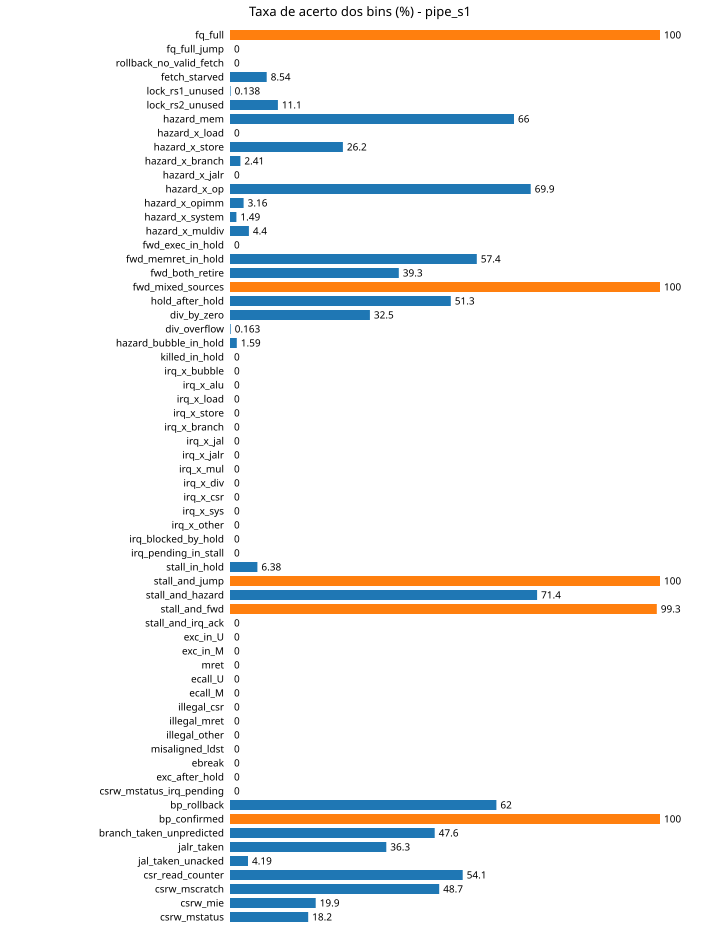
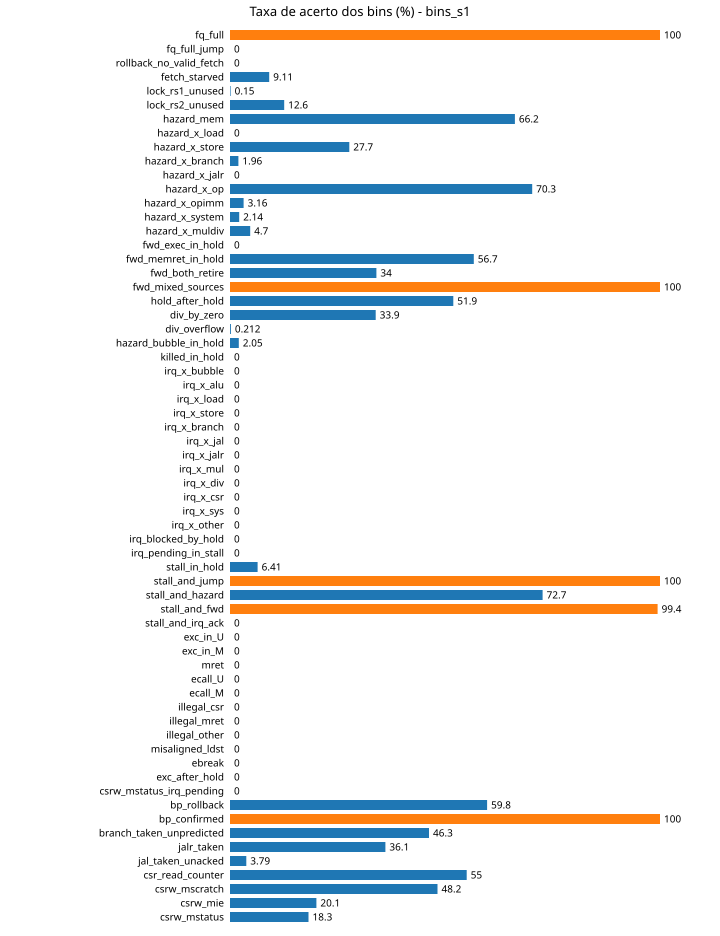

# Relatório das fontes de feedback

Gerado por `feedback_report.py` a partir de 7 execução(ões). Fontes: ver `FONTES.md`.

## 1. Execuções

| execução | guide | record | schedule | seed | casos | status | tempo (s) | casos/s | core |
|---|---|---|---|---|---|---|---|---|---|
| none_s1 | none | 0,1,2,6,7 | rarity | 1 | 8000 | pass=8000 | 87.4 | 91.54 | DELAY=2 IQ=2 |
| none_s2 | none | 0,1,2,6,7 | rarity | 2 | 8000 | pass=8000 | 86.5 | 92.50 | DELAY=2 IQ=2 |
| none_s3 | none | 0,1,2,6,7 | rarity | 3 | 8000 | pass=8000 | 86.5 | 92.48 | DELAY=2 IQ=2 |
| pipe_s1 | 0 | 0,1,2,6,7 | rarity | 1 | 8000 | pass=8000 | 86.8 | 92.17 | DELAY=2 IQ=2 |
| bins_s1 | 0,6 | 0,1,2,6,7 | rarity | 1 | 8000 | pass=8000 | 87.0 | 92.00 | DELAY=2 IQ=2 |
| csr_s1 | 1 | 0,1,2,6,7 | rarity | 1 | 8000 | pass=8000 | 87.0 | 91.91 | DELAY=2 IQ=2 |
| vl_s1 | 2 | 0,1,2,6,7 | rarity | 1 | 8000 | pass=8000 | 86.6 | 92.41 | DELAY=2 IQ=2 |

| execução | compile ms (média/mediana) | dut ms | sail ms | leitura ms | ciclos/caso | instr/caso | CPI |
|---|---|---|---|---|---|---|---|
| none_s1 | 22.9 / 22.4 | 90.7 / 91.8 | 9.8 / 9.8 | 6.4 / 4.8 | 338.9 | 233.4 | 1.44 |
| none_s2 | 22.9 / 22.4 | 91.1 / 92.0 | 9.8 / 9.9 | 4.6 / 4.8 | 340.2 | 233.8 | 1.44 |
| none_s3 | 22.9 / 22.4 | 91.1 / 91.9 | 9.8 / 9.8 | 4.6 / 4.8 | 339.9 | 233.4 | 1.44 |
| pipe_s1 | 22.9 / 22.4 | 91.5 / 92.3 | 9.9 / 9.9 | 4.6 / 4.8 | 377.5 | 245.3 | 1.52 |
| bins_s1 | 22.9 / 22.4 | 91.7 / 92.8 | 9.9 / 9.9 | 4.6 / 4.9 | 383.3 | 246.2 | 1.53 |
| csr_s1 | 22.9 / 22.5 | 91.8 / 92.7 | 9.9 / 10.0 | 4.7 / 4.9 | 323.5 | 247.2 | 1.30 |
| vl_s1 | 22.9 / 22.4 | 91.2 / 92.2 | 9.8 / 9.9 | 4.6 / 4.8 | 338.1 | 232.2 | 1.43 |

## 2. Posições por fonte no fim da execução

Nota: os totais da fonte 2 nesta tabela incluem 111 pontos das próprias sondas (`riscof_tb.dut.fuzz_*`) e 56 do `RS5Debug`; o núcleo do RS5 responde por 1065 posições (corrigido em `coverage.py` depois destas execuções).

| execução | fonte 0 (pipe_edges) | fonte 1 (csr_trans) | fonte 2 (verilator) | fonte 6 (bins) |
|---|---|---|---|---|
| none_s1 | 8755 pos / 13845 buckets | 345 pos / 539 buckets | 1176 pos / 3055 buckets | 31 pos / 149 buckets |
| none_s2 | 8686 pos / 13891 buckets | 344 pos / 557 buckets | 1176 pos / 3026 buckets | 31 pos / 150 buckets |
| none_s3 | 8779 pos / 13951 buckets | 342 pos / 542 buckets | 1176 pos / 3013 buckets | 31 pos / 149 buckets |
| pipe_s1 | 6761 pos / 9969 buckets | 260 pos / 409 buckets | 1177 pos / 2806 buckets | 31 pos / 143 buckets |
| bins_s1 | 6622 pos / 9868 buckets | 276 pos / 429 buckets | 1177 pos / 2789 buckets | 31 pos / 143 buckets |
| csr_s1 | 6281 pos / 9372 buckets | 530 pos / 997 buckets | 1177 pos / 2780 buckets | 31 pos / 146 buckets |
| vl_s1 | 6121 pos / 9153 buckets | 260 pos / 399 buckets | 1177 pos / 2779 buckets | 31 pos / 141 buckets |

Posições atingidas **por caso** (média / mín / máx), ou seja, quantas posições um programa típico toca:

| execução | fonte 0 | fonte 1 | fonte 2 | fonte 6 |
|---|---|---|---|---|
| none_s1 | 86 / 35 / 161 | 2 / 0 / 17 | 866 / 800 / 928 | 11 / 5 / 21 |
| none_s2 | 86 / 36 / 158 | 2 / 0 / 16 | 866 / 801 / 921 | 12 / 5 / 21 |
| none_s3 | 86 / 37 / 163 | 2 / 0 / 14 | 866 / 802 / 924 | 12 / 5 / 21 |
| pipe_s1 | 96 / 30 / 208 | 2 / 0 / 14 | 873 / 799 / 935 | 12 / 5 / 21 |
| bins_s1 | 97 / 31 / 204 | 2 / 0 / 15 | 874 / 800 / 933 | 12 / 5 / 24 |
| csr_s1 | 90 / 33 / 181 | 9 / 0 / 32 | 879 / 800 / 937 | 13 / 5 / 21 |
| vl_s1 | 83 / 28 / 177 | 3 / 0 / 13 | 870 / 797 / 924 | 11 / 5 / 20 |

## 3. Saturação: posições novas ao longo dos casos

Casos necessários para atingir 50%, 90% e 99% das posições finais, último caso que trouxe posição nova, e taxa de novidade (posições novas por janela de 200 casos) no início, no meio e no fim.

### Fonte 0 (pipe_edges)

| execução | total | 50% | 90% | 99% | última nova | novas/janela início | meio | fim | % achado nos últimos 20% dos casos |
|---|---|---|---|---|---|---|---|---|---|
| none_s1 | 8755 | 953 | 5626 | 7685 | 7995 | 2216 | 105 | 47 | 6.21% |
| none_s2 | 8686 | 975 | 5391 | 7745 | 7991 | 2259 | 126 | 70 | 5.58% |
| none_s3 | 8779 | 1045 | 5570 | 7717 | 7996 | 2156 | 113 | 62 | 6.37% |
| pipe_s1 | 6761 | 1291 | 5858 | 7729 | 7995 | 1505 | 95 | 51 | 7.22% |
| bins_s1 | 6622 | 1228 | 5847 | 7703 | 7997 | 1501 | 79 | 37 | 7.05% |
| csr_s1 | 6281 | 1233 | 5921 | 7734 | 7992 | 1439 | 60 | 47 | 7.80% |
| vl_s1 | 6121 | 1190 | 5662 | 7726 | 7997 | 1388 | 72 | 43 | 6.78% |

### Fonte 1 (csr_trans)

| execução | total | 50% | 90% | 99% | última nova | novas/janela início | meio | fim | % achado nos últimos 20% dos casos |
|---|---|---|---|---|---|---|---|---|---|
| none_s1 | 345 | 1127 | 5004 | 6843 | 7487 | 76 | 4 | 0 | 1.45% |
| none_s2 | 344 | 1088 | 5401 | 7958 | 7986 | 73 | 4 | 4 | 5.81% |
| none_s3 | 342 | 1133 | 5017 | 7813 | 7964 | 72 | 2 | 4 | 6.14% |
| pipe_s1 | 260 | 1219 | 5576 | 7975 | 7975 | 60 | 3 | 7 | 6.92% |
| bins_s1 | 276 | 1350 | 5622 | 7996 | 7996 | 47 | 4 | 9 | 7.61% |
| csr_s1 | 530 | 875 | 4217 | 7720 | 7995 | 99 | 5 | 5 | 2.64% |
| vl_s1 | 260 | 1350 | 5975 | 7954 | 7954 | 45 | 2 | 3 | 9.62% |

### Fonte 2 (verilator)

| execução | total | 50% | 90% | 99% | última nova | novas/janela início | meio | fim | % achado nos últimos 20% dos casos |
|---|---|---|---|---|---|---|---|---|---|
| none_s1 | 1176 | 2 | 45 | 232 | 459 | 1160 | 0 | 0 | 0.00% |
| none_s2 | 1176 | 3 | 61 | 242 | 627 | 1156 | 0 | 0 | 0.00% |
| none_s3 | 1176 | 2 | 46 | 260 | 859 | 1155 | 0 | 0 | 0.00% |
| pipe_s1 | 1177 | 3 | 83 | 1251 | 4452 | 1091 | 0 | 0 | 0.00% |
| bins_s1 | 1177 | 5 | 102 | 952 | 1802 | 1094 | 0 | 0 | 0.00% |
| csr_s1 | 1177 | 6 | 98 | 1086 | 2179 | 1075 | 0 | 0 | 0.00% |
| vl_s1 | 1177 | 3 | 102 | 873 | 1649 | 1084 | 0 | 0 | 0.00% |

### Fonte 6 (bins)

| execução | total | 50% | 90% | 99% | última nova | novas/janela início | meio | fim | % achado nos últimos 20% dos casos |
|---|---|---|---|---|---|---|---|---|---|
| none_s1 | 31 | 11 | 99 | 365 | 365 | 29 | 0 | 0 | 0.00% |
| none_s2 | 31 | 4 | 73 | 918 | 918 | 30 | 0 | 0 | 0.00% |
| none_s3 | 31 | 2 | 47 | 859 | 859 | 30 | 0 | 0 | 0.00% |
| pipe_s1 | 31 | 11 | 212 | 2180 | 2180 | 27 | 0 | 0 | 0.00% |
| bins_s1 | 31 | 5 | 116 | 1535 | 1535 | 29 | 0 | 0 | 0.00% |
| csr_s1 | 31 | 6 | 119 | 2408 | 2408 | 28 | 0 | 0 | 0.00% |
| vl_s1 | 31 | 7 | 136 | 2413 | 2413 | 28 | 0 | 0 | 0.00% |

## 4. Colisões de hash e estabilidade

| execução | colisões fonte 0 (posições com 2+ chaves) | colisões fonte 1 | estabilidade |
|---|---|---|---|
| none_s1 | 475 (5.43% das posições) | 0 | 160 casos calibrados, 0 instáveis |
| none_s2 | 469 (5.40% das posições) | 0 | sem calibração |
| none_s3 | 409 (4.66% das posições) | 0 | sem calibração |
| pipe_s1 | 431 (6.37% das posições) | 2 | sem calibração |
| bins_s1 | 486 (7.34% das posições) | 7 | sem calibração |
| csr_s1 | 481 (7.66% das posições) | 28 | sem calibração |
| vl_s1 | 508 (8.30% das posições) | 4 | sem calibração |

Colisão = uma posição do mapa que, dentro de um mesmo caso, recebeu duas chaves originais diferentes (medido na sonda, coluna `colidiu`). Instável = posição cuja contagem mudou entre duas execuções do mesmo binário.

## 5. Fonte 0 em detalhe: estados, durações e raridade

### none_s1

- arestas (posições): **8755**; snapshots distintos: **1543**; arestas por snapshot: 5.7
- raridade: 2451 arestas vistas em 1 caso só (28.0%), 3374 em 2–9 casos, 2930 em 10+ casos
- estimativa Chao1 do total alcançável por este gerador: **11531** arestas (observadas 8755, 76%)
- distribuição da duração do estado de origem: 1: 7806, 2: 525, 3: 230, 4-7: 148, 8-15: 37, 16-31: 5, 32-127: 4
- snapshots por classe em execute: alu: 272, branch: 196, load: 185, div: 178, mul: 152, csr: 137, store: 136, jal: 133, bubble: 129, jalr: 24, other: 1

Arestas mais comuns (freq = casos em que apareceu):

| freq | aresta |
|---|---|
| 8000 | `[x=store bp_take fq=1 m/r=res/res] --1c(1)--> [x=jal bpt jumping stall fq=0 m/r=-/res]` |
| 8000 | `[x=alu fwd=ex/mem fq=1 m/r=res/-] --1c(1)--> [x=store bp_take fq=1 m/r=res/res]` |
| 8000 | `[x=store fq=3 m/r=-/-] --1c(1)--> [x=store fq=2 m/r=-/-]` |
| 8000 | `[x=alu fwd=mem/ex fq=1 m/r=res/res] --1c(1)--> [x=alu fq=1 m/r=res/res]` |
| 8000 | `[x=alu fwd=ex/rf mul=AHBH fq=1 m/r=-/-] --1c(1)--> [x=alu fwd=ex/rf fq=1 m/r=res/-]` |
| 8000 | `[x=alu fwd=ex/rf fq=1 m/r=res/res] --2c(2)--> [x=alu fwd=mem/rf fq=1 m/r=res/res]` |

Exemplos de arestas vistas uma única vez (caso que as descobriu):

| caso | aresta |
|---|---|
| 7982 | `[x=alu fwd=mem/ex fq=2 m/r=res/-] --1c(1)--> [x=mul fwd=ret/mem fq=2 m/r=res/res]` |
| 7982 | `[x=csr fwd=ex/mem fq=2 m/r=res/res] --1c(1)--> [x=csr fq=2 m/r=res/res]` |
| 7984 | `[x=div fwd=ex/ex fq=2 m/r=-/-] --1c(1)--> [x=alu fwd=rf/ex fq=2 m/r=res/-]` |
| 7987 | `[x=alu fq=1 m/r=res/res] --3c(3)--> [x=load fwd=mem/mem fq=1 m/r=res/res]` |
| 7988 | `[x=alu fwd=ret/ex fq=2 m/r=-/res] --1c(1)--> [x=mul fwd=rf/mem fq=1 m/r=res/-]` |
| 7989 | `[x=load fq=2 m/r=res/-] --1c(1)--> [x=load fwd=ret/ret stall fq=2 m/r=load/res]` |
| 7994 | `[x=alu fwd=rf/mem fq=1 m/r=res/-] --1c(1)--> [x=mul fwd=rf/ret fq=1 m/r=res/res]` |
| 7994 | `[x=alu fwd=ex/ex fq=1 m/r=res/res] --1c(1)--> [x=mul fwd=ret/ret fq=1 m/r=res/res]` |

### none_s2

- arestas (posições): **8686**; snapshots distintos: **1493**; arestas por snapshot: 5.8
- raridade: 2354 arestas vistas em 1 caso só (27.1%), 3374 em 2–9 casos, 2958 em 10+ casos
- estimativa Chao1 do total alcançável por este gerador: **11193** arestas (observadas 8686, 78%)
- distribuição da duração do estado de origem: 1: 7767, 2: 522, 3: 196, 4-7: 152, 8-15: 40, 16-31: 4, 32-127: 5
- snapshots por classe em execute: alu: 262, branch: 199, load: 187, div: 167, csr: 141, jal: 137, mul: 135, store: 123, bubble: 117, jalr: 24, other: 1

Arestas mais comuns (freq = casos em que apareceu):

| freq | aresta |
|---|---|
| 8000 | `[x=store bp_take fq=1 m/r=res/res] --1c(1)--> [x=jal bpt jumping stall fq=0 m/r=-/res]` |
| 8000 | `[x=alu fwd=ex/mem fq=1 m/r=res/-] --1c(1)--> [x=store bp_take fq=1 m/r=res/res]` |
| 8000 | `[x=store fq=3 m/r=-/-] --1c(1)--> [x=store fq=2 m/r=-/-]` |
| 8000 | `[x=alu fwd=mem/ex fq=1 m/r=res/res] --1c(1)--> [x=alu fq=1 m/r=res/res]` |
| 8000 | `[x=alu fwd=ex/rf mul=AHBH fq=1 m/r=-/-] --1c(1)--> [x=alu fwd=ex/rf fq=1 m/r=res/-]` |
| 8000 | `[x=alu fwd=ex/rf fq=1 m/r=res/res] --2c(2)--> [x=alu fwd=mem/rf fq=1 m/r=res/res]` |

Exemplos de arestas vistas uma única vez (caso que as descobriu):

| caso | aresta |
|---|---|
| 7979 | `[x=branch bpt fwd=rf/mem jumping rollback fq=2 m/r=res/load] --1c(1)--> [x=mul fwd=rf/ret fq=2 m/r=-/res]` |
| 7980 | `[x=alu fq=1 m/r=res/res] --2c(2)--> [x=div fwd=mem/ret fq=1 m/r=res/res]` |
| 7981 | `[x=csr fq=1 m/r=res/res] --1c(1)--> [x=load fwd=rf/mem fq=1 m/r=res/res]` |
| 7981 | `[x=jal bpt fwd=ret/rf jumping fq=2 m/r=-/res] --1c(1)--> [x=bubble killed dec_invalid jumping fq=1 m/r=res/-]` |
| 7981 | `[x=csr bp_take fq=2 m/r=res/res] --1c(1)--> [x=jal bpt fwd=ret/rf jumping fq=2 m/r=-/res]` |
| 7985 | `[x=csr fwd=ex/ret fq=1 m/r=-/res] --1c(1)--> [x=branch jump fq=1 m/r=res/-]` |
| 7985 | `[x=csr fq=1 m/r=res/res] --1c(1)--> [x=csr fwd=ex/ret fq=1 m/r=-/res]` |
| 7990 | `[x=load fq=2 m/r=load/load] --6c(4-7)--> [x=branch fwd=rf/mem dec_hz=rs2 jump fq=2 m/r=load/load]` |

### none_s3

- arestas (posições): **8779**; snapshots distintos: **1552**; arestas por snapshot: 5.7
- raridade: 2410 arestas vistas em 1 caso só (27.5%), 3417 em 2–9 casos, 2952 em 10+ casos
- estimativa Chao1 do total alcançável por este gerador: **11409** arestas (observadas 8779, 77%)
- distribuição da duração do estado de origem: 1: 7846, 2: 532, 3: 215, 4-7: 146, 8-15: 30, 16-31: 5, 32-127: 5
- snapshots por classe em execute: alu: 266, branch: 200, div: 189, load: 182, csr: 144, mul: 143, jal: 138, store: 132, bubble: 130, jalr: 27, other: 1

Arestas mais comuns (freq = casos em que apareceu):

| freq | aresta |
|---|---|
| 8000 | `[x=store bp_take fq=1 m/r=res/res] --1c(1)--> [x=jal bpt jumping stall fq=0 m/r=-/res]` |
| 8000 | `[x=alu fwd=ex/mem fq=1 m/r=res/-] --1c(1)--> [x=store bp_take fq=1 m/r=res/res]` |
| 8000 | `[x=store fq=3 m/r=-/-] --1c(1)--> [x=store fq=2 m/r=-/-]` |
| 8000 | `[x=alu fwd=mem/ex fq=1 m/r=res/res] --1c(1)--> [x=alu fq=1 m/r=res/res]` |
| 8000 | `[x=alu fwd=ex/rf mul=AHBH fq=1 m/r=-/-] --1c(1)--> [x=alu fwd=ex/rf fq=1 m/r=res/-]` |
| 8000 | `[x=alu fwd=ex/rf fq=1 m/r=res/res] --2c(2)--> [x=alu fwd=mem/rf fq=1 m/r=res/res]` |

Exemplos de arestas vistas uma única vez (caso que as descobriu):

| caso | aresta |
|---|---|
| 7984 | `[x=alu fwd=rf/mem fq=2 m/r=res/res] --1c(1)--> [x=div fwd=ret/rf fq=2 m/r=res/res]` |
| 7990 | `[x=csr fwd=ex/rf fq=1 m/r=res/res] --1c(1)--> [x=branch jump fq=1 m/r=res/res]` |
| 7992 | `[x=alu fq=1 m/r=res/res] --4c(4-7)--> [x=store fwd=rf/mem fq=1 m/r=res/res]` |
| 7992 | `[x=store fwd=rf/mem fq=1 m/r=res/res] --1c(1)--> [x=mul stall fq=1 m/r=-/res]` |
| 7992 | `[x=store fwd=rf/mem fq=1 m/r=res/-] --1c(1)--> [x=mul stall fq=1 m/r=-/res]` |
| 7993 | `[x=alu fq=2 m/r=res/res] --9c(8-15)--> [x=alu fwd=ex/ex fq=2 m/r=res/res]` |
| 7993 | `[x=csr fwd=ret/rf fq=1 m/r=res/res] --1c(1)--> [x=csr fwd=rf/ex fq=1 m/r=-/res]` |
| 7995 | `[x=alu fwd=ex/rf fq=2 m/r=res/load] --1c(1)--> [x=jalr fwd=ex/mem jump fq=2 m/r=res/res]` |

### pipe_s1

- arestas (posições): **6761**; snapshots distintos: **1372**; arestas por snapshot: 4.9
- raridade: 1069 arestas vistas em 1 caso só (15.8%), 2612 em 2–9 casos, 3080 em 10+ casos
- estimativa Chao1 do total alcançável por este gerador: **7576** arestas (observadas 6761, 89%)
- distribuição da duração do estado de origem: 1: 6083, 2: 370, 3: 166, 4-7: 114, 8-15: 21, 16-31: 3, 32-127: 4
- snapshots por classe em execute: alu: 245, branch: 181, load: 167, div: 148, mul: 134, csr: 124, bubble: 122, store: 115, jal: 112, jalr: 23, other: 1

Arestas mais comuns (freq = casos em que apareceu):

| freq | aresta |
|---|---|
| 8000 | `[x=store bp_take fq=1 m/r=res/res] --1c(1)--> [x=jal bpt jumping stall fq=0 m/r=-/res]` |
| 8000 | `[x=alu fwd=ex/mem fq=1 m/r=res/-] --1c(1)--> [x=store bp_take fq=1 m/r=res/res]` |
| 8000 | `[x=store fq=3 m/r=-/-] --1c(1)--> [x=store fq=2 m/r=-/-]` |
| 8000 | `[x=alu fwd=mem/ex fq=1 m/r=res/res] --1c(1)--> [x=alu fq=1 m/r=res/res]` |
| 8000 | `[x=alu fwd=ex/rf mul=AHBH fq=1 m/r=-/-] --1c(1)--> [x=alu fwd=ex/rf fq=1 m/r=res/-]` |
| 8000 | `[x=alu fwd=ex/rf fq=1 m/r=res/res] --2c(2)--> [x=alu fwd=mem/rf fq=1 m/r=res/res]` |

Exemplos de arestas vistas uma única vez (caso que as descobriu):

| caso | aresta |
|---|---|
| 7979 | `[x=div fwd=ret/rf fq=2 m/r=res/load] --1c(1)--> [x=div fwd=rf/ex fq=3 m/r=-/res]` |
| 7985 | `[x=alu fwd=ex/rf fq=1 m/r=-/res] --1c(1)--> [x=branch fwd=mem/mem fq=1 m/r=res/-]` |
| 7989 | `[x=load fwd=ret/ret fq=2 m/r=res/res] --1c(1)--> [x=alu stall fq=2 m/r=load/res]` |
| 7989 | `[x=alu fq=2 m/r=res/res] --1c(1)--> [x=load fwd=ret/ret fq=2 m/r=res/res]` |
| 7992 | `[x=csr bp_take fq=1 m/r=res/res] --1c(1)--> [x=jal bpt fwd=ret/rf jumping fq=0 m/r=res/res]` |
| 7993 | `[x=alu fq=2 m/r=load/load] --1c(1)--> [x=alu fwd=rf/ret fq=2 m/r=res/load]` |
| 7993 | `[x=alu fwd=rf/ret fq=2 m/r=res/load] --1c(1)--> [x=alu fwd=mem/rf fq=2 m/r=res/res]` |
| 7994 | `[x=jalr fwd=ex/rf jump fq=2 m/r=res/res] --1c(1)--> [x=bubble killed fwd=mem/rf jumping fq=0 m/r=res/res]` |

### bins_s1

- arestas (posições): **6622**; snapshots distintos: **1354**; arestas por snapshot: 4.9
- raridade: 1045 arestas vistas em 1 caso só (15.8%), 2523 em 2–9 casos, 3054 em 10+ casos
- estimativa Chao1 do total alcançável por este gerador: **7432** arestas (observadas 6622, 89%)
- distribuição da duração do estado de origem: 1: 5965, 2: 364, 3: 148, 4-7: 116, 8-15: 22, 16-31: 3, 32-127: 4
- snapshots por classe em execute: alu: 240, branch: 178, load: 164, div: 148, mul: 133, csr: 125, bubble: 121, jal: 114, store: 109, jalr: 21, other: 1

Arestas mais comuns (freq = casos em que apareceu):

| freq | aresta |
|---|---|
| 8000 | `[x=store bp_take fq=1 m/r=res/res] --1c(1)--> [x=jal bpt jumping stall fq=0 m/r=-/res]` |
| 8000 | `[x=alu fwd=ex/mem fq=1 m/r=res/-] --1c(1)--> [x=store bp_take fq=1 m/r=res/res]` |
| 8000 | `[x=store fq=3 m/r=-/-] --1c(1)--> [x=store fq=2 m/r=-/-]` |
| 8000 | `[x=alu fwd=mem/ex fq=1 m/r=res/res] --1c(1)--> [x=alu fq=1 m/r=res/res]` |
| 8000 | `[x=alu fwd=ex/rf mul=AHBH fq=1 m/r=-/-] --1c(1)--> [x=alu fwd=ex/rf fq=1 m/r=res/-]` |
| 8000 | `[x=alu fwd=ex/rf fq=1 m/r=res/res] --2c(2)--> [x=alu fwd=mem/rf fq=1 m/r=res/res]` |

Exemplos de arestas vistas uma única vez (caso que as descobriu):

| caso | aresta |
|---|---|
| 7941 | `[x=alu fwd=mem/rf fq=2 m/r=res/res] --1c(1)--> [x=branch fwd=mem/ret fq=2 m/r=res/res]` |
| 7957 | `[x=branch bpt jumping rollback fq=2 m/r=res/load] --1c(1)--> [x=div fwd=ret/rf fq=2 m/r=-/res]` |
| 7963 | `[x=alu fwd=ex/ret fq=1 m/r=-/res] --1c(1)--> [x=alu fwd=ex/rf fq=1 m/r=res/-]` |
| 7963 | `[x=alu fwd=ex/ex fq=1 m/r=res/-] --1c(1)--> [x=branch fwd=mem/rf fq=1 m/r=res/res]` |
| 7977 | `[x=load fq=2 m/r=load/load] --2c(2)--> [x=alu fwd=rf/ex fq=2 m/r=load/load]` |
| 7979 | `[x=csr fq=1 m/r=res/res] --1c(1)--> [x=branch fwd=mem/mem fq=1 m/r=res/res]` |
| 7982 | `[x=csr fwd=ex/rf fq=1 m/r=res/res] --1c(1)--> [x=branch fq=1 m/r=res/res]` |
| 7996 | `[x=alu fq=2 m/r=-/load] --1c(1)--> [x=alu bp_take fq=2 m/r=res/-]` |

### csr_s1

- arestas (posições): **6281**; snapshots distintos: **1316**; arestas por snapshot: 4.8
- raridade: 1943 arestas vistas em 1 caso só (30.9%), 2307 em 2–9 casos, 2031 em 10+ casos
- estimativa Chao1 do total alcançável por este gerador: **8655** arestas (observadas 6281, 73%)
- distribuição da duração do estado de origem: 1: 5636, 2: 344, 3: 161, 4-7: 113, 8-15: 18, 16-31: 4, 32-127: 5
- snapshots por classe em execute: alu: 241, branch: 168, load: 160, div: 147, mul: 136, bubble: 119, csr: 116, store: 107, jal: 100, jalr: 21, other: 1

Arestas mais comuns (freq = casos em que apareceu):

| freq | aresta |
|---|---|
| 8000 | `[x=store bp_take fq=1 m/r=res/res] --1c(1)--> [x=jal bpt jumping stall fq=0 m/r=-/res]` |
| 8000 | `[x=alu fwd=ex/mem fq=1 m/r=res/-] --1c(1)--> [x=store bp_take fq=1 m/r=res/res]` |
| 8000 | `[x=store fq=3 m/r=-/-] --1c(1)--> [x=store fq=2 m/r=-/-]` |
| 8000 | `[x=alu fwd=mem/ex fq=1 m/r=res/res] --1c(1)--> [x=alu fq=1 m/r=res/res]` |
| 8000 | `[x=alu fwd=ex/rf mul=AHBH fq=1 m/r=-/-] --1c(1)--> [x=alu fwd=ex/rf fq=1 m/r=res/-]` |
| 8000 | `[x=alu fwd=ex/rf fq=1 m/r=res/res] --2c(2)--> [x=alu fwd=mem/rf fq=1 m/r=res/res]` |

Exemplos de arestas vistas uma única vez (caso que as descobriu):

| caso | aresta |
|---|---|
| 7958 | `[x=branch bpt jumping rollback fq=2 m/r=res/res] --1c(1)--> [x=csr fwd=ret/rf fq=2 m/r=-/res]` |
| 7959 | `[x=alu fwd=rf/mem fq=2 m/r=res/load] --1c(1)--> [x=alu fwd=mem/ret fq=2 m/r=res/res]` |
| 7974 | `[x=csr fwd=rf/ret fq=1 m/r=-/res] --1c(1)--> [x=branch fwd=mem/rf fq=1 m/r=res/-]` |
| 7986 | `[x=csr fq=1 m/r=res/res] --1c(1)--> [x=alu fwd=ex/ex fq=1 m/r=res/res]` |
| 7987 | `[x=csr fwd=rf/mem fq=1 m/r=res/res] --1c(1)--> [x=div fwd=ret/mem fq=1 m/r=res/res]` |
| 7987 | `[x=branch bpt fwd=rf/mem jumping rollback fq=2 m/r=res/load] --1c(1)--> [x=store dec_hz=mem fq=2 m/r=-/res]` |
| 7991 | `[x=alu fwd=rf/ret fq=2 m/r=res/load] --1c(1)--> [x=csr fq=2 m/r=res/res]` |
| 7991 | `[x=csr fwd=ex/ex fq=3 m/r=load/-] --1c(1)--> [x=alu fwd=rf/ret fq=2 m/r=res/load]` |

### vl_s1

- arestas (posições): **6121**; snapshots distintos: **1287**; arestas por snapshot: 4.8
- raridade: 1803 arestas vistas em 1 caso só (29.5%), 2189 em 2–9 casos, 2129 em 10+ casos
- estimativa Chao1 do total alcançável por este gerador: **8423** arestas (observadas 6121, 73%)
- distribuição da duração do estado de origem: 1: 5510, 2: 330, 3: 143, 4-7: 106, 8-15: 24, 16-31: 4, 32-127: 4
- snapshots por classe em execute: alu: 239, branch: 169, load: 158, div: 139, mul: 129, bubble: 121, csr: 111, store: 101, jal: 98, jalr: 21, other: 1

Arestas mais comuns (freq = casos em que apareceu):

| freq | aresta |
|---|---|
| 8000 | `[x=store bp_take fq=1 m/r=res/res] --1c(1)--> [x=jal bpt jumping stall fq=0 m/r=-/res]` |
| 8000 | `[x=alu fwd=ex/mem fq=1 m/r=res/-] --1c(1)--> [x=store bp_take fq=1 m/r=res/res]` |
| 8000 | `[x=store fq=3 m/r=-/-] --1c(1)--> [x=store fq=2 m/r=-/-]` |
| 8000 | `[x=alu fwd=mem/ex fq=1 m/r=res/res] --1c(1)--> [x=alu fq=1 m/r=res/res]` |
| 8000 | `[x=alu fwd=ex/rf mul=AHBH fq=1 m/r=-/-] --1c(1)--> [x=alu fwd=ex/rf fq=1 m/r=res/-]` |
| 8000 | `[x=alu fwd=ex/rf fq=1 m/r=res/res] --2c(2)--> [x=alu fwd=mem/rf fq=1 m/r=res/res]` |

Exemplos de arestas vistas uma única vez (caso que as descobriu):

| caso | aresta |
|---|---|
| 7932 | `[x=jalr jump fq=2 m/r=res/res] --1c(1)--> [x=bubble killed fwd=ret/ret jumping fq=0 m/r=res/res]` |
| 7943 | `[x=jalr fwd=rf/mem jump fq=2 m/r=res/res] --1c(1)--> [x=bubble killed fwd=mem/rf jumping fq=0 m/r=res/res]` |
| 7943 | `[x=alu fwd=ex/rf fq=2 m/r=res/-] --1c(1)--> [x=jalr fwd=rf/mem jump fq=2 m/r=res/res]` |
| 7952 | `[x=csr fwd=ex/rf fq=1 m/r=res/res] --1c(1)--> [x=alu fwd=ex/rf fq=1 m/r=res/res]` |
| 7962 | `[x=csr fwd=ex/rf fq=1 m/r=res/res] --1c(1)--> [x=div fwd=mem/mem fq=1 m/r=res/res]` |
| 7996 | `[x=csr fwd=rf/mem fq=1 m/r=res/res] --1c(1)--> [x=div fwd=ret/mem fq=1 m/r=res/res]` |
| 7996 | `[x=branch bpt fwd=rf/mem jumping rollback fq=2 m/r=res/load] --1c(1)--> [x=store dec_hz=mem fq=2 m/r=-/res]` |
| 7996 | `[x=csr fq=1 m/r=res/res] --3c(3)--> [x=csr fwd=rf/mem fq=1 m/r=res/res]` |

## 6. Fonte 1: transições de trap/CSR

### none_s1

- transições: 345; por evento: csr_r: 192, csr_w: 153
| freq | transição |
|---|---|
| 3121 | `csr_w mscratch @{M mie=0 mpie=0 mpp=3 ip=t} [x=csr]` |
| 2756 | `csr_r mhpmcounter @{M mie=0 mpie=0 mpp=3 ip=t} [x=csr]` |
| 1943 | `csr_r mcycle/minstret @{M mie=0 mpie=0 mpp=3 ip=t} [x=csr]` |
| 1574 | `csr_r ucounter @{M mie=0 mpie=0 mpp=3 ip=t} [x=csr]` |
| 575 | `csr_r mstatus @{M mie=0 mpie=0 mpp=3 ip=t} [x=csr]` |
| 550 | `csr_r mie @{M mie=0 mpie=0 mpp=3 ip=t} [x=csr]` |
| 546 | `csr_w mie @{M mie=0 mpie=0 mpp=3 ip=t} [x=csr]` |
| 484 | `csr_w mstatus @{M mie=0 mpie=0 mpp=3 ip=t} [x=csr]` |
| 307 | `csr_r mscratch @{M mie=0 mpie=0 mpp=3 ip=t} [x=csr]` |
| 290 | `csr_r mtval @{M mie=0 mpie=0 mpp=3 ip=t} [x=csr]` |

### none_s2

- transições: 344; por evento: csr_r: 200, csr_w: 144
| freq | transição |
|---|---|
| 3158 | `csr_w mscratch @{M mie=0 mpie=0 mpp=3 ip=t} [x=csr]` |
| 2843 | `csr_r mhpmcounter @{M mie=0 mpie=0 mpp=3 ip=t} [x=csr]` |
| 1991 | `csr_r mcycle/minstret @{M mie=0 mpie=0 mpp=3 ip=t} [x=csr]` |
| 1584 | `csr_r ucounter @{M mie=0 mpie=0 mpp=3 ip=t} [x=csr]` |
| 569 | `csr_w mie @{M mie=0 mpie=0 mpp=3 ip=t} [x=csr]` |
| 556 | `csr_r mstatus @{M mie=0 mpie=0 mpp=3 ip=t} [x=csr]` |
| 548 | `csr_r mie @{M mie=0 mpie=0 mpp=3 ip=t} [x=csr]` |
| 478 | `csr_w mstatus @{M mie=0 mpie=0 mpp=3 ip=t} [x=csr]` |
| 328 | `csr_r mscratch @{M mie=0 mpie=0 mpp=3 ip=t} [x=csr]` |
| 292 | `csr_r mepc @{M mie=0 mpie=0 mpp=3 ip=t} [x=csr]` |

### none_s3

- transições: 342; por evento: csr_r: 202, csr_w: 140
| freq | transição |
|---|---|
| 3181 | `csr_w mscratch @{M mie=0 mpie=0 mpp=3 ip=t} [x=csr]` |
| 2723 | `csr_r mhpmcounter @{M mie=0 mpie=0 mpp=3 ip=t} [x=csr]` |
| 1985 | `csr_r mcycle/minstret @{M mie=0 mpie=0 mpp=3 ip=t} [x=csr]` |
| 1570 | `csr_r ucounter @{M mie=0 mpie=0 mpp=3 ip=t} [x=csr]` |
| 595 | `csr_r mstatus @{M mie=0 mpie=0 mpp=3 ip=t} [x=csr]` |
| 575 | `csr_r mie @{M mie=0 mpie=0 mpp=3 ip=t} [x=csr]` |
| 548 | `csr_w mie @{M mie=0 mpie=0 mpp=3 ip=t} [x=csr]` |
| 459 | `csr_w mstatus @{M mie=0 mpie=0 mpp=3 ip=t} [x=csr]` |
| 328 | `csr_r mscratch @{M mie=0 mpie=0 mpp=3 ip=t} [x=csr]` |
| 297 | `csr_r mcause @{M mie=0 mpie=0 mpp=3 ip=t} [x=csr]` |

### pipe_s1

- transições: 260; por evento: csr_r: 148, csr_w: 112
| freq | transição |
|---|---|
| 3262 | `csr_w mscratch @{M mie=0 mpie=0 mpp=3 ip=t} [x=csr]` |
| 3002 | `csr_r mhpmcounter @{M mie=0 mpie=0 mpp=3 ip=t} [x=csr]` |
| 1891 | `csr_r mcycle/minstret @{M mie=0 mpie=0 mpp=3 ip=t} [x=csr]` |
| 1503 | `csr_r ucounter @{M mie=0 mpie=0 mpp=3 ip=t} [x=csr]` |
| 787 | `csr_r mie @{M mie=0 mpie=0 mpp=3 ip=t} [x=csr]` |
| 714 | `csr_w mie @{M mie=0 mpie=0 mpp=3 ip=t} [x=csr]` |
| 585 | `csr_w mstatus @{M mie=0 mpie=0 mpp=3 ip=t} [x=csr]` |
| 438 | `csr_r mstatus @{M mie=0 mpie=0 mpp=3 ip=t} [x=csr]` |
| 413 | `csr_r mscratch @{M mie=0 mpie=0 mpp=3 ip=t} [x=csr]` |
| 320 | `csr_w mie @{M mie=0 mpie=0 mpp=3 ip=t} => {M mie=0 mpie=0 mpp=3 ie=ste ip=t} [x=csr]` |

### bins_s1

- transições: 276; por evento: csr_r: 147, csr_w: 129
| freq | transição |
|---|---|
| 3034 | `csr_w mscratch @{M mie=0 mpie=0 mpp=3 ip=t} [x=csr]` |
| 2913 | `csr_r mhpmcounter @{M mie=0 mpie=0 mpp=3 ip=t} [x=csr]` |
| 2008 | `csr_r mcycle/minstret @{M mie=0 mpie=0 mpp=3 ip=t} [x=csr]` |
| 1429 | `csr_r ucounter @{M mie=0 mpie=0 mpp=3 ip=t} [x=csr]` |
| 809 | `csr_r mie @{M mie=0 mpie=0 mpp=3 ip=t} [x=csr]` |
| 611 | `csr_w mie @{M mie=0 mpie=0 mpp=3 ip=t} [x=csr]` |
| 510 | `csr_r mstatus @{M mie=0 mpie=0 mpp=3 ip=t} [x=csr]` |
| 507 | `csr_w mstatus @{M mie=0 mpie=0 mpp=3 ip=t} [x=csr]` |
| 356 | `csr_w mstatus @{M mie=0 mpie=0 mpp=3 ip=t} => {M mie=0 mpie=1 mpp=0 ip=t} [x=csr]` |
| 282 | `csr_r mscratch @{M mie=0 mpie=0 mpp=3 ip=t} [x=csr]` |

### csr_s1

- transições: 530; por evento: csr_r: 276, csr_w: 254
| freq | transição |
|---|---|
| 4334 | `csr_r mhpmcounter @{M mie=0 mpie=0 mpp=3 ip=t} [x=csr]` |
| 2745 | `csr_w mscratch @{M mie=0 mpie=0 mpp=3 ip=t} [x=csr]` |
| 2250 | `csr_r mcycle/minstret @{M mie=0 mpie=0 mpp=3 ip=t} [x=csr]` |
| 1093 | `csr_w mstatus @{M mie=0 mpie=0 mpp=3 ip=t} => {M mie=0 mpie=1 mpp=0 ip=t} [x=csr]` |
| 1049 | `csr_r mcycle/minstret @{M mie=0 mpie=1 mpp=0 ip=t} [x=csr]` |
| 1023 | `csr_w mscratch @{M mie=0 mpie=1 mpp=0 ip=t} [x=csr]` |
| 1003 | `csr_r mhpmcounter @{M mie=0 mpie=1 mpp=0 ip=t} [x=csr]` |
| 887 | `csr_w mstatus @{M mie=0 mpie=0 mpp=3 ip=t} => {M mie=0 mpie=0 mpp=0 ip=t} [x=csr]` |
| 792 | `csr_r ucounter @{M mie=0 mpie=0 mpp=3 ip=t} [x=csr]` |
| 778 | `csr_w mie @{M mie=0 mpie=0 mpp=3 ip=t} [x=csr]` |

### vl_s1

- transições: 260; por evento: csr_r: 145, csr_w: 115
| freq | transição |
|---|---|
| 3565 | `csr_w mscratch @{M mie=0 mpie=0 mpp=3 ip=t} [x=csr]` |
| 3385 | `csr_r mhpmcounter @{M mie=0 mpie=0 mpp=3 ip=t} [x=csr]` |
| 2814 | `csr_r mcycle/minstret @{M mie=0 mpie=0 mpp=3 ip=t} [x=csr]` |
| 2451 | `csr_r ucounter @{M mie=0 mpie=0 mpp=3 ip=t} [x=csr]` |
| 1099 | `csr_w mie @{M mie=0 mpie=0 mpp=3 ip=t} [x=csr]` |
| 1083 | `csr_r mie @{M mie=0 mpie=0 mpp=3 ip=t} [x=csr]` |
| 1010 | `csr_w mstatus @{M mie=0 mpie=0 mpp=3 ip=t} [x=csr]` |
| 753 | `csr_r mcause @{M mie=0 mpie=0 mpp=3 ip=t} [x=csr]` |
| 454 | `csr_r mstatus @{M mie=0 mpie=0 mpp=3 ip=t} [x=csr]` |
| 451 | `csr_w mie @{M mie=0 mpie=0 mpp=3 ip=t} => {M mie=0 mpie=0 mpp=3 ie=ste ip=t} [x=csr]` |

## 7. Fonte 6: taxa de acerto dos bins

Fração dos casos em que cada bin foi atingido. Classificação: `>90%` não discrimina; `1–90%` serve de feedback; `0%` é alvo (se alcançável) ou exclusão. Bins marcados `(impossível)` não devem acertar nesta configuração.

### none_s1

Resumo: 0%: 31, 1-90%: 23, <1%: 3, >90%: 5, impossível: 2

| # | bin | acerto | classe |
|---|---|---|---|
| 0 | fq_full | 100.0% | >90% |
| 1 | fq_full_jump | 0.0% | 0% |
| 2 | rollback_no_valid_fetch | 0.0% | 0% |
| 3 | fetch_starved | 7.4% | 1-90% |
| 4 | lock_rs1_unused | 0.2% | <1% |
| 5 | lock_rs2_unused | 11.4% | 1-90% |
| 6 | hazard_mem | 57.5% | 1-90% |
| 7 | hazard_x_load | 0.0% | 0% |
| 8 | hazard_x_store | 16.8% | 1-90% |
| 9 | hazard_x_branch | 2.2% | 1-90% |
| 10 | hazard_x_jalr | 0.0% | 0% |
| 11 | hazard_x_op | 59.8% | 1-90% |
| 12 | hazard_x_opimm | 3.2% | 1-90% |
| 13 | hazard_x_system | 0.5% | <1% |
| 14 | hazard_x_muldiv | 5.0% | 1-90% |
| 15 | fwd_exec_in_hold | 0.0% | 0% |
| 16 | fwd_memret_in_hold | 46.2% | 1-90% |
| 17 | fwd_both_retire | 31.1% | 1-90% |
| 18 | fwd_mixed_sources | 100.0% | >90% |
| 19 | hold_after_hold | 44.7% | 1-90% |
| 20 | div_by_zero | 26.1% | 1-90% |
| 21 | div_overflow | 0.1% | <1% |
| 22 | hazard_bubble_in_hold | 1.1% | 1-90% |
| 23 | killed_in_hold | 0.0% | impossível |
| 24 | irq_x_bubble | 0.0% | 0% |
| 25 | irq_x_alu | 0.0% | 0% |
| 26 | irq_x_load | 0.0% | 0% |
| 27 | irq_x_store | 0.0% | 0% |
| 28 | irq_x_branch | 0.0% | 0% |
| 29 | irq_x_jal | 0.0% | 0% |
| 30 | irq_x_jalr | 0.0% | 0% |
| 31 | irq_x_mul | 0.0% | 0% |
| 32 | irq_x_div | 0.0% | 0% |
| 33 | irq_x_csr | 0.0% | 0% |
| 34 | irq_x_sys | 0.0% | 0% |
| 35 | irq_x_other | 0.0% | 0% |
| 36 | irq_blocked_by_hold | 0.0% | 0% |
| 37 | irq_pending_in_stall | 0.0% | 0% |
| 38 | stall_in_hold | 5.0% | 1-90% |
| 39 | stall_and_jump | 100.0% | >90% |
| 40 | stall_and_hazard | 61.9% | 1-90% |
| 41 | stall_and_fwd | 99.6% | >90% |
| 42 | stall_and_irq_ack | 0.0% | impossível |
| 43 | exc_in_U | 0.0% | 0% |
| 44 | exc_in_M | 0.0% | 0% |
| 45 | mret | 0.0% | 0% |
| 46 | ecall_U | 0.0% | 0% |
| 47 | ecall_M | 0.0% | 0% |
| 48 | illegal_csr | 0.0% | 0% |
| 49 | illegal_mret | 0.0% | 0% |
| 50 | illegal_other | 0.0% | 0% |
| 51 | misaligned_ldst | 0.0% | 0% |
| 52 | ebreak | 0.0% | 0% |
| 53 | exc_after_hold | 0.0% | 0% |
| 54 | csrw_mstatus_irq_pending | 0.0% | 0% |
| 55 | bp_rollback | 49.9% | 1-90% |
| 56 | bp_confirmed | 100.0% | >90% |
| 57 | branch_taken_unpredicted | 43.2% | 1-90% |
| 58 | jalr_taken | 44.0% | 1-90% |
| 59 | jal_taken_unacked | 3.8% | 1-90% |
| 60 | csr_read_counter | 51.4% | 1-90% |
| 61 | csrw_mscratch | 44.4% | 1-90% |
| 62 | csrw_mie | 16.2% | 1-90% |
| 63 | csrw_mstatus | 16.5% | 1-90% |

### none_s2

Resumo: 0%: 31, 1-90%: 22, <1%: 4, >90%: 5, impossível: 2

| # | bin | acerto | classe |
|---|---|---|---|
| 0 | fq_full | 100.0% | >90% |
| 1 | fq_full_jump | 0.0% | 0% |
| 2 | rollback_no_valid_fetch | 0.0% | 0% |
| 3 | fetch_starved | 8.0% | 1-90% |
| 4 | lock_rs1_unused | 0.3% | <1% |
| 5 | lock_rs2_unused | 11.8% | 1-90% |
| 6 | hazard_mem | 57.3% | 1-90% |
| 7 | hazard_x_load | 0.0% | 0% |
| 8 | hazard_x_store | 16.2% | 1-90% |
| 9 | hazard_x_branch | 2.1% | 1-90% |
| 10 | hazard_x_jalr | 0.0% | 0% |
| 11 | hazard_x_op | 59.7% | 1-90% |
| 12 | hazard_x_opimm | 3.1% | 1-90% |
| 13 | hazard_x_system | 0.6% | <1% |
| 14 | hazard_x_muldiv | 4.9% | 1-90% |
| 15 | fwd_exec_in_hold | 0.0% | 0% |
| 16 | fwd_memret_in_hold | 46.1% | 1-90% |
| 17 | fwd_both_retire | 31.8% | 1-90% |
| 18 | fwd_mixed_sources | 100.0% | >90% |
| 19 | hold_after_hold | 44.3% | 1-90% |
| 20 | div_by_zero | 27.0% | 1-90% |
| 21 | div_overflow | 0.2% | <1% |
| 22 | hazard_bubble_in_hold | 0.8% | <1% |
| 23 | killed_in_hold | 0.0% | impossível |
| 24 | irq_x_bubble | 0.0% | 0% |
| 25 | irq_x_alu | 0.0% | 0% |
| 26 | irq_x_load | 0.0% | 0% |
| 27 | irq_x_store | 0.0% | 0% |
| 28 | irq_x_branch | 0.0% | 0% |
| 29 | irq_x_jal | 0.0% | 0% |
| 30 | irq_x_jalr | 0.0% | 0% |
| 31 | irq_x_mul | 0.0% | 0% |
| 32 | irq_x_div | 0.0% | 0% |
| 33 | irq_x_csr | 0.0% | 0% |
| 34 | irq_x_sys | 0.0% | 0% |
| 35 | irq_x_other | 0.0% | 0% |
| 36 | irq_blocked_by_hold | 0.0% | 0% |
| 37 | irq_pending_in_stall | 0.0% | 0% |
| 38 | stall_in_hold | 4.6% | 1-90% |
| 39 | stall_and_jump | 100.0% | >90% |
| 40 | stall_and_hazard | 62.4% | 1-90% |
| 41 | stall_and_fwd | 99.6% | >90% |
| 42 | stall_and_irq_ack | 0.0% | impossível |
| 43 | exc_in_U | 0.0% | 0% |
| 44 | exc_in_M | 0.0% | 0% |
| 45 | mret | 0.0% | 0% |
| 46 | ecall_U | 0.0% | 0% |
| 47 | ecall_M | 0.0% | 0% |
| 48 | illegal_csr | 0.0% | 0% |
| 49 | illegal_mret | 0.0% | 0% |
| 50 | illegal_other | 0.0% | 0% |
| 51 | misaligned_ldst | 0.0% | 0% |
| 52 | ebreak | 0.0% | 0% |
| 53 | exc_after_hold | 0.0% | 0% |
| 54 | csrw_mstatus_irq_pending | 0.0% | 0% |
| 55 | bp_rollback | 51.5% | 1-90% |
| 56 | bp_confirmed | 100.0% | >90% |
| 57 | branch_taken_unpredicted | 43.2% | 1-90% |
| 58 | jalr_taken | 43.2% | 1-90% |
| 59 | jal_taken_unacked | 4.0% | 1-90% |
| 60 | csr_read_counter | 52.0% | 1-90% |
| 61 | csrw_mscratch | 45.2% | 1-90% |
| 62 | csrw_mie | 16.2% | 1-90% |
| 63 | csrw_mstatus | 16.6% | 1-90% |

### none_s3

Resumo: 0%: 31, 1-90%: 22, <1%: 4, >90%: 5, impossível: 2

| # | bin | acerto | classe |
|---|---|---|---|
| 0 | fq_full | 100.0% | >90% |
| 1 | fq_full_jump | 0.0% | 0% |
| 2 | rollback_no_valid_fetch | 0.0% | 0% |
| 3 | fetch_starved | 7.9% | 1-90% |
| 4 | lock_rs1_unused | 0.2% | <1% |
| 5 | lock_rs2_unused | 12.5% | 1-90% |
| 6 | hazard_mem | 57.3% | 1-90% |
| 7 | hazard_x_load | 0.0% | 0% |
| 8 | hazard_x_store | 16.6% | 1-90% |
| 9 | hazard_x_branch | 2.2% | 1-90% |
| 10 | hazard_x_jalr | 0.0% | 0% |
| 11 | hazard_x_op | 60.1% | 1-90% |
| 12 | hazard_x_opimm | 3.4% | 1-90% |
| 13 | hazard_x_system | 0.7% | <1% |
| 14 | hazard_x_muldiv | 5.0% | 1-90% |
| 15 | fwd_exec_in_hold | 0.0% | 0% |
| 16 | fwd_memret_in_hold | 47.2% | 1-90% |
| 17 | fwd_both_retire | 31.1% | 1-90% |
| 18 | fwd_mixed_sources | 100.0% | >90% |
| 19 | hold_after_hold | 45.6% | 1-90% |
| 20 | div_by_zero | 27.0% | 1-90% |
| 21 | div_overflow | 0.1% | <1% |
| 22 | hazard_bubble_in_hold | 0.9% | <1% |
| 23 | killed_in_hold | 0.0% | impossível |
| 24 | irq_x_bubble | 0.0% | 0% |
| 25 | irq_x_alu | 0.0% | 0% |
| 26 | irq_x_load | 0.0% | 0% |
| 27 | irq_x_store | 0.0% | 0% |
| 28 | irq_x_branch | 0.0% | 0% |
| 29 | irq_x_jal | 0.0% | 0% |
| 30 | irq_x_jalr | 0.0% | 0% |
| 31 | irq_x_mul | 0.0% | 0% |
| 32 | irq_x_div | 0.0% | 0% |
| 33 | irq_x_csr | 0.0% | 0% |
| 34 | irq_x_sys | 0.0% | 0% |
| 35 | irq_x_other | 0.0% | 0% |
| 36 | irq_blocked_by_hold | 0.0% | 0% |
| 37 | irq_pending_in_stall | 0.0% | 0% |
| 38 | stall_in_hold | 4.9% | 1-90% |
| 39 | stall_and_jump | 100.0% | >90% |
| 40 | stall_and_hazard | 62.4% | 1-90% |
| 41 | stall_and_fwd | 99.5% | >90% |
| 42 | stall_and_irq_ack | 0.0% | impossível |
| 43 | exc_in_U | 0.0% | 0% |
| 44 | exc_in_M | 0.0% | 0% |
| 45 | mret | 0.0% | 0% |
| 46 | ecall_U | 0.0% | 0% |
| 47 | ecall_M | 0.0% | 0% |
| 48 | illegal_csr | 0.0% | 0% |
| 49 | illegal_mret | 0.0% | 0% |
| 50 | illegal_other | 0.0% | 0% |
| 51 | misaligned_ldst | 0.0% | 0% |
| 52 | ebreak | 0.0% | 0% |
| 53 | exc_after_hold | 0.0% | 0% |
| 54 | csrw_mstatus_irq_pending | 0.0% | 0% |
| 55 | bp_rollback | 50.5% | 1-90% |
| 56 | bp_confirmed | 100.0% | >90% |
| 57 | branch_taken_unpredicted | 44.1% | 1-90% |
| 58 | jalr_taken | 43.8% | 1-90% |
| 59 | jal_taken_unacked | 4.0% | 1-90% |
| 60 | csr_read_counter | 52.1% | 1-90% |
| 61 | csrw_mscratch | 45.5% | 1-90% |
| 62 | csrw_mie | 15.8% | 1-90% |
| 63 | csrw_mstatus | 16.2% | 1-90% |

### pipe_s1

Resumo: 0%: 31, 1-90%: 24, <1%: 2, >90%: 5, impossível: 2

| # | bin | acerto | classe |
|---|---|---|---|
| 0 | fq_full | 100.0% | >90% |
| 1 | fq_full_jump | 0.0% | 0% |
| 2 | rollback_no_valid_fetch | 0.0% | 0% |
| 3 | fetch_starved | 8.5% | 1-90% |
| 4 | lock_rs1_unused | 0.1% | <1% |
| 5 | lock_rs2_unused | 11.1% | 1-90% |
| 6 | hazard_mem | 66.0% | 1-90% |
| 7 | hazard_x_load | 0.0% | 0% |
| 8 | hazard_x_store | 26.2% | 1-90% |
| 9 | hazard_x_branch | 2.4% | 1-90% |
| 10 | hazard_x_jalr | 0.0% | 0% |
| 11 | hazard_x_op | 69.9% | 1-90% |
| 12 | hazard_x_opimm | 3.2% | 1-90% |
| 13 | hazard_x_system | 1.5% | 1-90% |
| 14 | hazard_x_muldiv | 4.4% | 1-90% |
| 15 | fwd_exec_in_hold | 0.0% | 0% |
| 16 | fwd_memret_in_hold | 57.4% | 1-90% |
| 17 | fwd_both_retire | 39.3% | 1-90% |
| 18 | fwd_mixed_sources | 100.0% | >90% |
| 19 | hold_after_hold | 51.3% | 1-90% |
| 20 | div_by_zero | 32.5% | 1-90% |
| 21 | div_overflow | 0.2% | <1% |
| 22 | hazard_bubble_in_hold | 1.6% | 1-90% |
| 23 | killed_in_hold | 0.0% | impossível |
| 24 | irq_x_bubble | 0.0% | 0% |
| 25 | irq_x_alu | 0.0% | 0% |
| 26 | irq_x_load | 0.0% | 0% |
| 27 | irq_x_store | 0.0% | 0% |
| 28 | irq_x_branch | 0.0% | 0% |
| 29 | irq_x_jal | 0.0% | 0% |
| 30 | irq_x_jalr | 0.0% | 0% |
| 31 | irq_x_mul | 0.0% | 0% |
| 32 | irq_x_div | 0.0% | 0% |
| 33 | irq_x_csr | 0.0% | 0% |
| 34 | irq_x_sys | 0.0% | 0% |
| 35 | irq_x_other | 0.0% | 0% |
| 36 | irq_blocked_by_hold | 0.0% | 0% |
| 37 | irq_pending_in_stall | 0.0% | 0% |
| 38 | stall_in_hold | 6.4% | 1-90% |
| 39 | stall_and_jump | 100.0% | >90% |
| 40 | stall_and_hazard | 71.4% | 1-90% |
| 41 | stall_and_fwd | 99.3% | >90% |
| 42 | stall_and_irq_ack | 0.0% | impossível |
| 43 | exc_in_U | 0.0% | 0% |
| 44 | exc_in_M | 0.0% | 0% |
| 45 | mret | 0.0% | 0% |
| 46 | ecall_U | 0.0% | 0% |
| 47 | ecall_M | 0.0% | 0% |
| 48 | illegal_csr | 0.0% | 0% |
| 49 | illegal_mret | 0.0% | 0% |
| 50 | illegal_other | 0.0% | 0% |
| 51 | misaligned_ldst | 0.0% | 0% |
| 52 | ebreak | 0.0% | 0% |
| 53 | exc_after_hold | 0.0% | 0% |
| 54 | csrw_mstatus_irq_pending | 0.0% | 0% |
| 55 | bp_rollback | 62.0% | 1-90% |
| 56 | bp_confirmed | 100.0% | >90% |
| 57 | branch_taken_unpredicted | 47.6% | 1-90% |
| 58 | jalr_taken | 36.3% | 1-90% |
| 59 | jal_taken_unacked | 4.2% | 1-90% |
| 60 | csr_read_counter | 54.1% | 1-90% |
| 61 | csrw_mscratch | 48.7% | 1-90% |
| 62 | csrw_mie | 19.9% | 1-90% |
| 63 | csrw_mstatus | 18.2% | 1-90% |

### bins_s1

Resumo: 0%: 31, 1-90%: 24, <1%: 2, >90%: 5, impossível: 2

| # | bin | acerto | classe |
|---|---|---|---|
| 0 | fq_full | 100.0% | >90% |
| 1 | fq_full_jump | 0.0% | 0% |
| 2 | rollback_no_valid_fetch | 0.0% | 0% |
| 3 | fetch_starved | 9.1% | 1-90% |
| 4 | lock_rs1_unused | 0.1% | <1% |
| 5 | lock_rs2_unused | 12.6% | 1-90% |
| 6 | hazard_mem | 66.2% | 1-90% |
| 7 | hazard_x_load | 0.0% | 0% |
| 8 | hazard_x_store | 27.7% | 1-90% |
| 9 | hazard_x_branch | 2.0% | 1-90% |
| 10 | hazard_x_jalr | 0.0% | 0% |
| 11 | hazard_x_op | 70.3% | 1-90% |
| 12 | hazard_x_opimm | 3.2% | 1-90% |
| 13 | hazard_x_system | 2.1% | 1-90% |
| 14 | hazard_x_muldiv | 4.7% | 1-90% |
| 15 | fwd_exec_in_hold | 0.0% | 0% |
| 16 | fwd_memret_in_hold | 56.7% | 1-90% |
| 17 | fwd_both_retire | 34.0% | 1-90% |
| 18 | fwd_mixed_sources | 100.0% | >90% |
| 19 | hold_after_hold | 51.9% | 1-90% |
| 20 | div_by_zero | 33.9% | 1-90% |
| 21 | div_overflow | 0.2% | <1% |
| 22 | hazard_bubble_in_hold | 2.0% | 1-90% |
| 23 | killed_in_hold | 0.0% | impossível |
| 24 | irq_x_bubble | 0.0% | 0% |
| 25 | irq_x_alu | 0.0% | 0% |
| 26 | irq_x_load | 0.0% | 0% |
| 27 | irq_x_store | 0.0% | 0% |
| 28 | irq_x_branch | 0.0% | 0% |
| 29 | irq_x_jal | 0.0% | 0% |
| 30 | irq_x_jalr | 0.0% | 0% |
| 31 | irq_x_mul | 0.0% | 0% |
| 32 | irq_x_div | 0.0% | 0% |
| 33 | irq_x_csr | 0.0% | 0% |
| 34 | irq_x_sys | 0.0% | 0% |
| 35 | irq_x_other | 0.0% | 0% |
| 36 | irq_blocked_by_hold | 0.0% | 0% |
| 37 | irq_pending_in_stall | 0.0% | 0% |
| 38 | stall_in_hold | 6.4% | 1-90% |
| 39 | stall_and_jump | 100.0% | >90% |
| 40 | stall_and_hazard | 72.7% | 1-90% |
| 41 | stall_and_fwd | 99.4% | >90% |
| 42 | stall_and_irq_ack | 0.0% | impossível |
| 43 | exc_in_U | 0.0% | 0% |
| 44 | exc_in_M | 0.0% | 0% |
| 45 | mret | 0.0% | 0% |
| 46 | ecall_U | 0.0% | 0% |
| 47 | ecall_M | 0.0% | 0% |
| 48 | illegal_csr | 0.0% | 0% |
| 49 | illegal_mret | 0.0% | 0% |
| 50 | illegal_other | 0.0% | 0% |
| 51 | misaligned_ldst | 0.0% | 0% |
| 52 | ebreak | 0.0% | 0% |
| 53 | exc_after_hold | 0.0% | 0% |
| 54 | csrw_mstatus_irq_pending | 0.0% | 0% |
| 55 | bp_rollback | 59.8% | 1-90% |
| 56 | bp_confirmed | 100.0% | >90% |
| 57 | branch_taken_unpredicted | 46.3% | 1-90% |
| 58 | jalr_taken | 36.1% | 1-90% |
| 59 | jal_taken_unacked | 3.8% | 1-90% |
| 60 | csr_read_counter | 55.0% | 1-90% |
| 61 | csrw_mscratch | 48.2% | 1-90% |
| 62 | csrw_mie | 20.1% | 1-90% |
| 63 | csrw_mstatus | 18.3% | 1-90% |

### csr_s1

Resumo: 0%: 31, 1-90%: 21, <1%: 5, >90%: 5, impossível: 2

| # | bin | acerto | classe |
|---|---|---|---|
| 0 | fq_full | 100.0% | >90% |
| 1 | fq_full_jump | 0.0% | 0% |
| 2 | rollback_no_valid_fetch | 0.0% | 0% |
| 3 | fetch_starved | 4.1% | 1-90% |
| 4 | lock_rs1_unused | 0.1% | <1% |
| 5 | lock_rs2_unused | 5.4% | 1-90% |
| 6 | hazard_mem | 52.7% | 1-90% |
| 7 | hazard_x_load | 0.0% | 0% |
| 8 | hazard_x_store | 26.2% | 1-90% |
| 9 | hazard_x_branch | 0.8% | <1% |
| 10 | hazard_x_jalr | 0.0% | 0% |
| 11 | hazard_x_op | 50.2% | 1-90% |
| 12 | hazard_x_opimm | 1.1% | 1-90% |
| 13 | hazard_x_system | 0.6% | <1% |
| 14 | hazard_x_muldiv | 1.6% | 1-90% |
| 15 | fwd_exec_in_hold | 0.0% | 0% |
| 16 | fwd_memret_in_hold | 48.1% | 1-90% |
| 17 | fwd_both_retire | 38.5% | 1-90% |
| 18 | fwd_mixed_sources | 100.0% | >90% |
| 19 | hold_after_hold | 45.2% | 1-90% |
| 20 | div_by_zero | 14.5% | 1-90% |
| 21 | div_overflow | 0.1% | <1% |
| 22 | hazard_bubble_in_hold | 1.0% | <1% |
| 23 | killed_in_hold | 0.0% | impossível |
| 24 | irq_x_bubble | 0.0% | 0% |
| 25 | irq_x_alu | 0.0% | 0% |
| 26 | irq_x_load | 0.0% | 0% |
| 27 | irq_x_store | 0.0% | 0% |
| 28 | irq_x_branch | 0.0% | 0% |
| 29 | irq_x_jal | 0.0% | 0% |
| 30 | irq_x_jalr | 0.0% | 0% |
| 31 | irq_x_mul | 0.0% | 0% |
| 32 | irq_x_div | 0.0% | 0% |
| 33 | irq_x_csr | 0.0% | 0% |
| 34 | irq_x_sys | 0.0% | 0% |
| 35 | irq_x_other | 0.0% | 0% |
| 36 | irq_blocked_by_hold | 0.0% | 0% |
| 37 | irq_pending_in_stall | 0.0% | 0% |
| 38 | stall_in_hold | 6.5% | 1-90% |
| 39 | stall_and_jump | 100.0% | >90% |
| 40 | stall_and_hazard | 52.9% | 1-90% |
| 41 | stall_and_fwd | 99.9% | >90% |
| 42 | stall_and_irq_ack | 0.0% | impossível |
| 43 | exc_in_U | 0.0% | 0% |
| 44 | exc_in_M | 0.0% | 0% |
| 45 | mret | 0.0% | 0% |
| 46 | ecall_U | 0.0% | 0% |
| 47 | ecall_M | 0.0% | 0% |
| 48 | illegal_csr | 0.0% | 0% |
| 49 | illegal_mret | 0.0% | 0% |
| 50 | illegal_other | 0.0% | 0% |
| 51 | misaligned_ldst | 0.0% | 0% |
| 52 | ebreak | 0.0% | 0% |
| 53 | exc_after_hold | 0.0% | 0% |
| 54 | csrw_mstatus_irq_pending | 0.0% | 0% |
| 55 | bp_rollback | 53.6% | 1-90% |
| 56 | bp_confirmed | 100.0% | >90% |
| 57 | branch_taken_unpredicted | 45.5% | 1-90% |
| 58 | jalr_taken | 23.2% | 1-90% |
| 59 | jal_taken_unacked | 1.4% | 1-90% |
| 60 | csr_read_counter | 88.7% | 1-90% |
| 61 | csrw_mscratch | 84.2% | 1-90% |
| 62 | csrw_mie | 71.3% | 1-90% |
| 63 | csrw_mstatus | 71.7% | 1-90% |

### vl_s1

Resumo: 0%: 31, 1-90%: 23, <1%: 3, >90%: 5, impossível: 2

| # | bin | acerto | classe |
|---|---|---|---|
| 0 | fq_full | 100.0% | >90% |
| 1 | fq_full_jump | 0.0% | 0% |
| 2 | rollback_no_valid_fetch | 0.0% | 0% |
| 3 | fetch_starved | 7.9% | 1-90% |
| 4 | lock_rs1_unused | 0.1% | <1% |
| 5 | lock_rs2_unused | 7.0% | 1-90% |
| 6 | hazard_mem | 47.8% | 1-90% |
| 7 | hazard_x_load | 0.0% | 0% |
| 8 | hazard_x_store | 15.0% | 1-90% |
| 9 | hazard_x_branch | 2.1% | 1-90% |
| 10 | hazard_x_jalr | 0.0% | 0% |
| 11 | hazard_x_op | 60.5% | 1-90% |
| 12 | hazard_x_opimm | 1.6% | 1-90% |
| 13 | hazard_x_system | 1.2% | 1-90% |
| 14 | hazard_x_muldiv | 2.2% | 1-90% |
| 15 | fwd_exec_in_hold | 0.0% | 0% |
| 16 | fwd_memret_in_hold | 47.4% | 1-90% |
| 17 | fwd_both_retire | 20.6% | 1-90% |
| 18 | fwd_mixed_sources | 100.0% | >90% |
| 19 | hold_after_hold | 39.6% | 1-90% |
| 20 | div_by_zero | 20.4% | 1-90% |
| 21 | div_overflow | 0.2% | <1% |
| 22 | hazard_bubble_in_hold | 0.5% | <1% |
| 23 | killed_in_hold | 0.0% | impossível |
| 24 | irq_x_bubble | 0.0% | 0% |
| 25 | irq_x_alu | 0.0% | 0% |
| 26 | irq_x_load | 0.0% | 0% |
| 27 | irq_x_store | 0.0% | 0% |
| 28 | irq_x_branch | 0.0% | 0% |
| 29 | irq_x_jal | 0.0% | 0% |
| 30 | irq_x_jalr | 0.0% | 0% |
| 31 | irq_x_mul | 0.0% | 0% |
| 32 | irq_x_div | 0.0% | 0% |
| 33 | irq_x_csr | 0.0% | 0% |
| 34 | irq_x_sys | 0.0% | 0% |
| 35 | irq_x_other | 0.0% | 0% |
| 36 | irq_blocked_by_hold | 0.0% | 0% |
| 37 | irq_pending_in_stall | 0.0% | 0% |
| 38 | stall_in_hold | 2.0% | 1-90% |
| 39 | stall_and_jump | 100.0% | >90% |
| 40 | stall_and_hazard | 61.9% | 1-90% |
| 41 | stall_and_fwd | 99.8% | >90% |
| 42 | stall_and_irq_ack | 0.0% | impossível |
| 43 | exc_in_U | 0.0% | 0% |
| 44 | exc_in_M | 0.0% | 0% |
| 45 | mret | 0.0% | 0% |
| 46 | ecall_U | 0.0% | 0% |
| 47 | ecall_M | 0.0% | 0% |
| 48 | illegal_csr | 0.0% | 0% |
| 49 | illegal_mret | 0.0% | 0% |
| 50 | illegal_other | 0.0% | 0% |
| 51 | misaligned_ldst | 0.0% | 0% |
| 52 | ebreak | 0.0% | 0% |
| 53 | exc_after_hold | 0.0% | 0% |
| 54 | csrw_mstatus_irq_pending | 0.0% | 0% |
| 55 | bp_rollback | 42.6% | 1-90% |
| 56 | bp_confirmed | 100.0% | >90% |
| 57 | branch_taken_unpredicted | 37.3% | 1-90% |
| 58 | jalr_taken | 36.6% | 1-90% |
| 59 | jal_taken_unacked | 2.7% | 1-90% |
| 60 | csr_read_counter | 67.7% | 1-90% |
| 61 | csrw_mscratch | 50.1% | 1-90% |
| 62 | csrw_mie | 27.3% | 1-90% |
| 63 | csrw_mstatus | 18.3% | 1-90% |

## 8. Fonte 7: escalares

| execução | escalar | máx | média dos máx por caso | mediana | casos com 0 |
|---|---|---|---|---|---|
| none_s1 | fq_level_max | 3 | 3 | 3.0 | 0 |
| none_s1 | hold_run_max | 35 | 20.7 | 35.0 | 2304 |
| none_s1 | hazard_run_max | 36 | 1.3 | 1.0 | 2435 |
| none_s1 | stall_run_max | 2 | 2 | 2.0 | 0 |
| none_s1 | killed_run_max | 3 | 2.7 | 3.0 | 0 |
| none_s1 | irq_wait_max | 0 | 0 | 0.0 | 8000 |
| none_s1 | fq_full_run_max | 36 | 21.4 | 35.0 | 0 |
| none_s1 | snapshot_run_max | 32 | 29.9 | 32.0 | 0 |
| none_s2 | fq_level_max | 3 | 3 | 3.0 | 0 |
| none_s2 | hold_run_max | 35 | 20.7 | 35.0 | 2325 |
| none_s2 | hazard_run_max | 36 | 1.2 | 1.0 | 2433 |
| none_s2 | stall_run_max | 2 | 2 | 2.0 | 0 |
| none_s2 | killed_run_max | 3 | 2.7 | 3.0 | 0 |
| none_s2 | irq_wait_max | 0 | 0 | 0.0 | 8000 |
| none_s2 | fq_full_run_max | 36 | 21.5 | 35.0 | 0 |
| none_s2 | snapshot_run_max | 32 | 29.9 | 32.0 | 0 |
| none_s3 | fq_level_max | 3 | 3 | 3.0 | 0 |
| none_s3 | hold_run_max | 35 | 21.0 | 35.0 | 2273 |
| none_s3 | hazard_run_max | 36 | 1.3 | 1.0 | 2410 |
| none_s3 | stall_run_max | 2 | 2 | 2.0 | 0 |
| none_s3 | killed_run_max | 3 | 2.7 | 3.0 | 0 |
| none_s3 | irq_wait_max | 0 | 0 | 0.0 | 8000 |
| none_s3 | fq_full_run_max | 36 | 21.8 | 35.0 | 0 |
| none_s3 | snapshot_run_max | 32 | 29.9 | 32.0 | 0 |
| pipe_s1 | fq_level_max | 3 | 3 | 3.0 | 0 |
| pipe_s1 | hold_run_max | 35 | 23.6 | 35.0 | 1699 |
| pipe_s1 | hazard_run_max | 36 | 1.6 | 2.0 | 1784 |
| pipe_s1 | stall_run_max | 2 | 2 | 2.0 | 0 |
| pipe_s1 | killed_run_max | 3 | 2.7 | 3.0 | 0 |
| pipe_s1 | irq_wait_max | 0 | 0 | 0.0 | 8000 |
| pipe_s1 | fq_full_run_max | 36 | 24.1 | 35.0 | 0 |
| pipe_s1 | snapshot_run_max | 32 | 30.3 | 32.0 | 0 |
| bins_s1 | fq_level_max | 3 | 3 | 3.0 | 0 |
| bins_s1 | hold_run_max | 35 | 24.1 | 35.0 | 1683 |
| bins_s1 | hazard_run_max | 36 | 1.6 | 2.0 | 1743 |
| bins_s1 | stall_run_max | 2 | 2 | 2.0 | 0 |
| bins_s1 | killed_run_max | 3 | 2.7 | 3.0 | 0 |
| bins_s1 | irq_wait_max | 0 | 0 | 0.0 | 8000 |
| bins_s1 | fq_full_run_max | 36 | 24.6 | 35.0 | 0 |
| bins_s1 | snapshot_run_max | 32 | 30.4 | 32.0 | 0 |
| csr_s1 | fq_level_max | 3 | 3 | 3.0 | 0 |
| csr_s1 | hold_run_max | 35 | 13.7 | 4.0 | 2471 |
| csr_s1 | hazard_run_max | 36 | 1.0 | 1.0 | 3243 |
| csr_s1 | stall_run_max | 2 | 2 | 2.0 | 0 |
| csr_s1 | killed_run_max | 3 | 2.6 | 3.0 | 0 |
| csr_s1 | irq_wait_max | 0 | 0 | 0.0 | 8000 |
| csr_s1 | fq_full_run_max | 36 | 14.4 | 4.0 | 0 |
| csr_s1 | snapshot_run_max | 32 | 28.8 | 27.0 | 0 |
| vl_s1 | fq_level_max | 3 | 3 | 3.0 | 0 |
| vl_s1 | hold_run_max | 35 | 19.8 | 35.0 | 2857 |
| vl_s1 | hazard_run_max | 36 | 1.1 | 1.0 | 2724 |
| vl_s1 | stall_run_max | 2 | 2 | 2.0 | 0 |
| vl_s1 | killed_run_max | 3 | 2.6 | 3.0 | 0 |
| vl_s1 | irq_wait_max | 0 | 0 | 0.0 | 8000 |
| vl_s1 | fq_full_run_max | 36 | 20.5 | 35.0 | 0 |
| vl_s1 | snapshot_run_max | 32 | 29.8 | 32.0 | 0 |

## 9. Sobreposição: novidade em uma fonte x novidade em outra

Para cada par (A, B): dos casos que trouxeram posição nova em A, quantos também trouxeram em B. Linhas próximas de 100% em todas as colunas = A não acrescenta sinal próprio; baixas = A vê coisas que B não vê.

### none_s1

| A \ B | fonte 0 | fonte 1 | fonte 2 | fonte 6 |
|---|---|---|---|---|
| fonte 0 (3436 casos c/ novidade) | - | 4% | 4% | 0% |
| fonte 1 (200 casos c/ novidade) | 64% | - | 12% | 2% |
| fonte 2 (126 casos c/ novidade) | 99% | 19% | - | 10% |
| fonte 6 (16 casos c/ novidade) | 100% | 25% | 81% | - |

### none_s2

| A \ B | fonte 0 | fonte 1 | fonte 2 | fonte 6 |
|---|---|---|---|---|
| fonte 0 (3459 casos c/ novidade) | - | 4% | 4% | 0% |
| fonte 1 (188 casos c/ novidade) | 72% | - | 11% | 2% |
| fonte 2 (130 casos c/ novidade) | 95% | 16% | - | 10% |
| fonte 6 (16 casos c/ novidade) | 100% | 25% | 81% | - |

### none_s3

| A \ B | fonte 0 | fonte 1 | fonte 2 | fonte 6 |
|---|---|---|---|---|
| fonte 0 (3510 casos c/ novidade) | - | 4% | 3% | 0% |
| fonte 1 (194 casos c/ novidade) | 66% | - | 13% | 2% |
| fonte 2 (123 casos c/ novidade) | 98% | 21% | - | 7% |
| fonte 6 (13 casos c/ novidade) | 100% | 31% | 69% | - |

### pipe_s1

| A \ B | fonte 0 | fonte 1 | fonte 2 | fonte 6 |
|---|---|---|---|---|
| fonte 0 (2639 casos c/ novidade) | - | 3% | 4% | 1% |
| fonte 1 (147 casos c/ novidade) | 62% | - | 14% | 3% |
| fonte 2 (124 casos c/ novidade) | 83% | 17% | - | 8% |
| fonte 6 (14 casos c/ novidade) | 100% | 36% | 71% | - |

### bins_s1

| A \ B | fonte 0 | fonte 1 | fonte 2 | fonte 6 |
|---|---|---|---|---|
| fonte 0 (2575 casos c/ novidade) | - | 3% | 4% | 1% |
| fonte 1 (157 casos c/ novidade) | 55% | - | 14% | 3% |
| fonte 2 (129 casos c/ novidade) | 80% | 17% | - | 9% |
| fonte 6 (14 casos c/ novidade) | 100% | 36% | 79% | - |

### csr_s1

| A \ B | fonte 0 | fonte 1 | fonte 2 | fonte 6 |
|---|---|---|---|---|
| fonte 0 (2253 casos c/ novidade) | - | 5% | 5% | 1% |
| fonte 1 (305 casos c/ novidade) | 36% | - | 7% | 2% |
| fonte 2 (128 casos c/ novidade) | 80% | 16% | - | 9% |
| fonte 6 (15 casos c/ novidade) | 100% | 40% | 73% | - |

### vl_s1

| A \ B | fonte 0 | fonte 1 | fonte 2 | fonte 6 |
|---|---|---|---|---|
| fonte 0 (2202 casos c/ novidade) | - | 5% | 5% | 1% |
| fonte 1 (148 casos c/ novidade) | 68% | - | 18% | 2% |
| fonte 2 (129 casos c/ novidade) | 82% | 20% | - | 9% |
| fonte 6 (15 casos c/ novidade) | 100% | 20% | 73% | - |

## 9b. Sobreposição entre execuções (mesmo índice = mesma posição)

Para cada fonte: tamanho da união das posições de todas as execuções, posições comuns a todas, e, por execução, quantas posições só ela encontrou. Índices são comparáveis porque o `fuzz_cov.sv` é o mesmo.

### Fonte 0 (pipe_edges): união 12174, comum a todas 4191 (34.4% da união)

| execução | posições | só nesta execução | % da união |
|---|---|---|---|
| none_s1 | 8755 | 651 | 71.9% |
| none_s2 | 8686 | 743 | 71.3% |
| none_s3 | 8779 | 779 | 72.1% |
| pipe_s1 | 6761 | 148 | 55.5% |
| bins_s1 | 6622 | 138 | 54.4% |
| csr_s1 | 6281 | 138 | 51.6% |
| vl_s1 | 6121 | 78 | 50.3% |

### Fonte 1 (csr_trans): união 556, comum a todas 180 (32.4% da união)

| execução | posições | só nesta execução | % da união |
|---|---|---|---|
| none_s1 | 345 | 4 | 62.1% |
| none_s2 | 344 | 8 | 61.9% |
| none_s3 | 342 | 3 | 61.5% |
| pipe_s1 | 260 | 1 | 46.8% |
| bins_s1 | 276 | 2 | 49.6% |
| csr_s1 | 530 | 88 | 95.3% |
| vl_s1 | 260 | 1 | 46.8% |

### Fonte 2 (verilator): união 1177, comum a todas 1176 (99.9% da união)

| execução | posições | só nesta execução | % da união |
|---|---|---|---|
| none_s1 | 1176 | 0 | 99.9% |
| none_s2 | 1176 | 0 | 99.9% |
| none_s3 | 1176 | 0 | 99.9% |
| pipe_s1 | 1177 | 0 | 100.0% |
| bins_s1 | 1177 | 0 | 100.0% |
| csr_s1 | 1177 | 0 | 100.0% |
| vl_s1 | 1177 | 0 | 100.0% |

### Fonte 6 (bins): união 31, comum a todas 31 (100.0% da união)

| execução | posições | só nesta execução | % da união |
|---|---|---|---|
| none_s1 | 31 | 0 | 100.0% |
| none_s2 | 31 | 0 | 100.0% |
| none_s3 | 31 | 0 | 100.0% |
| pipe_s1 | 31 | 0 | 100.0% |
| bins_s1 | 31 | 0 | 100.0% |
| csr_s1 | 31 | 0 | 100.0% |
| vl_s1 | 31 | 0 | 100.0% |

## 10. Gerador e corpus

| execução | corpus final | casos com score>0 | aleatórios | mutados | operadores | novas pos. fonte 0 por caso (aleat / mut) | idem fonte 6 |
|---|---|---|---|---|---|---|---|
| none_s1 | 0 | 0 | 8000 | 0 | random=8000 | 1.09 / 0.00 | 0.00 / 0.00 |
| none_s2 | 0 | 0 | 8000 | 0 | random=8000 | 1.09 / 0.00 | 0.00 / 0.00 |
| none_s3 | 0 | 0 | 8000 | 0 | random=8000 | 1.10 / 0.00 | 0.00 / 0.00 |
| pipe_s1 | 3102 | 3102 | 1621 | 6379 | point=1839 random=1621 splice=918 insert=917 data=916 swap=913 delete=876 | 2.32 / 0.47 | 0.02 / 0.00 |
| bins_s1 | 3087 | 3087 | 1612 | 6388 | point=1837 random=1612 swap=939 data=936 delete=914 insert=905 splice=857 | 2.31 / 0.45 | 0.02 / 0.00 |
| csr_s1 | 551 | 551 | 1627 | 6373 | point=1879 random=1627 insert=932 data=919 delete=891 swap=885 splice=867 | 2.54 / 0.34 | 0.02 / 0.00 |
| vl_s1 | 443 | 443 | 1639 | 6361 | point=1836 random=1639 data=939 swap=928 insert=898 delete=895 splice=865 | 2.47 / 0.33 | 0.02 / 0.00 |

Blocos gerados (none_s1): csr=5537, mix=5534, mem=5511, alu=5511, branch=5505, loop=5458, muldiv=5432, jump=5431

## 11. Casos que não passaram

- none_s1: todos os casos passaram
- none_s2: todos os casos passaram
- none_s3: todos os casos passaram
- pipe_s1: todos os casos passaram
- bins_s1: todos os casos passaram
- csr_s1: todos os casos passaram
- vl_s1: todos os casos passaram

