# Relatório das fontes de feedback

Gerado por `feedback_report.py` a partir de 17 execução(ões). Fontes: ver `FONTES.md`.

## 1. Execuções

| execução | guide | record | schedule | seed | casos | status | tempo (s) | casos/s | core |
|---|---|---|---|---|---|---|---|---|---|
| none_s1 | none | 0,1,2,6,7 | rarity | 1 | 8000 | pass=8000 | 87.4 | 91.54 | DELAY=2 IQ=2 |
| none_s2 | none | 0,1,2,6,7 | rarity | 2 | 8000 | pass=8000 | 86.5 | 92.50 | DELAY=2 IQ=2 |
| none_s3 | none | 0,1,2,6,7 | rarity | 3 | 8000 | pass=8000 | 86.5 | 92.48 | DELAY=2 IQ=2 |
| rand_s1 | none | 0,1,2,3,6,7 | uniform | 1 | 8000 | pass=8000 | 118.2 | 67.68 | DELAY=2 IQ=2 |
| rand_s2 | none | 0,1,2,3,6,7 | uniform | 2 | 8000 | pass=8000 | 118.0 | 67.77 | DELAY=2 IQ=2 |
| rand_s3 | none | 0,1,2,3,6,7 | uniform | 3 | 8000 | pass=8000 | 117.9 | 67.85 | DELAY=2 IQ=2 |
| pipe_s1 | 0 | 0,1,2,6,7 | rarity | 1 | 8000 | pass=8000 | 86.8 | 92.17 | DELAY=2 IQ=2 |
| pipe_s2 | 0 | 0,1,2,3,6,7 | rarity | 2 | 8000 | pass=8000 | 118.4 | 67.59 | DELAY=2 IQ=2 |
| pipe_s3 | 0 | 0,1,2,3,6,7 | rarity | 3 | 8000 | pass=8000 | 118.3 | 67.65 | DELAY=2 IQ=2 |
| pipe_mp05_s1 | 0 | 0,1,2,3,6,7 | rarity | 1 | 8000 | pass=8000 | 118.2 | 67.71 | DELAY=2 IQ=2 |
| pipe_mp02_s1 | 0 | 0,1,2,3,6,7 | rarity | 1 | 8000 | pass=8000 | 118.1 | 67.75 | DELAY=2 IQ=2 |
| pipe_pos_s1 | 0 | 0,1,2,3,6,7 | rarity | 1 | 8000 | pass=8000 | 118.3 | 67.60 | DELAY=2 IQ=2 |
| coarse_s1 | 3 | 0,1,2,3,6,7 | rarity | 1 | 8000 | pass=8000 | 118.2 | 67.67 | DELAY=2 IQ=2 |
| coarse_pos_s1 | 3 | 0,1,2,3,6,7 | rarity | 1 | 8000 | pass=8000 | 118.2 | 67.69 | DELAY=2 IQ=2 |
| bins_s1 | 0,6 | 0,1,2,6,7 | rarity | 1 | 8000 | pass=8000 | 87.0 | 92.00 | DELAY=2 IQ=2 |
| csr_s1 | 1 | 0,1,2,6,7 | rarity | 1 | 8000 | pass=8000 | 87.0 | 91.91 | DELAY=2 IQ=2 |
| vl_s1 | 2 | 0,1,2,6,7 | rarity | 1 | 8000 | pass=8000 | 86.6 | 92.41 | DELAY=2 IQ=2 |

| execução | compile ms (média/mediana) | dut ms | sail ms | leitura ms | ciclos/caso | instr/caso | CPI |
|---|---|---|---|---|---|---|---|
| none_s1 | 22.9 / 22.4 | 90.7 / 91.8 | 9.8 / 9.8 | 6.4 / 4.8 | 338.9 | 233.4 | 1.44 |
| none_s2 | 22.9 / 22.4 | 91.1 / 92.0 | 9.8 / 9.9 | 4.6 / 4.8 | 340.2 | 233.8 | 1.44 |
| none_s3 | 22.9 / 22.4 | 91.1 / 91.9 | 9.8 / 9.8 | 4.6 / 4.8 | 339.9 | 233.4 | 1.44 |
| rand_s1 | 30.8 / 30.0 | 90.8 / 91.4 | 16.3 / 14.1 | 8.3 / 8.3 | 347.5 | 236.1 | 1.45 |
| rand_s2 | 30.8 / 30.0 | 90.7 / 91.3 | 16.5 / 15.7 | 8.2 / 8.2 | 342.2 | 234.9 | 1.44 |
| rand_s3 | 30.8 / 29.9 | 90.6 / 91.2 | 16.4 / 15.1 | 8.1 / 8.1 | 340.8 | 233.6 | 1.44 |
| pipe_s1 | 22.9 / 22.4 | 91.5 / 92.3 | 9.9 / 9.9 | 4.6 / 4.8 | 377.5 | 245.3 | 1.52 |
| pipe_s2 | 30.8 / 30.0 | 90.7 / 91.4 | 16.6 / 15.6 | 8.5 / 8.5 | 366.6 | 245.4 | 1.48 |
| pipe_s3 | 30.8 / 30.0 | 90.7 / 91.4 | 16.5 / 15.1 | 8.4 / 8.5 | 369.9 | 243.2 | 1.51 |
| pipe_mp05_s1 | 30.8 / 30.0 | 90.8 / 91.4 | 16.4 / 14.5 | 8.3 / 8.3 | 358.3 | 239.7 | 1.47 |
| pipe_mp02_s1 | 30.8 / 30.1 | 90.7 / 91.3 | 16.5 / 14.9 | 8.2 / 8.2 | 346.1 | 236.2 | 1.45 |
| pipe_pos_s1 | 30.8 / 30.0 | 90.7 / 91.4 | 16.5 / 15.2 | 8.5 / 8.5 | 372.2 | 246.0 | 1.49 |
| coarse_s1 | 30.8 / 30.0 | 90.8 / 91.4 | 16.3 / 14.4 | 8.4 / 8.4 | 370.1 | 240.5 | 1.51 |
| coarse_pos_s1 | 30.7 / 30.0 | 90.6 / 91.3 | 16.5 / 15.4 | 8.4 / 8.4 | 364.9 | 239.9 | 1.50 |
| bins_s1 | 22.9 / 22.4 | 91.7 / 92.8 | 9.9 / 9.9 | 4.6 / 4.9 | 383.3 | 246.2 | 1.53 |
| csr_s1 | 22.9 / 22.5 | 91.8 / 92.7 | 9.9 / 10.0 | 4.7 / 4.9 | 323.5 | 247.2 | 1.30 |
| vl_s1 | 22.9 / 22.4 | 91.2 / 92.2 | 9.8 / 9.9 | 4.6 / 4.8 | 338.1 | 232.2 | 1.43 |

## 2. Posições por fonte no fim da execução

| execução | fonte 0 (pipe_edges) | fonte 1 (csr_trans) | fonte 2 (verilator) | fonte 3 (pipe_coarse) | fonte 6 (bins) |
|---|---|---|---|---|---|
| none_s1 | 8755 pos / 13845 buckets | 345 pos / 539 buckets | 1176 pos / 3055 buckets | - | 31 pos / 149 buckets |
| none_s2 | 8686 pos / 13891 buckets | 344 pos / 557 buckets | 1176 pos / 3026 buckets | - | 31 pos / 150 buckets |
| none_s3 | 8779 pos / 13951 buckets | 342 pos / 542 buckets | 1176 pos / 3013 buckets | - | 31 pos / 149 buckets |
| rand_s1 | 6599 pos / 9798 buckets | 270 pos / 412 buckets | 1009 pos / 2454 buckets | 641 pos / 1339 buckets | 31 pos / 141 buckets |
| rand_s2 | 6464 pos / 9683 buckets | 296 pos / 457 buckets | 1009 pos / 2458 buckets | 639 pos / 1356 buckets | 31 pos / 145 buckets |
| rand_s3 | 6467 pos / 9548 buckets | 291 pos / 464 buckets | 1009 pos / 2470 buckets | 645 pos / 1341 buckets | 31 pos / 144 buckets |
| pipe_s1 | 6761 pos / 9969 buckets | 260 pos / 409 buckets | 1177 pos / 2806 buckets | - | 31 pos / 143 buckets |
| pipe_s2 | 6659 pos / 9909 buckets | 254 pos / 389 buckets | 1009 pos / 2482 buckets | 636 pos / 1372 buckets | 31 pos / 149 buckets |
| pipe_s3 | 6639 pos / 9864 buckets | 306 pos / 471 buckets | 1009 pos / 2490 buckets | 660 pos / 1371 buckets | 31 pos / 146 buckets |
| pipe_mp05_s1 | 7739 pos / 11975 buckets | 312 pos / 495 buckets | 1009 pos / 2565 buckets | 690 pos / 1477 buckets | 31 pos / 145 buckets |
| pipe_mp02_s1 | 8351 pos / 13156 buckets | 352 pos / 545 buckets | 1009 pos / 2670 buckets | 705 pos / 1544 buckets | 31 pos / 146 buckets |
| pipe_pos_s1 | 6675 pos / 9937 buckets | 282 pos / 431 buckets | 1009 pos / 2452 buckets | 648 pos / 1358 buckets | 31 pos / 143 buckets |
| coarse_s1 | 6570 pos / 9726 buckets | 272 pos / 421 buckets | 1009 pos / 2448 buckets | 658 pos / 1373 buckets | 31 pos / 141 buckets |
| coarse_pos_s1 | 6552 pos / 9666 buckets | 261 pos / 408 buckets | 1009 pos / 2444 buckets | 678 pos / 1386 buckets | 31 pos / 139 buckets |
| bins_s1 | 6622 pos / 9868 buckets | 276 pos / 429 buckets | 1177 pos / 2789 buckets | - | 31 pos / 143 buckets |
| csr_s1 | 6281 pos / 9372 buckets | 530 pos / 997 buckets | 1177 pos / 2780 buckets | - | 31 pos / 146 buckets |
| vl_s1 | 6121 pos / 9153 buckets | 260 pos / 399 buckets | 1177 pos / 2779 buckets | - | 31 pos / 141 buckets |

Posições atingidas **por caso** (média / mín / máx), ou seja, quantas posições um programa típico toca:

| execução | fonte 0 | fonte 1 | fonte 2 | fonte 3 | fonte 6 |
|---|---|---|---|---|---|
| none_s1 | 86 / 35 / 161 | 2 / 0 / 17 | 866 / 800 / 928 | - | 11 / 5 / 21 |
| none_s2 | 86 / 36 / 158 | 2 / 0 / 16 | 866 / 801 / 921 | - | 12 / 5 / 21 |
| none_s3 | 86 / 37 / 163 | 2 / 0 / 14 | 866 / 802 / 924 | - | 12 / 5 / 21 |
| rand_s1 | 89 / 28 / 218 | 3 / 0 / 17 | 711 / 652 / 766 | 48 / 15 / 102 | 12 / 5 / 22 |
| rand_s2 | 88 / 29 / 211 | 2 / 0 / 17 | 708 / 649 / 768 | 47 / 15 / 105 | 11 / 5 / 23 |
| rand_s3 | 86 / 29 / 205 | 2 / 0 / 13 | 709 / 647 / 761 | 46 / 15 / 107 | 11 / 5 / 21 |
| pipe_s1 | 96 / 30 / 208 | 2 / 0 / 14 | 873 / 799 / 935 | - | 12 / 5 / 21 |
| pipe_s2 | 97 / 29 / 214 | 2 / 0 / 17 | 714 / 655 / 762 | 51 / 16 / 104 | 12 / 5 / 22 |
| pipe_s3 | 95 / 28 / 209 | 3 / 0 / 19 | 716 / 654 / 765 | 51 / 16 / 108 | 12 / 5 / 22 |
| pipe_mp05_s1 | 91 / 31 / 191 | 2 / 0 / 15 | 712 / 652 / 762 | 49 / 16 / 96 | 12 / 5 / 22 |
| pipe_mp02_s1 | 88 / 35 / 196 | 2 / 0 / 15 | 710 / 655 / 761 | 47 / 17 / 96 | 12 / 5 / 22 |
| pipe_pos_s1 | 97 / 30 / 216 | 3 / 0 / 14 | 716 / 652 / 763 | 52 / 15 / 108 | 12 / 5 / 22 |
| coarse_s1 | 94 / 28 / 197 | 3 / 0 / 14 | 716 / 655 / 771 | 52 / 16 / 101 | 12 / 5 / 23 |
| coarse_pos_s1 | 93 / 30 / 192 | 3 / 0 / 14 | 715 / 653 / 763 | 51 / 16 / 96 | 12 / 5 / 23 |
| bins_s1 | 97 / 31 / 204 | 2 / 0 / 15 | 874 / 800 / 933 | - | 12 / 5 / 24 |
| csr_s1 | 90 / 33 / 181 | 9 / 0 / 32 | 879 / 800 / 937 | - | 13 / 5 / 21 |
| vl_s1 | 83 / 28 / 177 | 3 / 0 / 13 | 870 / 797 / 924 | - | 11 / 5 / 20 |

## 3. Saturação: posições novas ao longo dos casos

Casos necessários para atingir 50%, 90% e 99% das posições finais, último caso que trouxe posição nova, e taxa de novidade (posições novas por janela de 200 casos) no início, no meio e no fim.

### Fonte 0 (pipe_edges)

| execução | total | 50% | 90% | 99% | última nova | novas/janela início | meio | fim | % achado nos últimos 20% dos casos |
|---|---|---|---|---|---|---|---|---|---|
| none_s1 | 8755 | 953 | 5626 | 7685 | 7995 | 2216 | 105 | 47 | 6.21% |
| none_s2 | 8686 | 975 | 5391 | 7745 | 7991 | 2259 | 126 | 70 | 5.58% |
| none_s3 | 8779 | 1045 | 5570 | 7717 | 7996 | 2156 | 113 | 62 | 6.37% |
| rand_s1 | 6599 | 1228 | 5778 | 7692 | 8000 | 1505 | 76 | 47 | 6.85% |
| rand_s2 | 6464 | 1239 | 5767 | 7734 | 7997 | 1532 | 78 | 45 | 6.59% |
| rand_s3 | 6467 | 1319 | 5887 | 7706 | 7996 | 1371 | 69 | 38 | 6.76% |
| pipe_s1 | 6761 | 1291 | 5858 | 7729 | 7995 | 1505 | 95 | 51 | 7.22% |
| pipe_s2 | 6659 | 1316 | 5892 | 7774 | 7986 | 1536 | 94 | 50 | 7.25% |
| pipe_s3 | 6639 | 1285 | 5844 | 7701 | 7994 | 1428 | 71 | 32 | 7.31% |
| pipe_mp05_s1 | 7739 | 1127 | 5827 | 7794 | 7994 | 1824 | 98 | 69 | 7.17% |
| pipe_mp02_s1 | 8351 | 974 | 5470 | 7722 | 7996 | 2117 | 98 | 59 | 5.78% |
| pipe_pos_s1 | 6675 | 1161 | 5870 | 7742 | 7996 | 1588 | 72 | 48 | 7.73% |
| coarse_s1 | 6570 | 1216 | 5859 | 7732 | 7980 | 1462 | 85 | 51 | 7.00% |
| coarse_pos_s1 | 6552 | 1139 | 5946 | 7746 | 7991 | 1533 | 81 | 54 | 7.55% |
| bins_s1 | 6622 | 1228 | 5847 | 7703 | 7997 | 1501 | 79 | 37 | 7.05% |
| csr_s1 | 6281 | 1233 | 5921 | 7734 | 7992 | 1439 | 60 | 47 | 7.80% |
| vl_s1 | 6121 | 1190 | 5662 | 7726 | 7997 | 1388 | 72 | 43 | 6.78% |

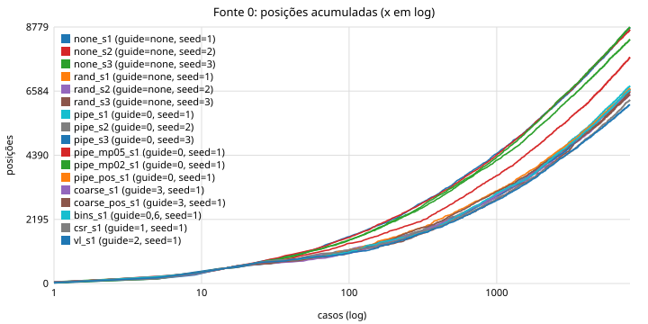

### Fonte 1 (csr_trans)

| execução | total | 50% | 90% | 99% | última nova | novas/janela início | meio | fim | % achado nos últimos 20% dos casos |
|---|---|---|---|---|---|---|---|---|---|
| none_s1 | 345 | 1127 | 5004 | 6843 | 7487 | 76 | 4 | 0 | 1.45% |
| none_s2 | 344 | 1088 | 5401 | 7958 | 7986 | 73 | 4 | 4 | 5.81% |
| none_s3 | 342 | 1133 | 5017 | 7813 | 7964 | 72 | 2 | 4 | 6.14% |
| rand_s1 | 270 | 1211 | 6385 | 7961 | 7979 | 62 | 4 | 7 | 9.63% |
| rand_s2 | 296 | 1835 | 6965 | 7937 | 7977 | 49 | 2 | 4 | 12.50% |
| rand_s3 | 291 | 1099 | 5588 | 7263 | 7976 | 72 | 4 | 2 | 5.15% |
| pipe_s1 | 260 | 1219 | 5576 | 7975 | 7975 | 60 | 3 | 7 | 6.92% |
| pipe_s2 | 254 | 1729 | 5521 | 7914 | 7974 | 36 | 1 | 5 | 6.69% |
| pipe_s3 | 306 | 1662 | 5918 | 7670 | 7817 | 70 | 4 | 1 | 6.54% |
| pipe_mp05_s1 | 312 | 1223 | 5533 | 7732 | 7997 | 74 | 1 | 2 | 5.13% |
| pipe_mp02_s1 | 352 | 1066 | 5017 | 7186 | 7899 | 67 | 4 | 2 | 2.84% |
| pipe_pos_s1 | 282 | 1395 | 5294 | 7995 | 7995 | 61 | 4 | 4 | 4.96% |
| coarse_s1 | 272 | 1084 | 5540 | 7872 | 7959 | 73 | 1 | 3 | 5.88% |
| coarse_pos_s1 | 261 | 1215 | 5567 | 7988 | 7988 | 62 | 1 | 4 | 7.66% |
| bins_s1 | 276 | 1350 | 5622 | 7996 | 7996 | 47 | 4 | 9 | 7.61% |
| csr_s1 | 530 | 875 | 4217 | 7720 | 7995 | 99 | 5 | 5 | 2.64% |
| vl_s1 | 260 | 1350 | 5975 | 7954 | 7954 | 45 | 2 | 3 | 9.62% |

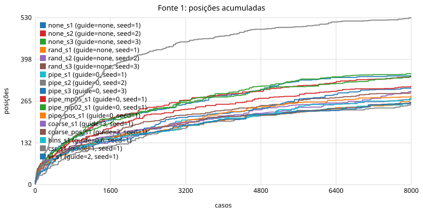
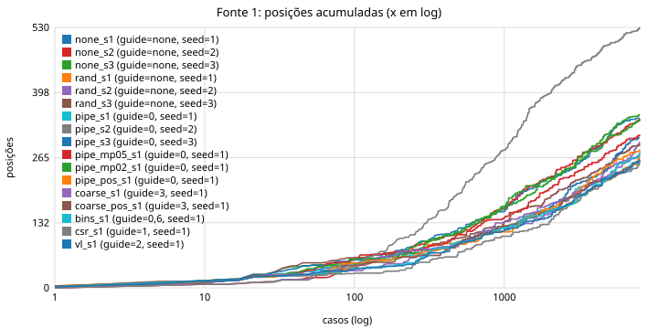

### Fonte 2 (verilator)

| execução | total | 50% | 90% | 99% | última nova | novas/janela início | meio | fim | % achado nos últimos 20% dos casos |
|---|---|---|---|---|---|---|---|---|---|
| none_s1 | 1176 | 2 | 45 | 232 | 459 | 1160 | 0 | 0 | 0.00% |
| none_s2 | 1176 | 3 | 61 | 242 | 627 | 1156 | 0 | 0 | 0.00% |
| none_s3 | 1176 | 2 | 46 | 260 | 859 | 1155 | 0 | 0 | 0.00% |
| rand_s1 | 1009 | 4 | 120 | 1061 | 2138 | 928 | 0 | 0 | 0.00% |
| rand_s2 | 1009 | 4 | 162 | 854 | 1579 | 921 | 0 | 0 | 0.00% |
| rand_s3 | 1009 | 10 | 137 | 1009 | 1756 | 920 | 0 | 0 | 0.00% |
| pipe_s1 | 1177 | 3 | 83 | 1251 | 4452 | 1091 | 0 | 0 | 0.00% |
| pipe_s2 | 1009 | 2 | 168 | 820 | 1313 | 922 | 0 | 0 | 0.00% |
| pipe_s3 | 1009 | 8 | 138 | 918 | 1575 | 921 | 0 | 0 | 0.00% |
| pipe_mp05_s1 | 1009 | 3 | 83 | 452 | 1245 | 955 | 0 | 0 | 0.00% |
| pipe_mp02_s1 | 1009 | 7 | 62 | 312 | 627 | 983 | 0 | 0 | 0.00% |
| pipe_pos_s1 | 1009 | 5 | 128 | 768 | 1597 | 931 | 0 | 0 | 0.00% |
| coarse_s1 | 1009 | 10 | 174 | 1003 | 1841 | 918 | 0 | 0 | 0.00% |
| coarse_pos_s1 | 1009 | 2 | 126 | 736 | 1299 | 931 | 0 | 0 | 0.00% |
| bins_s1 | 1177 | 5 | 102 | 952 | 1802 | 1094 | 0 | 0 | 0.00% |
| csr_s1 | 1177 | 6 | 98 | 1086 | 2179 | 1075 | 0 | 0 | 0.00% |
| vl_s1 | 1177 | 3 | 102 | 873 | 1649 | 1084 | 0 | 0 | 0.00% |

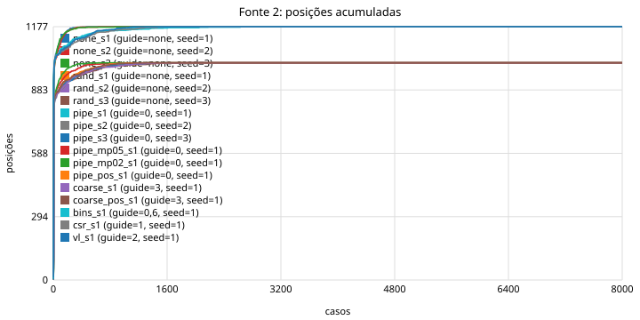
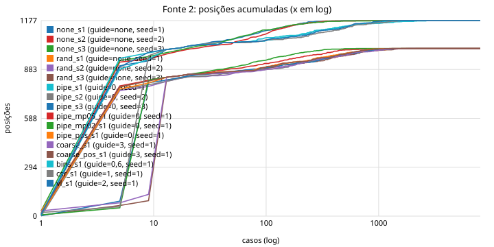

### Fonte 3 (pipe_coarse)

| execução | total | 50% | 90% | 99% | última nova | novas/janela início | meio | fim | % achado nos últimos 20% dos casos |
|---|---|---|---|---|---|---|---|---|---|
| rand_s1 | 641 | 258 | 3750 | 7202 | 7782 | 301 | 5 | 0 | 2.65% |
| rand_s2 | 639 | 285 | 4413 | 7322 | 7744 | 298 | 5 | 0 | 3.13% |
| rand_s3 | 645 | 288 | 4115 | 7627 | 7964 | 288 | 4 | 4 | 2.95% |
| pipe_s2 | 636 | 300 | 3736 | 7000 | 7699 | 292 | 9 | 0 | 2.36% |
| pipe_s3 | 660 | 307 | 4318 | 7112 | 7891 | 301 | 4 | 1 | 2.58% |
| pipe_mp05_s1 | 690 | 173 | 3484 | 7470 | 7967 | 356 | 4 | 4 | 2.03% |
| pipe_mp02_s1 | 705 | 166 | 3262 | 7297 | 7866 | 374 | 4 | 2 | 1.84% |
| pipe_pos_s1 | 648 | 230 | 3461 | 7215 | 7785 | 311 | 2 | 0 | 3.09% |
| coarse_s1 | 658 | 278 | 4310 | 7361 | 7853 | 291 | 7 | 2 | 2.58% |
| coarse_pos_s1 | 678 | 240 | 4497 | 7644 | 7820 | 318 | 3 | 1 | 3.83% |

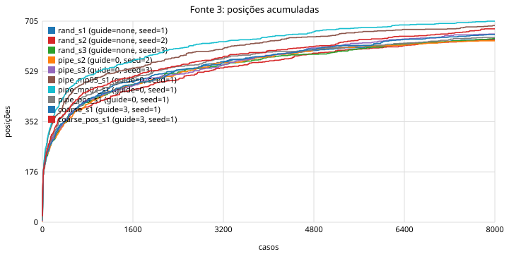
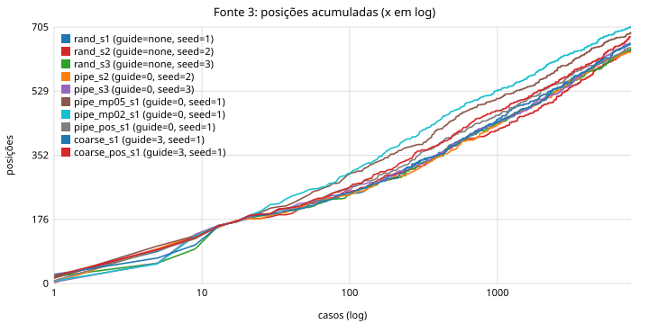

### Fonte 6 (bins)

| execução | total | 50% | 90% | 99% | última nova | novas/janela início | meio | fim | % achado nos últimos 20% dos casos |
|---|---|---|---|---|---|---|---|---|---|
| none_s1 | 31 | 11 | 99 | 365 | 365 | 29 | 0 | 0 | 0.00% |
| none_s2 | 31 | 4 | 73 | 918 | 918 | 30 | 0 | 0 | 0.00% |
| none_s3 | 31 | 2 | 47 | 859 | 859 | 30 | 0 | 0 | 0.00% |
| rand_s1 | 31 | 8 | 56 | 2138 | 2138 | 29 | 0 | 0 | 0.00% |
| rand_s2 | 31 | 4 | 206 | 1591 | 1591 | 27 | 0 | 0 | 0.00% |
| rand_s3 | 31 | 10 | 135 | 1369 | 1369 | 28 | 0 | 0 | 0.00% |
| pipe_s1 | 31 | 11 | 212 | 2180 | 2180 | 27 | 0 | 0 | 0.00% |
| pipe_s2 | 31 | 5 | 261 | 954 | 954 | 27 | 0 | 0 | 0.00% |
| pipe_s3 | 31 | 8 | 71 | 916 | 916 | 28 | 0 | 0 | 0.00% |
| pipe_mp05_s1 | 31 | 6 | 96 | 535 | 535 | 28 | 0 | 0 | 0.00% |
| pipe_mp02_s1 | 31 | 7 | 50 | 221 | 221 | 30 | 0 | 0 | 0.00% |
| pipe_pos_s1 | 31 | 6 | 111 | 540 | 540 | 29 | 0 | 0 | 0.00% |
| coarse_s1 | 31 | 10 | 94 | 2419 | 2419 | 28 | 0 | 0 | 0.00% |
| coarse_pos_s1 | 31 | 7 | 145 | 2419 | 2419 | 29 | 0 | 0 | 0.00% |
| bins_s1 | 31 | 5 | 116 | 1535 | 1535 | 29 | 0 | 0 | 0.00% |
| csr_s1 | 31 | 6 | 119 | 2408 | 2408 | 28 | 0 | 0 | 0.00% |
| vl_s1 | 31 | 7 | 136 | 2413 | 2413 | 28 | 0 | 0 | 0.00% |

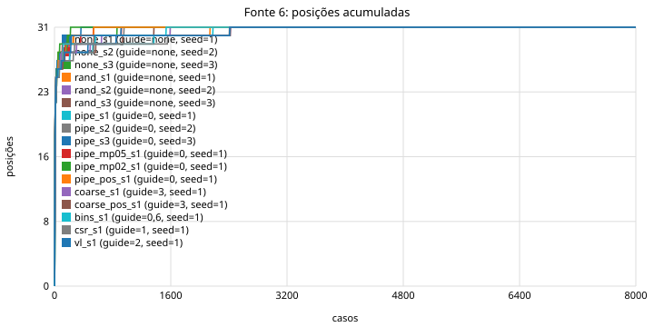
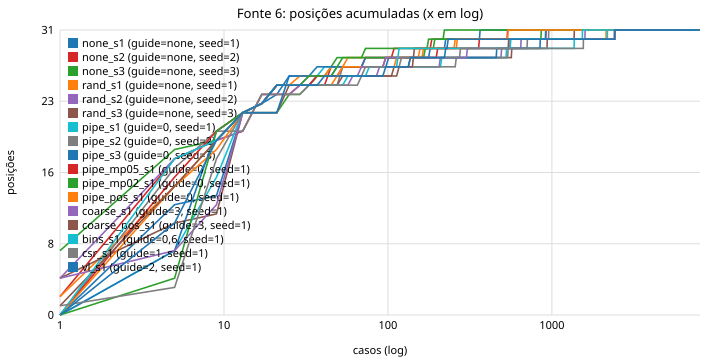

## 4. Colisões de hash e estabilidade

| execução | colisões fonte 0 (posições com 2+ chaves) | colisões fonte 1 | estabilidade |
|---|---|---|---|
| none_s1 | 475 (5.43% das posições) | 0 | 160 casos calibrados, 0 instáveis |
| none_s2 | 469 (5.40% das posições) | 0 | sem calibração |
| none_s3 | 409 (4.66% das posições) | 0 | sem calibração |
| rand_s1 | 522 (7.91% das posições) | 0 | sem calibração |
| rand_s2 | 456 (7.05% das posições) | 0 | sem calibração |
| rand_s3 | 540 (8.35% das posições) | 0 | sem calibração |
| pipe_s1 | 431 (6.37% das posições) | 2 | sem calibração |
| pipe_s2 | 455 (6.83% das posições) | 0 | sem calibração |
| pipe_s3 | 557 (8.39% das posições) | 0 | sem calibração |
| pipe_mp05_s1 | 503 (6.50% das posições) | 0 | sem calibração |
| pipe_mp02_s1 | 502 (6.01% das posições) | 3 | sem calibração |
| pipe_pos_s1 | 455 (6.82% das posições) | 4 | sem calibração |
| coarse_s1 | 795 (12.10% das posições) | 0 | sem calibração |
| coarse_pos_s1 | 763 (11.65% das posições) | 2 | sem calibração |
| bins_s1 | 486 (7.34% das posições) | 7 | sem calibração |
| csr_s1 | 481 (7.66% das posições) | 28 | sem calibração |
| vl_s1 | 508 (8.30% das posições) | 4 | sem calibração |

Colisão = uma posição do mapa que, dentro de um mesmo caso, recebeu duas chaves originais diferentes (medido na sonda, coluna `colidiu`). Instável = posição cuja contagem mudou entre duas execuções do mesmo binário.

## 5. Fonte 0 em detalhe: estados, durações e raridade

### none_s1

- arestas (posições): **8755**; snapshots distintos: **1543**; arestas por snapshot: 5.7
- raridade: 2451 arestas vistas em 1 caso só (28.0%), 3374 em 2–9 casos, 2930 em 10+ casos
- estimativa Chao1 do total alcançável por este gerador: **11531** arestas (observadas 8755, 76%)
- distribuição da duração do estado de origem: 1: 7806, 2: 525, 3: 230, 4-7: 148, 8-15: 37, 16-31: 5, 32-127: 4
- snapshots por classe em execute: alu: 272, branch: 196, load: 185, div: 178, mul: 152, csr: 137, store: 136, jal: 133, bubble: 129, jalr: 24, other: 1

Arestas mais comuns (freq = casos em que apareceu):

| freq | aresta |
|---|---|
| 8000 | `[x=store bp_take fq=1 m/r=res/res] --1c(1)--> [x=jal bpt jumping stall fq=0 m/r=-/res]` |
| 8000 | `[x=alu fwd=ex/mem fq=1 m/r=res/-] --1c(1)--> [x=store bp_take fq=1 m/r=res/res]` |
| 8000 | `[x=store fq=3 m/r=-/-] --1c(1)--> [x=store fq=2 m/r=-/-]` |
| 8000 | `[x=alu fwd=mem/ex fq=1 m/r=res/res] --1c(1)--> [x=alu fq=1 m/r=res/res]` |
| 8000 | `[x=alu fwd=ex/rf mul=AHBH fq=1 m/r=-/-] --1c(1)--> [x=alu fwd=ex/rf fq=1 m/r=res/-]` |
| 8000 | `[x=alu fwd=ex/rf fq=1 m/r=res/res] --2c(2)--> [x=alu fwd=mem/rf fq=1 m/r=res/res]` |

Exemplos de arestas vistas uma única vez (caso que as descobriu):

| caso | aresta |
|---|---|
| 7982 | `[x=alu fwd=mem/ex fq=2 m/r=res/-] --1c(1)--> [x=mul fwd=ret/mem fq=2 m/r=res/res]` |
| 7982 | `[x=csr fwd=ex/mem fq=2 m/r=res/res] --1c(1)--> [x=csr fq=2 m/r=res/res]` |
| 7984 | `[x=div fwd=ex/ex fq=2 m/r=-/-] --1c(1)--> [x=alu fwd=rf/ex fq=2 m/r=res/-]` |
| 7987 | `[x=alu fq=1 m/r=res/res] --3c(3)--> [x=load fwd=mem/mem fq=1 m/r=res/res]` |
| 7988 | `[x=alu fwd=ret/ex fq=2 m/r=-/res] --1c(1)--> [x=mul fwd=rf/mem fq=1 m/r=res/-]` |
| 7989 | `[x=load fq=2 m/r=res/-] --1c(1)--> [x=load fwd=ret/ret stall fq=2 m/r=load/res]` |
| 7994 | `[x=alu fwd=rf/mem fq=1 m/r=res/-] --1c(1)--> [x=mul fwd=rf/ret fq=1 m/r=res/res]` |
| 7994 | `[x=alu fwd=ex/ex fq=1 m/r=res/res] --1c(1)--> [x=mul fwd=ret/ret fq=1 m/r=res/res]` |

### none_s2

- arestas (posições): **8686**; snapshots distintos: **1493**; arestas por snapshot: 5.8
- raridade: 2354 arestas vistas em 1 caso só (27.1%), 3374 em 2–9 casos, 2958 em 10+ casos
- estimativa Chao1 do total alcançável por este gerador: **11193** arestas (observadas 8686, 78%)
- distribuição da duração do estado de origem: 1: 7767, 2: 522, 3: 196, 4-7: 152, 8-15: 40, 16-31: 4, 32-127: 5
- snapshots por classe em execute: alu: 262, branch: 199, load: 187, div: 167, csr: 141, jal: 137, mul: 135, store: 123, bubble: 117, jalr: 24, other: 1

Arestas mais comuns (freq = casos em que apareceu):

| freq | aresta |
|---|---|
| 8000 | `[x=store bp_take fq=1 m/r=res/res] --1c(1)--> [x=jal bpt jumping stall fq=0 m/r=-/res]` |
| 8000 | `[x=alu fwd=ex/mem fq=1 m/r=res/-] --1c(1)--> [x=store bp_take fq=1 m/r=res/res]` |
| 8000 | `[x=store fq=3 m/r=-/-] --1c(1)--> [x=store fq=2 m/r=-/-]` |
| 8000 | `[x=alu fwd=mem/ex fq=1 m/r=res/res] --1c(1)--> [x=alu fq=1 m/r=res/res]` |
| 8000 | `[x=alu fwd=ex/rf mul=AHBH fq=1 m/r=-/-] --1c(1)--> [x=alu fwd=ex/rf fq=1 m/r=res/-]` |
| 8000 | `[x=alu fwd=ex/rf fq=1 m/r=res/res] --2c(2)--> [x=alu fwd=mem/rf fq=1 m/r=res/res]` |

Exemplos de arestas vistas uma única vez (caso que as descobriu):

| caso | aresta |
|---|---|
| 7979 | `[x=branch bpt fwd=rf/mem jumping rollback fq=2 m/r=res/load] --1c(1)--> [x=mul fwd=rf/ret fq=2 m/r=-/res]` |
| 7980 | `[x=alu fq=1 m/r=res/res] --2c(2)--> [x=div fwd=mem/ret fq=1 m/r=res/res]` |
| 7981 | `[x=csr fq=1 m/r=res/res] --1c(1)--> [x=load fwd=rf/mem fq=1 m/r=res/res]` |
| 7981 | `[x=jal bpt fwd=ret/rf jumping fq=2 m/r=-/res] --1c(1)--> [x=bubble killed dec_invalid jumping fq=1 m/r=res/-]` |
| 7981 | `[x=csr bp_take fq=2 m/r=res/res] --1c(1)--> [x=jal bpt fwd=ret/rf jumping fq=2 m/r=-/res]` |
| 7985 | `[x=csr fwd=ex/ret fq=1 m/r=-/res] --1c(1)--> [x=branch jump fq=1 m/r=res/-]` |
| 7985 | `[x=csr fq=1 m/r=res/res] --1c(1)--> [x=csr fwd=ex/ret fq=1 m/r=-/res]` |
| 7990 | `[x=load fq=2 m/r=load/load] --6c(4-7)--> [x=branch fwd=rf/mem dec_hz=rs2 jump fq=2 m/r=load/load]` |

### none_s3

- arestas (posições): **8779**; snapshots distintos: **1552**; arestas por snapshot: 5.7
- raridade: 2410 arestas vistas em 1 caso só (27.5%), 3417 em 2–9 casos, 2952 em 10+ casos
- estimativa Chao1 do total alcançável por este gerador: **11409** arestas (observadas 8779, 77%)
- distribuição da duração do estado de origem: 1: 7846, 2: 532, 3: 215, 4-7: 146, 8-15: 30, 16-31: 5, 32-127: 5
- snapshots por classe em execute: alu: 266, branch: 200, div: 189, load: 182, csr: 144, mul: 143, jal: 138, store: 132, bubble: 130, jalr: 27, other: 1

Arestas mais comuns (freq = casos em que apareceu):

| freq | aresta |
|---|---|
| 8000 | `[x=store bp_take fq=1 m/r=res/res] --1c(1)--> [x=jal bpt jumping stall fq=0 m/r=-/res]` |
| 8000 | `[x=alu fwd=ex/mem fq=1 m/r=res/-] --1c(1)--> [x=store bp_take fq=1 m/r=res/res]` |
| 8000 | `[x=store fq=3 m/r=-/-] --1c(1)--> [x=store fq=2 m/r=-/-]` |
| 8000 | `[x=alu fwd=mem/ex fq=1 m/r=res/res] --1c(1)--> [x=alu fq=1 m/r=res/res]` |
| 8000 | `[x=alu fwd=ex/rf mul=AHBH fq=1 m/r=-/-] --1c(1)--> [x=alu fwd=ex/rf fq=1 m/r=res/-]` |
| 8000 | `[x=alu fwd=ex/rf fq=1 m/r=res/res] --2c(2)--> [x=alu fwd=mem/rf fq=1 m/r=res/res]` |

Exemplos de arestas vistas uma única vez (caso que as descobriu):

| caso | aresta |
|---|---|
| 7984 | `[x=alu fwd=rf/mem fq=2 m/r=res/res] --1c(1)--> [x=div fwd=ret/rf fq=2 m/r=res/res]` |
| 7990 | `[x=csr fwd=ex/rf fq=1 m/r=res/res] --1c(1)--> [x=branch jump fq=1 m/r=res/res]` |
| 7992 | `[x=alu fq=1 m/r=res/res] --4c(4-7)--> [x=store fwd=rf/mem fq=1 m/r=res/res]` |
| 7992 | `[x=store fwd=rf/mem fq=1 m/r=res/res] --1c(1)--> [x=mul stall fq=1 m/r=-/res]` |
| 7992 | `[x=store fwd=rf/mem fq=1 m/r=res/-] --1c(1)--> [x=mul stall fq=1 m/r=-/res]` |
| 7993 | `[x=alu fq=2 m/r=res/res] --9c(8-15)--> [x=alu fwd=ex/ex fq=2 m/r=res/res]` |
| 7993 | `[x=csr fwd=ret/rf fq=1 m/r=res/res] --1c(1)--> [x=csr fwd=rf/ex fq=1 m/r=-/res]` |
| 7995 | `[x=alu fwd=ex/rf fq=2 m/r=res/load] --1c(1)--> [x=jalr fwd=ex/mem jump fq=2 m/r=res/res]` |

### rand_s1

- arestas (posições): **6599**; snapshots distintos: **1343**; arestas por snapshot: 4.9
- raridade: 1363 arestas vistas em 1 caso só (20.7%), 2454 em 2–9 casos, 2782 em 10+ casos
- estimativa Chao1 do total alcançável por este gerador: **7947** arestas (observadas 6599, 83%)
- distribuição da duração do estado de origem: 1: 5948, 2: 355, 3: 154, 4-7: 109, 8-15: 24, 16-31: 4, 32-127: 5
- snapshots por classe em execute: alu: 234, branch: 181, load: 164, div: 149, mul: 129, csr: 125, bubble: 120, store: 111, jal: 106, jalr: 23, other: 1

Arestas mais comuns (freq = casos em que apareceu):

| freq | aresta |
|---|---|
| 8000 | `[x=store bp_take fq=1 m/r=res/res] --1c(1)--> [x=jal bpt jumping stall fq=0 m/r=-/res]` |
| 8000 | `[x=alu fwd=ex/mem fq=1 m/r=res/-] --1c(1)--> [x=store bp_take fq=1 m/r=res/res]` |
| 8000 | `[x=store fq=3 m/r=-/-] --1c(1)--> [x=store fq=2 m/r=-/-]` |
| 8000 | `[x=alu fwd=mem/ex fq=1 m/r=res/res] --1c(1)--> [x=alu fq=1 m/r=res/res]` |
| 8000 | `[x=alu fwd=ex/rf mul=AHBH fq=1 m/r=-/-] --1c(1)--> [x=alu fwd=ex/rf fq=1 m/r=res/-]` |
| 8000 | `[x=alu fwd=ex/rf fq=1 m/r=res/res] --2c(2)--> [x=alu fwd=mem/rf fq=1 m/r=res/res]` |

Exemplos de arestas vistas uma única vez (caso que as descobriu):

| caso | aresta |
|---|---|
| 7970 | `[x=branch fwd=rf/ret fq=1 m/r=res/res] --1c(1)--> [x=alu bp_take fq=1 m/r=-/res]` |
| 7972 | `[x=bubble killed fwd=rf/ret fq=1 m/r=-/load] --1c(1)--> [x=alu fq=1 m/r=-/-]` |
| 7974 | `[x=csr fq=2 m/r=-/-] --1c(1)--> [x=store dec_hz=mem fq=2 m/r=res/-]` |
| 7977 | `[x=alu fwd=mem/rf fq=1 m/r=res/-] --1c(1)--> [x=alu fwd=ret/mem fq=1 m/r=res/res]` |
| 7982 | `[x=alu fwd=ret/ret fq=2 m/r=res/res] --1c(1)--> [x=alu fwd=rf/ex fq=2 m/r=res/res]` |
| 7985 | `[x=alu fwd=mem/rf fq=2 m/r=res/res] --2c(2)--> [x=alu fwd=ex/rf fq=2 m/r=res/res]` |
| 7999 | `[x=alu fq=3 m/r=load/-] --1c(1)--> [x=alu fwd=ex/ret fq=2 m/r=res/load]` |
| 7999 | `[x=div fwd=ret/rf fq=0 m/r=-/res] --1c(1)--> [x=div fq=1 m/r=-/-]` |

### rand_s2

- arestas (posições): **6464**; snapshots distintos: **1333**; arestas por snapshot: 4.8
- raridade: 1270 arestas vistas em 1 caso só (19.6%), 2429 em 2–9 casos, 2765 em 10+ casos
- estimativa Chao1 do total alcançável por este gerador: **7623** arestas (observadas 6464, 85%)
- distribuição da duração do estado de origem: 1: 5821, 2: 354, 3: 160, 4-7: 103, 8-15: 18, 16-31: 4, 32-127: 4
- snapshots por classe em execute: alu: 235, branch: 187, load: 161, div: 143, mul: 128, csr: 127, bubble: 112, store: 111, jal: 106, jalr: 22, other: 1

Arestas mais comuns (freq = casos em que apareceu):

| freq | aresta |
|---|---|
| 8000 | `[x=store bp_take fq=1 m/r=res/res] --1c(1)--> [x=jal bpt jumping stall fq=0 m/r=-/res]` |
| 8000 | `[x=alu fwd=ex/mem fq=1 m/r=res/-] --1c(1)--> [x=store bp_take fq=1 m/r=res/res]` |
| 8000 | `[x=store fq=3 m/r=-/-] --1c(1)--> [x=store fq=2 m/r=-/-]` |
| 8000 | `[x=alu fwd=mem/ex fq=1 m/r=res/res] --1c(1)--> [x=alu fq=1 m/r=res/res]` |
| 8000 | `[x=alu fwd=ex/rf mul=AHBH fq=1 m/r=-/-] --1c(1)--> [x=alu fwd=ex/rf fq=1 m/r=res/-]` |
| 8000 | `[x=alu fwd=ex/rf fq=1 m/r=res/res] --2c(2)--> [x=alu fwd=mem/rf fq=1 m/r=res/res]` |

Exemplos de arestas vistas uma única vez (caso que as descobriu):

| caso | aresta |
|---|---|
| 7982 | `[x=csr fq=2 m/r=res/-] --1c(1)--> [x=branch fq=2 m/r=res/res]` |
| 7984 | `[x=div dec_invalid fq=3 m/r=-/-] --1c(1)--> [x=bubble killed fwd=mem/mem fq=2 m/r=res/-]` |
| 7984 | `[x=bubble killed fwd=mem/mem fq=2 m/r=res/-] --1c(1)--> [x=alu fwd=rf/ret fq=2 m/r=-/res]` |
| 7984 | `[x=alu fwd=rf/ret fq=2 m/r=-/res] --1c(1)--> [x=div fq=2 m/r=res/-]` |
| 7987 | `[x=load fwd=ret/rf fq=2 m/r=load/load] --1c(1)--> [x=alu fwd=rf/mem dec_hz=rs2 fq=2 m/r=load/load]` |
| 7989 | `[x=store bp_take fq=2 m/r=res/-] --1c(1)--> [x=jal bpt fwd=ret/ret jumping stall fq=2 m/r=-/res]` |
| 7989 | `[x=jal bpt fwd=ret/ret jumping stall fq=2 m/r=-/res] --1c(1)--> [x=jal bpt dec_invalid jumping stall fq=1 m/r=-/-]` |
| 7996 | `[x=alu fwd=ret/rf fq=1 m/r=res/res] --2c(2)--> [x=alu fwd=mem/mem fq=1 m/r=res/res]` |

### rand_s3

- arestas (posições): **6467**; snapshots distintos: **1334**; arestas por snapshot: 4.8
- raridade: 1340 arestas vistas em 1 caso só (20.7%), 2485 em 2–9 casos, 2642 em 10+ casos
- estimativa Chao1 do total alcançável por este gerador: **7699** arestas (observadas 6467, 84%)
- distribuição da duração do estado de origem: 1: 5782, 2: 377, 3: 163, 4-7: 109, 8-15: 26, 16-31: 5, 32-127: 5
- snapshots por classe em execute: alu: 239, branch: 177, div: 170, load: 164, mul: 128, csr: 111, store: 109, jal: 107, bubble: 106, jalr: 22, other: 1

Arestas mais comuns (freq = casos em que apareceu):

| freq | aresta |
|---|---|
| 8000 | `[x=store bp_take fq=1 m/r=res/res] --1c(1)--> [x=jal bpt jumping stall fq=0 m/r=-/res]` |
| 8000 | `[x=alu fwd=ex/mem fq=1 m/r=res/-] --1c(1)--> [x=store bp_take fq=1 m/r=res/res]` |
| 8000 | `[x=store fq=3 m/r=-/-] --1c(1)--> [x=store fq=2 m/r=-/-]` |
| 8000 | `[x=alu fwd=mem/ex fq=1 m/r=res/res] --1c(1)--> [x=alu fq=1 m/r=res/res]` |
| 8000 | `[x=alu fwd=ex/rf mul=AHBH fq=1 m/r=-/-] --1c(1)--> [x=alu fwd=ex/rf fq=1 m/r=res/-]` |
| 8000 | `[x=alu fwd=ex/rf fq=1 m/r=res/res] --2c(2)--> [x=alu fwd=mem/rf fq=1 m/r=res/res]` |

Exemplos de arestas vistas uma única vez (caso que as descobriu):

| caso | aresta |
|---|---|
| 7963 | `[x=bubble killed stall fq=1 m/r=load/res] --1c(1)--> [x=bubble killed stall fq=2 m/r=load/-]` |
| 7963 | `[x=load dec_invalid fq=1 m/r=res/-] --1c(1)--> [x=bubble killed stall fq=1 m/r=load/res]` |
| 7963 | `[x=bubble killed fq=3 m/r=load/-] --1c(1)--> [x=alu fq=2 m/r=-/load]` |
| 7970 | `[x=div fwd=ex/rf fq=2 m/r=-/res] --1c(1)--> [x=alu fwd=ex/mem fq=2 m/r=res/-]` |
| 7980 | `[x=alu fwd=rf/ex fq=1 m/r=res/res] --1c(1)--> [x=csr fwd=rf/mem fq=1 m/r=res/res]` |
| 7981 | `[x=alu fq=3 m/r=load/-] --1c(1)--> [x=mul fwd=rf/mem fq=2 m/r=res/load]` |
| 7986 | `[x=alu fwd=mem/mem fq=2 m/r=res/res] --1c(1)--> [x=alu fwd=ex/ex fq=2 m/r=res/res]` |
| 7995 | `[x=div fq=3 m/r=-/res] --1c(1)--> [x=store fwd=rf/mem fq=2 m/r=res/-]` |

### pipe_s1

- arestas (posições): **6761**; snapshots distintos: **1372**; arestas por snapshot: 4.9
- raridade: 1069 arestas vistas em 1 caso só (15.8%), 2612 em 2–9 casos, 3080 em 10+ casos
- estimativa Chao1 do total alcançável por este gerador: **7576** arestas (observadas 6761, 89%)
- distribuição da duração do estado de origem: 1: 6083, 2: 370, 3: 166, 4-7: 114, 8-15: 21, 16-31: 3, 32-127: 4
- snapshots por classe em execute: alu: 245, branch: 181, load: 167, div: 148, mul: 134, csr: 124, bubble: 122, store: 115, jal: 112, jalr: 23, other: 1

Arestas mais comuns (freq = casos em que apareceu):

| freq | aresta |
|---|---|
| 8000 | `[x=store bp_take fq=1 m/r=res/res] --1c(1)--> [x=jal bpt jumping stall fq=0 m/r=-/res]` |
| 8000 | `[x=alu fwd=ex/mem fq=1 m/r=res/-] --1c(1)--> [x=store bp_take fq=1 m/r=res/res]` |
| 8000 | `[x=store fq=3 m/r=-/-] --1c(1)--> [x=store fq=2 m/r=-/-]` |
| 8000 | `[x=alu fwd=mem/ex fq=1 m/r=res/res] --1c(1)--> [x=alu fq=1 m/r=res/res]` |
| 8000 | `[x=alu fwd=ex/rf mul=AHBH fq=1 m/r=-/-] --1c(1)--> [x=alu fwd=ex/rf fq=1 m/r=res/-]` |
| 8000 | `[x=alu fwd=ex/rf fq=1 m/r=res/res] --2c(2)--> [x=alu fwd=mem/rf fq=1 m/r=res/res]` |

Exemplos de arestas vistas uma única vez (caso que as descobriu):

| caso | aresta |
|---|---|
| 7979 | `[x=div fwd=ret/rf fq=2 m/r=res/load] --1c(1)--> [x=div fwd=rf/ex fq=3 m/r=-/res]` |
| 7985 | `[x=alu fwd=ex/rf fq=1 m/r=-/res] --1c(1)--> [x=branch fwd=mem/mem fq=1 m/r=res/-]` |
| 7989 | `[x=load fwd=ret/ret fq=2 m/r=res/res] --1c(1)--> [x=alu stall fq=2 m/r=load/res]` |
| 7989 | `[x=alu fq=2 m/r=res/res] --1c(1)--> [x=load fwd=ret/ret fq=2 m/r=res/res]` |
| 7992 | `[x=csr bp_take fq=1 m/r=res/res] --1c(1)--> [x=jal bpt fwd=ret/rf jumping fq=0 m/r=res/res]` |
| 7993 | `[x=alu fq=2 m/r=load/load] --1c(1)--> [x=alu fwd=rf/ret fq=2 m/r=res/load]` |
| 7993 | `[x=alu fwd=rf/ret fq=2 m/r=res/load] --1c(1)--> [x=alu fwd=mem/rf fq=2 m/r=res/res]` |
| 7994 | `[x=jalr fwd=ex/rf jump fq=2 m/r=res/res] --1c(1)--> [x=bubble killed fwd=mem/rf jumping fq=0 m/r=res/res]` |

### pipe_s2

- arestas (posições): **6659**; snapshots distintos: **1329**; arestas por snapshot: 5.0
- raridade: 1107 arestas vistas em 1 caso só (16.6%), 2451 em 2–9 casos, 3101 em 10+ casos
- estimativa Chao1 do total alcançável por este gerador: **7572** arestas (observadas 6659, 88%)
- distribuição da duração do estado de origem: 1: 6003, 2: 371, 3: 159, 4-7: 96, 8-15: 21, 16-31: 4, 32-127: 5
- snapshots por classe em execute: alu: 235, branch: 183, load: 160, div: 157, mul: 124, csr: 119, bubble: 111, store: 110, jal: 106, jalr: 23, other: 1

Arestas mais comuns (freq = casos em que apareceu):

| freq | aresta |
|---|---|
| 8000 | `[x=store bp_take fq=1 m/r=res/res] --1c(1)--> [x=jal bpt jumping stall fq=0 m/r=-/res]` |
| 8000 | `[x=alu fwd=ex/mem fq=1 m/r=res/-] --1c(1)--> [x=store bp_take fq=1 m/r=res/res]` |
| 8000 | `[x=store fq=3 m/r=-/-] --1c(1)--> [x=store fq=2 m/r=-/-]` |
| 8000 | `[x=alu fwd=mem/ex fq=1 m/r=res/res] --1c(1)--> [x=alu fq=1 m/r=res/res]` |
| 8000 | `[x=alu fwd=ex/rf mul=AHBH fq=1 m/r=-/-] --1c(1)--> [x=alu fwd=ex/rf fq=1 m/r=res/-]` |
| 8000 | `[x=alu fwd=ex/rf fq=1 m/r=res/res] --2c(2)--> [x=alu fwd=mem/rf fq=1 m/r=res/res]` |

Exemplos de arestas vistas uma única vez (caso que as descobriu):

| caso | aresta |
|---|---|
| 7971 | `[x=alu fwd=rf/ret fq=2 m/r=res/res] --1c(1)--> [x=mul fwd=mem/ret fq=2 m/r=res/res]` |
| 7974 | `[x=div fwd=ex/rf fq=3 m/r=-/-] --1c(1)--> [x=mul bp_take fq=2 m/r=res/-]` |
| 7974 | `[x=alu fwd=ret/rf fq=1 m/r=res/res] --2c(2)--> [x=alu fwd=mem/mem fq=1 m/r=res/res]` |
| 7979 | `[x=div fq=2 m/r=-/-] --1c(1)--> [x=alu fwd=mem/ex fq=2 m/r=res/-]` |
| 7979 | `[x=csr fwd=mem/rf fq=1 m/r=res/-] --1c(1)--> [x=div fq=1 m/r=-/res]` |
| 7980 | `[x=alu fwd=ex/mem fq=1 m/r=res/res] --1c(1)--> [x=mul fq=1 m/r=res/res]` |
| 7982 | `[x=alu fwd=ex/mem fq=1 m/r=res/res] --1c(1)--> [x=div fwd=rf/ret fq=1 m/r=res/res]` |
| 7985 | `[x=div fwd=ex/ex fq=2 m/r=-/-] --1c(1)--> [x=alu fwd=rf/ex fq=2 m/r=res/-]` |

### pipe_s3

- arestas (posições): **6639**; snapshots distintos: **1370**; arestas por snapshot: 4.8
- raridade: 1092 arestas vistas em 1 caso só (16.4%), 2492 em 2–9 casos, 3055 em 10+ casos
- estimativa Chao1 do total alcançável por este gerador: **7481** arestas (observadas 6639, 89%)
- distribuição da duração do estado de origem: 1: 5946, 2: 380, 3: 169, 4-7: 116, 8-15: 19, 16-31: 4, 32-127: 5
- snapshots por classe em execute: alu: 243, branch: 185, load: 166, div: 165, mul: 133, csr: 121, bubble: 114, store: 111, jal: 109, jalr: 22, other: 1

Arestas mais comuns (freq = casos em que apareceu):

| freq | aresta |
|---|---|
| 8000 | `[x=store bp_take fq=1 m/r=res/res] --1c(1)--> [x=jal bpt jumping stall fq=0 m/r=-/res]` |
| 8000 | `[x=alu fwd=ex/mem fq=1 m/r=res/-] --1c(1)--> [x=store bp_take fq=1 m/r=res/res]` |
| 8000 | `[x=store fq=3 m/r=-/-] --1c(1)--> [x=store fq=2 m/r=-/-]` |
| 8000 | `[x=alu fwd=mem/ex fq=1 m/r=res/res] --1c(1)--> [x=alu fq=1 m/r=res/res]` |
| 8000 | `[x=alu fwd=ex/rf mul=AHBH fq=1 m/r=-/-] --1c(1)--> [x=alu fwd=ex/rf fq=1 m/r=res/-]` |
| 8000 | `[x=alu fwd=ex/rf fq=1 m/r=res/res] --2c(2)--> [x=alu fwd=mem/rf fq=1 m/r=res/res]` |

Exemplos de arestas vistas uma única vez (caso que as descobriu):

| caso | aresta |
|---|---|
| 7937 | `[x=csr fwd=rf/mem fq=1 m/r=res/-] --1c(1)--> [x=branch jump fq=1 m/r=res/res]` |
| 7937 | `[x=csr fwd=ret/rf fq=1 m/r=-/res] --1c(1)--> [x=csr fwd=rf/mem fq=1 m/r=res/-]` |
| 7953 | `[x=store fq=2 m/r=-/-] --1c(1)--> [x=branch stall fq=2 m/r=-/-]` |
| 7977 | `[x=div fwd=ret/ret fq=2 m/r=-/res] --1c(1)--> [x=div fwd=rf/mem fq=2 m/r=res/-]` |
| 7984 | `[x=csr fq=1 m/r=res/-] --1c(1)--> [x=div fq=1 m/r=-/res]` |
| 7990 | `[x=branch fwd=rf/ret fq=1 m/r=res/res] --1c(1)--> [x=alu fwd=ex/rf fq=1 m/r=-/res]` |
| 7992 | `[x=csr fwd=rf/ex fq=1 m/r=res/res] --1c(1)--> [x=branch fwd=rf/ret jump fq=1 m/r=res/res]` |
| 7993 | `[x=bubble killed fwd=rf/ret fq=1 m/r=res/res] --1c(1)--> [x=alu fwd=ex/rf fq=1 m/r=-/res]` |

### pipe_mp05_s1

- arestas (posições): **7739**; snapshots distintos: **1445**; arestas por snapshot: 5.4
- raridade: 1452 arestas vistas em 1 caso só (18.8%), 3117 em 2–9 casos, 3170 em 10+ casos
- estimativa Chao1 do total alcançável por este gerador: **8881** arestas (observadas 7739, 87%)
- distribuição da duração do estado de origem: 1: 6942, 2: 431, 3: 198, 4-7: 129, 8-15: 30, 16-31: 5, 32-127: 4
- snapshots por classe em execute: alu: 265, branch: 186, load: 173, div: 170, mul: 140, csr: 124, store: 123, jal: 121, bubble: 119, jalr: 23, other: 1

Arestas mais comuns (freq = casos em que apareceu):

| freq | aresta |
|---|---|
| 8000 | `[x=store bp_take fq=1 m/r=res/res] --1c(1)--> [x=jal bpt jumping stall fq=0 m/r=-/res]` |
| 8000 | `[x=alu fwd=ex/mem fq=1 m/r=res/-] --1c(1)--> [x=store bp_take fq=1 m/r=res/res]` |
| 8000 | `[x=store fq=3 m/r=-/-] --1c(1)--> [x=store fq=2 m/r=-/-]` |
| 8000 | `[x=alu fwd=mem/ex fq=1 m/r=res/res] --1c(1)--> [x=alu fq=1 m/r=res/res]` |
| 8000 | `[x=alu fwd=ex/rf mul=AHBH fq=1 m/r=-/-] --1c(1)--> [x=alu fwd=ex/rf fq=1 m/r=res/-]` |
| 8000 | `[x=alu fwd=ex/rf fq=1 m/r=res/res] --2c(2)--> [x=alu fwd=mem/rf fq=1 m/r=res/res]` |

Exemplos de arestas vistas uma única vez (caso que as descobriu):

| caso | aresta |
|---|---|
| 7961 | `[x=alu fwd=mem/ex fq=2 m/r=res/res] --1c(1)--> [x=branch fwd=rf/mem fq=2 m/r=res/res]` |
| 7966 | `[x=jal bpt fq=1 m/r=load/-] --1c(1)--> [x=branch fq=1 m/r=res/load]` |
| 7974 | `[x=alu fwd=rf/ex fq=1 m/r=res/res] --1c(1)--> [x=branch fwd=ret/mem jump fq=1 m/r=res/res]` |
| 7978 | `[x=alu fwd=mem/mem fq=2 m/r=res/-] --1c(1)--> [x=alu fwd=mem/rf fq=2 m/r=res/res]` |
| 7986 | `[x=alu fwd=rf/mem fq=2 m/r=res/res] --2c(2)--> [x=store dec_hz=mem fq=2 m/r=res/res]` |
| 7987 | `[x=load bp_take fq=3 m/r=load/-] --1c(1)--> [x=jal bpt fwd=mem/ex dec_hz=rs1 jumping fq=2 m/r=load/load]` |
| 7988 | `[x=load fwd=rf/mem fq=2 m/r=res/-] --1c(1)--> [x=alu fwd=ret/rf stall fq=2 m/r=load/res]` |
| 7993 | `[x=div fwd=ex/rf fq=2 m/r=-/-] --1c(1)--> [x=alu fwd=rf/ex fq=2 m/r=res/-]` |

### pipe_mp02_s1

- arestas (posições): **8351**; snapshots distintos: **1510**; arestas por snapshot: 5.5
- raridade: 1886 arestas vistas em 1 caso só (22.6%), 3409 em 2–9 casos, 3056 em 10+ casos
- estimativa Chao1 do total alcançável por este gerador: **10068** arestas (observadas 8351, 83%)
- distribuição da duração do estado de origem: 1: 7436, 2: 509, 3: 215, 4-7: 144, 8-15: 37, 16-31: 5, 32-127: 5
- snapshots por classe em execute: alu: 257, branch: 197, div: 181, load: 179, mul: 149, jal: 135, csr: 134, store: 128, bubble: 127, jalr: 22, other: 1

Arestas mais comuns (freq = casos em que apareceu):

| freq | aresta |
|---|---|
| 8000 | `[x=store bp_take fq=1 m/r=res/res] --1c(1)--> [x=jal bpt jumping stall fq=0 m/r=-/res]` |
| 8000 | `[x=alu fwd=ex/mem fq=1 m/r=res/-] --1c(1)--> [x=store bp_take fq=1 m/r=res/res]` |
| 8000 | `[x=store fq=3 m/r=-/-] --1c(1)--> [x=store fq=2 m/r=-/-]` |
| 8000 | `[x=alu fwd=mem/ex fq=1 m/r=res/res] --1c(1)--> [x=alu fq=1 m/r=res/res]` |
| 8000 | `[x=alu fwd=ex/rf mul=AHBH fq=1 m/r=-/-] --1c(1)--> [x=alu fwd=ex/rf fq=1 m/r=res/-]` |
| 8000 | `[x=alu fwd=ex/rf fq=1 m/r=res/res] --2c(2)--> [x=alu fwd=mem/rf fq=1 m/r=res/res]` |

Exemplos de arestas vistas uma única vez (caso que as descobriu):

| caso | aresta |
|---|---|
| 7965 | `[x=alu fwd=ex/rf fq=2 m/r=res/res] --2c(2)--> [x=alu fwd=ret/ex fq=2 m/r=res/res]` |
| 7966 | `[x=csr fwd=ret/mem fq=1 m/r=res/res] --1c(1)--> [x=branch fwd=ret/rf jump fq=1 m/r=res/res]` |
| 7969 | `[x=branch bpt fwd=mem/rf jumping rollback fq=2 m/r=res/-] --1c(1)--> [x=mul fwd=rf/ret fq=2 m/r=-/res]` |
| 7976 | `[x=alu fwd=ex/ex fq=2 m/r=res/-] --1c(1)--> [x=csr fq=2 m/r=res/res]` |
| 7979 | `[x=alu fwd=ex/rf fq=1 m/r=res/-] --1c(1)--> [x=branch fwd=rf/ret jump fq=1 m/r=res/res]` |
| 7979 | `[x=csr fwd=rf/mem fq=1 m/r=res/-] --1c(1)--> [x=csr fwd=ex/ex fq=1 m/r=-/res]` |
| 7984 | `[x=mul dec_hz=rs1 mul=AHBL fq=3 m/r=-/-] --1c(1)--> [x=mul fwd=ex/rf dec_hz=rs1 mul=AHBH fq=3 m/r=-/-]` |
| 7995 | `[x=bubble hz fwd=ret/rf fq=3 m/r=load/load] --1c(1)--> [x=branch fwd=rf/ret fq=2 m/r=-/load]` |

### pipe_pos_s1

- arestas (posições): **6675**; snapshots distintos: **1342**; arestas por snapshot: 5.0
- raridade: 1049 arestas vistas em 1 caso só (15.7%), 2483 em 2–9 casos, 3143 em 10+ casos
- estimativa Chao1 do total alcançável por este gerador: **7510** arestas (observadas 6675, 89%)
- distribuição da duração do estado de origem: 1: 6000, 2: 377, 3: 151, 4-7: 114, 8-15: 24, 16-31: 4, 32-127: 5
- snapshots por classe em execute: alu: 232, branch: 183, load: 159, div: 146, mul: 134, csr: 131, bubble: 120, store: 112, jal: 104, jalr: 20, other: 1

Arestas mais comuns (freq = casos em que apareceu):

| freq | aresta |
|---|---|
| 8000 | `[x=store bp_take fq=1 m/r=res/res] --1c(1)--> [x=jal bpt jumping stall fq=0 m/r=-/res]` |
| 8000 | `[x=alu fwd=ex/mem fq=1 m/r=res/-] --1c(1)--> [x=store bp_take fq=1 m/r=res/res]` |
| 8000 | `[x=store fq=3 m/r=-/-] --1c(1)--> [x=store fq=2 m/r=-/-]` |
| 8000 | `[x=alu fwd=mem/ex fq=1 m/r=res/res] --1c(1)--> [x=alu fq=1 m/r=res/res]` |
| 8000 | `[x=alu fwd=ex/rf mul=AHBH fq=1 m/r=-/-] --1c(1)--> [x=alu fwd=ex/rf fq=1 m/r=res/-]` |
| 8000 | `[x=alu fwd=ex/rf fq=1 m/r=res/res] --2c(2)--> [x=alu fwd=mem/rf fq=1 m/r=res/res]` |

Exemplos de arestas vistas uma única vez (caso que as descobriu):

| caso | aresta |
|---|---|
| 7974 | `[x=alu bp_take fq=2 m/r=res/-] --1c(1)--> [x=jal bpt fwd=mem/mem jumping fq=2 m/r=res/res]` |
| 7977 | `[x=branch bpt fwd=rf/ret jumping rollback fq=2 m/r=res/load] --1c(1)--> [x=alu fq=2 m/r=-/res]` |
| 7982 | `[x=alu fq=2 m/r=res/-] --1c(1)--> [x=store fwd=ret/ret fq=2 m/r=res/res]` |
| 7985 | `[x=alu fwd=mem/mem fq=2 m/r=res/-] --1c(1)--> [x=branch fwd=mem/rf fq=2 m/r=res/res]` |
| 7986 | `[x=bubble killed fwd=mem/rf fq=2 m/r=res/-] --1c(1)--> [x=alu fwd=ret/ret fq=2 m/r=-/res]` |
| 7986 | `[x=alu fwd=ret/ret fq=2 m/r=-/res] --1c(1)--> [x=mul fq=2 m/r=res/-]` |
| 7991 | `[x=csr fq=1 m/r=res/res] --1c(1)--> [x=branch fwd=mem/mem jump fq=1 m/r=res/res]` |
| 7995 | `[x=alu fwd=ex/rf fq=2 m/r=res/-] --1c(1)--> [x=jalr fwd=rf/mem jump fq=2 m/r=res/res]` |

### coarse_s1

- arestas (posições): **6570**; snapshots distintos: **1336**; arestas por snapshot: 4.9
- raridade: 1635 arestas vistas em 1 caso só (24.9%), 2278 em 2–9 casos, 2657 em 10+ casos
- estimativa Chao1 do total alcançável por este gerador: **8521** arestas (observadas 6570, 77%)
- distribuição da duração do estado de origem: 1: 5888, 2: 358, 3: 161, 4-7: 125, 8-15: 30, 16-31: 4, 32-127: 4
- snapshots por classe em execute: alu: 241, branch: 186, load: 165, div: 147, mul: 134, csr: 119, bubble: 109, store: 109, jal: 104, jalr: 21, other: 1

Arestas mais comuns (freq = casos em que apareceu):

| freq | aresta |
|---|---|
| 8000 | `[x=store bp_take fq=1 m/r=res/res] --1c(1)--> [x=jal bpt jumping stall fq=0 m/r=-/res]` |
| 8000 | `[x=alu fwd=ex/mem fq=1 m/r=res/-] --1c(1)--> [x=store bp_take fq=1 m/r=res/res]` |
| 8000 | `[x=store fq=3 m/r=-/-] --1c(1)--> [x=store fq=2 m/r=-/-]` |
| 8000 | `[x=alu fwd=mem/ex fq=1 m/r=res/res] --1c(1)--> [x=alu fq=1 m/r=res/res]` |
| 8000 | `[x=alu fwd=ex/rf mul=AHBH fq=1 m/r=-/-] --1c(1)--> [x=alu fwd=ex/rf fq=1 m/r=res/-]` |
| 8000 | `[x=alu fwd=ex/rf fq=1 m/r=res/res] --2c(2)--> [x=alu fwd=mem/rf fq=1 m/r=res/res]` |

Exemplos de arestas vistas uma única vez (caso que as descobriu):

| caso | aresta |
|---|---|
| 7967 | `[x=alu fq=2 m/r=load/load] --1c(1)--> [x=alu fwd=mem/ret fq=2 m/r=res/load]` |
| 7970 | `[x=csr fq=1 m/r=res/res] --2c(2)--> [x=load fwd=ex/ex dec_hz=rs1rs2 fq=1 m/r=-/res]` |
| 7973 | `[x=branch bpt jumping rollback fq=1 m/r=res/res] --1c(1)--> [x=div fwd=ret/rf fq=0 m/r=-/res]` |
| 7973 | `[x=alu fwd=ex/ret fq=2 m/r=res/load] --1c(1)--> [x=alu fq=2 m/r=res/res]` |
| 7973 | `[x=div fwd=ret/rf fq=0 m/r=-/res] --1c(1)--> [x=div fq=1 m/r=-/-]` |
| 7976 | `[x=csr fwd=rf/mem fq=1 m/r=res/res] --1c(1)--> [x=div fwd=ret/mem fq=1 m/r=res/res]` |
| 7976 | `[x=branch bpt fwd=rf/mem jumping rollback fq=2 m/r=res/load] --1c(1)--> [x=store dec_hz=mem fq=2 m/r=-/res]` |
| 7979 | `[x=alu fwd=rf/ex fq=3 m/r=-/-] --1c(1)--> [x=mul fwd=rf/mem fq=2 m/r=res/-]` |

### coarse_pos_s1

- arestas (posições): **6552**; snapshots distintos: **1368**; arestas por snapshot: 4.8
- raridade: 1694 arestas vistas em 1 caso só (25.9%), 2243 em 2–9 casos, 2615 em 10+ casos
- estimativa Chao1 do total alcançável por este gerador: **8440** arestas (observadas 6552, 78%)
- distribuição da duração do estado de origem: 1: 5859, 2: 390, 3: 158, 4-7: 116, 8-15: 22, 16-31: 4, 32-127: 3
- snapshots por classe em execute: alu: 239, branch: 182, load: 165, div: 157, mul: 141, csr: 122, store: 113, jal: 113, bubble: 112, jalr: 23, other: 1

Arestas mais comuns (freq = casos em que apareceu):

| freq | aresta |
|---|---|
| 8000 | `[x=store bp_take fq=1 m/r=res/res] --1c(1)--> [x=jal bpt jumping stall fq=0 m/r=-/res]` |
| 8000 | `[x=alu fwd=ex/mem fq=1 m/r=res/-] --1c(1)--> [x=store bp_take fq=1 m/r=res/res]` |
| 8000 | `[x=store fq=3 m/r=-/-] --1c(1)--> [x=store fq=2 m/r=-/-]` |
| 8000 | `[x=alu fwd=mem/ex fq=1 m/r=res/res] --1c(1)--> [x=alu fq=1 m/r=res/res]` |
| 8000 | `[x=alu fwd=ex/rf mul=AHBH fq=1 m/r=-/-] --1c(1)--> [x=alu fwd=ex/rf fq=1 m/r=res/-]` |
| 8000 | `[x=alu fwd=ex/rf fq=1 m/r=res/res] --2c(2)--> [x=alu fwd=mem/rf fq=1 m/r=res/res]` |

Exemplos de arestas vistas uma única vez (caso que as descobriu):

| caso | aresta |
|---|---|
| 7955 | `[x=csr fwd=ret/rf fq=2 m/r=res/res] --1c(1)--> [x=branch fq=2 m/r=res/res]` |
| 7974 | `[x=bubble killed bp_take fq=1 m/r=-/load] --1c(1)--> [x=jal bpt jumping fq=0 m/r=-/-]` |
| 7974 | `[x=branch dec_invalid jumping fq=1 m/r=load/-] --1c(1)--> [x=bubble killed bp_take fq=1 m/r=-/load]` |
| 7974 | `[x=csr fwd=ex/rf fq=1 m/r=res/res] --1c(1)--> [x=branch fq=1 m/r=res/res]` |
| 7976 | `[x=jalr fwd=rf/mem jump fq=2 m/r=res/res] --1c(1)--> [x=bubble killed fwd=mem/rf jumping fq=0 m/r=res/res]` |
| 7979 | `[x=div fwd=rf/ex fq=3 m/r=-/-] --1c(1)--> [x=alu fwd=rf/mem fq=2 m/r=res/-]` |
| 7982 | `[x=alu fwd=mem/rf fq=2 m/r=res/res] --1c(1)--> [x=branch fwd=rf/mem fq=2 m/r=res/res]` |
| 7990 | `[x=div fq=3 m/r=-/-] --2c(2)--> [x=div fq=2 m/r=res/-]` |

### bins_s1

- arestas (posições): **6622**; snapshots distintos: **1354**; arestas por snapshot: 4.9
- raridade: 1045 arestas vistas em 1 caso só (15.8%), 2523 em 2–9 casos, 3054 em 10+ casos
- estimativa Chao1 do total alcançável por este gerador: **7432** arestas (observadas 6622, 89%)
- distribuição da duração do estado de origem: 1: 5965, 2: 364, 3: 148, 4-7: 116, 8-15: 22, 16-31: 3, 32-127: 4
- snapshots por classe em execute: alu: 240, branch: 178, load: 164, div: 148, mul: 133, csr: 125, bubble: 121, jal: 114, store: 109, jalr: 21, other: 1

Arestas mais comuns (freq = casos em que apareceu):

| freq | aresta |
|---|---|
| 8000 | `[x=store bp_take fq=1 m/r=res/res] --1c(1)--> [x=jal bpt jumping stall fq=0 m/r=-/res]` |
| 8000 | `[x=alu fwd=ex/mem fq=1 m/r=res/-] --1c(1)--> [x=store bp_take fq=1 m/r=res/res]` |
| 8000 | `[x=store fq=3 m/r=-/-] --1c(1)--> [x=store fq=2 m/r=-/-]` |
| 8000 | `[x=alu fwd=mem/ex fq=1 m/r=res/res] --1c(1)--> [x=alu fq=1 m/r=res/res]` |
| 8000 | `[x=alu fwd=ex/rf mul=AHBH fq=1 m/r=-/-] --1c(1)--> [x=alu fwd=ex/rf fq=1 m/r=res/-]` |
| 8000 | `[x=alu fwd=ex/rf fq=1 m/r=res/res] --2c(2)--> [x=alu fwd=mem/rf fq=1 m/r=res/res]` |

Exemplos de arestas vistas uma única vez (caso que as descobriu):

| caso | aresta |
|---|---|
| 7941 | `[x=alu fwd=mem/rf fq=2 m/r=res/res] --1c(1)--> [x=branch fwd=mem/ret fq=2 m/r=res/res]` |
| 7957 | `[x=branch bpt jumping rollback fq=2 m/r=res/load] --1c(1)--> [x=div fwd=ret/rf fq=2 m/r=-/res]` |
| 7963 | `[x=alu fwd=ex/ret fq=1 m/r=-/res] --1c(1)--> [x=alu fwd=ex/rf fq=1 m/r=res/-]` |
| 7963 | `[x=alu fwd=ex/ex fq=1 m/r=res/-] --1c(1)--> [x=branch fwd=mem/rf fq=1 m/r=res/res]` |
| 7977 | `[x=load fq=2 m/r=load/load] --2c(2)--> [x=alu fwd=rf/ex fq=2 m/r=load/load]` |
| 7979 | `[x=csr fq=1 m/r=res/res] --1c(1)--> [x=branch fwd=mem/mem fq=1 m/r=res/res]` |
| 7982 | `[x=csr fwd=ex/rf fq=1 m/r=res/res] --1c(1)--> [x=branch fq=1 m/r=res/res]` |
| 7996 | `[x=alu fq=2 m/r=-/load] --1c(1)--> [x=alu bp_take fq=2 m/r=res/-]` |

### csr_s1

- arestas (posições): **6281**; snapshots distintos: **1316**; arestas por snapshot: 4.8
- raridade: 1943 arestas vistas em 1 caso só (30.9%), 2307 em 2–9 casos, 2031 em 10+ casos
- estimativa Chao1 do total alcançável por este gerador: **8655** arestas (observadas 6281, 73%)
- distribuição da duração do estado de origem: 1: 5636, 2: 344, 3: 161, 4-7: 113, 8-15: 18, 16-31: 4, 32-127: 5
- snapshots por classe em execute: alu: 241, branch: 168, load: 160, div: 147, mul: 136, bubble: 119, csr: 116, store: 107, jal: 100, jalr: 21, other: 1

Arestas mais comuns (freq = casos em que apareceu):

| freq | aresta |
|---|---|
| 8000 | `[x=store bp_take fq=1 m/r=res/res] --1c(1)--> [x=jal bpt jumping stall fq=0 m/r=-/res]` |
| 8000 | `[x=alu fwd=ex/mem fq=1 m/r=res/-] --1c(1)--> [x=store bp_take fq=1 m/r=res/res]` |
| 8000 | `[x=store fq=3 m/r=-/-] --1c(1)--> [x=store fq=2 m/r=-/-]` |
| 8000 | `[x=alu fwd=mem/ex fq=1 m/r=res/res] --1c(1)--> [x=alu fq=1 m/r=res/res]` |
| 8000 | `[x=alu fwd=ex/rf mul=AHBH fq=1 m/r=-/-] --1c(1)--> [x=alu fwd=ex/rf fq=1 m/r=res/-]` |
| 8000 | `[x=alu fwd=ex/rf fq=1 m/r=res/res] --2c(2)--> [x=alu fwd=mem/rf fq=1 m/r=res/res]` |

Exemplos de arestas vistas uma única vez (caso que as descobriu):

| caso | aresta |
|---|---|
| 7958 | `[x=branch bpt jumping rollback fq=2 m/r=res/res] --1c(1)--> [x=csr fwd=ret/rf fq=2 m/r=-/res]` |
| 7959 | `[x=alu fwd=rf/mem fq=2 m/r=res/load] --1c(1)--> [x=alu fwd=mem/ret fq=2 m/r=res/res]` |
| 7974 | `[x=csr fwd=rf/ret fq=1 m/r=-/res] --1c(1)--> [x=branch fwd=mem/rf fq=1 m/r=res/-]` |
| 7986 | `[x=csr fq=1 m/r=res/res] --1c(1)--> [x=alu fwd=ex/ex fq=1 m/r=res/res]` |
| 7987 | `[x=csr fwd=rf/mem fq=1 m/r=res/res] --1c(1)--> [x=div fwd=ret/mem fq=1 m/r=res/res]` |
| 7987 | `[x=branch bpt fwd=rf/mem jumping rollback fq=2 m/r=res/load] --1c(1)--> [x=store dec_hz=mem fq=2 m/r=-/res]` |
| 7991 | `[x=alu fwd=rf/ret fq=2 m/r=res/load] --1c(1)--> [x=csr fq=2 m/r=res/res]` |
| 7991 | `[x=csr fwd=ex/ex fq=3 m/r=load/-] --1c(1)--> [x=alu fwd=rf/ret fq=2 m/r=res/load]` |

### vl_s1

- arestas (posições): **6121**; snapshots distintos: **1287**; arestas por snapshot: 4.8
- raridade: 1803 arestas vistas em 1 caso só (29.5%), 2189 em 2–9 casos, 2129 em 10+ casos
- estimativa Chao1 do total alcançável por este gerador: **8423** arestas (observadas 6121, 73%)
- distribuição da duração do estado de origem: 1: 5510, 2: 330, 3: 143, 4-7: 106, 8-15: 24, 16-31: 4, 32-127: 4
- snapshots por classe em execute: alu: 239, branch: 169, load: 158, div: 139, mul: 129, bubble: 121, csr: 111, store: 101, jal: 98, jalr: 21, other: 1

Arestas mais comuns (freq = casos em que apareceu):

| freq | aresta |
|---|---|
| 8000 | `[x=store bp_take fq=1 m/r=res/res] --1c(1)--> [x=jal bpt jumping stall fq=0 m/r=-/res]` |
| 8000 | `[x=alu fwd=ex/mem fq=1 m/r=res/-] --1c(1)--> [x=store bp_take fq=1 m/r=res/res]` |
| 8000 | `[x=store fq=3 m/r=-/-] --1c(1)--> [x=store fq=2 m/r=-/-]` |
| 8000 | `[x=alu fwd=mem/ex fq=1 m/r=res/res] --1c(1)--> [x=alu fq=1 m/r=res/res]` |
| 8000 | `[x=alu fwd=ex/rf mul=AHBH fq=1 m/r=-/-] --1c(1)--> [x=alu fwd=ex/rf fq=1 m/r=res/-]` |
| 8000 | `[x=alu fwd=ex/rf fq=1 m/r=res/res] --2c(2)--> [x=alu fwd=mem/rf fq=1 m/r=res/res]` |

Exemplos de arestas vistas uma única vez (caso que as descobriu):

| caso | aresta |
|---|---|
| 7932 | `[x=jalr jump fq=2 m/r=res/res] --1c(1)--> [x=bubble killed fwd=ret/ret jumping fq=0 m/r=res/res]` |
| 7943 | `[x=jalr fwd=rf/mem jump fq=2 m/r=res/res] --1c(1)--> [x=bubble killed fwd=mem/rf jumping fq=0 m/r=res/res]` |
| 7943 | `[x=alu fwd=ex/rf fq=2 m/r=res/-] --1c(1)--> [x=jalr fwd=rf/mem jump fq=2 m/r=res/res]` |
| 7952 | `[x=csr fwd=ex/rf fq=1 m/r=res/res] --1c(1)--> [x=alu fwd=ex/rf fq=1 m/r=res/res]` |
| 7962 | `[x=csr fwd=ex/rf fq=1 m/r=res/res] --1c(1)--> [x=div fwd=mem/mem fq=1 m/r=res/res]` |
| 7996 | `[x=csr fwd=rf/mem fq=1 m/r=res/res] --1c(1)--> [x=div fwd=ret/mem fq=1 m/r=res/res]` |
| 7996 | `[x=branch bpt fwd=rf/mem jumping rollback fq=2 m/r=res/load] --1c(1)--> [x=store dec_hz=mem fq=2 m/r=-/res]` |
| 7996 | `[x=csr fq=1 m/r=res/res] --3c(3)--> [x=csr fwd=rf/mem fq=1 m/r=res/res]` |

## 6. Fonte 1: transições de trap/CSR

### none_s1

- transições: 345; por evento: csr_r: 192, csr_w: 153
| freq | transição |
|---|---|
| 3121 | `csr_w mscratch @{M mie=0 mpie=0 mpp=3 ip=t} [x=csr]` |
| 2756 | `csr_r mhpmcounter @{M mie=0 mpie=0 mpp=3 ip=t} [x=csr]` |
| 1943 | `csr_r mcycle/minstret @{M mie=0 mpie=0 mpp=3 ip=t} [x=csr]` |
| 1574 | `csr_r ucounter @{M mie=0 mpie=0 mpp=3 ip=t} [x=csr]` |
| 575 | `csr_r mstatus @{M mie=0 mpie=0 mpp=3 ip=t} [x=csr]` |
| 550 | `csr_r mie @{M mie=0 mpie=0 mpp=3 ip=t} [x=csr]` |
| 546 | `csr_w mie @{M mie=0 mpie=0 mpp=3 ip=t} [x=csr]` |
| 484 | `csr_w mstatus @{M mie=0 mpie=0 mpp=3 ip=t} [x=csr]` |
| 307 | `csr_r mscratch @{M mie=0 mpie=0 mpp=3 ip=t} [x=csr]` |
| 290 | `csr_r mtval @{M mie=0 mpie=0 mpp=3 ip=t} [x=csr]` |

### none_s2

- transições: 344; por evento: csr_r: 200, csr_w: 144
| freq | transição |
|---|---|
| 3158 | `csr_w mscratch @{M mie=0 mpie=0 mpp=3 ip=t} [x=csr]` |
| 2843 | `csr_r mhpmcounter @{M mie=0 mpie=0 mpp=3 ip=t} [x=csr]` |
| 1991 | `csr_r mcycle/minstret @{M mie=0 mpie=0 mpp=3 ip=t} [x=csr]` |
| 1584 | `csr_r ucounter @{M mie=0 mpie=0 mpp=3 ip=t} [x=csr]` |
| 569 | `csr_w mie @{M mie=0 mpie=0 mpp=3 ip=t} [x=csr]` |
| 556 | `csr_r mstatus @{M mie=0 mpie=0 mpp=3 ip=t} [x=csr]` |
| 548 | `csr_r mie @{M mie=0 mpie=0 mpp=3 ip=t} [x=csr]` |
| 478 | `csr_w mstatus @{M mie=0 mpie=0 mpp=3 ip=t} [x=csr]` |
| 328 | `csr_r mscratch @{M mie=0 mpie=0 mpp=3 ip=t} [x=csr]` |
| 292 | `csr_r mepc @{M mie=0 mpie=0 mpp=3 ip=t} [x=csr]` |

### none_s3

- transições: 342; por evento: csr_r: 202, csr_w: 140
| freq | transição |
|---|---|
| 3181 | `csr_w mscratch @{M mie=0 mpie=0 mpp=3 ip=t} [x=csr]` |
| 2723 | `csr_r mhpmcounter @{M mie=0 mpie=0 mpp=3 ip=t} [x=csr]` |
| 1985 | `csr_r mcycle/minstret @{M mie=0 mpie=0 mpp=3 ip=t} [x=csr]` |
| 1570 | `csr_r ucounter @{M mie=0 mpie=0 mpp=3 ip=t} [x=csr]` |
| 595 | `csr_r mstatus @{M mie=0 mpie=0 mpp=3 ip=t} [x=csr]` |
| 575 | `csr_r mie @{M mie=0 mpie=0 mpp=3 ip=t} [x=csr]` |
| 548 | `csr_w mie @{M mie=0 mpie=0 mpp=3 ip=t} [x=csr]` |
| 459 | `csr_w mstatus @{M mie=0 mpie=0 mpp=3 ip=t} [x=csr]` |
| 328 | `csr_r mscratch @{M mie=0 mpie=0 mpp=3 ip=t} [x=csr]` |
| 297 | `csr_r mcause @{M mie=0 mpie=0 mpp=3 ip=t} [x=csr]` |

### rand_s1

- transições: 270; por evento: csr_r: 150, csr_w: 120
| freq | transição |
|---|---|
| 3421 | `csr_w mscratch @{M mie=0 mpie=0 mpp=3 ip=t} [x=csr]` |
| 3299 | `csr_r mhpmcounter @{M mie=0 mpie=0 mpp=3 ip=t} [x=csr]` |
| 2153 | `csr_r mcycle/minstret @{M mie=0 mpie=0 mpp=3 ip=t} [x=csr]` |
| 1731 | `csr_r ucounter @{M mie=0 mpie=0 mpp=3 ip=t} [x=csr]` |
| 982 | `csr_r mie @{M mie=0 mpie=0 mpp=3 ip=t} [x=csr]` |
| 669 | `csr_w mie @{M mie=0 mpie=0 mpp=3 ip=t} [x=csr]` |
| 639 | `csr_w mstatus @{M mie=0 mpie=0 mpp=3 ip=t} [x=csr]` |
| 631 | `csr_r mstatus @{M mie=0 mpie=0 mpp=3 ip=t} [x=csr]` |
| 419 | `csr_r mscratch @{M mie=0 mpie=0 mpp=3 ip=t} [x=csr]` |
| 286 | `csr_w mstatus @{M mie=0 mpie=0 mpp=3 ip=t} => {M mie=0 mpie=1 mpp=0 ip=t} [x=csr]` |

### rand_s2

- transições: 296; por evento: csr_r: 173, csr_w: 123
| freq | transição |
|---|---|
| 2904 | `csr_w mscratch @{M mie=0 mpie=0 mpp=3 ip=t} [x=csr]` |
| 2737 | `csr_r mhpmcounter @{M mie=0 mpie=0 mpp=3 ip=t} [x=csr]` |
| 1882 | `csr_r mcycle/minstret @{M mie=0 mpie=0 mpp=3 ip=t} [x=csr]` |
| 1291 | `csr_r ucounter @{M mie=0 mpie=0 mpp=3 ip=t} [x=csr]` |
| 655 | `csr_r mstatus @{M mie=0 mpie=0 mpp=3 ip=t} [x=csr]` |
| 636 | `csr_w mstatus @{M mie=0 mpie=0 mpp=3 ip=t} [x=csr]` |
| 569 | `csr_w mie @{M mie=0 mpie=0 mpp=3 ip=t} [x=csr]` |
| 452 | `csr_r mie @{M mie=0 mpie=0 mpp=3 ip=t} [x=csr]` |
| 384 | `csr_r mtvec @{M mie=0 mpie=0 mpp=3 ip=t} [x=csr]` |
| 310 | `csr_r mepc @{M mie=0 mpie=0 mpp=3 ip=t} [x=csr]` |

### rand_s3

- transições: 291; por evento: csr_r: 164, csr_w: 127
| freq | transição |
|---|---|
| 3032 | `csr_w mscratch @{M mie=0 mpie=0 mpp=3 ip=t} [x=csr]` |
| 2787 | `csr_r mhpmcounter @{M mie=0 mpie=0 mpp=3 ip=t} [x=csr]` |
| 2163 | `csr_r mcycle/minstret @{M mie=0 mpie=0 mpp=3 ip=t} [x=csr]` |
| 1510 | `csr_r ucounter @{M mie=0 mpie=0 mpp=3 ip=t} [x=csr]` |
| 823 | `csr_r mie @{M mie=0 mpie=0 mpp=3 ip=t} [x=csr]` |
| 491 | `csr_w mie @{M mie=0 mpie=0 mpp=3 ip=t} [x=csr]` |
| 405 | `csr_r mstatus @{M mie=0 mpie=0 mpp=3 ip=t} [x=csr]` |
| 394 | `csr_w mstatus @{M mie=0 mpie=0 mpp=3 ip=t} [x=csr]` |
| 359 | `csr_w mstatus @{M mie=0 mpie=0 mpp=3 ip=t} => {M mie=0 mpie=1 mpp=0 ip=t} [x=csr]` |
| 334 | `csr_w mstatus @{M mie=0 mpie=0 mpp=3 ip=t} => {M mie=0 mpie=0 mpp=0 ip=t} [x=csr]` |

### pipe_s1

- transições: 260; por evento: csr_r: 148, csr_w: 112
| freq | transição |
|---|---|
| 3262 | `csr_w mscratch @{M mie=0 mpie=0 mpp=3 ip=t} [x=csr]` |
| 3002 | `csr_r mhpmcounter @{M mie=0 mpie=0 mpp=3 ip=t} [x=csr]` |
| 1891 | `csr_r mcycle/minstret @{M mie=0 mpie=0 mpp=3 ip=t} [x=csr]` |
| 1503 | `csr_r ucounter @{M mie=0 mpie=0 mpp=3 ip=t} [x=csr]` |
| 787 | `csr_r mie @{M mie=0 mpie=0 mpp=3 ip=t} [x=csr]` |
| 714 | `csr_w mie @{M mie=0 mpie=0 mpp=3 ip=t} [x=csr]` |
| 585 | `csr_w mstatus @{M mie=0 mpie=0 mpp=3 ip=t} [x=csr]` |
| 438 | `csr_r mstatus @{M mie=0 mpie=0 mpp=3 ip=t} [x=csr]` |
| 413 | `csr_r mscratch @{M mie=0 mpie=0 mpp=3 ip=t} [x=csr]` |
| 320 | `csr_w mie @{M mie=0 mpie=0 mpp=3 ip=t} => {M mie=0 mpie=0 mpp=3 ie=ste ip=t} [x=csr]` |

### pipe_s2

- transições: 254; por evento: csr_r: 148, csr_w: 106
| freq | transição |
|---|---|
| 3424 | `csr_w mscratch @{M mie=0 mpie=0 mpp=3 ip=t} [x=csr]` |
| 3234 | `csr_r mhpmcounter @{M mie=0 mpie=0 mpp=3 ip=t} [x=csr]` |
| 2077 | `csr_r mcycle/minstret @{M mie=0 mpie=0 mpp=3 ip=t} [x=csr]` |
| 1440 | `csr_r ucounter @{M mie=0 mpie=0 mpp=3 ip=t} [x=csr]` |
| 823 | `csr_w mie @{M mie=0 mpie=0 mpp=3 ip=t} [x=csr]` |
| 705 | `csr_r mstatus @{M mie=0 mpie=0 mpp=3 ip=t} [x=csr]` |
| 663 | `csr_w mstatus @{M mie=0 mpie=0 mpp=3 ip=t} [x=csr]` |
| 438 | `csr_r mtvec @{M mie=0 mpie=0 mpp=3 ip=t} [x=csr]` |
| 396 | `csr_r mie @{M mie=0 mpie=0 mpp=3 ip=t} [x=csr]` |
| 370 | `csr_r mscratch @{M mie=0 mpie=0 mpp=3 ip=t} [x=csr]` |

### pipe_s3

- transições: 306; por evento: csr_r: 167, csr_w: 139
| freq | transição |
|---|---|
| 3423 | `csr_w mscratch @{M mie=0 mpie=0 mpp=3 ip=t} [x=csr]` |
| 3374 | `csr_r mhpmcounter @{M mie=0 mpie=0 mpp=3 ip=t} [x=csr]` |
| 2529 | `csr_r mcycle/minstret @{M mie=0 mpie=0 mpp=3 ip=t} [x=csr]` |
| 1402 | `csr_r ucounter @{M mie=0 mpie=0 mpp=3 ip=t} [x=csr]` |
| 807 | `csr_r mie @{M mie=0 mpie=0 mpp=3 ip=t} [x=csr]` |
| 567 | `csr_w mie @{M mie=0 mpie=0 mpp=3 ip=t} [x=csr]` |
| 555 | `csr_r mstatus @{M mie=0 mpie=0 mpp=3 ip=t} [x=csr]` |
| 433 | `csr_w mstatus @{M mie=0 mpie=0 mpp=3 ip=t} => {M mie=0 mpie=0 mpp=0 ip=t} [x=csr]` |
| 406 | `csr_w mstatus @{M mie=0 mpie=0 mpp=3 ip=t} [x=csr]` |
| 350 | `csr_r mcause @{M mie=0 mpie=0 mpp=3 ip=t} [x=csr]` |

### pipe_mp05_s1

- transições: 312; por evento: csr_r: 168, csr_w: 144
| freq | transição |
|---|---|
| 3299 | `csr_w mscratch @{M mie=0 mpie=0 mpp=3 ip=t} [x=csr]` |
| 2955 | `csr_r mhpmcounter @{M mie=0 mpie=0 mpp=3 ip=t} [x=csr]` |
| 2002 | `csr_r mcycle/minstret @{M mie=0 mpie=0 mpp=3 ip=t} [x=csr]` |
| 1531 | `csr_r ucounter @{M mie=0 mpie=0 mpp=3 ip=t} [x=csr]` |
| 625 | `csr_r mie @{M mie=0 mpie=0 mpp=3 ip=t} [x=csr]` |
| 599 | `csr_r mstatus @{M mie=0 mpie=0 mpp=3 ip=t} [x=csr]` |
| 575 | `csr_w mie @{M mie=0 mpie=0 mpp=3 ip=t} [x=csr]` |
| 458 | `csr_w mstatus @{M mie=0 mpie=0 mpp=3 ip=t} [x=csr]` |
| 321 | `csr_r mtval @{M mie=0 mpie=0 mpp=3 ip=t} [x=csr]` |
| 304 | `csr_w mstatus @{M mie=0 mpie=0 mpp=3 ip=t} => {M mie=0 mpie=1 mpp=0 ip=t} [x=csr]` |

### pipe_mp02_s1

- transições: 352; por evento: csr_r: 199, csr_w: 153
| freq | transição |
|---|---|
| 3274 | `csr_w mscratch @{M mie=0 mpie=0 mpp=3 ip=t} [x=csr]` |
| 2811 | `csr_r mhpmcounter @{M mie=0 mpie=0 mpp=3 ip=t} [x=csr]` |
| 1994 | `csr_r mcycle/minstret @{M mie=0 mpie=0 mpp=3 ip=t} [x=csr]` |
| 1582 | `csr_r ucounter @{M mie=0 mpie=0 mpp=3 ip=t} [x=csr]` |
| 595 | `csr_r mstatus @{M mie=0 mpie=0 mpp=3 ip=t} [x=csr]` |
| 574 | `csr_r mie @{M mie=0 mpie=0 mpp=3 ip=t} [x=csr]` |
| 557 | `csr_w mie @{M mie=0 mpie=0 mpp=3 ip=t} [x=csr]` |
| 519 | `csr_w mstatus @{M mie=0 mpie=0 mpp=3 ip=t} [x=csr]` |
| 322 | `csr_r mscratch @{M mie=0 mpie=0 mpp=3 ip=t} [x=csr]` |
| 308 | `csr_r mcause @{M mie=0 mpie=0 mpp=3 ip=t} [x=csr]` |

### pipe_pos_s1

- transições: 282; por evento: csr_r: 154, csr_w: 128
| freq | transição |
|---|---|
| 3340 | `csr_r mhpmcounter @{M mie=0 mpie=0 mpp=3 ip=t} [x=csr]` |
| 3303 | `csr_w mscratch @{M mie=0 mpie=0 mpp=3 ip=t} [x=csr]` |
| 2321 | `csr_r mcycle/minstret @{M mie=0 mpie=0 mpp=3 ip=t} [x=csr]` |
| 1814 | `csr_r ucounter @{M mie=0 mpie=0 mpp=3 ip=t} [x=csr]` |
| 803 | `csr_r mie @{M mie=0 mpie=0 mpp=3 ip=t} [x=csr]` |
| 750 | `csr_w mie @{M mie=0 mpie=0 mpp=3 ip=t} [x=csr]` |
| 649 | `csr_w mstatus @{M mie=0 mpie=0 mpp=3 ip=t} [x=csr]` |
| 455 | `csr_r mstatus @{M mie=0 mpie=0 mpp=3 ip=t} [x=csr]` |
| 414 | `csr_r mscratch @{M mie=0 mpie=0 mpp=3 ip=t} [x=csr]` |
| 349 | `csr_w mie @{M mie=0 mpie=0 mpp=3 ip=t} => {M mie=0 mpie=0 mpp=3 ie=ste ip=t} [x=csr]` |

### coarse_s1

- transições: 272; por evento: csr_r: 152, csr_w: 120
| freq | transição |
|---|---|
| 3341 | `csr_w mscratch @{M mie=0 mpie=0 mpp=3 ip=t} [x=csr]` |
| 3044 | `csr_r mhpmcounter @{M mie=0 mpie=0 mpp=3 ip=t} [x=csr]` |
| 2195 | `csr_r mcycle/minstret @{M mie=0 mpie=0 mpp=3 ip=t} [x=csr]` |
| 1765 | `csr_r ucounter @{M mie=0 mpie=0 mpp=3 ip=t} [x=csr]` |
| 1187 | `csr_r mie @{M mie=0 mpie=0 mpp=3 ip=t} [x=csr]` |
| 783 | `csr_r mstatus @{M mie=0 mpie=0 mpp=3 ip=t} [x=csr]` |
| 703 | `csr_w mstatus @{M mie=0 mpie=0 mpp=3 ip=t} [x=csr]` |
| 682 | `csr_w mie @{M mie=0 mpie=0 mpp=3 ip=t} [x=csr]` |
| 434 | `csr_r mcause @{M mie=0 mpie=0 mpp=3 ip=t} [x=csr]` |
| 399 | `csr_r mscratch @{M mie=0 mpie=0 mpp=3 ip=t} [x=csr]` |

### coarse_pos_s1

- transições: 261; por evento: csr_r: 148, csr_w: 113
| freq | transição |
|---|---|
| 3217 | `csr_w mscratch @{M mie=0 mpie=0 mpp=3 ip=t} [x=csr]` |
| 2828 | `csr_r mhpmcounter @{M mie=0 mpie=0 mpp=3 ip=t} [x=csr]` |
| 1931 | `csr_r mcycle/minstret @{M mie=0 mpie=0 mpp=3 ip=t} [x=csr]` |
| 1318 | `csr_r ucounter @{M mie=0 mpie=0 mpp=3 ip=t} [x=csr]` |
| 1047 | `csr_r mie @{M mie=0 mpie=0 mpp=3 ip=t} [x=csr]` |
| 759 | `csr_r mstatus @{M mie=0 mpie=0 mpp=3 ip=t} [x=csr]` |
| 647 | `csr_w mstatus @{M mie=0 mpie=0 mpp=3 ip=t} [x=csr]` |
| 619 | `csr_w mie @{M mie=0 mpie=0 mpp=3 ip=t} [x=csr]` |
| 519 | `csr_w mie @{M mie=0 mpie=0 mpp=3 ip=t} => {M mie=0 mpie=0 mpp=3 ie=ste ip=t} [x=csr]` |
| 436 | `csr_r mscratch @{M mie=0 mpie=0 mpp=3 ip=t} [x=csr]` |

### bins_s1

- transições: 276; por evento: csr_r: 147, csr_w: 129
| freq | transição |
|---|---|
| 3034 | `csr_w mscratch @{M mie=0 mpie=0 mpp=3 ip=t} [x=csr]` |
| 2913 | `csr_r mhpmcounter @{M mie=0 mpie=0 mpp=3 ip=t} [x=csr]` |
| 2008 | `csr_r mcycle/minstret @{M mie=0 mpie=0 mpp=3 ip=t} [x=csr]` |
| 1429 | `csr_r ucounter @{M mie=0 mpie=0 mpp=3 ip=t} [x=csr]` |
| 809 | `csr_r mie @{M mie=0 mpie=0 mpp=3 ip=t} [x=csr]` |
| 611 | `csr_w mie @{M mie=0 mpie=0 mpp=3 ip=t} [x=csr]` |
| 510 | `csr_r mstatus @{M mie=0 mpie=0 mpp=3 ip=t} [x=csr]` |
| 507 | `csr_w mstatus @{M mie=0 mpie=0 mpp=3 ip=t} [x=csr]` |
| 356 | `csr_w mstatus @{M mie=0 mpie=0 mpp=3 ip=t} => {M mie=0 mpie=1 mpp=0 ip=t} [x=csr]` |
| 282 | `csr_r mscratch @{M mie=0 mpie=0 mpp=3 ip=t} [x=csr]` |

### csr_s1

- transições: 530; por evento: csr_r: 276, csr_w: 254
| freq | transição |
|---|---|
| 4334 | `csr_r mhpmcounter @{M mie=0 mpie=0 mpp=3 ip=t} [x=csr]` |
| 2745 | `csr_w mscratch @{M mie=0 mpie=0 mpp=3 ip=t} [x=csr]` |
| 2250 | `csr_r mcycle/minstret @{M mie=0 mpie=0 mpp=3 ip=t} [x=csr]` |
| 1093 | `csr_w mstatus @{M mie=0 mpie=0 mpp=3 ip=t} => {M mie=0 mpie=1 mpp=0 ip=t} [x=csr]` |
| 1049 | `csr_r mcycle/minstret @{M mie=0 mpie=1 mpp=0 ip=t} [x=csr]` |
| 1023 | `csr_w mscratch @{M mie=0 mpie=1 mpp=0 ip=t} [x=csr]` |
| 1003 | `csr_r mhpmcounter @{M mie=0 mpie=1 mpp=0 ip=t} [x=csr]` |
| 887 | `csr_w mstatus @{M mie=0 mpie=0 mpp=3 ip=t} => {M mie=0 mpie=0 mpp=0 ip=t} [x=csr]` |
| 792 | `csr_r ucounter @{M mie=0 mpie=0 mpp=3 ip=t} [x=csr]` |
| 778 | `csr_w mie @{M mie=0 mpie=0 mpp=3 ip=t} [x=csr]` |

### vl_s1

- transições: 260; por evento: csr_r: 145, csr_w: 115
| freq | transição |
|---|---|
| 3565 | `csr_w mscratch @{M mie=0 mpie=0 mpp=3 ip=t} [x=csr]` |
| 3385 | `csr_r mhpmcounter @{M mie=0 mpie=0 mpp=3 ip=t} [x=csr]` |
| 2814 | `csr_r mcycle/minstret @{M mie=0 mpie=0 mpp=3 ip=t} [x=csr]` |
| 2451 | `csr_r ucounter @{M mie=0 mpie=0 mpp=3 ip=t} [x=csr]` |
| 1099 | `csr_w mie @{M mie=0 mpie=0 mpp=3 ip=t} [x=csr]` |
| 1083 | `csr_r mie @{M mie=0 mpie=0 mpp=3 ip=t} [x=csr]` |
| 1010 | `csr_w mstatus @{M mie=0 mpie=0 mpp=3 ip=t} [x=csr]` |
| 753 | `csr_r mcause @{M mie=0 mpie=0 mpp=3 ip=t} [x=csr]` |
| 454 | `csr_r mstatus @{M mie=0 mpie=0 mpp=3 ip=t} [x=csr]` |
| 451 | `csr_w mie @{M mie=0 mpie=0 mpp=3 ip=t} => {M mie=0 mpie=0 mpp=3 ie=ste ip=t} [x=csr]` |

## 7. Fonte 6: taxa de acerto dos bins

Fração dos casos em que cada bin foi atingido. Classificação: `>90%` não discrimina; `1–90%` serve de feedback; `0%` é alvo (se alcançável) ou exclusão. Bins marcados `(impossível)` não devem acertar nesta configuração.

### none_s1

Resumo: 0%: 31, 1-90%: 23, <1%: 3, >90%: 5, impossível: 2

| # | bin | acerto | classe |
|---|---|---|---|
| 0 | fq_full | 100.0% | >90% |
| 1 | fq_full_jump | 0.0% | 0% |
| 2 | rollback_no_valid_fetch | 0.0% | 0% |
| 3 | fetch_starved | 7.4% | 1-90% |
| 4 | lock_rs1_unused | 0.2% | <1% |
| 5 | lock_rs2_unused | 11.4% | 1-90% |
| 6 | hazard_mem | 57.5% | 1-90% |
| 7 | hazard_x_load | 0.0% | 0% |
| 8 | hazard_x_store | 16.8% | 1-90% |
| 9 | hazard_x_branch | 2.2% | 1-90% |
| 10 | hazard_x_jalr | 0.0% | 0% |
| 11 | hazard_x_op | 59.8% | 1-90% |
| 12 | hazard_x_opimm | 3.2% | 1-90% |
| 13 | hazard_x_system | 0.5% | <1% |
| 14 | hazard_x_muldiv | 5.0% | 1-90% |
| 15 | fwd_exec_in_hold | 0.0% | 0% |
| 16 | fwd_memret_in_hold | 46.2% | 1-90% |
| 17 | fwd_both_retire | 31.1% | 1-90% |
| 18 | fwd_mixed_sources | 100.0% | >90% |
| 19 | hold_after_hold | 44.7% | 1-90% |
| 20 | div_by_zero | 26.1% | 1-90% |
| 21 | div_overflow | 0.1% | <1% |
| 22 | hazard_bubble_in_hold | 1.1% | 1-90% |
| 23 | killed_in_hold | 0.0% | impossível |
| 24 | irq_x_bubble | 0.0% | 0% |
| 25 | irq_x_alu | 0.0% | 0% |
| 26 | irq_x_load | 0.0% | 0% |
| 27 | irq_x_store | 0.0% | 0% |
| 28 | irq_x_branch | 0.0% | 0% |
| 29 | irq_x_jal | 0.0% | 0% |
| 30 | irq_x_jalr | 0.0% | 0% |
| 31 | irq_x_mul | 0.0% | 0% |
| 32 | irq_x_div | 0.0% | 0% |
| 33 | irq_x_csr | 0.0% | 0% |
| 34 | irq_x_sys | 0.0% | 0% |
| 35 | irq_x_other | 0.0% | 0% |
| 36 | irq_blocked_by_hold | 0.0% | 0% |
| 37 | irq_pending_in_stall | 0.0% | 0% |
| 38 | stall_in_hold | 5.0% | 1-90% |
| 39 | stall_and_jump | 100.0% | >90% |
| 40 | stall_and_hazard | 61.9% | 1-90% |
| 41 | stall_and_fwd | 99.6% | >90% |
| 42 | stall_and_irq_ack | 0.0% | impossível |
| 43 | exc_in_U | 0.0% | 0% |
| 44 | exc_in_M | 0.0% | 0% |
| 45 | mret | 0.0% | 0% |
| 46 | ecall_U | 0.0% | 0% |
| 47 | ecall_M | 0.0% | 0% |
| 48 | illegal_csr | 0.0% | 0% |
| 49 | illegal_mret | 0.0% | 0% |
| 50 | illegal_other | 0.0% | 0% |
| 51 | misaligned_ldst | 0.0% | 0% |
| 52 | ebreak | 0.0% | 0% |
| 53 | exc_after_hold | 0.0% | 0% |
| 54 | csrw_mstatus_irq_pending | 0.0% | 0% |
| 55 | bp_rollback | 49.9% | 1-90% |
| 56 | bp_confirmed | 100.0% | >90% |
| 57 | branch_taken_unpredicted | 43.2% | 1-90% |
| 58 | jalr_taken | 44.0% | 1-90% |
| 59 | jal_taken_unacked | 3.8% | 1-90% |
| 60 | csr_read_counter | 51.4% | 1-90% |
| 61 | csrw_mscratch | 44.4% | 1-90% |
| 62 | csrw_mie | 16.2% | 1-90% |
| 63 | csrw_mstatus | 16.5% | 1-90% |

### none_s2

Resumo: 0%: 31, 1-90%: 22, <1%: 4, >90%: 5, impossível: 2

| # | bin | acerto | classe |
|---|---|---|---|
| 0 | fq_full | 100.0% | >90% |
| 1 | fq_full_jump | 0.0% | 0% |
| 2 | rollback_no_valid_fetch | 0.0% | 0% |
| 3 | fetch_starved | 8.0% | 1-90% |
| 4 | lock_rs1_unused | 0.3% | <1% |
| 5 | lock_rs2_unused | 11.8% | 1-90% |
| 6 | hazard_mem | 57.3% | 1-90% |
| 7 | hazard_x_load | 0.0% | 0% |
| 8 | hazard_x_store | 16.2% | 1-90% |
| 9 | hazard_x_branch | 2.1% | 1-90% |
| 10 | hazard_x_jalr | 0.0% | 0% |
| 11 | hazard_x_op | 59.7% | 1-90% |
| 12 | hazard_x_opimm | 3.1% | 1-90% |
| 13 | hazard_x_system | 0.6% | <1% |
| 14 | hazard_x_muldiv | 4.9% | 1-90% |
| 15 | fwd_exec_in_hold | 0.0% | 0% |
| 16 | fwd_memret_in_hold | 46.1% | 1-90% |
| 17 | fwd_both_retire | 31.8% | 1-90% |
| 18 | fwd_mixed_sources | 100.0% | >90% |
| 19 | hold_after_hold | 44.3% | 1-90% |
| 20 | div_by_zero | 27.0% | 1-90% |
| 21 | div_overflow | 0.2% | <1% |
| 22 | hazard_bubble_in_hold | 0.8% | <1% |
| 23 | killed_in_hold | 0.0% | impossível |
| 24 | irq_x_bubble | 0.0% | 0% |
| 25 | irq_x_alu | 0.0% | 0% |
| 26 | irq_x_load | 0.0% | 0% |
| 27 | irq_x_store | 0.0% | 0% |
| 28 | irq_x_branch | 0.0% | 0% |
| 29 | irq_x_jal | 0.0% | 0% |
| 30 | irq_x_jalr | 0.0% | 0% |
| 31 | irq_x_mul | 0.0% | 0% |
| 32 | irq_x_div | 0.0% | 0% |
| 33 | irq_x_csr | 0.0% | 0% |
| 34 | irq_x_sys | 0.0% | 0% |
| 35 | irq_x_other | 0.0% | 0% |
| 36 | irq_blocked_by_hold | 0.0% | 0% |
| 37 | irq_pending_in_stall | 0.0% | 0% |
| 38 | stall_in_hold | 4.6% | 1-90% |
| 39 | stall_and_jump | 100.0% | >90% |
| 40 | stall_and_hazard | 62.4% | 1-90% |
| 41 | stall_and_fwd | 99.6% | >90% |
| 42 | stall_and_irq_ack | 0.0% | impossível |
| 43 | exc_in_U | 0.0% | 0% |
| 44 | exc_in_M | 0.0% | 0% |
| 45 | mret | 0.0% | 0% |
| 46 | ecall_U | 0.0% | 0% |
| 47 | ecall_M | 0.0% | 0% |
| 48 | illegal_csr | 0.0% | 0% |
| 49 | illegal_mret | 0.0% | 0% |
| 50 | illegal_other | 0.0% | 0% |
| 51 | misaligned_ldst | 0.0% | 0% |
| 52 | ebreak | 0.0% | 0% |
| 53 | exc_after_hold | 0.0% | 0% |
| 54 | csrw_mstatus_irq_pending | 0.0% | 0% |
| 55 | bp_rollback | 51.5% | 1-90% |
| 56 | bp_confirmed | 100.0% | >90% |
| 57 | branch_taken_unpredicted | 43.2% | 1-90% |
| 58 | jalr_taken | 43.2% | 1-90% |
| 59 | jal_taken_unacked | 4.0% | 1-90% |
| 60 | csr_read_counter | 52.0% | 1-90% |
| 61 | csrw_mscratch | 45.2% | 1-90% |
| 62 | csrw_mie | 16.2% | 1-90% |
| 63 | csrw_mstatus | 16.6% | 1-90% |

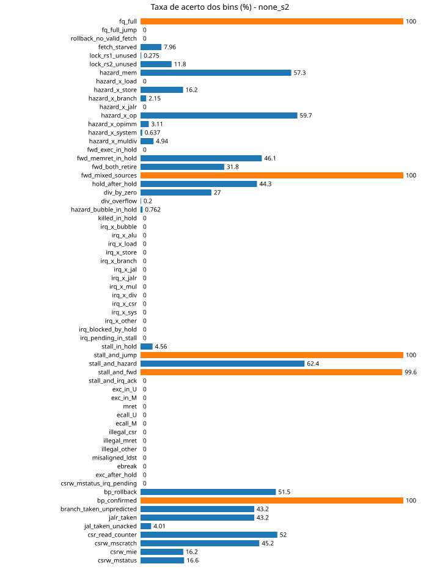

### none_s3

Resumo: 0%: 31, 1-90%: 22, <1%: 4, >90%: 5, impossível: 2

| # | bin | acerto | classe |
|---|---|---|---|
| 0 | fq_full | 100.0% | >90% |
| 1 | fq_full_jump | 0.0% | 0% |
| 2 | rollback_no_valid_fetch | 0.0% | 0% |
| 3 | fetch_starved | 7.9% | 1-90% |
| 4 | lock_rs1_unused | 0.2% | <1% |
| 5 | lock_rs2_unused | 12.5% | 1-90% |
| 6 | hazard_mem | 57.3% | 1-90% |
| 7 | hazard_x_load | 0.0% | 0% |
| 8 | hazard_x_store | 16.6% | 1-90% |
| 9 | hazard_x_branch | 2.2% | 1-90% |
| 10 | hazard_x_jalr | 0.0% | 0% |
| 11 | hazard_x_op | 60.1% | 1-90% |
| 12 | hazard_x_opimm | 3.4% | 1-90% |
| 13 | hazard_x_system | 0.7% | <1% |
| 14 | hazard_x_muldiv | 5.0% | 1-90% |
| 15 | fwd_exec_in_hold | 0.0% | 0% |
| 16 | fwd_memret_in_hold | 47.2% | 1-90% |
| 17 | fwd_both_retire | 31.1% | 1-90% |
| 18 | fwd_mixed_sources | 100.0% | >90% |
| 19 | hold_after_hold | 45.6% | 1-90% |
| 20 | div_by_zero | 27.0% | 1-90% |
| 21 | div_overflow | 0.1% | <1% |
| 22 | hazard_bubble_in_hold | 0.9% | <1% |
| 23 | killed_in_hold | 0.0% | impossível |
| 24 | irq_x_bubble | 0.0% | 0% |
| 25 | irq_x_alu | 0.0% | 0% |
| 26 | irq_x_load | 0.0% | 0% |
| 27 | irq_x_store | 0.0% | 0% |
| 28 | irq_x_branch | 0.0% | 0% |
| 29 | irq_x_jal | 0.0% | 0% |
| 30 | irq_x_jalr | 0.0% | 0% |
| 31 | irq_x_mul | 0.0% | 0% |
| 32 | irq_x_div | 0.0% | 0% |
| 33 | irq_x_csr | 0.0% | 0% |
| 34 | irq_x_sys | 0.0% | 0% |
| 35 | irq_x_other | 0.0% | 0% |
| 36 | irq_blocked_by_hold | 0.0% | 0% |
| 37 | irq_pending_in_stall | 0.0% | 0% |
| 38 | stall_in_hold | 4.9% | 1-90% |
| 39 | stall_and_jump | 100.0% | >90% |
| 40 | stall_and_hazard | 62.4% | 1-90% |
| 41 | stall_and_fwd | 99.5% | >90% |
| 42 | stall_and_irq_ack | 0.0% | impossível |
| 43 | exc_in_U | 0.0% | 0% |
| 44 | exc_in_M | 0.0% | 0% |
| 45 | mret | 0.0% | 0% |
| 46 | ecall_U | 0.0% | 0% |
| 47 | ecall_M | 0.0% | 0% |
| 48 | illegal_csr | 0.0% | 0% |
| 49 | illegal_mret | 0.0% | 0% |
| 50 | illegal_other | 0.0% | 0% |
| 51 | misaligned_ldst | 0.0% | 0% |
| 52 | ebreak | 0.0% | 0% |
| 53 | exc_after_hold | 0.0% | 0% |
| 54 | csrw_mstatus_irq_pending | 0.0% | 0% |
| 55 | bp_rollback | 50.5% | 1-90% |
| 56 | bp_confirmed | 100.0% | >90% |
| 57 | branch_taken_unpredicted | 44.1% | 1-90% |
| 58 | jalr_taken | 43.8% | 1-90% |
| 59 | jal_taken_unacked | 4.0% | 1-90% |
| 60 | csr_read_counter | 52.1% | 1-90% |
| 61 | csrw_mscratch | 45.5% | 1-90% |
| 62 | csrw_mie | 15.8% | 1-90% |
| 63 | csrw_mstatus | 16.2% | 1-90% |

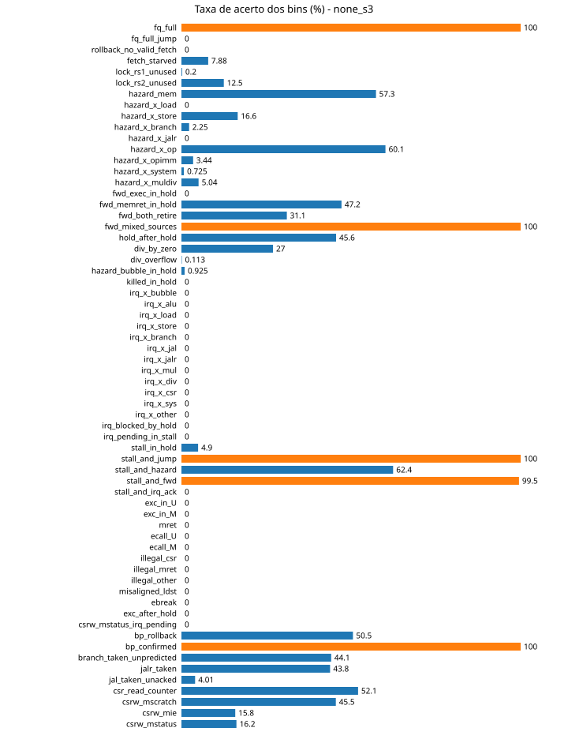

### rand_s1

Resumo: 0%: 31, 1-90%: 23, <1%: 3, >90%: 5, impossível: 2

| # | bin | acerto | classe |
|---|---|---|---|
| 0 | fq_full | 100.0% | >90% |
| 1 | fq_full_jump | 0.0% | 0% |
| 2 | rollback_no_valid_fetch | 0.0% | 0% |
| 3 | fetch_starved | 10.4% | 1-90% |
| 4 | lock_rs1_unused | 0.3% | <1% |
| 5 | lock_rs2_unused | 8.0% | 1-90% |
| 6 | hazard_mem | 56.8% | 1-90% |
| 7 | hazard_x_load | 0.0% | 0% |
| 8 | hazard_x_store | 21.3% | 1-90% |
| 9 | hazard_x_branch | 2.3% | 1-90% |
| 10 | hazard_x_jalr | 0.0% | 0% |
| 11 | hazard_x_op | 63.1% | 1-90% |
| 12 | hazard_x_opimm | 2.3% | 1-90% |
| 13 | hazard_x_system | 1.6% | 1-90% |
| 14 | hazard_x_muldiv | 3.4% | 1-90% |
| 15 | fwd_exec_in_hold | 0.0% | 0% |
| 16 | fwd_memret_in_hold | 49.0% | 1-90% |
| 17 | fwd_both_retire | 30.5% | 1-90% |
| 18 | fwd_mixed_sources | 100.0% | >90% |
| 19 | hold_after_hold | 44.2% | 1-90% |
| 20 | div_by_zero | 27.7% | 1-90% |
| 21 | div_overflow | 0.1% | <1% |
| 22 | hazard_bubble_in_hold | 1.0% | <1% |
| 23 | killed_in_hold | 0.0% | impossível |
| 24 | irq_x_bubble | 0.0% | 0% |
| 25 | irq_x_alu | 0.0% | 0% |
| 26 | irq_x_load | 0.0% | 0% |
| 27 | irq_x_store | 0.0% | 0% |
| 28 | irq_x_branch | 0.0% | 0% |
| 29 | irq_x_jal | 0.0% | 0% |
| 30 | irq_x_jalr | 0.0% | 0% |
| 31 | irq_x_mul | 0.0% | 0% |
| 32 | irq_x_div | 0.0% | 0% |
| 33 | irq_x_csr | 0.0% | 0% |
| 34 | irq_x_sys | 0.0% | 0% |
| 35 | irq_x_other | 0.0% | 0% |
| 36 | irq_blocked_by_hold | 0.0% | 0% |
| 37 | irq_pending_in_stall | 0.0% | 0% |
| 38 | stall_in_hold | 3.5% | 1-90% |
| 39 | stall_and_jump | 100.0% | >90% |
| 40 | stall_and_hazard | 66.9% | 1-90% |
| 41 | stall_and_fwd | 99.4% | >90% |
| 42 | stall_and_irq_ack | 0.0% | impossível |
| 43 | exc_in_U | 0.0% | 0% |
| 44 | exc_in_M | 0.0% | 0% |
| 45 | mret | 0.0% | 0% |
| 46 | ecall_U | 0.0% | 0% |
| 47 | ecall_M | 0.0% | 0% |
| 48 | illegal_csr | 0.0% | 0% |
| 49 | illegal_mret | 0.0% | 0% |
| 50 | illegal_other | 0.0% | 0% |
| 51 | misaligned_ldst | 0.0% | 0% |
| 52 | ebreak | 0.0% | 0% |
| 53 | exc_after_hold | 0.0% | 0% |
| 54 | csrw_mstatus_irq_pending | 0.0% | 0% |
| 55 | bp_rollback | 54.6% | 1-90% |
| 56 | bp_confirmed | 100.0% | >90% |
| 57 | branch_taken_unpredicted | 48.4% | 1-90% |
| 58 | jalr_taken | 40.0% | 1-90% |
| 59 | jal_taken_unacked | 5.4% | 1-90% |
| 60 | csr_read_counter | 58.4% | 1-90% |
| 61 | csrw_mscratch | 51.5% | 1-90% |
| 62 | csrw_mie | 19.9% | 1-90% |
| 63 | csrw_mstatus | 17.9% | 1-90% |

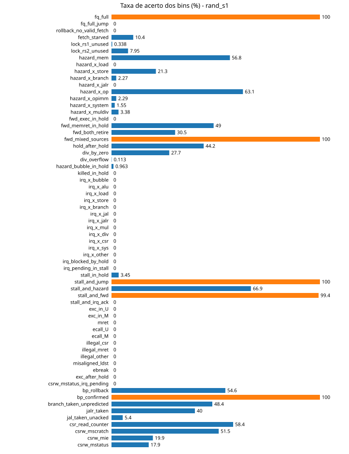

### rand_s2

Resumo: 0%: 31, 1-90%: 22, <1%: 4, >90%: 5, impossível: 2

| # | bin | acerto | classe |
|---|---|---|---|
| 0 | fq_full | 100.0% | >90% |
| 1 | fq_full_jump | 0.0% | 0% |
| 2 | rollback_no_valid_fetch | 0.0% | 0% |
| 3 | fetch_starved | 6.2% | 1-90% |
| 4 | lock_rs1_unused | 0.2% | <1% |
| 5 | lock_rs2_unused | 9.0% | 1-90% |
| 6 | hazard_mem | 56.0% | 1-90% |
| 7 | hazard_x_load | 0.0% | 0% |
| 8 | hazard_x_store | 14.2% | 1-90% |
| 9 | hazard_x_branch | 2.6% | 1-90% |
| 10 | hazard_x_jalr | 0.0% | 0% |
| 11 | hazard_x_op | 57.0% | 1-90% |
| 12 | hazard_x_opimm | 3.5% | 1-90% |
| 13 | hazard_x_system | 0.6% | <1% |
| 14 | hazard_x_muldiv | 5.8% | 1-90% |
| 15 | fwd_exec_in_hold | 0.0% | 0% |
| 16 | fwd_memret_in_hold | 45.8% | 1-90% |
| 17 | fwd_both_retire | 33.1% | 1-90% |
| 18 | fwd_mixed_sources | 100.0% | >90% |
| 19 | hold_after_hold | 48.1% | 1-90% |
| 20 | div_by_zero | 25.9% | 1-90% |
| 21 | div_overflow | 0.4% | <1% |
| 22 | hazard_bubble_in_hold | 0.7% | <1% |
| 23 | killed_in_hold | 0.0% | impossível |
| 24 | irq_x_bubble | 0.0% | 0% |
| 25 | irq_x_alu | 0.0% | 0% |
| 26 | irq_x_load | 0.0% | 0% |
| 27 | irq_x_store | 0.0% | 0% |
| 28 | irq_x_branch | 0.0% | 0% |
| 29 | irq_x_jal | 0.0% | 0% |
| 30 | irq_x_jalr | 0.0% | 0% |
| 31 | irq_x_mul | 0.0% | 0% |
| 32 | irq_x_div | 0.0% | 0% |
| 33 | irq_x_csr | 0.0% | 0% |
| 34 | irq_x_sys | 0.0% | 0% |
| 35 | irq_x_other | 0.0% | 0% |
| 36 | irq_blocked_by_hold | 0.0% | 0% |
| 37 | irq_pending_in_stall | 0.0% | 0% |
| 38 | stall_in_hold | 4.8% | 1-90% |
| 39 | stall_and_jump | 100.0% | >90% |
| 40 | stall_and_hazard | 60.4% | 1-90% |
| 41 | stall_and_fwd | 99.6% | >90% |
| 42 | stall_and_irq_ack | 0.0% | impossível |
| 43 | exc_in_U | 0.0% | 0% |
| 44 | exc_in_M | 0.0% | 0% |
| 45 | mret | 0.0% | 0% |
| 46 | ecall_U | 0.0% | 0% |
| 47 | ecall_M | 0.0% | 0% |
| 48 | illegal_csr | 0.0% | 0% |
| 49 | illegal_mret | 0.0% | 0% |
| 50 | illegal_other | 0.0% | 0% |
| 51 | misaligned_ldst | 0.0% | 0% |
| 52 | ebreak | 0.0% | 0% |
| 53 | exc_after_hold | 0.0% | 0% |
| 54 | csrw_mstatus_irq_pending | 0.0% | 0% |
| 55 | bp_rollback | 48.3% | 1-90% |
| 56 | bp_confirmed | 100.0% | >90% |
| 57 | branch_taken_unpredicted | 42.8% | 1-90% |
| 58 | jalr_taken | 48.1% | 1-90% |
| 59 | jal_taken_unacked | 2.6% | 1-90% |
| 60 | csr_read_counter | 49.7% | 1-90% |
| 61 | csrw_mscratch | 42.2% | 1-90% |
| 62 | csrw_mie | 17.1% | 1-90% |
| 63 | csrw_mstatus | 18.3% | 1-90% |

### rand_s3

Resumo: 0%: 31, 1-90%: 23, <1%: 3, >90%: 5, impossível: 2

| # | bin | acerto | classe |
|---|---|---|---|
| 0 | fq_full | 100.0% | >90% |
| 1 | fq_full_jump | 0.0% | 0% |
| 2 | rollback_no_valid_fetch | 0.0% | 0% |
| 3 | fetch_starved | 8.8% | 1-90% |
| 4 | lock_rs1_unused | 0.1% | <1% |
| 5 | lock_rs2_unused | 12.9% | 1-90% |
| 6 | hazard_mem | 55.5% | 1-90% |
| 7 | hazard_x_load | 0.0% | 0% |
| 8 | hazard_x_store | 14.3% | 1-90% |
| 9 | hazard_x_branch | 4.1% | 1-90% |
| 10 | hazard_x_jalr | 0.0% | 0% |
| 11 | hazard_x_op | 59.0% | 1-90% |
| 12 | hazard_x_opimm | 4.0% | 1-90% |
| 13 | hazard_x_system | 1.1% | 1-90% |
| 14 | hazard_x_muldiv | 3.5% | 1-90% |
| 15 | fwd_exec_in_hold | 0.0% | 0% |
| 16 | fwd_memret_in_hold | 45.0% | 1-90% |
| 17 | fwd_both_retire | 28.6% | 1-90% |
| 18 | fwd_mixed_sources | 100.0% | >90% |
| 19 | hold_after_hold | 43.2% | 1-90% |
| 20 | div_by_zero | 22.6% | 1-90% |
| 21 | div_overflow | 0.1% | <1% |
| 22 | hazard_bubble_in_hold | 0.6% | <1% |
| 23 | killed_in_hold | 0.0% | impossível |
| 24 | irq_x_bubble | 0.0% | 0% |
| 25 | irq_x_alu | 0.0% | 0% |
| 26 | irq_x_load | 0.0% | 0% |
| 27 | irq_x_store | 0.0% | 0% |
| 28 | irq_x_branch | 0.0% | 0% |
| 29 | irq_x_jal | 0.0% | 0% |
| 30 | irq_x_jalr | 0.0% | 0% |
| 31 | irq_x_mul | 0.0% | 0% |
| 32 | irq_x_div | 0.0% | 0% |
| 33 | irq_x_csr | 0.0% | 0% |
| 34 | irq_x_sys | 0.0% | 0% |
| 35 | irq_x_other | 0.0% | 0% |
| 36 | irq_blocked_by_hold | 0.0% | 0% |
| 37 | irq_pending_in_stall | 0.0% | 0% |
| 38 | stall_in_hold | 4.0% | 1-90% |
| 39 | stall_and_jump | 100.0% | >90% |
| 40 | stall_and_hazard | 58.8% | 1-90% |
| 41 | stall_and_fwd | 99.8% | >90% |
| 42 | stall_and_irq_ack | 0.0% | impossível |
| 43 | exc_in_U | 0.0% | 0% |
| 44 | exc_in_M | 0.0% | 0% |
| 45 | mret | 0.0% | 0% |
| 46 | ecall_U | 0.0% | 0% |
| 47 | ecall_M | 0.0% | 0% |
| 48 | illegal_csr | 0.0% | 0% |
| 49 | illegal_mret | 0.0% | 0% |
| 50 | illegal_other | 0.0% | 0% |
| 51 | misaligned_ldst | 0.0% | 0% |
| 52 | ebreak | 0.0% | 0% |
| 53 | exc_after_hold | 0.0% | 0% |
| 54 | csrw_mstatus_irq_pending | 0.0% | 0% |
| 55 | bp_rollback | 53.3% | 1-90% |
| 56 | bp_confirmed | 100.0% | >90% |
| 57 | branch_taken_unpredicted | 35.6% | 1-90% |
| 58 | jalr_taken | 45.1% | 1-90% |
| 59 | jal_taken_unacked | 6.2% | 1-90% |
| 60 | csr_read_counter | 53.7% | 1-90% |
| 61 | csrw_mscratch | 47.0% | 1-90% |
| 62 | csrw_mie | 18.4% | 1-90% |
| 63 | csrw_mstatus | 19.2% | 1-90% |

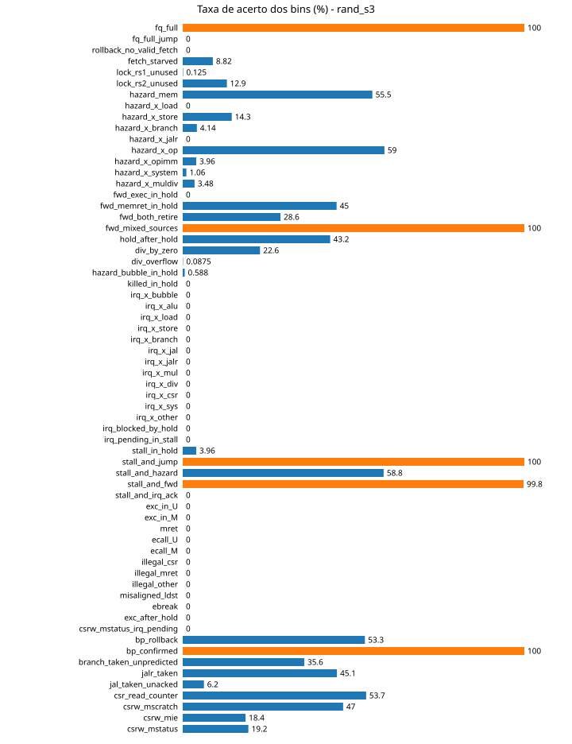

### pipe_s1

Resumo: 0%: 31, 1-90%: 24, <1%: 2, >90%: 5, impossível: 2

| # | bin | acerto | classe |
|---|---|---|---|
| 0 | fq_full | 100.0% | >90% |
| 1 | fq_full_jump | 0.0% | 0% |
| 2 | rollback_no_valid_fetch | 0.0% | 0% |
| 3 | fetch_starved | 8.5% | 1-90% |
| 4 | lock_rs1_unused | 0.1% | <1% |
| 5 | lock_rs2_unused | 11.1% | 1-90% |
| 6 | hazard_mem | 66.0% | 1-90% |
| 7 | hazard_x_load | 0.0% | 0% |
| 8 | hazard_x_store | 26.2% | 1-90% |
| 9 | hazard_x_branch | 2.4% | 1-90% |
| 10 | hazard_x_jalr | 0.0% | 0% |
| 11 | hazard_x_op | 69.9% | 1-90% |
| 12 | hazard_x_opimm | 3.2% | 1-90% |
| 13 | hazard_x_system | 1.5% | 1-90% |
| 14 | hazard_x_muldiv | 4.4% | 1-90% |
| 15 | fwd_exec_in_hold | 0.0% | 0% |
| 16 | fwd_memret_in_hold | 57.4% | 1-90% |
| 17 | fwd_both_retire | 39.3% | 1-90% |
| 18 | fwd_mixed_sources | 100.0% | >90% |
| 19 | hold_after_hold | 51.3% | 1-90% |
| 20 | div_by_zero | 32.5% | 1-90% |
| 21 | div_overflow | 0.2% | <1% |
| 22 | hazard_bubble_in_hold | 1.6% | 1-90% |
| 23 | killed_in_hold | 0.0% | impossível |
| 24 | irq_x_bubble | 0.0% | 0% |
| 25 | irq_x_alu | 0.0% | 0% |
| 26 | irq_x_load | 0.0% | 0% |
| 27 | irq_x_store | 0.0% | 0% |
| 28 | irq_x_branch | 0.0% | 0% |
| 29 | irq_x_jal | 0.0% | 0% |
| 30 | irq_x_jalr | 0.0% | 0% |
| 31 | irq_x_mul | 0.0% | 0% |
| 32 | irq_x_div | 0.0% | 0% |
| 33 | irq_x_csr | 0.0% | 0% |
| 34 | irq_x_sys | 0.0% | 0% |
| 35 | irq_x_other | 0.0% | 0% |
| 36 | irq_blocked_by_hold | 0.0% | 0% |
| 37 | irq_pending_in_stall | 0.0% | 0% |
| 38 | stall_in_hold | 6.4% | 1-90% |
| 39 | stall_and_jump | 100.0% | >90% |
| 40 | stall_and_hazard | 71.4% | 1-90% |
| 41 | stall_and_fwd | 99.3% | >90% |
| 42 | stall_and_irq_ack | 0.0% | impossível |
| 43 | exc_in_U | 0.0% | 0% |
| 44 | exc_in_M | 0.0% | 0% |
| 45 | mret | 0.0% | 0% |
| 46 | ecall_U | 0.0% | 0% |
| 47 | ecall_M | 0.0% | 0% |
| 48 | illegal_csr | 0.0% | 0% |
| 49 | illegal_mret | 0.0% | 0% |
| 50 | illegal_other | 0.0% | 0% |
| 51 | misaligned_ldst | 0.0% | 0% |
| 52 | ebreak | 0.0% | 0% |
| 53 | exc_after_hold | 0.0% | 0% |
| 54 | csrw_mstatus_irq_pending | 0.0% | 0% |
| 55 | bp_rollback | 62.0% | 1-90% |
| 56 | bp_confirmed | 100.0% | >90% |
| 57 | branch_taken_unpredicted | 47.6% | 1-90% |
| 58 | jalr_taken | 36.3% | 1-90% |
| 59 | jal_taken_unacked | 4.2% | 1-90% |
| 60 | csr_read_counter | 54.1% | 1-90% |
| 61 | csrw_mscratch | 48.7% | 1-90% |
| 62 | csrw_mie | 19.9% | 1-90% |
| 63 | csrw_mstatus | 18.2% | 1-90% |

### pipe_s2

Resumo: 0%: 31, 1-90%: 23, <1%: 3, >90%: 5, impossível: 2

| # | bin | acerto | classe |
|---|---|---|---|
| 0 | fq_full | 100.0% | >90% |
| 1 | fq_full_jump | 0.0% | 0% |
| 2 | rollback_no_valid_fetch | 0.0% | 0% |
| 3 | fetch_starved | 11.4% | 1-90% |
| 4 | lock_rs1_unused | 0.2% | <1% |
| 5 | lock_rs2_unused | 9.0% | 1-90% |
| 6 | hazard_mem | 63.1% | 1-90% |
| 7 | hazard_x_load | 0.0% | 0% |
| 8 | hazard_x_store | 20.6% | 1-90% |
| 9 | hazard_x_branch | 4.2% | 1-90% |
| 10 | hazard_x_jalr | 0.0% | 0% |
| 11 | hazard_x_op | 66.2% | 1-90% |
| 12 | hazard_x_opimm | 4.9% | 1-90% |
| 13 | hazard_x_system | 0.7% | <1% |
| 14 | hazard_x_muldiv | 5.8% | 1-90% |
| 15 | fwd_exec_in_hold | 0.0% | 0% |
| 16 | fwd_memret_in_hold | 49.2% | 1-90% |
| 17 | fwd_both_retire | 40.1% | 1-90% |
| 18 | fwd_mixed_sources | 100.0% | >90% |
| 19 | hold_after_hold | 56.0% | 1-90% |
| 20 | div_by_zero | 30.9% | 1-90% |
| 21 | div_overflow | 0.3% | <1% |
| 22 | hazard_bubble_in_hold | 1.4% | 1-90% |
| 23 | killed_in_hold | 0.0% | impossível |
| 24 | irq_x_bubble | 0.0% | 0% |
| 25 | irq_x_alu | 0.0% | 0% |
| 26 | irq_x_load | 0.0% | 0% |
| 27 | irq_x_store | 0.0% | 0% |
| 28 | irq_x_branch | 0.0% | 0% |
| 29 | irq_x_jal | 0.0% | 0% |
| 30 | irq_x_jalr | 0.0% | 0% |
| 31 | irq_x_mul | 0.0% | 0% |
| 32 | irq_x_div | 0.0% | 0% |
| 33 | irq_x_csr | 0.0% | 0% |
| 34 | irq_x_sys | 0.0% | 0% |
| 35 | irq_x_other | 0.0% | 0% |
| 36 | irq_blocked_by_hold | 0.0% | 0% |
| 37 | irq_pending_in_stall | 0.0% | 0% |
| 38 | stall_in_hold | 6.7% | 1-90% |
| 39 | stall_and_jump | 100.0% | >90% |
| 40 | stall_and_hazard | 69.3% | 1-90% |
| 41 | stall_and_fwd | 99.5% | >90% |
| 42 | stall_and_irq_ack | 0.0% | impossível |
| 43 | exc_in_U | 0.0% | 0% |
| 44 | exc_in_M | 0.0% | 0% |
| 45 | mret | 0.0% | 0% |
| 46 | ecall_U | 0.0% | 0% |
| 47 | ecall_M | 0.0% | 0% |
| 48 | illegal_csr | 0.0% | 0% |
| 49 | illegal_mret | 0.0% | 0% |
| 50 | illegal_other | 0.0% | 0% |
| 51 | misaligned_ldst | 0.0% | 0% |
| 52 | ebreak | 0.0% | 0% |
| 53 | exc_after_hold | 0.0% | 0% |
| 54 | csrw_mstatus_irq_pending | 0.0% | 0% |
| 55 | bp_rollback | 61.2% | 1-90% |
| 56 | bp_confirmed | 100.0% | >90% |
| 57 | branch_taken_unpredicted | 46.9% | 1-90% |
| 58 | jalr_taken | 45.2% | 1-90% |
| 59 | jal_taken_unacked | 4.3% | 1-90% |
| 60 | csr_read_counter | 54.8% | 1-90% |
| 61 | csrw_mscratch | 46.8% | 1-90% |
| 62 | csrw_mie | 16.8% | 1-90% |
| 63 | csrw_mstatus | 17.8% | 1-90% |

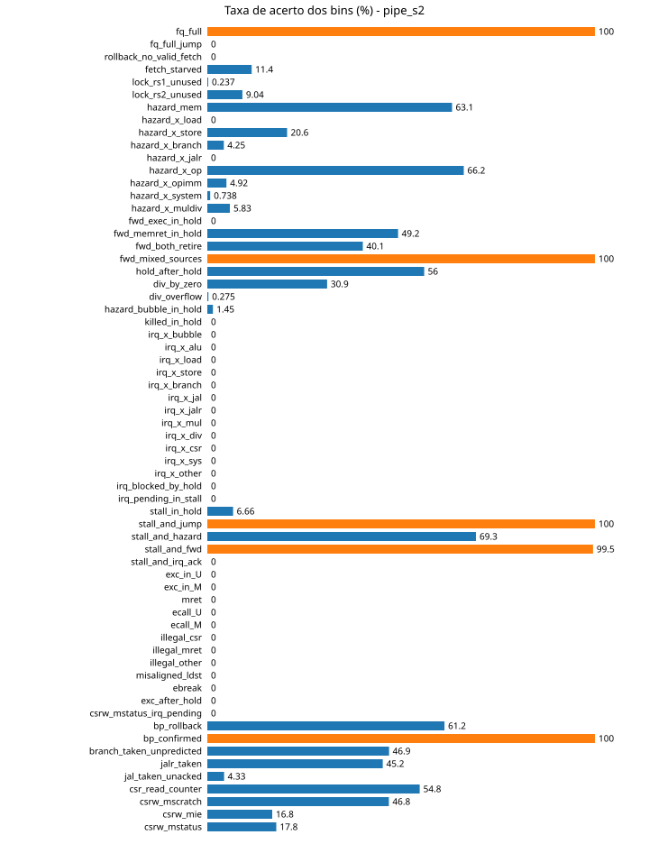

### pipe_s3

Resumo: 0%: 31, 1-90%: 24, <1%: 2, >90%: 5, impossível: 2

| # | bin | acerto | classe |
|---|---|---|---|
| 0 | fq_full | 100.0% | >90% |
| 1 | fq_full_jump | 0.0% | 0% |
| 2 | rollback_no_valid_fetch | 0.0% | 0% |
| 3 | fetch_starved | 13.3% | 1-90% |
| 4 | lock_rs1_unused | 0.1% | <1% |
| 5 | lock_rs2_unused | 14.5% | 1-90% |
| 6 | hazard_mem | 62.6% | 1-90% |
| 7 | hazard_x_load | 0.0% | 0% |
| 8 | hazard_x_store | 19.6% | 1-90% |
| 9 | hazard_x_branch | 2.9% | 1-90% |
| 10 | hazard_x_jalr | 0.0% | 0% |
| 11 | hazard_x_op | 62.6% | 1-90% |
| 12 | hazard_x_opimm | 5.2% | 1-90% |
| 13 | hazard_x_system | 2.2% | 1-90% |
| 14 | hazard_x_muldiv | 5.7% | 1-90% |
| 15 | fwd_exec_in_hold | 0.0% | 0% |
| 16 | fwd_memret_in_hold | 59.9% | 1-90% |
| 17 | fwd_both_retire | 37.0% | 1-90% |
| 18 | fwd_mixed_sources | 100.0% | >90% |
| 19 | hold_after_hold | 50.6% | 1-90% |
| 20 | div_by_zero | 29.7% | 1-90% |
| 21 | div_overflow | 0.1% | <1% |
| 22 | hazard_bubble_in_hold | 1.6% | 1-90% |
| 23 | killed_in_hold | 0.0% | impossível |
| 24 | irq_x_bubble | 0.0% | 0% |
| 25 | irq_x_alu | 0.0% | 0% |
| 26 | irq_x_load | 0.0% | 0% |
| 27 | irq_x_store | 0.0% | 0% |
| 28 | irq_x_branch | 0.0% | 0% |
| 29 | irq_x_jal | 0.0% | 0% |
| 30 | irq_x_jalr | 0.0% | 0% |
| 31 | irq_x_mul | 0.0% | 0% |
| 32 | irq_x_div | 0.0% | 0% |
| 33 | irq_x_csr | 0.0% | 0% |
| 34 | irq_x_sys | 0.0% | 0% |
| 35 | irq_x_other | 0.0% | 0% |
| 36 | irq_blocked_by_hold | 0.0% | 0% |
| 37 | irq_pending_in_stall | 0.0% | 0% |
| 38 | stall_in_hold | 6.9% | 1-90% |
| 39 | stall_and_jump | 100.0% | >90% |
| 40 | stall_and_hazard | 65.4% | 1-90% |
| 41 | stall_and_fwd | 99.8% | >90% |
| 42 | stall_and_irq_ack | 0.0% | impossível |
| 43 | exc_in_U | 0.0% | 0% |
| 44 | exc_in_M | 0.0% | 0% |
| 45 | mret | 0.0% | 0% |
| 46 | ecall_U | 0.0% | 0% |
| 47 | ecall_M | 0.0% | 0% |
| 48 | illegal_csr | 0.0% | 0% |
| 49 | illegal_mret | 0.0% | 0% |
| 50 | illegal_other | 0.0% | 0% |
| 51 | misaligned_ldst | 0.0% | 0% |
| 52 | ebreak | 0.0% | 0% |
| 53 | exc_after_hold | 0.0% | 0% |
| 54 | csrw_mstatus_irq_pending | 0.0% | 0% |
| 55 | bp_rollback | 63.7% | 1-90% |
| 56 | bp_confirmed | 100.0% | >90% |
| 57 | branch_taken_unpredicted | 45.2% | 1-90% |
| 58 | jalr_taken | 41.4% | 1-90% |
| 59 | jal_taken_unacked | 7.5% | 1-90% |
| 60 | csr_read_counter | 59.1% | 1-90% |
| 61 | csrw_mscratch | 52.1% | 1-90% |
| 62 | csrw_mie | 17.0% | 1-90% |
| 63 | csrw_mstatus | 20.3% | 1-90% |

### pipe_mp05_s1

Resumo: 0%: 31, 1-90%: 24, <1%: 2, >90%: 5, impossível: 2

| # | bin | acerto | classe |
|---|---|---|---|
| 0 | fq_full | 100.0% | >90% |
| 1 | fq_full_jump | 0.0% | 0% |
| 2 | rollback_no_valid_fetch | 0.0% | 0% |
| 3 | fetch_starved | 9.4% | 1-90% |
| 4 | lock_rs1_unused | 0.3% | <1% |
| 5 | lock_rs2_unused | 11.8% | 1-90% |
| 6 | hazard_mem | 61.2% | 1-90% |
| 7 | hazard_x_load | 0.0% | 0% |
| 8 | hazard_x_store | 19.4% | 1-90% |
| 9 | hazard_x_branch | 2.0% | 1-90% |
| 10 | hazard_x_jalr | 0.0% | 0% |
| 11 | hazard_x_op | 64.1% | 1-90% |
| 12 | hazard_x_opimm | 3.1% | 1-90% |
| 13 | hazard_x_system | 1.3% | 1-90% |
| 14 | hazard_x_muldiv | 6.2% | 1-90% |
| 15 | fwd_exec_in_hold | 0.0% | 0% |
| 16 | fwd_memret_in_hold | 49.2% | 1-90% |
| 17 | fwd_both_retire | 35.0% | 1-90% |
| 18 | fwd_mixed_sources | 100.0% | >90% |
| 19 | hold_after_hold | 48.5% | 1-90% |
| 20 | div_by_zero | 28.8% | 1-90% |
| 21 | div_overflow | 0.2% | <1% |
| 22 | hazard_bubble_in_hold | 1.2% | 1-90% |
| 23 | killed_in_hold | 0.0% | impossível |
| 24 | irq_x_bubble | 0.0% | 0% |
| 25 | irq_x_alu | 0.0% | 0% |
| 26 | irq_x_load | 0.0% | 0% |
| 27 | irq_x_store | 0.0% | 0% |
| 28 | irq_x_branch | 0.0% | 0% |
| 29 | irq_x_jal | 0.0% | 0% |
| 30 | irq_x_jalr | 0.0% | 0% |
| 31 | irq_x_mul | 0.0% | 0% |
| 32 | irq_x_div | 0.0% | 0% |
| 33 | irq_x_csr | 0.0% | 0% |
| 34 | irq_x_sys | 0.0% | 0% |
| 35 | irq_x_other | 0.0% | 0% |
| 36 | irq_blocked_by_hold | 0.0% | 0% |
| 37 | irq_pending_in_stall | 0.0% | 0% |
| 38 | stall_in_hold | 5.1% | 1-90% |
| 39 | stall_and_jump | 100.0% | >90% |
| 40 | stall_and_hazard | 67.1% | 1-90% |
| 41 | stall_and_fwd | 99.6% | >90% |
| 42 | stall_and_irq_ack | 0.0% | impossível |
| 43 | exc_in_U | 0.0% | 0% |
| 44 | exc_in_M | 0.0% | 0% |
| 45 | mret | 0.0% | 0% |
| 46 | ecall_U | 0.0% | 0% |
| 47 | ecall_M | 0.0% | 0% |
| 48 | illegal_csr | 0.0% | 0% |
| 49 | illegal_mret | 0.0% | 0% |
| 50 | illegal_other | 0.0% | 0% |
| 51 | misaligned_ldst | 0.0% | 0% |
| 52 | ebreak | 0.0% | 0% |
| 53 | exc_after_hold | 0.0% | 0% |
| 54 | csrw_mstatus_irq_pending | 0.0% | 0% |
| 55 | bp_rollback | 57.6% | 1-90% |
| 56 | bp_confirmed | 100.0% | >90% |
| 57 | branch_taken_unpredicted | 45.3% | 1-90% |
| 58 | jalr_taken | 39.5% | 1-90% |
| 59 | jal_taken_unacked | 4.8% | 1-90% |
| 60 | csr_read_counter | 54.8% | 1-90% |
| 61 | csrw_mscratch | 48.8% | 1-90% |
| 62 | csrw_mie | 17.5% | 1-90% |
| 63 | csrw_mstatus | 17.7% | 1-90% |

### pipe_mp02_s1

Resumo: 0%: 31, 1-90%: 23, <1%: 3, >90%: 5, impossível: 2

| # | bin | acerto | classe |
|---|---|---|---|
| 0 | fq_full | 100.0% | >90% |
| 1 | fq_full_jump | 0.0% | 0% |
| 2 | rollback_no_valid_fetch | 0.0% | 0% |
| 3 | fetch_starved | 8.3% | 1-90% |
| 4 | lock_rs1_unused | 0.3% | <1% |
| 5 | lock_rs2_unused | 11.8% | 1-90% |
| 6 | hazard_mem | 57.8% | 1-90% |
| 7 | hazard_x_load | 0.0% | 0% |
| 8 | hazard_x_store | 17.5% | 1-90% |
| 9 | hazard_x_branch | 2.1% | 1-90% |
| 10 | hazard_x_jalr | 0.0% | 0% |
| 11 | hazard_x_op | 61.5% | 1-90% |
| 12 | hazard_x_opimm | 3.3% | 1-90% |
| 13 | hazard_x_system | 0.8% | <1% |
| 14 | hazard_x_muldiv | 5.0% | 1-90% |
| 15 | fwd_exec_in_hold | 0.0% | 0% |
| 16 | fwd_memret_in_hold | 47.7% | 1-90% |
| 17 | fwd_both_retire | 32.4% | 1-90% |
| 18 | fwd_mixed_sources | 100.0% | >90% |
| 19 | hold_after_hold | 46.4% | 1-90% |
| 20 | div_by_zero | 27.2% | 1-90% |
| 21 | div_overflow | 0.2% | <1% |
| 22 | hazard_bubble_in_hold | 1.2% | 1-90% |
| 23 | killed_in_hold | 0.0% | impossível |
| 24 | irq_x_bubble | 0.0% | 0% |
| 25 | irq_x_alu | 0.0% | 0% |
| 26 | irq_x_load | 0.0% | 0% |
| 27 | irq_x_store | 0.0% | 0% |
| 28 | irq_x_branch | 0.0% | 0% |
| 29 | irq_x_jal | 0.0% | 0% |
| 30 | irq_x_jalr | 0.0% | 0% |
| 31 | irq_x_mul | 0.0% | 0% |
| 32 | irq_x_div | 0.0% | 0% |
| 33 | irq_x_csr | 0.0% | 0% |
| 34 | irq_x_sys | 0.0% | 0% |
| 35 | irq_x_other | 0.0% | 0% |
| 36 | irq_blocked_by_hold | 0.0% | 0% |
| 37 | irq_pending_in_stall | 0.0% | 0% |
| 38 | stall_in_hold | 4.8% | 1-90% |
| 39 | stall_and_jump | 100.0% | >90% |
| 40 | stall_and_hazard | 63.7% | 1-90% |
| 41 | stall_and_fwd | 99.5% | >90% |
| 42 | stall_and_irq_ack | 0.0% | impossível |
| 43 | exc_in_U | 0.0% | 0% |
| 44 | exc_in_M | 0.0% | 0% |
| 45 | mret | 0.0% | 0% |
| 46 | ecall_U | 0.0% | 0% |
| 47 | ecall_M | 0.0% | 0% |
| 48 | illegal_csr | 0.0% | 0% |
| 49 | illegal_mret | 0.0% | 0% |
| 50 | illegal_other | 0.0% | 0% |
| 51 | misaligned_ldst | 0.0% | 0% |
| 52 | ebreak | 0.0% | 0% |
| 53 | exc_after_hold | 0.0% | 0% |
| 54 | csrw_mstatus_irq_pending | 0.0% | 0% |
| 55 | bp_rollback | 53.3% | 1-90% |
| 56 | bp_confirmed | 100.0% | >90% |
| 57 | branch_taken_unpredicted | 43.6% | 1-90% |
| 58 | jalr_taken | 43.9% | 1-90% |
| 59 | jal_taken_unacked | 3.9% | 1-90% |
| 60 | csr_read_counter | 53.0% | 1-90% |
| 61 | csrw_mscratch | 46.9% | 1-90% |
| 62 | csrw_mie | 16.8% | 1-90% |
| 63 | csrw_mstatus | 17.3% | 1-90% |

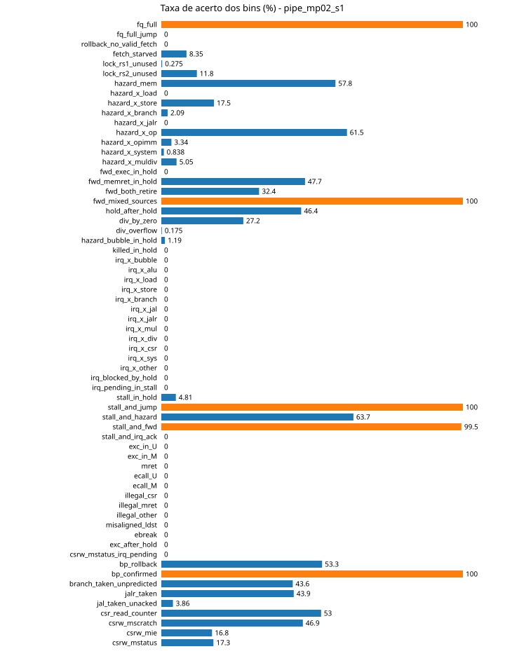

### pipe_pos_s1

Resumo: 0%: 31, 1-90%: 24, <1%: 2, >90%: 5, impossível: 2

| # | bin | acerto | classe |
|---|---|---|---|
| 0 | fq_full | 100.0% | >90% |
| 1 | fq_full_jump | 0.0% | 0% |
| 2 | rollback_no_valid_fetch | 0.0% | 0% |
| 3 | fetch_starved | 10.9% | 1-90% |
| 4 | lock_rs1_unused | 0.5% | <1% |
| 5 | lock_rs2_unused | 11.9% | 1-90% |
| 6 | hazard_mem | 65.8% | 1-90% |
| 7 | hazard_x_load | 0.0% | 0% |
| 8 | hazard_x_store | 21.6% | 1-90% |
| 9 | hazard_x_branch | 1.7% | 1-90% |
| 10 | hazard_x_jalr | 0.0% | 0% |
| 11 | hazard_x_op | 67.8% | 1-90% |
| 12 | hazard_x_opimm | 3.2% | 1-90% |
| 13 | hazard_x_system | 2.4% | 1-90% |
| 14 | hazard_x_muldiv | 5.7% | 1-90% |
| 15 | fwd_exec_in_hold | 0.0% | 0% |
| 16 | fwd_memret_in_hold | 56.6% | 1-90% |
| 17 | fwd_both_retire | 37.7% | 1-90% |
| 18 | fwd_mixed_sources | 100.0% | >90% |
| 19 | hold_after_hold | 50.4% | 1-90% |
| 20 | div_by_zero | 31.7% | 1-90% |
| 21 | div_overflow | 0.2% | <1% |
| 22 | hazard_bubble_in_hold | 1.2% | 1-90% |
| 23 | killed_in_hold | 0.0% | impossível |
| 24 | irq_x_bubble | 0.0% | 0% |
| 25 | irq_x_alu | 0.0% | 0% |
| 26 | irq_x_load | 0.0% | 0% |
| 27 | irq_x_store | 0.0% | 0% |
| 28 | irq_x_branch | 0.0% | 0% |
| 29 | irq_x_jal | 0.0% | 0% |
| 30 | irq_x_jalr | 0.0% | 0% |
| 31 | irq_x_mul | 0.0% | 0% |
| 32 | irq_x_div | 0.0% | 0% |
| 33 | irq_x_csr | 0.0% | 0% |
| 34 | irq_x_sys | 0.0% | 0% |
| 35 | irq_x_other | 0.0% | 0% |
| 36 | irq_blocked_by_hold | 0.0% | 0% |
| 37 | irq_pending_in_stall | 0.0% | 0% |
| 38 | stall_in_hold | 6.2% | 1-90% |
| 39 | stall_and_jump | 100.0% | >90% |
| 40 | stall_and_hazard | 71.5% | 1-90% |
| 41 | stall_and_fwd | 99.6% | >90% |
| 42 | stall_and_irq_ack | 0.0% | impossível |
| 43 | exc_in_U | 0.0% | 0% |
| 44 | exc_in_M | 0.0% | 0% |
| 45 | mret | 0.0% | 0% |
| 46 | ecall_U | 0.0% | 0% |
| 47 | ecall_M | 0.0% | 0% |
| 48 | illegal_csr | 0.0% | 0% |
| 49 | illegal_mret | 0.0% | 0% |
| 50 | illegal_other | 0.0% | 0% |
| 51 | misaligned_ldst | 0.0% | 0% |
| 52 | ebreak | 0.0% | 0% |
| 53 | exc_after_hold | 0.0% | 0% |
| 54 | csrw_mstatus_irq_pending | 0.0% | 0% |
| 55 | bp_rollback | 60.0% | 1-90% |
| 56 | bp_confirmed | 100.0% | >90% |
| 57 | branch_taken_unpredicted | 50.6% | 1-90% |
| 58 | jalr_taken | 36.1% | 1-90% |
| 59 | jal_taken_unacked | 5.0% | 1-90% |
| 60 | csr_read_counter | 57.8% | 1-90% |
| 61 | csrw_mscratch | 50.0% | 1-90% |
| 62 | csrw_mie | 21.0% | 1-90% |
| 63 | csrw_mstatus | 19.6% | 1-90% |

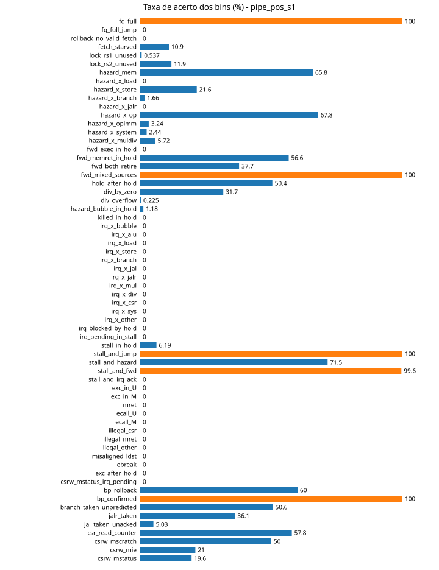

### coarse_s1

Resumo: 0%: 31, 1-90%: 24, <1%: 2, >90%: 5, impossível: 2

| # | bin | acerto | classe |
|---|---|---|---|
| 0 | fq_full | 100.0% | >90% |
| 1 | fq_full_jump | 0.0% | 0% |
| 2 | rollback_no_valid_fetch | 0.0% | 0% |
| 3 | fetch_starved | 8.9% | 1-90% |
| 4 | lock_rs1_unused | 0.1% | <1% |
| 5 | lock_rs2_unused | 9.8% | 1-90% |
| 6 | hazard_mem | 66.6% | 1-90% |
| 7 | hazard_x_load | 0.0% | 0% |
| 8 | hazard_x_store | 26.4% | 1-90% |
| 9 | hazard_x_branch | 2.2% | 1-90% |
| 10 | hazard_x_jalr | 0.0% | 0% |
| 11 | hazard_x_op | 72.9% | 1-90% |
| 12 | hazard_x_opimm | 2.1% | 1-90% |
| 13 | hazard_x_system | 1.4% | 1-90% |
| 14 | hazard_x_muldiv | 5.3% | 1-90% |
| 15 | fwd_exec_in_hold | 0.0% | 0% |
| 16 | fwd_memret_in_hold | 53.9% | 1-90% |
| 17 | fwd_both_retire | 27.0% | 1-90% |
| 18 | fwd_mixed_sources | 100.0% | >90% |
| 19 | hold_after_hold | 49.1% | 1-90% |
| 20 | div_by_zero | 29.4% | 1-90% |
| 21 | div_overflow | 0.1% | <1% |
| 22 | hazard_bubble_in_hold | 2.4% | 1-90% |
| 23 | killed_in_hold | 0.0% | impossível |
| 24 | irq_x_bubble | 0.0% | 0% |
| 25 | irq_x_alu | 0.0% | 0% |
| 26 | irq_x_load | 0.0% | 0% |
| 27 | irq_x_store | 0.0% | 0% |
| 28 | irq_x_branch | 0.0% | 0% |
| 29 | irq_x_jal | 0.0% | 0% |
| 30 | irq_x_jalr | 0.0% | 0% |
| 31 | irq_x_mul | 0.0% | 0% |
| 32 | irq_x_div | 0.0% | 0% |
| 33 | irq_x_csr | 0.0% | 0% |
| 34 | irq_x_sys | 0.0% | 0% |
| 35 | irq_x_other | 0.0% | 0% |
| 36 | irq_blocked_by_hold | 0.0% | 0% |
| 37 | irq_pending_in_stall | 0.0% | 0% |
| 38 | stall_in_hold | 8.0% | 1-90% |
| 39 | stall_and_jump | 100.0% | >90% |
| 40 | stall_and_hazard | 75.7% | 1-90% |
| 41 | stall_and_fwd | 99.6% | >90% |
| 42 | stall_and_irq_ack | 0.0% | impossível |
| 43 | exc_in_U | 0.0% | 0% |
| 44 | exc_in_M | 0.0% | 0% |
| 45 | mret | 0.0% | 0% |
| 46 | ecall_U | 0.0% | 0% |
| 47 | ecall_M | 0.0% | 0% |
| 48 | illegal_csr | 0.0% | 0% |
| 49 | illegal_mret | 0.0% | 0% |
| 50 | illegal_other | 0.0% | 0% |
| 51 | misaligned_ldst | 0.0% | 0% |
| 52 | ebreak | 0.0% | 0% |
| 53 | exc_after_hold | 0.0% | 0% |
| 54 | csrw_mstatus_irq_pending | 0.0% | 0% |
| 55 | bp_rollback | 57.5% | 1-90% |
| 56 | bp_confirmed | 100.0% | >90% |
| 57 | branch_taken_unpredicted | 39.8% | 1-90% |
| 58 | jalr_taken | 43.3% | 1-90% |
| 59 | jal_taken_unacked | 4.5% | 1-90% |
| 60 | csr_read_counter | 60.2% | 1-90% |
| 61 | csrw_mscratch | 54.2% | 1-90% |
| 62 | csrw_mie | 23.9% | 1-90% |
| 63 | csrw_mstatus | 19.4% | 1-90% |

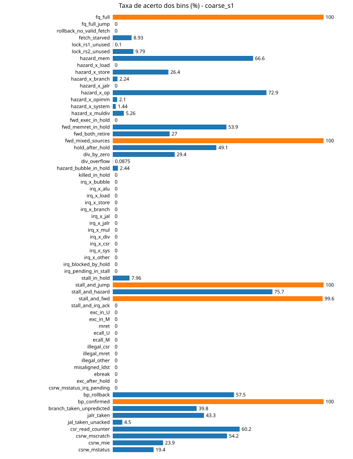

### coarse_pos_s1

Resumo: 0%: 31, 1-90%: 24, <1%: 2, >90%: 5, impossível: 2

| # | bin | acerto | classe |
|---|---|---|---|
| 0 | fq_full | 100.0% | >90% |
| 1 | fq_full_jump | 0.0% | 0% |
| 2 | rollback_no_valid_fetch | 0.0% | 0% |
| 3 | fetch_starved | 8.3% | 1-90% |
| 4 | lock_rs1_unused | 0.1% | <1% |
| 5 | lock_rs2_unused | 10.4% | 1-90% |
| 6 | hazard_mem | 71.6% | 1-90% |
| 7 | hazard_x_load | 0.0% | 0% |
| 8 | hazard_x_store | 31.2% | 1-90% |
| 9 | hazard_x_branch | 3.0% | 1-90% |
| 10 | hazard_x_jalr | 0.0% | 0% |
| 11 | hazard_x_op | 70.6% | 1-90% |
| 12 | hazard_x_opimm | 1.9% | 1-90% |
| 13 | hazard_x_system | 1.1% | 1-90% |
| 14 | hazard_x_muldiv | 3.9% | 1-90% |
| 15 | fwd_exec_in_hold | 0.0% | 0% |
| 16 | fwd_memret_in_hold | 49.5% | 1-90% |
| 17 | fwd_both_retire | 25.9% | 1-90% |
| 18 | fwd_mixed_sources | 100.0% | >90% |
| 19 | hold_after_hold | 48.4% | 1-90% |
| 20 | div_by_zero | 27.4% | 1-90% |
| 21 | div_overflow | 0.1% | <1% |
| 22 | hazard_bubble_in_hold | 2.5% | 1-90% |
| 23 | killed_in_hold | 0.0% | impossível |
| 24 | irq_x_bubble | 0.0% | 0% |
| 25 | irq_x_alu | 0.0% | 0% |
| 26 | irq_x_load | 0.0% | 0% |
| 27 | irq_x_store | 0.0% | 0% |
| 28 | irq_x_branch | 0.0% | 0% |
| 29 | irq_x_jal | 0.0% | 0% |
| 30 | irq_x_jalr | 0.0% | 0% |
| 31 | irq_x_mul | 0.0% | 0% |
| 32 | irq_x_div | 0.0% | 0% |
| 33 | irq_x_csr | 0.0% | 0% |
| 34 | irq_x_sys | 0.0% | 0% |
| 35 | irq_x_other | 0.0% | 0% |
| 36 | irq_blocked_by_hold | 0.0% | 0% |
| 37 | irq_pending_in_stall | 0.0% | 0% |
| 38 | stall_in_hold | 7.7% | 1-90% |
| 39 | stall_and_jump | 100.0% | >90% |
| 40 | stall_and_hazard | 78.1% | 1-90% |
| 41 | stall_and_fwd | 99.7% | >90% |
| 42 | stall_and_irq_ack | 0.0% | impossível |
| 43 | exc_in_U | 0.0% | 0% |
| 44 | exc_in_M | 0.0% | 0% |
| 45 | mret | 0.0% | 0% |
| 46 | ecall_U | 0.0% | 0% |
| 47 | ecall_M | 0.0% | 0% |
| 48 | illegal_csr | 0.0% | 0% |
| 49 | illegal_mret | 0.0% | 0% |
| 50 | illegal_other | 0.0% | 0% |
| 51 | misaligned_ldst | 0.0% | 0% |
| 52 | ebreak | 0.0% | 0% |
| 53 | exc_after_hold | 0.0% | 0% |
| 54 | csrw_mstatus_irq_pending | 0.0% | 0% |
| 55 | bp_rollback | 55.0% | 1-90% |
| 56 | bp_confirmed | 100.0% | >90% |
| 57 | branch_taken_unpredicted | 45.8% | 1-90% |
| 58 | jalr_taken | 38.2% | 1-90% |
| 59 | jal_taken_unacked | 4.0% | 1-90% |
| 60 | csr_read_counter | 56.9% | 1-90% |
| 61 | csrw_mscratch | 52.6% | 1-90% |
| 62 | csrw_mie | 24.7% | 1-90% |
| 63 | csrw_mstatus | 17.0% | 1-90% |

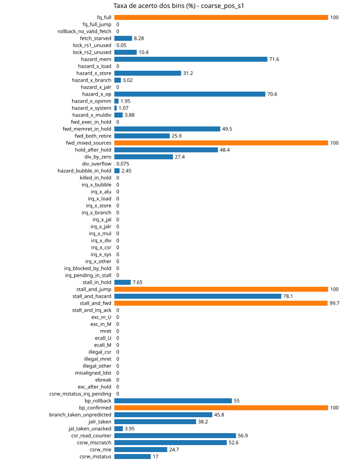

### bins_s1

Resumo: 0%: 31, 1-90%: 24, <1%: 2, >90%: 5, impossível: 2

| # | bin | acerto | classe |
|---|---|---|---|
| 0 | fq_full | 100.0% | >90% |
| 1 | fq_full_jump | 0.0% | 0% |
| 2 | rollback_no_valid_fetch | 0.0% | 0% |
| 3 | fetch_starved | 9.1% | 1-90% |
| 4 | lock_rs1_unused | 0.1% | <1% |
| 5 | lock_rs2_unused | 12.6% | 1-90% |
| 6 | hazard_mem | 66.2% | 1-90% |
| 7 | hazard_x_load | 0.0% | 0% |
| 8 | hazard_x_store | 27.7% | 1-90% |
| 9 | hazard_x_branch | 2.0% | 1-90% |
| 10 | hazard_x_jalr | 0.0% | 0% |
| 11 | hazard_x_op | 70.3% | 1-90% |
| 12 | hazard_x_opimm | 3.2% | 1-90% |
| 13 | hazard_x_system | 2.1% | 1-90% |
| 14 | hazard_x_muldiv | 4.7% | 1-90% |
| 15 | fwd_exec_in_hold | 0.0% | 0% |
| 16 | fwd_memret_in_hold | 56.7% | 1-90% |
| 17 | fwd_both_retire | 34.0% | 1-90% |
| 18 | fwd_mixed_sources | 100.0% | >90% |
| 19 | hold_after_hold | 51.9% | 1-90% |
| 20 | div_by_zero | 33.9% | 1-90% |
| 21 | div_overflow | 0.2% | <1% |
| 22 | hazard_bubble_in_hold | 2.0% | 1-90% |
| 23 | killed_in_hold | 0.0% | impossível |
| 24 | irq_x_bubble | 0.0% | 0% |
| 25 | irq_x_alu | 0.0% | 0% |
| 26 | irq_x_load | 0.0% | 0% |
| 27 | irq_x_store | 0.0% | 0% |
| 28 | irq_x_branch | 0.0% | 0% |
| 29 | irq_x_jal | 0.0% | 0% |
| 30 | irq_x_jalr | 0.0% | 0% |
| 31 | irq_x_mul | 0.0% | 0% |
| 32 | irq_x_div | 0.0% | 0% |
| 33 | irq_x_csr | 0.0% | 0% |
| 34 | irq_x_sys | 0.0% | 0% |
| 35 | irq_x_other | 0.0% | 0% |
| 36 | irq_blocked_by_hold | 0.0% | 0% |
| 37 | irq_pending_in_stall | 0.0% | 0% |
| 38 | stall_in_hold | 6.4% | 1-90% |
| 39 | stall_and_jump | 100.0% | >90% |
| 40 | stall_and_hazard | 72.7% | 1-90% |
| 41 | stall_and_fwd | 99.4% | >90% |
| 42 | stall_and_irq_ack | 0.0% | impossível |
| 43 | exc_in_U | 0.0% | 0% |
| 44 | exc_in_M | 0.0% | 0% |
| 45 | mret | 0.0% | 0% |
| 46 | ecall_U | 0.0% | 0% |
| 47 | ecall_M | 0.0% | 0% |
| 48 | illegal_csr | 0.0% | 0% |
| 49 | illegal_mret | 0.0% | 0% |
| 50 | illegal_other | 0.0% | 0% |
| 51 | misaligned_ldst | 0.0% | 0% |
| 52 | ebreak | 0.0% | 0% |
| 53 | exc_after_hold | 0.0% | 0% |
| 54 | csrw_mstatus_irq_pending | 0.0% | 0% |
| 55 | bp_rollback | 59.8% | 1-90% |
| 56 | bp_confirmed | 100.0% | >90% |
| 57 | branch_taken_unpredicted | 46.3% | 1-90% |
| 58 | jalr_taken | 36.1% | 1-90% |
| 59 | jal_taken_unacked | 3.8% | 1-90% |
| 60 | csr_read_counter | 55.0% | 1-90% |
| 61 | csrw_mscratch | 48.2% | 1-90% |
| 62 | csrw_mie | 20.1% | 1-90% |
| 63 | csrw_mstatus | 18.3% | 1-90% |

### csr_s1

Resumo: 0%: 31, 1-90%: 21, <1%: 5, >90%: 5, impossível: 2

| # | bin | acerto | classe |
|---|---|---|---|
| 0 | fq_full | 100.0% | >90% |
| 1 | fq_full_jump | 0.0% | 0% |
| 2 | rollback_no_valid_fetch | 0.0% | 0% |
| 3 | fetch_starved | 4.1% | 1-90% |
| 4 | lock_rs1_unused | 0.1% | <1% |
| 5 | lock_rs2_unused | 5.4% | 1-90% |
| 6 | hazard_mem | 52.7% | 1-90% |
| 7 | hazard_x_load | 0.0% | 0% |
| 8 | hazard_x_store | 26.2% | 1-90% |
| 9 | hazard_x_branch | 0.8% | <1% |
| 10 | hazard_x_jalr | 0.0% | 0% |
| 11 | hazard_x_op | 50.2% | 1-90% |
| 12 | hazard_x_opimm | 1.1% | 1-90% |
| 13 | hazard_x_system | 0.6% | <1% |
| 14 | hazard_x_muldiv | 1.6% | 1-90% |
| 15 | fwd_exec_in_hold | 0.0% | 0% |
| 16 | fwd_memret_in_hold | 48.1% | 1-90% |
| 17 | fwd_both_retire | 38.5% | 1-90% |
| 18 | fwd_mixed_sources | 100.0% | >90% |
| 19 | hold_after_hold | 45.2% | 1-90% |
| 20 | div_by_zero | 14.5% | 1-90% |
| 21 | div_overflow | 0.1% | <1% |
| 22 | hazard_bubble_in_hold | 1.0% | <1% |
| 23 | killed_in_hold | 0.0% | impossível |
| 24 | irq_x_bubble | 0.0% | 0% |
| 25 | irq_x_alu | 0.0% | 0% |
| 26 | irq_x_load | 0.0% | 0% |
| 27 | irq_x_store | 0.0% | 0% |
| 28 | irq_x_branch | 0.0% | 0% |
| 29 | irq_x_jal | 0.0% | 0% |
| 30 | irq_x_jalr | 0.0% | 0% |
| 31 | irq_x_mul | 0.0% | 0% |
| 32 | irq_x_div | 0.0% | 0% |
| 33 | irq_x_csr | 0.0% | 0% |
| 34 | irq_x_sys | 0.0% | 0% |
| 35 | irq_x_other | 0.0% | 0% |
| 36 | irq_blocked_by_hold | 0.0% | 0% |
| 37 | irq_pending_in_stall | 0.0% | 0% |
| 38 | stall_in_hold | 6.5% | 1-90% |
| 39 | stall_and_jump | 100.0% | >90% |
| 40 | stall_and_hazard | 52.9% | 1-90% |
| 41 | stall_and_fwd | 99.9% | >90% |
| 42 | stall_and_irq_ack | 0.0% | impossível |
| 43 | exc_in_U | 0.0% | 0% |
| 44 | exc_in_M | 0.0% | 0% |
| 45 | mret | 0.0% | 0% |
| 46 | ecall_U | 0.0% | 0% |
| 47 | ecall_M | 0.0% | 0% |
| 48 | illegal_csr | 0.0% | 0% |
| 49 | illegal_mret | 0.0% | 0% |
| 50 | illegal_other | 0.0% | 0% |
| 51 | misaligned_ldst | 0.0% | 0% |
| 52 | ebreak | 0.0% | 0% |
| 53 | exc_after_hold | 0.0% | 0% |
| 54 | csrw_mstatus_irq_pending | 0.0% | 0% |
| 55 | bp_rollback | 53.6% | 1-90% |
| 56 | bp_confirmed | 100.0% | >90% |
| 57 | branch_taken_unpredicted | 45.5% | 1-90% |
| 58 | jalr_taken | 23.2% | 1-90% |
| 59 | jal_taken_unacked | 1.4% | 1-90% |
| 60 | csr_read_counter | 88.7% | 1-90% |
| 61 | csrw_mscratch | 84.2% | 1-90% |
| 62 | csrw_mie | 71.3% | 1-90% |
| 63 | csrw_mstatus | 71.7% | 1-90% |

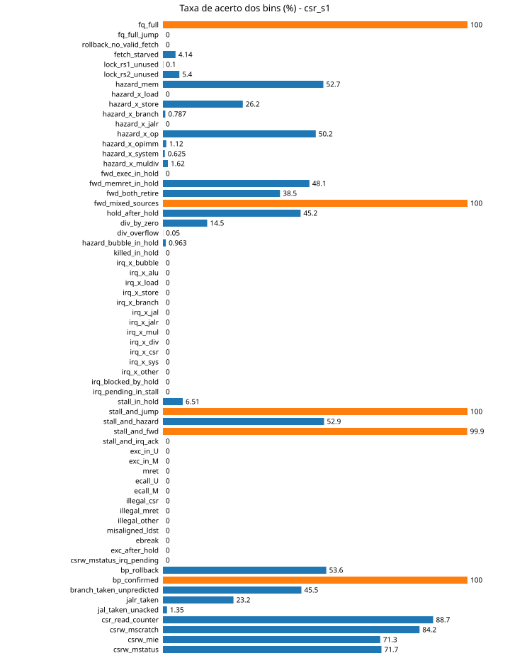

### vl_s1

Resumo: 0%: 31, 1-90%: 23, <1%: 3, >90%: 5, impossível: 2

| # | bin | acerto | classe |
|---|---|---|---|
| 0 | fq_full | 100.0% | >90% |
| 1 | fq_full_jump | 0.0% | 0% |
| 2 | rollback_no_valid_fetch | 0.0% | 0% |
| 3 | fetch_starved | 7.9% | 1-90% |
| 4 | lock_rs1_unused | 0.1% | <1% |
| 5 | lock_rs2_unused | 7.0% | 1-90% |
| 6 | hazard_mem | 47.8% | 1-90% |
| 7 | hazard_x_load | 0.0% | 0% |
| 8 | hazard_x_store | 15.0% | 1-90% |
| 9 | hazard_x_branch | 2.1% | 1-90% |
| 10 | hazard_x_jalr | 0.0% | 0% |
| 11 | hazard_x_op | 60.5% | 1-90% |
| 12 | hazard_x_opimm | 1.6% | 1-90% |
| 13 | hazard_x_system | 1.2% | 1-90% |
| 14 | hazard_x_muldiv | 2.2% | 1-90% |
| 15 | fwd_exec_in_hold | 0.0% | 0% |
| 16 | fwd_memret_in_hold | 47.4% | 1-90% |
| 17 | fwd_both_retire | 20.6% | 1-90% |
| 18 | fwd_mixed_sources | 100.0% | >90% |
| 19 | hold_after_hold | 39.6% | 1-90% |
| 20 | div_by_zero | 20.4% | 1-90% |
| 21 | div_overflow | 0.2% | <1% |
| 22 | hazard_bubble_in_hold | 0.5% | <1% |
| 23 | killed_in_hold | 0.0% | impossível |
| 24 | irq_x_bubble | 0.0% | 0% |
| 25 | irq_x_alu | 0.0% | 0% |
| 26 | irq_x_load | 0.0% | 0% |
| 27 | irq_x_store | 0.0% | 0% |
| 28 | irq_x_branch | 0.0% | 0% |
| 29 | irq_x_jal | 0.0% | 0% |
| 30 | irq_x_jalr | 0.0% | 0% |
| 31 | irq_x_mul | 0.0% | 0% |
| 32 | irq_x_div | 0.0% | 0% |
| 33 | irq_x_csr | 0.0% | 0% |
| 34 | irq_x_sys | 0.0% | 0% |
| 35 | irq_x_other | 0.0% | 0% |
| 36 | irq_blocked_by_hold | 0.0% | 0% |
| 37 | irq_pending_in_stall | 0.0% | 0% |
| 38 | stall_in_hold | 2.0% | 1-90% |
| 39 | stall_and_jump | 100.0% | >90% |
| 40 | stall_and_hazard | 61.9% | 1-90% |
| 41 | stall_and_fwd | 99.8% | >90% |
| 42 | stall_and_irq_ack | 0.0% | impossível |
| 43 | exc_in_U | 0.0% | 0% |
| 44 | exc_in_M | 0.0% | 0% |
| 45 | mret | 0.0% | 0% |
| 46 | ecall_U | 0.0% | 0% |
| 47 | ecall_M | 0.0% | 0% |
| 48 | illegal_csr | 0.0% | 0% |
| 49 | illegal_mret | 0.0% | 0% |
| 50 | illegal_other | 0.0% | 0% |
| 51 | misaligned_ldst | 0.0% | 0% |
| 52 | ebreak | 0.0% | 0% |
| 53 | exc_after_hold | 0.0% | 0% |
| 54 | csrw_mstatus_irq_pending | 0.0% | 0% |
| 55 | bp_rollback | 42.6% | 1-90% |
| 56 | bp_confirmed | 100.0% | >90% |
| 57 | branch_taken_unpredicted | 37.3% | 1-90% |
| 58 | jalr_taken | 36.6% | 1-90% |
| 59 | jal_taken_unacked | 2.7% | 1-90% |
| 60 | csr_read_counter | 67.7% | 1-90% |
| 61 | csrw_mscratch | 50.1% | 1-90% |
| 62 | csrw_mie | 27.3% | 1-90% |
| 63 | csrw_mstatus | 18.3% | 1-90% |

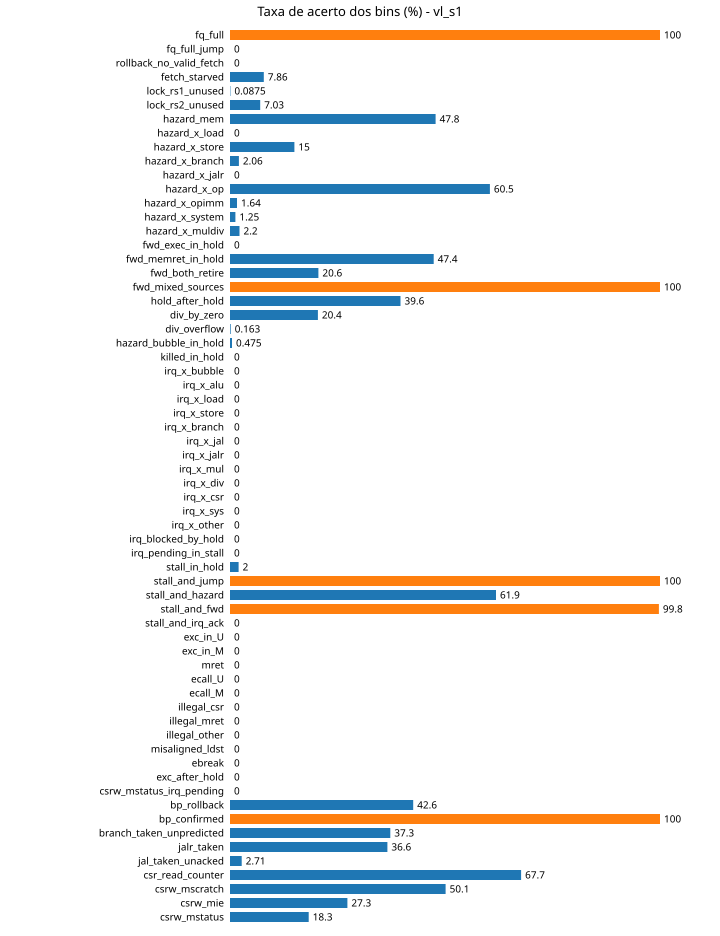

## 8. Fonte 7: escalares

| execução | escalar | máx | média dos máx por caso | mediana | casos com 0 |
|---|---|---|---|---|---|
| none_s1 | fq_level_max | 3 | 3 | 3.0 | 0 |
| none_s1 | hold_run_max | 35 | 20.7 | 35.0 | 2304 |
| none_s1 | hazard_run_max | 36 | 1.3 | 1.0 | 2435 |
| none_s1 | stall_run_max | 2 | 2 | 2.0 | 0 |
| none_s1 | killed_run_max | 3 | 2.7 | 3.0 | 0 |
| none_s1 | irq_wait_max | 0 | 0 | 0.0 | 8000 |
| none_s1 | fq_full_run_max | 36 | 21.4 | 35.0 | 0 |
| none_s1 | snapshot_run_max | 32 | 29.9 | 32.0 | 0 |
| none_s2 | fq_level_max | 3 | 3 | 3.0 | 0 |
| none_s2 | hold_run_max | 35 | 20.7 | 35.0 | 2325 |
| none_s2 | hazard_run_max | 36 | 1.2 | 1.0 | 2433 |
| none_s2 | stall_run_max | 2 | 2 | 2.0 | 0 |
| none_s2 | killed_run_max | 3 | 2.7 | 3.0 | 0 |
| none_s2 | irq_wait_max | 0 | 0 | 0.0 | 8000 |
| none_s2 | fq_full_run_max | 36 | 21.5 | 35.0 | 0 |
| none_s2 | snapshot_run_max | 32 | 29.9 | 32.0 | 0 |
| none_s3 | fq_level_max | 3 | 3 | 3.0 | 0 |
| none_s3 | hold_run_max | 35 | 21.0 | 35.0 | 2273 |
| none_s3 | hazard_run_max | 36 | 1.3 | 1.0 | 2410 |
| none_s3 | stall_run_max | 2 | 2 | 2.0 | 0 |
| none_s3 | killed_run_max | 3 | 2.7 | 3.0 | 0 |
| none_s3 | irq_wait_max | 0 | 0 | 0.0 | 8000 |
| none_s3 | fq_full_run_max | 36 | 21.8 | 35.0 | 0 |
| none_s3 | snapshot_run_max | 32 | 29.9 | 32.0 | 0 |
| rand_s1 | fq_level_max | 3 | 3 | 3.0 | 0 |
| rand_s1 | hold_run_max | 35 | 20.9 | 35.0 | 2377 |
| rand_s1 | hazard_run_max | 36 | 1.3 | 1.0 | 2264 |
| rand_s1 | stall_run_max | 2 | 2 | 2.0 | 0 |
| rand_s1 | killed_run_max | 3 | 2.7 | 3.0 | 0 |
| rand_s1 | irq_wait_max | 0 | 0 | 0.0 | 8000 |
| rand_s1 | fq_full_run_max | 36 | 21.6 | 35.0 | 0 |
| rand_s1 | snapshot_run_max | 32 | 29.9 | 32.0 | 0 |
| rand_s2 | fq_level_max | 3 | 3 | 3.0 | 0 |
| rand_s2 | hold_run_max | 35 | 20.4 | 35.0 | 2330 |
| rand_s2 | hazard_run_max | 36 | 1.2 | 1.0 | 2633 |
| rand_s2 | stall_run_max | 2 | 2 | 2.0 | 0 |
| rand_s2 | killed_run_max | 3 | 2.7 | 3.0 | 0 |
| rand_s2 | irq_wait_max | 0 | 0 | 0.0 | 8000 |
| rand_s2 | fq_full_run_max | 36 | 21.2 | 35.0 | 0 |
| rand_s2 | snapshot_run_max | 32 | 29.8 | 32.0 | 0 |
| rand_s3 | fq_level_max | 3 | 3 | 3.0 | 0 |
| rand_s3 | hold_run_max | 35 | 20.3 | 35.0 | 2522 |
| rand_s3 | hazard_run_max | 36 | 1.2 | 1.0 | 2541 |
| rand_s3 | stall_run_max | 2 | 2 | 2.0 | 0 |
| rand_s3 | killed_run_max | 3 | 2.7 | 3.0 | 0 |
| rand_s3 | irq_wait_max | 0 | 0 | 0.0 | 8000 |
| rand_s3 | fq_full_run_max | 36 | 21.1 | 34.0 | 0 |
| rand_s3 | snapshot_run_max | 32 | 29.8 | 32.0 | 0 |
| pipe_s1 | fq_level_max | 3 | 3 | 3.0 | 0 |
| pipe_s1 | hold_run_max | 35 | 23.6 | 35.0 | 1699 |
| pipe_s1 | hazard_run_max | 36 | 1.6 | 2.0 | 1784 |
| pipe_s1 | stall_run_max | 2 | 2 | 2.0 | 0 |
| pipe_s1 | killed_run_max | 3 | 2.7 | 3.0 | 0 |
| pipe_s1 | irq_wait_max | 0 | 0 | 0.0 | 8000 |
| pipe_s1 | fq_full_run_max | 36 | 24.1 | 35.0 | 0 |
| pipe_s1 | snapshot_run_max | 32 | 30.3 | 32.0 | 0 |
| pipe_s2 | fq_level_max | 3 | 3 | 3.0 | 0 |
| pipe_s2 | hold_run_max | 35 | 22.1 | 35.0 | 1729 |
| pipe_s2 | hazard_run_max | 36 | 1.5 | 1.0 | 1943 |
| pipe_s2 | stall_run_max | 2 | 2 | 2.0 | 0 |
| pipe_s2 | killed_run_max | 3 | 2.7 | 3.0 | 0 |
| pipe_s2 | irq_wait_max | 0 | 0 | 0.0 | 8000 |
| pipe_s2 | fq_full_run_max | 36 | 22.7 | 35.0 | 0 |
| pipe_s2 | snapshot_run_max | 32 | 30.1 | 32.0 | 0 |
| pipe_s3 | fq_level_max | 3 | 3 | 3.0 | 0 |
| pipe_s3 | hold_run_max | 35 | 24.4 | 35.0 | 1528 |
| pipe_s3 | hazard_run_max | 36 | 1.4 | 1.0 | 2048 |
| pipe_s3 | stall_run_max | 2 | 2 | 2.0 | 0 |
| pipe_s3 | killed_run_max | 3 | 2.7 | 3.0 | 0 |
| pipe_s3 | irq_wait_max | 0 | 0 | 0.0 | 8000 |
| pipe_s3 | fq_full_run_max | 36 | 24.9 | 35.0 | 0 |
| pipe_s3 | snapshot_run_max | 32 | 30.4 | 32.0 | 0 |
| pipe_mp05_s1 | fq_level_max | 3 | 3 | 3.0 | 0 |
| pipe_mp05_s1 | hold_run_max | 35 | 22.0 | 35.0 | 1954 |
| pipe_mp05_s1 | hazard_run_max | 36 | 1.4 | 1.0 | 2067 |
| pipe_mp05_s1 | stall_run_max | 2 | 2 | 2.0 | 0 |
| pipe_mp05_s1 | killed_run_max | 3 | 2.7 | 3.0 | 0 |
| pipe_mp05_s1 | irq_wait_max | 0 | 0 | 0.0 | 8000 |
| pipe_mp05_s1 | fq_full_run_max | 36 | 22.6 | 35.0 | 0 |
| pipe_mp05_s1 | snapshot_run_max | 32 | 30.1 | 32.0 | 0 |
| pipe_mp02_s1 | fq_level_max | 3 | 3 | 3.0 | 0 |
| pipe_mp02_s1 | hold_run_max | 35 | 21.4 | 35.0 | 2141 |
| pipe_mp02_s1 | hazard_run_max | 36 | 1.3 | 1.0 | 2327 |
| pipe_mp02_s1 | stall_run_max | 2 | 2 | 2.0 | 0 |
| pipe_mp02_s1 | killed_run_max | 3 | 2.7 | 3.0 | 0 |
| pipe_mp02_s1 | irq_wait_max | 0 | 0 | 0.0 | 8000 |
| pipe_mp02_s1 | fq_full_run_max | 36 | 22.1 | 35.0 | 0 |
| pipe_mp02_s1 | snapshot_run_max | 32 | 30.0 | 32.0 | 0 |
| pipe_pos_s1 | fq_level_max | 3 | 3 | 3.0 | 0 |
| pipe_pos_s1 | hold_run_max | 35 | 23.3 | 35.0 | 1764 |
| pipe_pos_s1 | hazard_run_max | 36 | 1.4 | 1.0 | 1764 |
| pipe_pos_s1 | stall_run_max | 2 | 2 | 2.0 | 0 |
| pipe_pos_s1 | killed_run_max | 3 | 2.7 | 3.0 | 0 |
| pipe_pos_s1 | irq_wait_max | 0 | 0 | 0.0 | 8000 |
| pipe_pos_s1 | fq_full_run_max | 36 | 23.8 | 35.0 | 0 |
| pipe_pos_s1 | snapshot_run_max | 32 | 30.3 | 32.0 | 0 |
| coarse_s1 | fq_level_max | 3 | 3 | 3.0 | 0 |
| coarse_s1 | hold_run_max | 35 | 22.4 | 35.0 | 1983 |
| coarse_s1 | hazard_run_max | 36 | 1.6 | 2.0 | 1570 |
| coarse_s1 | stall_run_max | 2 | 2 | 2.0 | 0 |
| coarse_s1 | killed_run_max | 3 | 2.7 | 3.0 | 0 |
| coarse_s1 | irq_wait_max | 0 | 0 | 0.0 | 8000 |
| coarse_s1 | fq_full_run_max | 36 | 23.1 | 35.0 | 0 |
| coarse_s1 | snapshot_run_max | 32 | 30.1 | 32.0 | 0 |
| coarse_pos_s1 | fq_level_max | 3 | 3 | 3.0 | 0 |
| coarse_pos_s1 | hold_run_max | 35 | 21.7 | 35.0 | 2106 |
| coarse_pos_s1 | hazard_run_max | 36 | 1.7 | 2.0 | 1370 |
| coarse_pos_s1 | stall_run_max | 2 | 2 | 2.0 | 0 |
| coarse_pos_s1 | killed_run_max | 3 | 2.7 | 3.0 | 0 |
| coarse_pos_s1 | irq_wait_max | 0 | 0 | 0.0 | 8000 |
| coarse_pos_s1 | fq_full_run_max | 36 | 22.4 | 35.0 | 0 |
| coarse_pos_s1 | snapshot_run_max | 32 | 30.0 | 32.0 | 0 |
| bins_s1 | fq_level_max | 3 | 3 | 3.0 | 0 |
| bins_s1 | hold_run_max | 35 | 24.1 | 35.0 | 1683 |
| bins_s1 | hazard_run_max | 36 | 1.6 | 2.0 | 1743 |
| bins_s1 | stall_run_max | 2 | 2 | 2.0 | 0 |
| bins_s1 | killed_run_max | 3 | 2.7 | 3.0 | 0 |
| bins_s1 | irq_wait_max | 0 | 0 | 0.0 | 8000 |
| bins_s1 | fq_full_run_max | 36 | 24.6 | 35.0 | 0 |
| bins_s1 | snapshot_run_max | 32 | 30.4 | 32.0 | 0 |
| csr_s1 | fq_level_max | 3 | 3 | 3.0 | 0 |
| csr_s1 | hold_run_max | 35 | 13.7 | 4.0 | 2471 |
| csr_s1 | hazard_run_max | 36 | 1.0 | 1.0 | 3243 |
| csr_s1 | stall_run_max | 2 | 2 | 2.0 | 0 |
| csr_s1 | killed_run_max | 3 | 2.6 | 3.0 | 0 |
| csr_s1 | irq_wait_max | 0 | 0 | 0.0 | 8000 |
| csr_s1 | fq_full_run_max | 36 | 14.4 | 4.0 | 0 |
| csr_s1 | snapshot_run_max | 32 | 28.8 | 27.0 | 0 |
| vl_s1 | fq_level_max | 3 | 3 | 3.0 | 0 |
| vl_s1 | hold_run_max | 35 | 19.8 | 35.0 | 2857 |
| vl_s1 | hazard_run_max | 36 | 1.1 | 1.0 | 2724 |
| vl_s1 | stall_run_max | 2 | 2 | 2.0 | 0 |
| vl_s1 | killed_run_max | 3 | 2.6 | 3.0 | 0 |
| vl_s1 | irq_wait_max | 0 | 0 | 0.0 | 8000 |
| vl_s1 | fq_full_run_max | 36 | 20.5 | 35.0 | 0 |
| vl_s1 | snapshot_run_max | 32 | 29.8 | 32.0 | 0 |

## 9. Sobreposição: novidade em uma fonte x novidade em outra

Para cada par (A, B): dos casos que trouxeram posição nova em A, quantos também trouxeram em B. Linhas próximas de 100% em todas as colunas = A não acrescenta sinal próprio; baixas = A vê coisas que B não vê.

### none_s1

| A \ B | fonte 0 | fonte 1 | fonte 2 | fonte 6 |
|---|---|---|---|---|
| fonte 0 (3436 casos c/ novidade) | - | 4% | 4% | 0% |
| fonte 1 (200 casos c/ novidade) | 64% | - | 12% | 2% |
| fonte 2 (126 casos c/ novidade) | 99% | 19% | - | 10% |
| fonte 6 (16 casos c/ novidade) | 100% | 25% | 81% | - |

### none_s2

| A \ B | fonte 0 | fonte 1 | fonte 2 | fonte 6 |
|---|---|---|---|---|
| fonte 0 (3459 casos c/ novidade) | - | 4% | 4% | 0% |
| fonte 1 (188 casos c/ novidade) | 72% | - | 11% | 2% |
| fonte 2 (130 casos c/ novidade) | 95% | 16% | - | 10% |
| fonte 6 (16 casos c/ novidade) | 100% | 25% | 81% | - |

### none_s3

| A \ B | fonte 0 | fonte 1 | fonte 2 | fonte 6 |
|---|---|---|---|---|
| fonte 0 (3510 casos c/ novidade) | - | 4% | 3% | 0% |
| fonte 1 (194 casos c/ novidade) | 66% | - | 13% | 2% |
| fonte 2 (123 casos c/ novidade) | 98% | 21% | - | 7% |
| fonte 6 (13 casos c/ novidade) | 100% | 31% | 69% | - |

### rand_s1

| A \ B | fonte 0 | fonte 1 | fonte 2 | fonte 3 | fonte 6 |
|---|---|---|---|---|---|
| fonte 0 (2550 casos c/ novidade) | - | 3% | 4% | 14% | 1% |
| fonte 1 (149 casos c/ novidade) | 55% | - | 15% | 20% | 3% |
| fonte 2 (124 casos c/ novidade) | 87% | 18% | - | 50% | 12% |
| fonte 3 (358 casos c/ novidade) | 99% | 8% | 17% | - | 4% |
| fonte 6 (18 casos c/ novidade) | 100% | 28% | 83% | 89% | - |

### rand_s2

| A \ B | fonte 0 | fonte 1 | fonte 2 | fonte 3 | fonte 6 |
|---|---|---|---|---|---|
| fonte 0 (2473 casos c/ novidade) | - | 3% | 4% | 14% | 1% |
| fonte 1 (152 casos c/ novidade) | 57% | - | 13% | 18% | 3% |
| fonte 2 (124 casos c/ novidade) | 86% | 16% | - | 45% | 10% |
| fonte 3 (349 casos c/ novidade) | 99% | 8% | 16% | - | 4% |
| fonte 6 (16 casos c/ novidade) | 100% | 31% | 75% | 88% | - |

### rand_s3

| A \ B | fonte 0 | fonte 1 | fonte 2 | fonte 3 | fonte 6 |
|---|---|---|---|---|---|
| fonte 0 (2430 casos c/ novidade) | - | 4% | 4% | 14% | 1% |
| fonte 1 (161 casos c/ novidade) | 55% | - | 15% | 18% | 3% |
| fonte 2 (134 casos c/ novidade) | 80% | 18% | - | 46% | 8% |
| fonte 3 (359 casos c/ novidade) | 97% | 8% | 17% | - | 3% |
| fonte 6 (14 casos c/ novidade) | 93% | 36% | 79% | 79% | - |

### pipe_s1

| A \ B | fonte 0 | fonte 1 | fonte 2 | fonte 6 |
|---|---|---|---|---|
| fonte 0 (2639 casos c/ novidade) | - | 3% | 4% | 1% |
| fonte 1 (147 casos c/ novidade) | 62% | - | 14% | 3% |
| fonte 2 (124 casos c/ novidade) | 83% | 17% | - | 8% |
| fonte 6 (14 casos c/ novidade) | 100% | 36% | 71% | - |

### pipe_s2

| A \ B | fonte 0 | fonte 1 | fonte 2 | fonte 3 | fonte 6 |
|---|---|---|---|---|---|
| fonte 0 (2543 casos c/ novidade) | - | 3% | 4% | 14% | 1% |
| fonte 1 (142 casos c/ novidade) | 57% | - | 11% | 16% | 4% |
| fonte 2 (120 casos c/ novidade) | 87% | 12% | - | 43% | 8% |
| fonte 3 (358 casos c/ novidade) | 99% | 6% | 15% | - | 4% |
| fonte 6 (14 casos c/ novidade) | 100% | 43% | 71% | 93% | - |

### pipe_s3

| A \ B | fonte 0 | fonte 1 | fonte 2 | fonte 3 | fonte 6 |
|---|---|---|---|---|---|
| fonte 0 (2541 casos c/ novidade) | - | 4% | 4% | 15% | 1% |
| fonte 1 (173 casos c/ novidade) | 55% | - | 13% | 16% | 3% |
| fonte 2 (134 casos c/ novidade) | 84% | 16% | - | 50% | 9% |
| fonte 3 (372 casos c/ novidade) | 99% | 7% | 18% | - | 3% |
| fonte 6 (14 casos c/ novidade) | 93% | 43% | 86% | 86% | - |

### pipe_mp05_s1

| A \ B | fonte 0 | fonte 1 | fonte 2 | fonte 3 | fonte 6 |
|---|---|---|---|---|---|
| fonte 0 (2942 casos c/ novidade) | - | 4% | 4% | 13% | 1% |
| fonte 1 (174 casos c/ novidade) | 63% | - | 15% | 22% | 3% |
| fonte 2 (130 casos c/ novidade) | 93% | 20% | - | 63% | 10% |
| fonte 3 (381 casos c/ novidade) | 98% | 10% | 22% | - | 4% |
| fonte 6 (17 casos c/ novidade) | 100% | 35% | 76% | 94% | - |

### pipe_mp02_s1

| A \ B | fonte 0 | fonte 1 | fonte 2 | fonte 3 | fonte 6 |
|---|---|---|---|---|---|
| fonte 0 (3258 casos c/ novidade) | - | 4% | 4% | 12% | 0% |
| fonte 1 (191 casos c/ novidade) | 66% | - | 13% | 18% | 2% |
| fonte 2 (128 casos c/ novidade) | 99% | 19% | - | 62% | 11% |
| fonte 3 (402 casos c/ novidade) | 99% | 9% | 20% | - | 4% |
| fonte 6 (16 casos c/ novidade) | 100% | 25% | 88% | 100% | - |

### pipe_pos_s1

| A \ B | fonte 0 | fonte 1 | fonte 2 | fonte 3 | fonte 6 |
|---|---|---|---|---|---|
| fonte 0 (2600 casos c/ novidade) | - | 3% | 4% | 13% | 1% |
| fonte 1 (156 casos c/ novidade) | 56% | - | 13% | 21% | 3% |
| fonte 2 (123 casos c/ novidade) | 90% | 17% | - | 51% | 11% |
| fonte 3 (354 casos c/ novidade) | 99% | 9% | 18% | - | 4% |
| fonte 6 (15 casos c/ novidade) | 100% | 27% | 87% | 87% | - |

### coarse_s1

| A \ B | fonte 0 | fonte 1 | fonte 2 | fonte 3 | fonte 6 |
|---|---|---|---|---|---|
| fonte 0 (2487 casos c/ novidade) | - | 4% | 4% | 15% | 1% |
| fonte 1 (158 casos c/ novidade) | 58% | - | 11% | 20% | 4% |
| fonte 2 (126 casos c/ novidade) | 80% | 14% | - | 45% | 11% |
| fonte 3 (370 casos c/ novidade) | 99% | 8% | 15% | - | 4% |
| fonte 6 (18 casos c/ novidade) | 100% | 33% | 78% | 83% | - |

### coarse_pos_s1

| A \ B | fonte 0 | fonte 1 | fonte 2 | fonte 3 | fonte 6 |
|---|---|---|---|---|---|
| fonte 0 (2477 casos c/ novidade) | - | 4% | 4% | 16% | 1% |
| fonte 1 (149 casos c/ novidade) | 60% | - | 12% | 20% | 3% |
| fonte 2 (124 casos c/ novidade) | 88% | 15% | - | 44% | 11% |
| fonte 3 (394 casos c/ novidade) | 99% | 8% | 14% | - | 4% |
| fonte 6 (17 casos c/ novidade) | 100% | 29% | 82% | 82% | - |

### bins_s1

| A \ B | fonte 0 | fonte 1 | fonte 2 | fonte 6 |
|---|---|---|---|---|
| fonte 0 (2575 casos c/ novidade) | - | 3% | 4% | 1% |
| fonte 1 (157 casos c/ novidade) | 55% | - | 14% | 3% |
| fonte 2 (129 casos c/ novidade) | 80% | 17% | - | 9% |
| fonte 6 (14 casos c/ novidade) | 100% | 36% | 79% | - |

### csr_s1

| A \ B | fonte 0 | fonte 1 | fonte 2 | fonte 6 |
|---|---|---|---|---|
| fonte 0 (2253 casos c/ novidade) | - | 5% | 5% | 1% |
| fonte 1 (305 casos c/ novidade) | 36% | - | 7% | 2% |
| fonte 2 (128 casos c/ novidade) | 80% | 16% | - | 9% |
| fonte 6 (15 casos c/ novidade) | 100% | 40% | 73% | - |

### vl_s1

| A \ B | fonte 0 | fonte 1 | fonte 2 | fonte 6 |
|---|---|---|---|---|
| fonte 0 (2202 casos c/ novidade) | - | 5% | 5% | 1% |
| fonte 1 (148 casos c/ novidade) | 68% | - | 18% | 2% |
| fonte 2 (129 casos c/ novidade) | 82% | 20% | - | 9% |
| fonte 6 (15 casos c/ novidade) | 100% | 20% | 73% | - |

## 9b. Sobreposição entre execuções (mesmo índice = mesma posição)

Para cada fonte: tamanho da união das posições de todas as execuções, posições comuns a todas, e, por execução, quantas posições só ela encontrou. Índices são comparáveis porque o `fuzz_cov.sv` é o mesmo.

### Fonte 0 (pipe_edges): união 13437, comum a todas 3321 (24.7% da união)

| execução | posições | só nesta execução | % da união |
|---|---|---|---|
| none_s1 | 8755 | 194 | 65.2% |
| none_s2 | 8686 | 355 | 64.6% |
| none_s3 | 8779 | 370 | 65.3% |
| rand_s1 | 6599 | 81 | 49.1% |
| rand_s2 | 6464 | 104 | 48.1% |
| rand_s3 | 6467 | 91 | 48.1% |
| pipe_s1 | 6761 | 70 | 50.3% |
| pipe_s2 | 6659 | 112 | 49.6% |
| pipe_s3 | 6639 | 115 | 49.4% |
| pipe_mp05_s1 | 7739 | 99 | 57.6% |
| pipe_mp02_s1 | 8351 | 104 | 62.1% |
| pipe_pos_s1 | 6675 | 80 | 49.7% |
| coarse_s1 | 6570 | 64 | 48.9% |
| coarse_pos_s1 | 6552 | 68 | 48.8% |
| bins_s1 | 6622 | 63 | 49.3% |
| csr_s1 | 6281 | 78 | 46.7% |
| vl_s1 | 6121 | 38 | 45.6% |

### Fonte 1 (csr_trans): união 571, comum a todas 130 (22.8% da união)

| execução | posições | só nesta execução | % da união |
|---|---|---|---|
| none_s1 | 345 | 1 | 60.4% |
| none_s2 | 344 | 6 | 60.2% |
| none_s3 | 342 | 2 | 59.9% |
| rand_s1 | 270 | 0 | 47.3% |
| rand_s2 | 296 | 1 | 51.8% |
| rand_s3 | 291 | 1 | 51.0% |
| pipe_s1 | 260 | 1 | 45.5% |
| pipe_s2 | 254 | 1 | 44.5% |
| pipe_s3 | 306 | 3 | 53.6% |
| pipe_mp05_s1 | 312 | 2 | 54.6% |
| pipe_mp02_s1 | 352 | 2 | 61.6% |
| pipe_pos_s1 | 282 | 1 | 49.4% |
| coarse_s1 | 272 | 1 | 47.6% |
| coarse_pos_s1 | 261 | 0 | 45.7% |
| bins_s1 | 276 | 2 | 48.3% |
| csr_s1 | 530 | 48 | 92.8% |
| vl_s1 | 260 | 0 | 45.5% |

### Fonte 2 (verilator): união 1177, comum a todas 1009 (85.7% da união)

| execução | posições | só nesta execução | % da união |
|---|---|---|---|
| none_s1 | 1176 | 0 | 99.9% |
| none_s2 | 1176 | 0 | 99.9% |
| none_s3 | 1176 | 0 | 99.9% |
| rand_s1 | 1009 | 0 | 85.7% |
| rand_s2 | 1009 | 0 | 85.7% |
| rand_s3 | 1009 | 0 | 85.7% |
| pipe_s1 | 1177 | 0 | 100.0% |
| pipe_s2 | 1009 | 0 | 85.7% |
| pipe_s3 | 1009 | 0 | 85.7% |
| pipe_mp05_s1 | 1009 | 0 | 85.7% |
| pipe_mp02_s1 | 1009 | 0 | 85.7% |
| pipe_pos_s1 | 1009 | 0 | 85.7% |
| coarse_s1 | 1009 | 0 | 85.7% |
| coarse_pos_s1 | 1009 | 0 | 85.7% |
| bins_s1 | 1177 | 0 | 100.0% |
| csr_s1 | 1177 | 0 | 100.0% |
| vl_s1 | 1177 | 0 | 100.0% |

### Fonte 3 (pipe_coarse): união 799, comum a todas 523 (65.5% da união)

| execução | posições | só nesta execução | % da união |
|---|---|---|---|
| rand_s1 | 641 | 2 | 80.2% |
| rand_s2 | 639 | 3 | 80.0% |
| rand_s3 | 645 | 3 | 80.7% |
| pipe_s2 | 636 | 3 | 79.6% |
| pipe_s3 | 660 | 2 | 82.6% |
| pipe_mp05_s1 | 690 | 5 | 86.4% |
| pipe_mp02_s1 | 705 | 8 | 88.2% |
| pipe_pos_s1 | 648 | 7 | 81.1% |
| coarse_s1 | 658 | 1 | 82.4% |
| coarse_pos_s1 | 678 | 7 | 84.9% |

### Fonte 6 (bins): união 31, comum a todas 31 (100.0% da união)

| execução | posições | só nesta execução | % da união |
|---|---|---|---|
| none_s1 | 31 | 0 | 100.0% |
| none_s2 | 31 | 0 | 100.0% |
| none_s3 | 31 | 0 | 100.0% |
| rand_s1 | 31 | 0 | 100.0% |
| rand_s2 | 31 | 0 | 100.0% |
| rand_s3 | 31 | 0 | 100.0% |
| pipe_s1 | 31 | 0 | 100.0% |
| pipe_s2 | 31 | 0 | 100.0% |
| pipe_s3 | 31 | 0 | 100.0% |
| pipe_mp05_s1 | 31 | 0 | 100.0% |
| pipe_mp02_s1 | 31 | 0 | 100.0% |
| pipe_pos_s1 | 31 | 0 | 100.0% |
| coarse_s1 | 31 | 0 | 100.0% |
| coarse_pos_s1 | 31 | 0 | 100.0% |
| bins_s1 | 31 | 0 | 100.0% |
| csr_s1 | 31 | 0 | 100.0% |
| vl_s1 | 31 | 0 | 100.0% |

## 9c. Posições exclusivas em relação à referência

Referência: a união das posições de none_s1, none_s2, none_s3 (24000 casos). Para cada execução, quantas das suas posições nenhum programa da referência atingiu. Uma execução que faz parte da referência é comparada com a união das **outras** execuções de referência.

### Fonte 0 (pipe_edges)

| execução | posições | também na referência | exclusivas | % exclusivas | exclusivas vistas 1x |
|---|---|---|---|---|---|
| none_s1 (ref.) | 8755 | 7677 | 1078 | 12.3% | 894 |
| none_s2 (ref.) | 8686 | 7725 | 961 | 11.1% | 807 |
| none_s3 (ref.) | 8779 | 7717 | 1062 | 12.1% | 870 |
| rand_s1 | 6599 | 6332 | 267 | 4.0% | 161 |
| rand_s2 | 6464 | 6222 | 242 | 3.7% | 145 |
| rand_s3 | 6467 | 6254 | 213 | 3.3% | 113 |
| pipe_s1 | 6761 | 6493 | 268 | 4.0% | 125 |
| pipe_s2 | 6659 | 6414 | 245 | 3.7% | 123 |
| pipe_s3 | 6639 | 6369 | 270 | 4.1% | 132 |
| pipe_mp05_s1 | 7739 | 7415 | 324 | 4.2% | 198 |
| pipe_mp02_s1 | 8351 | 8009 | 342 | 4.1% | 276 |
| pipe_pos_s1 | 6675 | 6408 | 267 | 4.0% | 132 |
| coarse_s1 | 6570 | 6308 | 262 | 4.0% | 173 |
| coarse_pos_s1 | 6552 | 6275 | 277 | 4.2% | 186 |
| bins_s1 | 6622 | 6362 | 260 | 3.9% | 120 |
| csr_s1 | 6281 | 6029 | 252 | 4.0% | 200 |
| vl_s1 | 6121 | 5930 | 191 | 3.1% | 164 |

### Fonte 1 (csr_trans)

| execução | posições | também na referência | exclusivas | % exclusivas | exclusivas vistas 1x |
|---|---|---|---|---|---|
| none_s1 (ref.) | 345 | 305 | 40 | 11.6% | 31 |
| none_s2 (ref.) | 344 | 312 | 32 | 9.3% | 31 |
| none_s3 (ref.) | 342 | 308 | 34 | 9.9% | 27 |
| rand_s1 | 270 | 262 | 8 | 3.0% | 7 |
| rand_s2 | 296 | 278 | 18 | 6.1% | 13 |
| rand_s3 | 291 | 275 | 16 | 5.5% | 9 |
| pipe_s1 | 260 | 249 | 11 | 4.2% | 8 |
| pipe_s2 | 254 | 245 | 9 | 3.5% | 2 |
| pipe_s3 | 306 | 284 | 22 | 7.2% | 17 |
| pipe_mp05_s1 | 312 | 294 | 18 | 5.8% | 14 |
| pipe_mp02_s1 | 352 | 332 | 20 | 5.7% | 15 |
| pipe_pos_s1 | 282 | 272 | 10 | 3.5% | 8 |
| coarse_s1 | 272 | 263 | 9 | 3.3% | 8 |
| coarse_pos_s1 | 261 | 255 | 6 | 2.3% | 5 |
| bins_s1 | 276 | 261 | 15 | 5.4% | 12 |
| csr_s1 | 530 | 416 | 114 | 21.5% | 6 |
| vl_s1 | 260 | 248 | 12 | 4.6% | 12 |

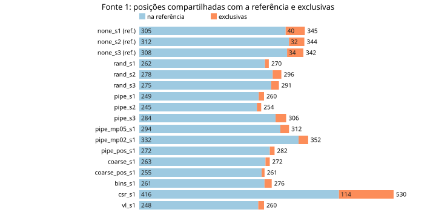

### Fonte 2 (verilator)

| execução | posições | também na referência | exclusivas | % exclusivas | exclusivas vistas 1x |
|---|---|---|---|---|---|
| none_s1 (ref.) | 1176 | 1176 | 0 | 0.0% | 0 |
| none_s2 (ref.) | 1176 | 1176 | 0 | 0.0% | 0 |
| none_s3 (ref.) | 1176 | 1176 | 0 | 0.0% | 0 |
| rand_s1 | 1009 | 1009 | 0 | 0.0% | 0 |
| rand_s2 | 1009 | 1009 | 0 | 0.0% | 0 |
| rand_s3 | 1009 | 1009 | 0 | 0.0% | 0 |
| pipe_s1 | 1177 | 1176 | 1 | 0.1% | 0 |
| pipe_s2 | 1009 | 1009 | 0 | 0.0% | 0 |
| pipe_s3 | 1009 | 1009 | 0 | 0.0% | 0 |
| pipe_mp05_s1 | 1009 | 1009 | 0 | 0.0% | 0 |
| pipe_mp02_s1 | 1009 | 1009 | 0 | 0.0% | 0 |
| pipe_pos_s1 | 1009 | 1009 | 0 | 0.0% | 0 |
| coarse_s1 | 1009 | 1009 | 0 | 0.0% | 0 |
| coarse_pos_s1 | 1009 | 1009 | 0 | 0.0% | 0 |
| bins_s1 | 1177 | 1176 | 1 | 0.1% | 0 |
| csr_s1 | 1177 | 1176 | 1 | 0.1% | 0 |
| vl_s1 | 1177 | 1176 | 1 | 0.1% | 0 |

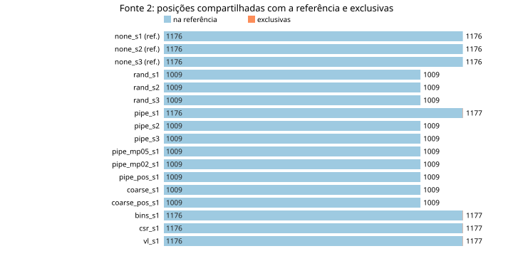

### Fonte 3 (pipe_coarse)

| execução | posições | também na referência | exclusivas | % exclusivas | exclusivas vistas 1x |
|---|---|---|---|---|---|
| rand_s1 | 641 | 0 | 641 | 100.0% | 57 |
| rand_s2 | 639 | 0 | 639 | 100.0% | 45 |
| rand_s3 | 645 | 0 | 645 | 100.0% | 67 |
| pipe_s2 | 636 | 0 | 636 | 100.0% | 33 |
| pipe_s3 | 660 | 0 | 660 | 100.0% | 40 |
| pipe_mp05_s1 | 690 | 0 | 690 | 100.0% | 46 |
| pipe_mp02_s1 | 705 | 0 | 705 | 100.0% | 53 |
| pipe_pos_s1 | 648 | 0 | 648 | 100.0% | 36 |
| coarse_s1 | 658 | 0 | 658 | 100.0% | 17 |
| coarse_pos_s1 | 678 | 0 | 678 | 100.0% | 28 |

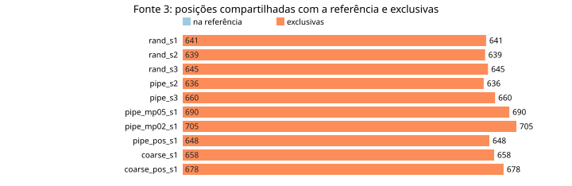

### Fonte 6 (bins)

| execução | posições | também na referência | exclusivas | % exclusivas | exclusivas vistas 1x |
|---|---|---|---|---|---|
| none_s1 (ref.) | 31 | 31 | 0 | 0.0% | 0 |
| none_s2 (ref.) | 31 | 31 | 0 | 0.0% | 0 |
| none_s3 (ref.) | 31 | 31 | 0 | 0.0% | 0 |
| rand_s1 | 31 | 31 | 0 | 0.0% | 0 |
| rand_s2 | 31 | 31 | 0 | 0.0% | 0 |
| rand_s3 | 31 | 31 | 0 | 0.0% | 0 |
| pipe_s1 | 31 | 31 | 0 | 0.0% | 0 |
| pipe_s2 | 31 | 31 | 0 | 0.0% | 0 |
| pipe_s3 | 31 | 31 | 0 | 0.0% | 0 |
| pipe_mp05_s1 | 31 | 31 | 0 | 0.0% | 0 |
| pipe_mp02_s1 | 31 | 31 | 0 | 0.0% | 0 |
| pipe_pos_s1 | 31 | 31 | 0 | 0.0% | 0 |
| coarse_s1 | 31 | 31 | 0 | 0.0% | 0 |
| coarse_pos_s1 | 31 | 31 | 0 | 0.0% | 0 |
| bins_s1 | 31 | 31 | 0 | 0.0% | 0 |
| csr_s1 | 31 | 31 | 0 | 0.0% | 0 |
| vl_s1 | 31 | 31 | 0 | 0.0% | 0 |

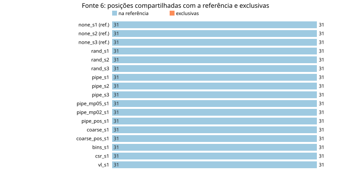

## 10. Gerador e corpus

| execução | corpus final | casos com score>0 | aleatórios | mutados | operadores | novas pos. fonte 0 por caso (aleat / mut) | idem fonte 6 |
|---|---|---|---|---|---|---|---|
| none_s1 | 0 | 0 | 8000 | 0 | random=8000 | 1.09 / 0.00 | 0.00 / 0.00 |
| none_s2 | 0 | 0 | 8000 | 0 | random=8000 | 1.09 / 0.00 | 0.00 / 0.00 |
| none_s3 | 0 | 0 | 8000 | 0 | random=8000 | 1.10 / 0.00 | 0.00 / 0.00 |
| rand_s1 | 7999 | 0 | 1607 | 6393 | point=1907 random=1607 swap=952 data=913 insert=884 delete=872 splice=865 | 2.41 / 0.43 | 0.02 / 0.00 |
| rand_s2 | 8000 | 0 | 1607 | 6393 | point=1833 random=1607 splice=939 insert=929 data=918 delete=911 swap=863 | 2.43 / 0.40 | 0.02 / 0.00 |
| rand_s3 | 8000 | 0 | 1636 | 6364 | point=1816 random=1636 delete=956 splice=915 insert=902 swap=901 data=874 | 2.41 / 0.40 | 0.02 / 0.00 |
| pipe_s1 | 3102 | 3102 | 1621 | 6379 | point=1839 random=1621 splice=918 insert=917 data=916 swap=913 delete=876 | 2.32 / 0.47 | 0.02 / 0.00 |
| pipe_s2 | 3026 | 3026 | 1636 | 6364 | point=1815 random=1636 delete=964 splice=907 insert=904 data=891 swap=883 | 2.40 / 0.43 | 0.02 / 0.00 |
| pipe_s3 | 3038 | 3038 | 1559 | 6441 | point=1863 random=1559 splice=954 delete=945 insert=922 swap=895 data=862 | 2.46 / 0.44 | 0.02 / 0.00 |
| pipe_mp05_s1 | 3582 | 3582 | 4006 | 3994 | random=4006 point=1123 data=591 delete=582 swap=572 insert=565 splice=561 | 1.57 / 0.36 | 0.01 / 0.00 |
| pipe_mp02_s1 | 4083 | 4083 | 6404 | 1596 | random=6404 point=486 splice=231 insert=230 delete=230 swap=218 data=201 | 1.23 / 0.29 | 0.00 / 0.00 |
| pipe_pos_s1 | 2600 | 2600 | 1595 | 6405 | point=1891 random=1595 data=930 swap=922 splice=915 insert=874 delete=873 | 2.39 / 0.45 | 0.02 / 0.00 |
| coarse_s1 | 657 | 657 | 1621 | 6379 | point=1838 random=1621 swap=924 data=918 insert=914 splice=895 delete=890 | 2.38 / 0.43 | 0.02 / 0.00 |
| coarse_pos_s1 | 394 | 394 | 1613 | 6387 | point=1868 random=1613 swap=920 splice=915 data=909 insert=900 delete=875 | 2.41 / 0.42 | 0.02 / 0.00 |
| bins_s1 | 3087 | 3087 | 1612 | 6388 | point=1837 random=1612 swap=939 data=936 delete=914 insert=905 splice=857 | 2.31 / 0.45 | 0.02 / 0.00 |
| csr_s1 | 551 | 551 | 1627 | 6373 | point=1879 random=1627 insert=932 data=919 delete=891 swap=885 splice=867 | 2.54 / 0.34 | 0.02 / 0.00 |
| vl_s1 | 443 | 443 | 1639 | 6361 | point=1836 random=1639 data=939 swap=928 insert=898 delete=895 splice=865 | 2.47 / 0.33 | 0.02 / 0.00 |

Blocos gerados (none_s1): csr=5537, mix=5534, mem=5511, alu=5511, branch=5505, loop=5458, muldiv=5432, jump=5431

## 11. Casos que não passaram

- none_s1: todos os casos passaram
- none_s2: todos os casos passaram
- none_s3: todos os casos passaram
- rand_s1: todos os casos passaram
- rand_s2: todos os casos passaram
- rand_s3: todos os casos passaram
- pipe_s1: todos os casos passaram
- pipe_s2: todos os casos passaram
- pipe_s3: todos os casos passaram
- pipe_mp05_s1: todos os casos passaram
- pipe_mp02_s1: todos os casos passaram
- pipe_pos_s1: todos os casos passaram
- coarse_s1: todos os casos passaram
- coarse_pos_s1: todos os casos passaram
- bins_s1: todos os casos passaram
- csr_s1: todos os casos passaram
- vl_s1: todos os casos passaram

