# Relatório das fontes de feedback

Gerado por `feedback_report.py` a partir de 10 execução(ões). Fontes: ver `FONTES.md`.

## 1. Execuções

| execução | guide | record | schedule | seed | casos | status | tempo (s) | casos/s | core |
|---|---|---|---|---|---|---|---|---|---|
| trap_none_s1 | none | 0,1,2,3,6,7 | rarity | 1 | 8000 | mismatch=25 pass=7975 | 119.8 | 66.77 | DELAY=2 IQ=2 |
| trap_none_s2 | none | 0,1,2,3,6,7 | rarity | 2 | 8000 | mismatch=30 pass=7970 | 120.0 | 66.66 | DELAY=2 IQ=2 |
| trap_none_s3 | none | 0,1,2,3,6,7 | rarity | 3 | 8000 | mismatch=33 pass=7967 | 119.9 | 66.71 | DELAY=2 IQ=2 |
| trap_rand_s1 | none | 0,1,2,3,6,7 | uniform | 1 | 8000 | mismatch=14 pass=7986 | 120.1 | 66.62 | DELAY=2 IQ=2 |
| trap_pipe_s1 | 0 | 0,1,2,3,6,7 | rarity | 1 | 8000 | mismatch=27 pass=7973 | 120.5 | 66.37 | DELAY=2 IQ=2 |
| trap_pipe_pos_s1 | 0 | 0,1,2,3,6,7 | rarity | 1 | 8000 | mismatch=17 pass=7983 | 120.6 | 66.33 | DELAY=2 IQ=2 |
| trap_coarse_s1 | 3 | 0,1,2,3,6,7 | rarity | 1 | 8000 | mismatch=34 pass=7966 | 120.7 | 66.31 | DELAY=2 IQ=2 |
| trap_csr_s1 | 1 | 0,1,2,3,6,7 | rarity | 1 | 8000 | mismatch=131 pass=7869 | 120.4 | 66.47 | DELAY=2 IQ=2 |
| trap_bins_s1 | 0,6 | 0,1,2,3,6,7 | rarity | 1 | 8000 | mismatch=24 pass=7976 | 120.4 | 66.43 | DELAY=2 IQ=2 |
| trap_vl_s1 | 2 | 0,1,2,3,6,7 | rarity | 1 | 8000 | mismatch=19 pass=7981 | 120.0 | 66.67 | DELAY=2 IQ=2 |

| execução | compile ms (média/mediana) | dut ms | sail ms | leitura ms | ciclos/caso | instr/caso | CPI |
|---|---|---|---|---|---|---|---|
| trap_none_s1 | 31.2 / 30.4 | 91.2 / 91.9 | 16.6 / 14.5 | 9.3 / 9.3 | 417.5 | 288.2 | 1.44 |
| trap_none_s2 | 31.2 / 30.4 | 91.2 / 91.9 | 16.8 / 15.8 | 9.3 / 9.4 | 418.1 | 288.2 | 1.44 |
| trap_none_s3 | 31.2 / 30.4 | 91.3 / 91.9 | 16.6 / 14.4 | 9.3 / 9.3 | 418.5 | 288.8 | 1.44 |
| trap_rand_s1 | 31.1 / 30.3 | 91.2 / 91.9 | 16.7 / 15.0 | 9.5 / 9.5 | 424.4 | 293.3 | 1.43 |
| trap_pipe_s1 | 31.2 / 30.5 | 91.3 / 92.1 | 16.7 / 14.7 | 9.8 / 9.9 | 473.9 | 315.1 | 1.49 |
| trap_pipe_pos_s1 | 31.1 / 30.3 | 91.4 / 92.1 | 16.9 / 14.8 | 9.9 / 9.9 | 471.7 | 313.7 | 1.49 |
| trap_coarse_s1 | 31.2 / 30.4 | 91.3 / 92.2 | 16.9 / 15.3 | 9.8 / 9.9 | 483.0 | 323.0 | 1.48 |
| trap_csr_s1 | 31.1 / 30.4 | 91.3 / 92.0 | 16.9 / 15.1 | 9.6 / 9.6 | 449.1 | 323.6 | 1.37 |
| trap_bins_s1 | 31.2 / 30.4 | 91.2 / 92.0 | 16.8 / 14.7 | 9.7 / 9.8 | 471.6 | 317.5 | 1.47 |
| trap_vl_s1 | 31.2 / 30.4 | 91.2 / 91.9 | 16.8 / 15.5 | 9.3 / 9.3 | 430.3 | 291.5 | 1.46 |

## 2. Posições por fonte no fim da execução

| execução | fonte 0 (pipe_edges) | fonte 1 (csr_trans) | fonte 2 (verilator) | fonte 3 (pipe_coarse) | fonte 6 (bins) |
|---|---|---|---|---|---|
| trap_none_s1 | 14599 pos / 20218 buckets | 658 pos / 1140 buckets | 1052 pos / 2980 buckets | 1914 pos / 3364 buckets | 49 pos / 214 buckets |
| trap_none_s2 | 14513 pos / 20091 buckets | 648 pos / 1101 buckets | 1052 pos / 2970 buckets | 1888 pos / 3319 buckets | 49 pos / 215 buckets |
| trap_none_s3 | 14603 pos / 20333 buckets | 680 pos / 1149 buckets | 1052 pos / 2977 buckets | 1913 pos / 3342 buckets | 49 pos / 212 buckets |
| trap_rand_s1 | 10553 pos / 13975 buckets | 552 pos / 892 buckets | 1052 pos / 2729 buckets | 1614 pos / 2767 buckets | 49 pos / 202 buckets |
| trap_pipe_s1 | 11124 pos / 14810 buckets | 513 pos / 885 buckets | 1052 pos / 2769 buckets | 1688 pos / 2916 buckets | 49 pos / 203 buckets |
| trap_pipe_pos_s1 | 11136 pos / 15036 buckets | 526 pos / 901 buckets | 1052 pos / 2738 buckets | 1697 pos / 2978 buckets | 49 pos / 210 buckets |
| trap_coarse_s1 | 10945 pos / 14723 buckets | 581 pos / 997 buckets | 1052 pos / 2756 buckets | 1715 pos / 2988 buckets | 49 pos / 205 buckets |
| trap_csr_s1 | 10155 pos / 13533 buckets | 812 pos / 1551 buckets | 1052 pos / 2758 buckets | 1638 pos / 2800 buckets | 49 pos / 197 buckets |
| trap_bins_s1 | 11008 pos / 14741 buckets | 560 pos / 948 buckets | 1052 pos / 2750 buckets | 1685 pos / 2902 buckets | 49 pos / 201 buckets |
| trap_vl_s1 | 10193 pos / 13630 buckets | 498 pos / 834 buckets | 1052 pos / 2702 buckets | 1640 pos / 2783 buckets | 49 pos / 196 buckets |

Posições atingidas **por caso** (média / mín / máx), ou seja, quantas posições um programa típico toca:

| execução | fonte 0 | fonte 1 | fonte 2 | fonte 3 | fonte 6 |
|---|---|---|---|---|---|
| trap_none_s1 | 124 / 47 / 226 | 13 / 2 / 41 | 748 / 672 / 801 | 68 / 20 / 133 | 17 / 6 / 30 |
| trap_none_s2 | 124 / 43 / 235 | 13 / 2 / 42 | 748 / 671 / 799 | 68 / 20 / 127 | 17 / 6 / 29 |
| trap_none_s3 | 124 / 43 / 224 | 13 / 2 / 41 | 748 / 670 / 798 | 68 / 21 / 135 | 17 / 6 / 29 |
| trap_rand_s1 | 128 / 40 / 261 | 13 / 2 / 48 | 750 / 672 / 801 | 70 / 19 / 145 | 17 / 6 / 32 |
| trap_pipe_s1 | 142 / 39 / 305 | 16 / 2 / 39 | 758 / 676 / 806 | 79 / 20 / 173 | 19 / 6 / 34 |
| trap_pipe_pos_s1 | 140 / 39 / 293 | 15 / 2 / 46 | 757 / 674 / 804 | 78 / 20 / 153 | 19 / 6 / 33 |
| trap_coarse_s1 | 142 / 40 / 299 | 17 / 2 / 44 | 760 / 674 / 804 | 80 / 19 / 168 | 19 / 6 / 33 |
| trap_csr_s1 | 134 / 43 / 268 | 22 / 2 / 75 | 756 / 674 / 813 | 75 / 22 / 155 | 19 / 6 / 33 |
| trap_bins_s1 | 141 / 40 / 303 | 16 / 2 / 51 | 758 / 672 / 807 | 78 / 19 / 159 | 19 / 6 / 35 |
| trap_vl_s1 | 124 / 40 / 257 | 13 / 2 / 39 | 751 / 673 / 802 | 69 / 19 / 143 | 17 / 6 / 32 |

## 3. Saturação: posições novas ao longo dos casos

Casos necessários para atingir 50%, 90% e 99% das posições finais, último caso que trouxe posição nova, e taxa de novidade (posições novas por janela de 200 casos) no início, no meio e no fim.

### Fonte 0 (pipe_edges)

| execução | total | 50% | 90% | 99% | última nova | novas/janela início | meio | fim | % achado nos últimos 20% dos casos |
|---|---|---|---|---|---|---|---|---|---|
| trap_none_s1 | 14599 | 1231 | 5839 | 7744 | 7993 | 3118 | 193 | 114 | 6.96% |
| trap_none_s2 | 14513 | 1241 | 5851 | 7752 | 7997 | 3179 | 228 | 114 | 7.43% |
| trap_none_s3 | 14603 | 1266 | 5847 | 7762 | 7997 | 2888 | 203 | 122 | 7.27% |
| trap_rand_s1 | 10553 | 1572 | 6230 | 7820 | 8000 | 1876 | 192 | 117 | 8.87% |
| trap_pipe_s1 | 11124 | 1636 | 6163 | 7842 | 8000 | 2087 | 179 | 120 | 8.28% |
| trap_pipe_pos_s1 | 11136 | 1710 | 6152 | 7827 | 7993 | 1964 | 161 | 126 | 8.29% |
| trap_coarse_s1 | 10945 | 1639 | 6219 | 7816 | 7995 | 2167 | 194 | 118 | 8.87% |
| trap_csr_s1 | 10155 | 1506 | 6093 | 7750 | 8000 | 2099 | 153 | 92 | 7.95% |
| trap_bins_s1 | 11008 | 1559 | 6268 | 7805 | 7991 | 1932 | 138 | 113 | 9.19% |
| trap_vl_s1 | 10193 | 1548 | 6053 | 7739 | 7999 | 2051 | 138 | 71 | 7.83% |

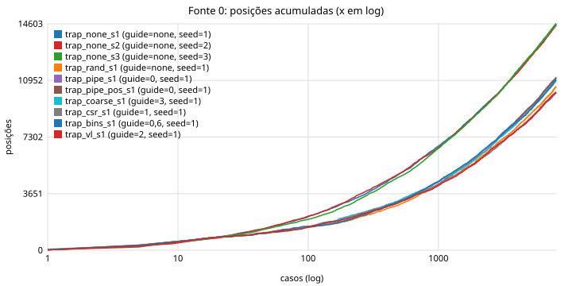

### Fonte 1 (csr_trans)

| execução | total | 50% | 90% | 99% | última nova | novas/janela início | meio | fim | % achado nos últimos 20% dos casos |
|---|---|---|---|---|---|---|---|---|---|
| trap_none_s1 | 658 | 739 | 5154 | 7589 | 7940 | 185 | 4 | 1 | 5.02% |
| trap_none_s2 | 648 | 572 | 4588 | 7904 | 7964 | 206 | 7 | 13 | 5.86% |
| trap_none_s3 | 680 | 690 | 4574 | 7647 | 7997 | 239 | 9 | 5 | 4.71% |
| trap_rand_s1 | 552 | 1057 | 5298 | 7506 | 7732 | 159 | 8 | 0 | 3.26% |
| trap_pipe_s1 | 513 | 768 | 6506 | 7887 | 7919 | 133 | 6 | 7 | 10.53% |
| trap_pipe_pos_s1 | 526 | 1108 | 5980 | 7581 | 7916 | 112 | 3 | 2 | 8.37% |
| trap_coarse_s1 | 581 | 877 | 5588 | 7443 | 7935 | 146 | 11 | 2 | 6.37% |
| trap_csr_s1 | 812 | 822 | 4871 | 7429 | 7990 | 159 | 9 | 4 | 4.19% |
| trap_bins_s1 | 560 | 1044 | 4825 | 7688 | 7995 | 146 | 12 | 4 | 3.75% |
| trap_vl_s1 | 498 | 959 | 5316 | 7616 | 7923 | 126 | 12 | 1 | 6.43% |

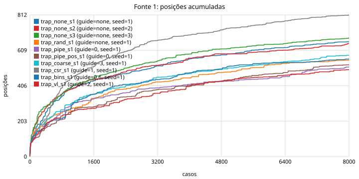
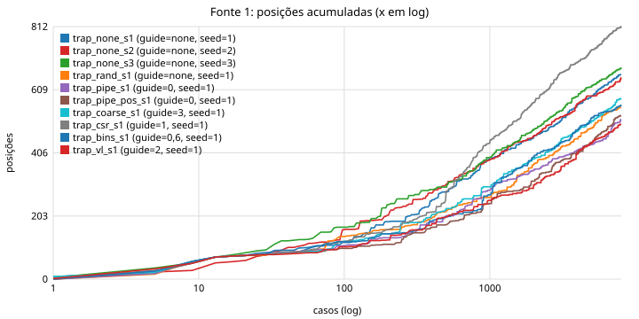

### Fonte 2 (verilator)

| execução | total | 50% | 90% | 99% | última nova | novas/janela início | meio | fim | % achado nos últimos 20% dos casos |
|---|---|---|---|---|---|---|---|---|---|
| trap_none_s1 | 1052 | 2 | 64 | 290 | 1070 | 1028 | 0 | 0 | 0.00% |
| trap_none_s2 | 1052 | 4 | 61 | 269 | 520 | 1030 | 0 | 0 | 0.00% |
| trap_none_s3 | 1052 | 2 | 63 | 253 | 536 | 1032 | 0 | 0 | 0.00% |
| trap_rand_s1 | 1052 | 4 | 212 | 1113 | 1951 | 946 | 0 | 0 | 0.00% |
| trap_pipe_s1 | 1052 | 2 | 135 | 1093 | 3044 | 973 | 0 | 0 | 0.00% |
| trap_pipe_pos_s1 | 1052 | 8 | 177 | 1209 | 4323 | 958 | 0 | 0 | 0.00% |
| trap_coarse_s1 | 1052 | 4 | 160 | 1237 | 3413 | 964 | 0 | 0 | 0.00% |
| trap_csr_s1 | 1052 | 3 | 140 | 1229 | 2567 | 965 | 0 | 0 | 0.00% |
| trap_bins_s1 | 1052 | 3 | 200 | 1098 | 1932 | 948 | 0 | 0 | 0.00% |
| trap_vl_s1 | 1052 | 4 | 156 | 966 | 1712 | 961 | 0 | 0 | 0.00% |

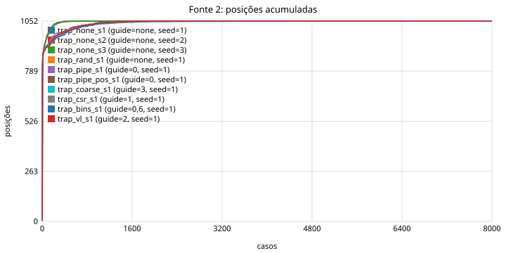
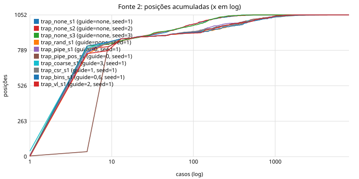

### Fonte 3 (pipe_coarse)

| execução | total | 50% | 90% | 99% | última nova | novas/janela início | meio | fim | % achado nos últimos 20% dos casos |
|---|---|---|---|---|---|---|---|---|---|
| trap_none_s1 | 1914 | 343 | 4698 | 7499 | 7991 | 815 | 23 | 5 | 3.71% |
| trap_none_s2 | 1888 | 333 | 4576 | 7620 | 7973 | 826 | 22 | 13 | 4.87% |
| trap_none_s3 | 1913 | 378 | 4379 | 7569 | 7990 | 737 | 18 | 7 | 4.65% |
| trap_rand_s1 | 1614 | 590 | 4898 | 7458 | 7924 | 585 | 15 | 3 | 3.97% |
| trap_pipe_s1 | 1688 | 626 | 5205 | 7642 | 7946 | 611 | 21 | 8 | 4.68% |
| trap_pipe_pos_s1 | 1697 | 575 | 4949 | 7627 | 7941 | 604 | 14 | 6 | 4.54% |
| trap_coarse_s1 | 1715 | 526 | 4989 | 7613 | 7973 | 645 | 18 | 4 | 4.26% |
| trap_csr_s1 | 1638 | 555 | 5199 | 7685 | 7997 | 621 | 20 | 10 | 5.37% |
| trap_bins_s1 | 1685 | 556 | 5291 | 7799 | 7991 | 599 | 13 | 16 | 4.69% |
| trap_vl_s1 | 1640 | 522 | 5221 | 7599 | 7985 | 637 | 16 | 6 | 4.94% |

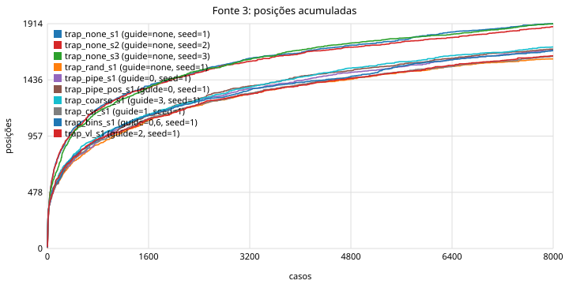
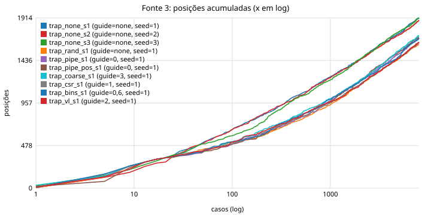

### Fonte 6 (bins)

| execução | total | 50% | 90% | 99% | última nova | novas/janela início | meio | fim | % achado nos últimos 20% dos casos |
|---|---|---|---|---|---|---|---|---|---|
| trap_none_s1 | 49 | 6 | 49 | 1070 | 1070 | 48 | 0 | 0 | 0.00% |
| trap_none_s2 | 49 | 5 | 74 | 771 | 771 | 47 | 0 | 0 | 0.00% |
| trap_none_s3 | 49 | 3 | 33 | 215 | 215 | 48 | 0 | 0 | 0.00% |
| trap_rand_s1 | 49 | 6 | 271 | 5885 | 5885 | 44 | 0 | 0 | 0.00% |
| trap_pipe_s1 | 49 | 6 | 317 | 1141 | 1141 | 44 | 0 | 0 | 0.00% |
| trap_pipe_pos_s1 | 49 | 8 | 118 | 4323 | 4323 | 45 | 0 | 0 | 0.00% |
| trap_coarse_s1 | 49 | 6 | 118 | 1924 | 1924 | 46 | 0 | 0 | 0.00% |
| trap_csr_s1 | 49 | 6 | 182 | 2012 | 2012 | 45 | 0 | 0 | 0.00% |
| trap_bins_s1 | 49 | 4 | 246 | 3168 | 3168 | 44 | 0 | 0 | 0.00% |
| trap_vl_s1 | 49 | 7 | 84 | 2421 | 2421 | 45 | 0 | 0 | 0.00% |

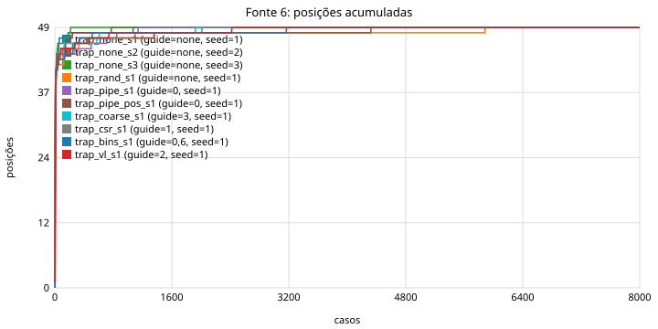
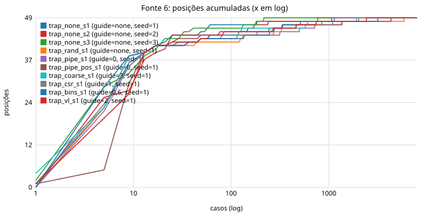

## 4. Colisões de hash e estabilidade

| execução | colisões fonte 0 (posições com 2+ chaves) | colisões fonte 1 | estabilidade |
|---|---|---|---|
| trap_none_s1 | 514 (3.52% das posições) | 29 | sem calibração |
| trap_none_s2 | 503 (3.47% das posições) | 30 | sem calibração |
| trap_none_s3 | 530 (3.63% das posições) | 27 | sem calibração |
| trap_rand_s1 | 568 (5.38% das posições) | 26 | sem calibração |
| trap_pipe_s1 | 562 (5.05% das posições) | 12 | sem calibração |
| trap_pipe_pos_s1 | 738 (6.63% das posições) | 14 | sem calibração |
| trap_coarse_s1 | 732 (6.69% das posições) | 18 | sem calibração |
| trap_csr_s1 | 509 (5.01% das posições) | 177 | sem calibração |
| trap_bins_s1 | 762 (6.92% das posições) | 7 | sem calibração |
| trap_vl_s1 | 596 (5.85% das posições) | 7 | sem calibração |

Colisão = uma posição do mapa que, dentro de um mesmo caso, recebeu duas chaves originais diferentes (medido na sonda, coluna `colidiu`). Instável = posição cuja contagem mudou entre duas execuções do mesmo binário.

## 5. Fonte 0 em detalhe: estados, durações e raridade

### trap_none_s1

- arestas (posições): **14599**; snapshots distintos: **3833**; arestas por snapshot: 3.8
- raridade: 4617 arestas vistas em 1 caso só (31.6%), 6001 em 2–9 casos, 3981 em 10+ casos
- estimativa Chao1 do total alcançável por este gerador: **19907** arestas (observadas 14599, 73%)
- distribuição da duração do estado de origem: 1: 13537, 2: 644, 3: 203, 4-7: 172, 8-15: 24, 16-31: 11, 32-127: 8
- snapshots por classe em execute: alu: 680, load: 508, div: 432, branch: 397, csr: 381, bubble: 361, mul: 356, store: 349, sys: 166, jal: 165, jalr: 37, other: 1

Arestas mais comuns (freq = casos em que apareceu):

| freq | aresta |
|---|---|
| 8000 | `[x=csr fq=1 m/r=res/-] --1c(1)--> [x=alu fwd=ex/rf fq=1 m/r=-/res]` |
| 8000 | `[x=alu fwd=ex/rf fq=1 m/r=res/res] --2c(2)--> [x=csr fq=1 m/r=res/res]` |
| 8000 | `[x=alu fwd=mem/ex fq=1 m/r=res/res] --1c(1)--> [x=alu fq=1 m/r=res/res]` |
| 8000 | `[x=alu fwd=ex/rf fq=1 m/r=-/res] --1c(1)--> [x=alu fq=1 m/r=res/-]` |
| 8000 | `[x=alu fwd=ex/rf mul=AHBH fq=1 m/r=-/-] --1c(1)--> [x=alu fwd=ex/rf fq=1 m/r=res/-]` |
| 8000 | `[x=alu fwd=ex/rf fq=1 m/r=res/res] --2c(2)--> [x=alu fwd=mem/rf fq=1 m/r=res/res]` |

Exemplos de arestas vistas uma única vez (caso que as descobriu):

| caso | aresta |
|---|---|
| 7986 | `[x=csr fwd=rf/ex fq=1 m/r=res/res] --1c(1)--> [x=div fq=1 m/r=res/res]` |
| 7987 | `[x=csr fwd=ex/ret fq=1 m/r=res/res] --1c(1)--> [x=mul fq=1 m/r=res/res]` |
| 7988 | `[x=alu fwd=ret/rf fq=2 m/r=-/res] --1c(1)--> [x=branch fq=2 m/r=res/-]` |
| 7990 | `[x=jal bpt jumping fq=2 m/r=-/res mie] --1c(1)--> [x=bubble killed dec_invalid jumping fq=1 m/r=res/- mie]` |
| 7990 | `[x=csr bp_take fq=2 m/r=res/- mie] --1c(1)--> [x=jal bpt jumping fq=2 m/r=-/res mie]` |
| 7990 | `[x=csr fq=2 m/r=-/res mie] --1c(1)--> [x=csr bp_take fq=2 m/r=res/- mie]` |
| 7990 | `[x=csr fq=2 m/r=-/- mie] --1c(1)--> [x=csr fq=2 m/r=res/- mie]` |
| 7992 | `[x=csr fwd=ex/ex fq=1 m/r=res/- mie] --1c(1)--> [x=alu fwd=ex/rf fq=1 m/r=res/res mie]` |

### trap_none_s2

- arestas (posições): **14513**; snapshots distintos: **3740**; arestas por snapshot: 3.9
- raridade: 4610 arestas vistas em 1 caso só (31.8%), 5885 em 2–9 casos, 4018 em 10+ casos
- estimativa Chao1 do total alcançável por este gerador: **20047** arestas (observadas 14513, 72%)
- distribuição da duração do estado de origem: 1: 13465, 2: 614, 3: 245, 4-7: 148, 8-15: 23, 16-31: 8, 32-127: 10
- snapshots por classe em execute: alu: 675, load: 525, div: 421, branch: 385, csr: 365, bubble: 360, mul: 342, store: 333, sys: 155, jal: 141, jalr: 37, other: 1

Arestas mais comuns (freq = casos em que apareceu):

| freq | aresta |
|---|---|
| 8000 | `[x=csr fq=1 m/r=res/-] --1c(1)--> [x=alu fwd=ex/rf fq=1 m/r=-/res]` |
| 8000 | `[x=alu fwd=ex/rf fq=1 m/r=res/res] --2c(2)--> [x=csr fq=1 m/r=res/res]` |
| 8000 | `[x=alu fwd=mem/ex fq=1 m/r=res/res] --1c(1)--> [x=alu fq=1 m/r=res/res]` |
| 8000 | `[x=alu fwd=ex/rf fq=1 m/r=-/res] --1c(1)--> [x=alu fq=1 m/r=res/-]` |
| 8000 | `[x=alu fwd=ex/rf mul=AHBH fq=1 m/r=-/-] --1c(1)--> [x=alu fwd=ex/rf fq=1 m/r=res/-]` |
| 8000 | `[x=alu fwd=ex/rf fq=1 m/r=res/res] --2c(2)--> [x=alu fwd=mem/rf fq=1 m/r=res/res]` |

Exemplos de arestas vistas uma única vez (caso que as descobriu):

| caso | aresta |
|---|---|
| 7983 | `[x=csr fwd=ret/ret fq=2 m/r=res/res] --1c(1)--> [x=csr fq=2 m/r=res/res]` |
| 7987 | `[x=alu fwd=ret/mem fq=1 m/r=res/res mie] --1c(1)--> [x=alu fwd=ex/rf fq=1 m/r=res/res mie]` |
| 7989 | `[x=alu fwd=mem/rf fq=1 m/r=res/-] --1c(1)--> [x=mul fwd=rf/ret fq=1 m/r=res/res]` |
| 7989 | `[x=csr fwd=rf/ex fq=2 m/r=load/load] --1c(1)--> [x=csr fq=2 m/r=res/load]` |
| 7989 | `[x=load fq=2 m/r=load/load] --2c(2)--> [x=csr fwd=rf/ex fq=2 m/r=load/load]` |
| 7992 | `[x=bubble hz fwd=ret/ret fq=3 m/r=res/load] --1c(1)--> [x=div fq=2 m/r=-/res]` |
| 7996 | `[x=alu fwd=ret/mem fq=1 m/r=res/res mie] --1c(1)--> [x=alu fwd=rf/ret fq=1 m/r=res/res mie]` |
| 7996 | `[x=alu fwd=rf/ret fq=1 m/r=res/res mie] --1c(1)--> [x=store fq=1 m/r=res/res mie]` |

### trap_none_s3

- arestas (posições): **14603**; snapshots distintos: **3782**; arestas por snapshot: 3.9
- raridade: 4608 arestas vistas em 1 caso só (31.6%), 5946 em 2–9 casos, 4049 em 10+ casos
- estimativa Chao1 do total alcançável por este gerador: **19962** arestas (observadas 14603, 73%)
- distribuição da duração do estado de origem: 1: 13532, 2: 648, 3: 226, 4-7: 153, 8-15: 26, 16-31: 9, 32-127: 9
- snapshots por classe em execute: alu: 665, load: 522, div: 422, branch: 396, csr: 385, bubble: 362, store: 353, mul: 333, sys: 162, jal: 139, jalr: 42, other: 1

Arestas mais comuns (freq = casos em que apareceu):

| freq | aresta |
|---|---|
| 8000 | `[x=csr fq=1 m/r=res/-] --1c(1)--> [x=alu fwd=ex/rf fq=1 m/r=-/res]` |
| 8000 | `[x=alu fwd=ex/rf fq=1 m/r=res/res] --2c(2)--> [x=csr fq=1 m/r=res/res]` |
| 8000 | `[x=alu fwd=mem/ex fq=1 m/r=res/res] --1c(1)--> [x=alu fq=1 m/r=res/res]` |
| 8000 | `[x=alu fwd=ex/rf fq=1 m/r=-/res] --1c(1)--> [x=alu fq=1 m/r=res/-]` |
| 8000 | `[x=alu fwd=ex/rf mul=AHBH fq=1 m/r=-/-] --1c(1)--> [x=alu fwd=ex/rf fq=1 m/r=res/-]` |
| 8000 | `[x=alu fwd=ex/rf fq=1 m/r=res/res] --2c(2)--> [x=alu fwd=mem/rf fq=1 m/r=res/res]` |

Exemplos de arestas vistas uma única vez (caso que as descobriu):

| caso | aresta |
|---|---|
| 7989 | `[x=store fq=2 m/r=load/load] --1c(1)--> [x=store fwd=ret/rf fq=2 m/r=-/load]` |
| 7989 | `[x=store fwd=ret/rf fq=2 m/r=-/load] --1c(1)--> [x=branch fq=2 m/r=-/-]` |
| 7990 | `[x=alu fwd=ex/rf fq=1 m/r=-/- mie] --1c(1)--> [x=div fwd=rf/mem irq_pend fq=1 m/r=res/- mie]` |
| 7991 | `[x=alu fwd=mem/rf fq=2 m/r=res/- mie] --1c(1)--> [x=csr fwd=rf/mem fq=2 m/r=res/res mie]` |
| 7992 | `[x=csr fq=1 m/r=-/-] --4c(4-7)--> [x=alu fwd=ex/rf fq=1 m/r=res/-]` |
| 7993 | `[x=alu fwd=ex/ex fq=1 m/r=-/- U] --1c(1)--> [x=branch fwd=mem/mem jump fq=1 m/r=res/- U]` |
| 7993 | `[x=alu fwd=rf/ret fq=1 m/r=res/res] --3c(3)--> [x=alu fwd=mem/rf fq=1 m/r=res/res]` |
| 7996 | `[x=branch bpt fwd=ret/rf jumping rollback fq=1 m/r=res/res] --1c(1)--> [x=csr fq=0 m/r=-/res]` |

### trap_rand_s1

- arestas (posições): **10553**; snapshots distintos: **3091**; arestas por snapshot: 3.4
- raridade: 2521 arestas vistas em 1 caso só (23.9%), 4242 em 2–9 casos, 3790 em 10+ casos
- estimativa Chao1 do total alcançável por este gerador: **13038** arestas (observadas 10553, 81%)
- distribuição da duração do estado de origem: 1: 9855, 2: 390, 3: 150, 4-7: 135, 8-15: 10, 16-31: 7, 32-127: 6
- snapshots por classe em execute: alu: 580, load: 412, div: 323, branch: 320, bubble: 316, csr: 303, store: 282, mul: 276, sys: 124, jal: 122, jalr: 32, other: 1

Arestas mais comuns (freq = casos em que apareceu):

| freq | aresta |
|---|---|
| 8000 | `[x=csr fq=1 m/r=res/-] --1c(1)--> [x=alu fwd=ex/rf fq=1 m/r=-/res]` |
| 8000 | `[x=alu fwd=ex/rf fq=1 m/r=res/res] --2c(2)--> [x=csr fq=1 m/r=res/res]` |
| 8000 | `[x=alu fwd=mem/ex fq=1 m/r=res/res] --1c(1)--> [x=alu fq=1 m/r=res/res]` |
| 8000 | `[x=alu fwd=ex/rf fq=1 m/r=-/res] --1c(1)--> [x=alu fq=1 m/r=res/-]` |
| 8000 | `[x=alu fwd=ex/rf mul=AHBH fq=1 m/r=-/-] --1c(1)--> [x=alu fwd=ex/rf fq=1 m/r=res/-]` |
| 8000 | `[x=alu fwd=ex/rf fq=1 m/r=res/res] --2c(2)--> [x=alu fwd=mem/rf fq=1 m/r=res/res]` |

Exemplos de arestas vistas uma única vez (caso que as descobriu):

| caso | aresta |
|---|---|
| 7982 | `[x=store fq=1 m/r=res/res] --1c(1)--> [x=alu fwd=ex/ex stall fq=1 m/r=-/res]` |
| 7982 | `[x=alu fwd=ex/ex stall fq=1 m/r=-/res] --1c(1)--> [x=alu fwd=ex/ex stall fq=2 m/r=-/-]` |
| 7982 | `[x=alu fwd=ret/rf fq=1 m/r=res/res U] --1c(1)--> [x=alu fwd=mem/rf fq=1 m/r=res/res U]` |
| 7995 | `[x=branch bpt fwd=rf/ret jumping rollback fq=2 m/r=res/res] --1c(1)--> [x=store fq=2 m/r=-/res]` |
| 7996 | `[x=branch fwd=mem/rf fq=2 m/r=res/-] --1c(1)--> [x=alu fwd=rf/ret fq=2 m/r=-/res]` |
| 7996 | `[x=alu fwd=rf/ret fq=2 m/r=-/res] --1c(1)--> [x=alu fwd=mem/rf fq=2 m/r=res/-]` |
| 7997 | `[x=csr fwd=ret/mem fq=1 m/r=res/res] --1c(1)--> [x=alu fwd=ret/rf fq=1 m/r=res/res]` |
| 7999 | `[x=branch bpt fwd=ret/rf jumping rollback fq=2 m/r=res/res] --1c(1)--> [x=alu fwd=ex/rf fq=2 m/r=-/res]` |

### trap_pipe_s1

- arestas (posições): **11124**; snapshots distintos: **3245**; arestas por snapshot: 3.4
- raridade: 2040 arestas vistas em 1 caso só (18.3%), 4603 em 2–9 casos, 4481 em 10+ casos
- estimativa Chao1 do total alcançável por este gerador: **12783** arestas (observadas 11124, 87%)
- distribuição da duração do estado de origem: 1: 10399, 2: 435, 3: 155, 4-7: 105, 8-15: 11, 16-31: 9, 32-127: 10
- snapshots por classe em execute: alu: 592, load: 450, branch: 344, div: 339, csr: 321, bubble: 320, store: 301, mul: 271, sys: 143, jal: 128, jalr: 35, other: 1

Arestas mais comuns (freq = casos em que apareceu):

| freq | aresta |
|---|---|
| 8000 | `[x=csr fq=1 m/r=res/-] --1c(1)--> [x=alu fwd=ex/rf fq=1 m/r=-/res]` |
| 8000 | `[x=alu fwd=ex/rf fq=1 m/r=res/res] --2c(2)--> [x=csr fq=1 m/r=res/res]` |
| 8000 | `[x=alu fwd=mem/ex fq=1 m/r=res/res] --1c(1)--> [x=alu fq=1 m/r=res/res]` |
| 8000 | `[x=alu fwd=ex/rf fq=1 m/r=-/res] --1c(1)--> [x=alu fq=1 m/r=res/-]` |
| 8000 | `[x=alu fwd=ex/rf mul=AHBH fq=1 m/r=-/-] --1c(1)--> [x=alu fwd=ex/rf fq=1 m/r=res/-]` |
| 8000 | `[x=alu fwd=ex/rf fq=1 m/r=res/res] --2c(2)--> [x=alu fwd=mem/rf fq=1 m/r=res/res]` |

Exemplos de arestas vistas uma única vez (caso que as descobriu):

| caso | aresta |
|---|---|
| 7995 | `[x=alu fq=3 m/r=load/-] --1c(1)--> [x=alu fwd=ret/ex fq=2 m/r=res/load]` |
| 7996 | `[x=store fq=3 m/r=load/-] --1c(1)--> [x=csr fwd=ex/ex fq=2 m/r=-/load]` |
| 7996 | `[x=csr fq=2 m/r=res/res] --2c(2)--> [x=load fq=2 m/r=-/res]` |
| 7998 | `[x=alu fwd=rf/mem fq=2 m/r=res/- U] --1c(1)--> [x=csr exc fq=2 m/r=res/res U]` |
| 7999 | `[x=csr irq_ack irq_pend fq=3 m/r=-/- mie] --1c(1)--> [x=bubble killed jumping fq=0 m/r=-/-]` |
| 7999 | `[x=csr stall irq_pend fq=2 m/r=-/- mie] --1c(1)--> [x=csr stall irq_pend fq=3 m/r=-/- mie]` |
| 7999 | `[x=store fq=2 m/r=-/- mie] --1c(1)--> [x=csr stall irq_pend fq=2 m/r=-/- mie]` |
| 7999 | `[x=csr stall irq_pend fq=3 m/r=-/- mie] --1c(1)--> [x=csr irq_ack irq_pend fq=3 m/r=-/- mie]` |

### trap_pipe_pos_s1

- arestas (posições): **11136**; snapshots distintos: **3217**; arestas por snapshot: 3.5
- raridade: 2113 arestas vistas em 1 caso só (19.0%), 4613 em 2–9 casos, 4410 em 10+ casos
- estimativa Chao1 do total alcançável por este gerador: **12925** arestas (observadas 11136, 86%)
- distribuição da duração do estado de origem: 1: 10369, 2: 447, 3: 170, 4-7: 123, 8-15: 11, 16-31: 6, 32-127: 10
- snapshots por classe em execute: alu: 576, load: 449, branch: 352, bubble: 336, div: 326, csr: 317, store: 279, mul: 275, sys: 150, jal: 124, jalr: 32, other: 1

Arestas mais comuns (freq = casos em que apareceu):

| freq | aresta |
|---|---|
| 8000 | `[x=csr fq=1 m/r=res/-] --1c(1)--> [x=alu fwd=ex/rf fq=1 m/r=-/res]` |
| 8000 | `[x=alu fwd=ex/rf fq=1 m/r=res/res] --2c(2)--> [x=csr fq=1 m/r=res/res]` |
| 8000 | `[x=alu fwd=mem/ex fq=1 m/r=res/res] --1c(1)--> [x=alu fq=1 m/r=res/res]` |
| 8000 | `[x=alu fwd=ex/rf fq=1 m/r=-/res] --1c(1)--> [x=alu fq=1 m/r=res/-]` |
| 8000 | `[x=alu fwd=ex/rf mul=AHBH fq=1 m/r=-/-] --1c(1)--> [x=alu fwd=ex/rf fq=1 m/r=res/-]` |
| 8000 | `[x=alu fwd=ex/rf fq=1 m/r=res/res] --2c(2)--> [x=alu fwd=mem/rf fq=1 m/r=res/res]` |

Exemplos de arestas vistas uma única vez (caso que as descobriu):

| caso | aresta |
|---|---|
| 7991 | `[x=load fq=2 m/r=res/- U] --1c(1)--> [x=csr stall fq=2 m/r=load/res U]` |
| 7991 | `[x=alu fq=3 m/r=load/-] --1c(1)--> [x=alu fwd=ret/ex fq=2 m/r=res/load]` |
| 7991 | `[x=load fwd=ex/mem dec_hz=rs1rs2 stall fq=2 m/r=load/- U] --1c(1)--> [x=load fwd=ex/mem dec_hz=rs1rs2 stall fq=3 m/r=load/- U]` |
| 7992 | `[x=bubble killed fwd=ret/rf fq=1 m/r=res/res] --1c(1)--> [x=alu fq=1 m/r=-/res]` |
| 7992 | `[x=alu dec_invalid fq=1 m/r=res/-] --1c(1)--> [x=bubble killed fwd=ret/rf fq=1 m/r=res/res]` |
| 7992 | `[x=branch bpt jumping rollback fq=1 m/r=res/res] --1c(1)--> [x=alu fwd=rf/ret fq=0 m/r=-/res]` |
| 7992 | `[x=csr fq=2 m/r=res/res] --2c(2)--> [x=load fq=2 m/r=-/res]` |
| 7992 | `[x=alu fwd=rf/ret fq=0 m/r=-/res] --1c(1)--> [x=alu dec_invalid fq=1 m/r=res/-]` |

### trap_coarse_s1

- arestas (posições): **10945**; snapshots distintos: **3205**; arestas por snapshot: 3.4
- raridade: 2922 arestas vistas em 1 caso só (26.7%), 4045 em 2–9 casos, 3978 em 10+ casos
- estimativa Chao1 do total alcançável por este gerador: **14341** arestas (observadas 10945, 76%)
- distribuição da duração do estado de origem: 1: 10218, 2: 426, 3: 151, 4-7: 122, 8-15: 14, 16-31: 6, 32-127: 8
- snapshots por classe em execute: alu: 574, load: 441, branch: 346, csr: 345, bubble: 326, div: 312, store: 297, mul: 257, jal: 137, sys: 133, jalr: 36, other: 1

Arestas mais comuns (freq = casos em que apareceu):

| freq | aresta |
|---|---|
| 8000 | `[x=csr fq=1 m/r=res/-] --1c(1)--> [x=alu fwd=ex/rf fq=1 m/r=-/res]` |
| 8000 | `[x=alu fwd=ex/rf fq=1 m/r=res/res] --2c(2)--> [x=csr fq=1 m/r=res/res]` |
| 8000 | `[x=alu fwd=mem/ex fq=1 m/r=res/res] --1c(1)--> [x=alu fq=1 m/r=res/res]` |
| 8000 | `[x=alu fwd=ex/rf fq=1 m/r=-/res] --1c(1)--> [x=alu fq=1 m/r=res/-]` |
| 8000 | `[x=alu fwd=ex/rf mul=AHBH fq=1 m/r=-/-] --1c(1)--> [x=alu fwd=ex/rf fq=1 m/r=res/-]` |
| 8000 | `[x=alu fwd=ex/rf fq=1 m/r=res/res] --2c(2)--> [x=alu fwd=mem/rf fq=1 m/r=res/res]` |

Exemplos de arestas vistas uma única vez (caso que as descobriu):

| caso | aresta |
|---|---|
| 7991 | `[x=load exc fq=2 m/r=res/res] --1c(1)--> [x=bubble killed dec_hz=rs2 jumping fq=0 m/r=load/res]` |
| 7991 | `[x=csr fwd=mem/rf exc fq=2 m/r=res/load U] --1c(1)--> [x=bubble killed jumping fq=0 m/r=-/res]` |
| 7993 | `[x=alu fwd=ex/ret fq=1 m/r=res/res mie] --1c(1)--> [x=mul fwd=ret/rf fq=1 m/r=res/res mie]` |
| 7993 | `[x=alu fwd=rf/ex fq=2 m/r=res/res mie] --1c(1)--> [x=mul fwd=ret/rf fq=2 m/r=res/res mie]` |
| 7993 | `[x=alu fq=2 m/r=-/res mie] --1c(1)--> [x=branch jump fq=2 m/r=res/- mie]` |
| 7993 | `[x=alu fwd=ex/rf fq=1 m/r=res/res mie] --1c(1)--> [x=csr exc fq=1 m/r=res/res mie]` |
| 7994 | `[x=store fq=1 m/r=res/- mie] --1c(1)--> [x=csr fwd=ret/rf stall fq=1 m/r=-/res mie]` |
| 7994 | `[x=csr fwd=ret/rf stall fq=1 m/r=-/res mie] --1c(1)--> [x=csr stall fq=2 m/r=-/- mie]` |

### trap_csr_s1

- arestas (posições): **10155**; snapshots distintos: **3057**; arestas por snapshot: 3.3
- raridade: 3522 arestas vistas em 1 caso só (34.7%), 3759 em 2–9 casos, 2874 em 10+ casos
- estimativa Chao1 do total alcançável por este gerador: **14763** arestas (observadas 10155, 69%)
- distribuição da duração do estado de origem: 1: 9445, 2: 405, 3: 150, 4-7: 121, 8-15: 16, 16-31: 9, 32-127: 9
- snapshots por classe em execute: alu: 553, load: 433, div: 329, csr: 308, bubble: 307, branch: 300, store: 285, mul: 266, sys: 128, jal: 118, jalr: 29, other: 1

Arestas mais comuns (freq = casos em que apareceu):

| freq | aresta |
|---|---|
| 8000 | `[x=csr fq=1 m/r=res/-] --1c(1)--> [x=alu fwd=ex/rf fq=1 m/r=-/res]` |
| 8000 | `[x=alu fwd=ex/rf fq=1 m/r=res/res] --2c(2)--> [x=csr fq=1 m/r=res/res]` |
| 8000 | `[x=alu fwd=mem/ex fq=1 m/r=res/res] --1c(1)--> [x=alu fq=1 m/r=res/res]` |
| 8000 | `[x=alu fwd=ex/rf fq=1 m/r=-/res] --1c(1)--> [x=alu fq=1 m/r=res/-]` |
| 8000 | `[x=alu fwd=ex/rf mul=AHBH fq=1 m/r=-/-] --1c(1)--> [x=alu fwd=ex/rf fq=1 m/r=res/-]` |
| 8000 | `[x=alu fwd=ex/rf fq=1 m/r=res/res] --2c(2)--> [x=alu fwd=mem/rf fq=1 m/r=res/res]` |

Exemplos de arestas vistas uma única vez (caso que as descobriu):

| caso | aresta |
|---|---|
| 7977 | `[x=branch bpt fwd=rf/mem jumping fq=0 m/r=res/res] --1c(1)--> [x=bubble killed dec_invalid jumping fq=1 m/r=-/res]` |
| 7977 | `[x=branch bpt fwd=rf/mem jumping rollback fq=1 m/r=res/res] --1c(1)--> [x=store dec_hz=mem fq=0 m/r=-/res]` |
| 7979 | `[x=mul mul=AHBL fq=3 m/r=-/-] --1c(1)--> [x=csr exc fq=2 m/r=res/-]` |
| 7987 | `[x=alu fwd=ret/ex fq=2 m/r=res/res U] --1c(1)--> [x=branch jump fq=2 m/r=res/res U]` |
| 7989 | `[x=sys fwd=ret/rf stall fq=2 m/r=load/res] --1c(1)--> [x=sys stall fq=3 m/r=load/-]` |
| 7991 | `[x=csr fq=1 m/r=res/-] --1c(1)--> [x=alu fwd=ret/rf fq=1 m/r=res/res]` |
| 7999 | `[x=alu fwd=rf/ex fq=1 m/r=-/- U] --1c(1)--> [x=alu fwd=ex/mem fq=1 m/r=res/- U]` |
| 7999 | `[x=branch fwd=mem/mem fq=1 m/r=res/res U] --1c(1)--> [x=alu fq=1 m/r=-/res U]` |

### trap_bins_s1

- arestas (posições): **11008**; snapshots distintos: **3211**; arestas por snapshot: 3.4
- raridade: 2091 arestas vistas em 1 caso só (19.0%), 4532 em 2–9 casos, 4385 em 10+ casos
- estimativa Chao1 do total alcançável por este gerador: **12717** arestas (observadas 11008, 87%)
- distribuição da duração do estado de origem: 1: 10257, 2: 446, 3: 144, 4-7: 128, 8-15: 17, 16-31: 8, 32-127: 8
- snapshots por classe em execute: alu: 577, load: 447, branch: 344, csr: 336, div: 333, bubble: 323, store: 296, mul: 273, sys: 136, jal: 112, jalr: 33, other: 1

Arestas mais comuns (freq = casos em que apareceu):

| freq | aresta |
|---|---|
| 8000 | `[x=csr fq=1 m/r=res/-] --1c(1)--> [x=alu fwd=ex/rf fq=1 m/r=-/res]` |
| 8000 | `[x=alu fwd=ex/rf fq=1 m/r=res/res] --2c(2)--> [x=csr fq=1 m/r=res/res]` |
| 8000 | `[x=alu fwd=mem/ex fq=1 m/r=res/res] --1c(1)--> [x=alu fq=1 m/r=res/res]` |
| 8000 | `[x=alu fwd=ex/rf fq=1 m/r=-/res] --1c(1)--> [x=alu fq=1 m/r=res/-]` |
| 8000 | `[x=alu fwd=ex/rf mul=AHBH fq=1 m/r=-/-] --1c(1)--> [x=alu fwd=ex/rf fq=1 m/r=res/-]` |
| 8000 | `[x=alu fwd=ex/rf fq=1 m/r=res/res] --2c(2)--> [x=alu fwd=mem/rf fq=1 m/r=res/res]` |

Exemplos de arestas vistas uma única vez (caso que as descobriu):

| caso | aresta |
|---|---|
| 7987 | `[x=csr fwd=rf/ex fq=2 m/r=-/res] --1c(1)--> [x=csr fwd=ex/ex fq=2 m/r=res/-]` |
| 7987 | `[x=csr fq=1 m/r=res/res] --4c(4-7)--> [x=load fwd=ex/mem dec_hz=rs1 fq=1 m/r=res/res]` |
| 7989 | `[x=csr fq=2 m/r=res/res] --4c(4-7)--> [x=csr fq=2 m/r=-/res]` |
| 7989 | `[x=csr fwd=rf/mem fq=2 m/r=res/-] --1c(1)--> [x=div fq=2 m/r=res/res]` |
| 7990 | `[x=alu fwd=rf/ex fq=2 m/r=-/- mie] --1c(1)--> [x=mul fwd=mem/rf irq_pend fq=2 m/r=res/- mie]` |
| 7990 | `[x=load fq=2 m/r=load/load] --2c(2)--> [x=alu fwd=mem/rf dec_hz=rs1 fq=2 m/r=load/load]` |
| 7990 | `[x=csr fwd=rf/mem fq=1 m/r=res/- mie] --1c(1)--> [x=csr fwd=ret/rf fq=1 m/r=-/res]` |
| 7990 | `[x=mul fwd=ret/rf mul=ALBL irq_pend fq=3 m/r=-/res mie] --1c(1)--> [x=mul mul=ALBH irq_pend fq=3 m/r=-/- mie]` |

### trap_vl_s1

- arestas (posições): **10193**; snapshots distintos: **3064**; arestas por snapshot: 3.3
- raridade: 3371 arestas vistas em 1 caso só (33.1%), 3905 em 2–9 casos, 2917 em 10+ casos
- estimativa Chao1 do total alcançável por este gerador: **14504** arestas (observadas 10193, 70%)
- distribuição da duração do estado de origem: 1: 9524, 2: 400, 3: 132, 4-7: 109, 8-15: 14, 16-31: 6, 32-127: 8
- snapshots por classe em execute: alu: 548, load: 422, bubble: 323, branch: 322, div: 304, csr: 299, mul: 284, store: 280, sys: 137, jal: 116, jalr: 28, other: 1

Arestas mais comuns (freq = casos em que apareceu):

| freq | aresta |
|---|---|
| 8000 | `[x=csr fq=1 m/r=res/-] --1c(1)--> [x=alu fwd=ex/rf fq=1 m/r=-/res]` |
| 8000 | `[x=alu fwd=ex/rf fq=1 m/r=res/res] --2c(2)--> [x=csr fq=1 m/r=res/res]` |
| 8000 | `[x=alu fwd=mem/ex fq=1 m/r=res/res] --1c(1)--> [x=alu fq=1 m/r=res/res]` |
| 8000 | `[x=alu fwd=ex/rf fq=1 m/r=-/res] --1c(1)--> [x=alu fq=1 m/r=res/-]` |
| 8000 | `[x=alu fwd=ex/rf mul=AHBH fq=1 m/r=-/-] --1c(1)--> [x=alu fwd=ex/rf fq=1 m/r=res/-]` |
| 8000 | `[x=alu fwd=ex/rf fq=1 m/r=res/res] --2c(2)--> [x=alu fwd=mem/rf fq=1 m/r=res/res]` |

Exemplos de arestas vistas uma única vez (caso que as descobriu):

| caso | aresta |
|---|---|
| 7975 | `[x=load exc fq=2 m/r=res/res] --1c(1)--> [x=bubble killed dec_hz=rs2 jumping fq=0 m/r=load/res]` |
| 7975 | `[x=csr fwd=mem/rf exc fq=2 m/r=res/load U] --1c(1)--> [x=bubble killed jumping fq=0 m/r=-/res]` |
| 7979 | `[x=mul mul=AHBL fq=3 m/r=-/-] --1c(1)--> [x=store fwd=rf/mem fq=2 m/r=res/-]` |
| 7984 | `[x=csr fq=1 m/r=res/res] --1c(1)--> [x=load fwd=mem/rf exc fq=1 m/r=res/res]` |
| 7988 | `[x=sys fwd=mem/rf exc fq=2 m/r=res/res U] --1c(1)--> [x=bubble killed fwd=ret/rf jumping fq=0 m/r=-/res]` |
| 7998 | `[x=alu fwd=rf/ex fq=1 m/r=-/- U] --1c(1)--> [x=alu fwd=ex/mem fq=1 m/r=res/- U]` |
| 7998 | `[x=branch fwd=mem/mem fq=1 m/r=res/res U] --1c(1)--> [x=alu fq=1 m/r=-/res U]` |
| 7998 | `[x=alu fwd=ex/mem fq=1 m/r=res/- U] --1c(1)--> [x=branch fwd=mem/mem fq=1 m/r=res/res U]` |

## 6. Fonte 1: transições de trap/CSR

### trap_none_s1

- transições: 658; por evento: csr_w: 261, csr_r: 204, exc: 122, irq: 56, mret: 15
| freq | transição |
|---|---|
| 8000 | `csr_w mstatus @{M mie=0 mpie=0 mpp=3 ip=t} [x=csr]` |
| 8000 | `csr_w mtvec @{M mie=0 mpie=0 mpp=3 ip=t} [x=csr]` |
| 5031 | `mret  @{M mie=0 mpie=0 mpp=3 ip=t} => {M mie=0 mpie=1 mpp=0 ip=t} [x=sys]` |
| 3898 | `csr_r mcause @{M mie=0 mpie=0 mpp=3 ip=t} [x=csr]` |
| 3778 | `csr_r mepc @{M mie=0 mpie=0 mpp=3 ip=t} [x=csr]` |
| 3778 | `csr_w mepc @{M mie=0 mpie=0 mpp=3 ip=t} [x=csr]` |
| 3058 | `csr_r mcause @{M mie=0 mpie=0 mpp=0 ip=t} [x=csr]` |
| 3055 | `csr_w mstatus @{M mie=0 mpie=0 mpp=0 ip=t} => {M mie=0 mpie=0 mpp=3 ip=t} [x=csr]` |
| 3051 | `mret  @{M mie=0 mpie=0 mpp=0 ip=t} => {U mie=0 mpie=1 mpp=0 ip=t} [x=sys]` |
| 3051 | `csr_r mepc @{M mie=0 mpie=0 mpp=0 ip=t} [x=csr]` |

### trap_none_s2

- transições: 648; por evento: csr_w: 248, csr_r: 206, exc: 127, irq: 52, mret: 15
| freq | transição |
|---|---|
| 8000 | `csr_w mstatus @{M mie=0 mpie=0 mpp=3 ip=t} [x=csr]` |
| 8000 | `csr_w mtvec @{M mie=0 mpie=0 mpp=3 ip=t} [x=csr]` |
| 4967 | `mret  @{M mie=0 mpie=0 mpp=3 ip=t} => {M mie=0 mpie=1 mpp=0 ip=t} [x=sys]` |
| 3837 | `csr_r mcause @{M mie=0 mpie=0 mpp=3 ip=t} [x=csr]` |
| 3705 | `csr_r mepc @{M mie=0 mpie=0 mpp=3 ip=t} [x=csr]` |
| 3705 | `csr_w mepc @{M mie=0 mpie=0 mpp=3 ip=t} [x=csr]` |
| 3108 | `csr_w mstatus @{M mie=0 mpie=0 mpp=0 ip=t} => {M mie=0 mpie=0 mpp=3 ip=t} [x=csr]` |
| 3107 | `csr_r mcause @{M mie=0 mpie=0 mpp=0 ip=t} [x=csr]` |
| 3101 | `mret  @{M mie=0 mpie=0 mpp=0 ip=t} => {U mie=0 mpie=1 mpp=0 ip=t} [x=sys]` |
| 3101 | `csr_r mepc @{M mie=0 mpie=0 mpp=0 ip=t} [x=csr]` |

### trap_none_s3

- transições: 680; por evento: csr_w: 272, csr_r: 208, exc: 127, irq: 58, mret: 15
| freq | transição |
|---|---|
| 8000 | `csr_w mstatus @{M mie=0 mpie=0 mpp=3 ip=t} [x=csr]` |
| 8000 | `csr_w mtvec @{M mie=0 mpie=0 mpp=3 ip=t} [x=csr]` |
| 5017 | `mret  @{M mie=0 mpie=0 mpp=3 ip=t} => {M mie=0 mpie=1 mpp=0 ip=t} [x=sys]` |
| 3922 | `csr_r mcause @{M mie=0 mpie=0 mpp=3 ip=t} [x=csr]` |
| 3790 | `csr_r mepc @{M mie=0 mpie=0 mpp=3 ip=t} [x=csr]` |
| 3790 | `csr_w mepc @{M mie=0 mpie=0 mpp=3 ip=t} [x=csr]` |
| 3083 | `csr_r mcause @{M mie=0 mpie=0 mpp=0 ip=t} [x=csr]` |
| 3080 | `csr_w mstatus @{M mie=0 mpie=0 mpp=0 ip=t} => {M mie=0 mpie=0 mpp=3 ip=t} [x=csr]` |
| 3073 | `mret  @{M mie=0 mpie=0 mpp=0 ip=t} => {U mie=0 mpie=1 mpp=0 ip=t} [x=sys]` |
| 3073 | `csr_r mepc @{M mie=0 mpie=0 mpp=0 ip=t} [x=csr]` |

### trap_rand_s1

- transições: 552; por evento: csr_w: 223, csr_r: 174, exc: 96, irq: 45, mret: 14
| freq | transição |
|---|---|
| 8000 | `csr_w mstatus @{M mie=0 mpie=0 mpp=3 ip=t} [x=csr]` |
| 8000 | `csr_w mtvec @{M mie=0 mpie=0 mpp=3 ip=t} [x=csr]` |
| 4989 | `mret  @{M mie=0 mpie=0 mpp=3 ip=t} => {M mie=0 mpie=1 mpp=0 ip=t} [x=sys]` |
| 3738 | `csr_r mcause @{M mie=0 mpie=0 mpp=3 ip=t} [x=csr]` |
| 3648 | `csr_r mepc @{M mie=0 mpie=0 mpp=3 ip=t} [x=csr]` |
| 3648 | `csr_w mepc @{M mie=0 mpie=0 mpp=3 ip=t} [x=csr]` |
| 3287 | `csr_r mcause @{M mie=0 mpie=0 mpp=0 ip=t} [x=csr]` |
| 3277 | `csr_w mstatus @{M mie=0 mpie=0 mpp=0 ip=t} => {M mie=0 mpie=0 mpp=3 ip=t} [x=csr]` |
| 3274 | `mret  @{M mie=0 mpie=0 mpp=0 ip=t} => {U mie=0 mpie=1 mpp=0 ip=t} [x=sys]` |
| 3274 | `csr_r mepc @{M mie=0 mpie=0 mpp=0 ip=t} [x=csr]` |

### trap_pipe_s1

- transições: 513; por evento: csr_w: 203, csr_r: 165, exc: 90, irq: 41, mret: 14
| freq | transição |
|---|---|
| 8000 | `csr_w mstatus @{M mie=0 mpie=0 mpp=3 ip=t} [x=csr]` |
| 8000 | `csr_w mtvec @{M mie=0 mpie=0 mpp=3 ip=t} [x=csr]` |
| 5474 | `mret  @{M mie=0 mpie=0 mpp=3 ip=t} => {M mie=0 mpie=1 mpp=0 ip=t} [x=sys]` |
| 4221 | `csr_r mcause @{M mie=0 mpie=0 mpp=3 ip=t} [x=csr]` |
| 4132 | `csr_r mepc @{M mie=0 mpie=0 mpp=3 ip=t} [x=csr]` |
| 4132 | `csr_w mepc @{M mie=0 mpie=0 mpp=3 ip=t} [x=csr]` |
| 3896 | `csr_r mcause @{M mie=0 mpie=0 mpp=0 ip=t} [x=csr]` |
| 3894 | `csr_w mstatus @{M mie=0 mpie=0 mpp=0 ip=t} => {M mie=0 mpie=0 mpp=3 ip=t} [x=csr]` |
| 3892 | `mret  @{M mie=0 mpie=0 mpp=0 ip=t} => {U mie=0 mpie=1 mpp=0 ip=t} [x=sys]` |
| 3892 | `csr_r mepc @{M mie=0 mpie=0 mpp=0 ip=t} [x=csr]` |

### trap_pipe_pos_s1

- transições: 526; por evento: csr_w: 205, csr_r: 172, exc: 93, irq: 41, mret: 15
| freq | transição |
|---|---|
| 8000 | `csr_w mstatus @{M mie=0 mpie=0 mpp=3 ip=t} [x=csr]` |
| 8000 | `csr_w mtvec @{M mie=0 mpie=0 mpp=3 ip=t} [x=csr]` |
| 5412 | `mret  @{M mie=0 mpie=0 mpp=3 ip=t} => {M mie=0 mpie=1 mpp=0 ip=t} [x=sys]` |
| 4184 | `csr_r mcause @{M mie=0 mpie=0 mpp=3 ip=t} [x=csr]` |
| 4091 | `csr_r mepc @{M mie=0 mpie=0 mpp=3 ip=t} [x=csr]` |
| 4091 | `csr_w mepc @{M mie=0 mpie=0 mpp=3 ip=t} [x=csr]` |
| 3708 | `csr_w mstatus @{M mie=0 mpie=0 mpp=0 ip=t} => {M mie=0 mpie=0 mpp=3 ip=t} [x=csr]` |
| 3702 | `csr_r mcause @{M mie=0 mpie=0 mpp=0 ip=t} [x=csr]` |
| 3698 | `mret  @{M mie=0 mpie=0 mpp=0 ip=t} => {U mie=0 mpie=1 mpp=0 ip=t} [x=sys]` |
| 3698 | `csr_r mepc @{M mie=0 mpie=0 mpp=0 ip=t} [x=csr]` |

### trap_coarse_s1

- transições: 581; por evento: csr_w: 237, csr_r: 171, exc: 105, irq: 54, mret: 14
| freq | transição |
|---|---|
| 8000 | `csr_w mstatus @{M mie=0 mpie=0 mpp=3 ip=t} [x=csr]` |
| 8000 | `csr_w mtvec @{M mie=0 mpie=0 mpp=3 ip=t} [x=csr]` |
| 5424 | `mret  @{M mie=0 mpie=0 mpp=3 ip=t} => {M mie=0 mpie=1 mpp=0 ip=t} [x=sys]` |
| 4335 | `csr_r mcause @{M mie=0 mpie=0 mpp=3 ip=t} [x=csr]` |
| 4292 | `csr_r mepc @{M mie=0 mpie=0 mpp=3 ip=t} [x=csr]` |
| 4292 | `csr_w mepc @{M mie=0 mpie=0 mpp=3 ip=t} [x=csr]` |
| 3825 | `csr_r mcause @{M mie=0 mpie=0 mpp=0 ip=t} [x=csr]` |
| 3823 | `csr_w mstatus @{M mie=0 mpie=0 mpp=0 ip=t} => {M mie=0 mpie=0 mpp=3 ip=t} [x=csr]` |
| 3822 | `mret  @{M mie=0 mpie=0 mpp=0 ip=t} => {U mie=0 mpie=1 mpp=0 ip=t} [x=sys]` |
| 3822 | `csr_r mepc @{M mie=0 mpie=0 mpp=0 ip=t} [x=csr]` |

### trap_csr_s1

- transições: 812; por evento: csr_w: 313, csr_r: 235, exc: 185, irq: 65, mret: 14
| freq | transição |
|---|---|
| 8000 | `csr_w mstatus @{M mie=0 mpie=0 mpp=3 ip=t} [x=csr]` |
| 8000 | `csr_w mtvec @{M mie=0 mpie=0 mpp=3 ip=t} [x=csr]` |
| 4396 | `mret  @{M mie=0 mpie=0 mpp=3 ip=t} => {M mie=0 mpie=1 mpp=0 ip=t} [x=sys]` |
| 3026 | `csr_r mcause @{M mie=0 mpie=0 mpp=0 ip=t} [x=csr]` |
| 3025 | `csr_w mstatus @{M mie=0 mpie=0 mpp=0 ip=t} => {M mie=0 mpie=0 mpp=3 ip=t} [x=csr]` |
| 3024 | `mret  @{M mie=0 mpie=0 mpp=0 ip=t} => {U mie=0 mpie=1 mpp=0 ip=t} [x=sys]` |
| 3024 | `csr_r mepc @{M mie=0 mpie=0 mpp=0 ip=t} [x=csr]` |
| 3024 | `csr_w mepc @{M mie=0 mpie=0 mpp=0 ip=t} [x=csr]` |
| 2851 | `csr_r mcause @{M mie=0 mpie=0 mpp=3 ip=t} [x=csr]` |
| 2807 | `mret  @{M mie=0 mpie=1 mpp=3 ip=t} => {M mie=1 mpie=1 mpp=0 ip=t} [x=sys]` |

### trap_bins_s1

- transições: 560; por evento: csr_w: 224, csr_r: 175, exc: 100, irq: 47, mret: 14
| freq | transição |
|---|---|
| 8000 | `csr_w mstatus @{M mie=0 mpie=0 mpp=3 ip=t} [x=csr]` |
| 8000 | `csr_w mtvec @{M mie=0 mpie=0 mpp=3 ip=t} [x=csr]` |
| 5585 | `mret  @{M mie=0 mpie=0 mpp=3 ip=t} => {M mie=0 mpie=1 mpp=0 ip=t} [x=sys]` |
| 4357 | `csr_r mcause @{M mie=0 mpie=0 mpp=3 ip=t} [x=csr]` |
| 4260 | `csr_r mepc @{M mie=0 mpie=0 mpp=3 ip=t} [x=csr]` |
| 4260 | `csr_w mepc @{M mie=0 mpie=0 mpp=3 ip=t} [x=csr]` |
| 3900 | `csr_w mstatus @{M mie=0 mpie=0 mpp=0 ip=t} => {M mie=0 mpie=0 mpp=3 ip=t} [x=csr]` |
| 3899 | `csr_r mcause @{M mie=0 mpie=0 mpp=0 ip=t} [x=csr]` |
| 3896 | `mret  @{M mie=0 mpie=0 mpp=0 ip=t} => {U mie=0 mpie=1 mpp=0 ip=t} [x=sys]` |
| 3896 | `csr_r mepc @{M mie=0 mpie=0 mpp=0 ip=t} [x=csr]` |

### trap_vl_s1

- transições: 498; por evento: csr_w: 202, csr_r: 157, exc: 84, irq: 41, mret: 14
| freq | transição |
|---|---|
| 8000 | `csr_w mstatus @{M mie=0 mpie=0 mpp=3 ip=t} [x=csr]` |
| 8000 | `csr_w mtvec @{M mie=0 mpie=0 mpp=3 ip=t} [x=csr]` |
| 4319 | `mret  @{M mie=0 mpie=0 mpp=3 ip=t} => {M mie=0 mpie=1 mpp=0 ip=t} [x=sys]` |
| 3501 | `csr_r mcause @{M mie=0 mpie=0 mpp=3 ip=t} [x=csr]` |
| 3413 | `csr_r mepc @{M mie=0 mpie=0 mpp=3 ip=t} [x=csr]` |
| 3413 | `csr_w mepc @{M mie=0 mpie=0 mpp=3 ip=t} [x=csr]` |
| 2986 | `csr_r mcause @{M mie=0 mpie=0 mpp=0 ip=t} [x=csr]` |
| 2981 | `csr_w mstatus @{M mie=0 mpie=0 mpp=0 ip=t} => {M mie=0 mpie=0 mpp=3 ip=t} [x=csr]` |
| 2979 | `mret  @{M mie=0 mpie=0 mpp=0 ip=t} => {U mie=0 mpie=1 mpp=0 ip=t} [x=sys]` |
| 2979 | `csr_r mepc @{M mie=0 mpie=0 mpp=0 ip=t} [x=csr]` |

## 7. Fonte 6: taxa de acerto dos bins

Fração dos casos em que cada bin foi atingido. Classificação: `>90%` não discrimina; `1–90%` serve de feedback; `0%` é alvo (se alcançável) ou exclusão. Bins marcados `(impossível)` não devem acertar nesta configuração.

### trap_none_s1

Resumo: 0%: 13, 1-90%: 39, <1%: 3, >90%: 7, impossível: 2

| # | bin | acerto | classe |
|---|---|---|---|
| 0 | fq_full | 100.0% | >90% |
| 1 | fq_full_jump | 0.0% | 0% |
| 2 | rollback_no_valid_fetch | 0.0% | 0% |
| 3 | fetch_starved | 18.8% | 1-90% |
| 4 | lock_rs1_unused | 0.3% | <1% |
| 5 | lock_rs2_unused | 10.1% | 1-90% |
| 6 | hazard_mem | 54.2% | 1-90% |
| 7 | hazard_x_load | 0.0% | 0% |
| 8 | hazard_x_store | 13.1% | 1-90% |
| 9 | hazard_x_branch | 2.8% | 1-90% |
| 10 | hazard_x_jalr | 0.0% | 0% |
| 11 | hazard_x_op | 58.5% | 1-90% |
| 12 | hazard_x_opimm | 78.5% | 1-90% |
| 13 | hazard_x_system | 1.0% | 1-90% |
| 14 | hazard_x_muldiv | 4.9% | 1-90% |
| 15 | fwd_exec_in_hold | 0.0% | 0% |
| 16 | fwd_memret_in_hold | 39.4% | 1-90% |
| 17 | fwd_both_retire | 27.7% | 1-90% |
| 18 | fwd_mixed_sources | 100.0% | >90% |
| 19 | hold_after_hold | 35.9% | 1-90% |
| 20 | div_by_zero | 22.2% | 1-90% |
| 21 | div_overflow | 0.1% | <1% |
| 22 | hazard_bubble_in_hold | 0.8% | <1% |
| 23 | killed_in_hold | 0.0% | impossível |
| 24 | irq_x_bubble | 0.0% | 0% |
| 25 | irq_x_alu | 10.9% | 1-90% |
| 26 | irq_x_load | 6.6% | 1-90% |
| 27 | irq_x_store | 1.6% | 1-90% |
| 28 | irq_x_branch | 0.0% | 0% |
| 29 | irq_x_jal | 0.0% | 0% |
| 30 | irq_x_jalr | 0.0% | 0% |
| 31 | irq_x_mul | 6.7% | 1-90% |
| 32 | irq_x_div | 6.7% | 1-90% |
| 33 | irq_x_csr | 6.3% | 1-90% |
| 34 | irq_x_sys | 0.0% | 0% |
| 35 | irq_x_other | 0.0% | 0% |
| 36 | irq_blocked_by_hold | 12.4% | 1-90% |
| 37 | irq_pending_in_stall | 11.0% | 1-90% |
| 38 | stall_in_hold | 5.6% | 1-90% |
| 39 | stall_and_jump | 100.0% | >90% |
| 40 | stall_and_hazard | 90.3% | >90% |
| 41 | stall_and_fwd | 99.9% | >90% |
| 42 | stall_and_irq_ack | 0.0% | impossível |
| 43 | exc_in_U | 39.4% | 1-90% |
| 44 | exc_in_M | 49.5% | 1-90% |
| 45 | mret | 77.9% | 1-90% |
| 46 | ecall_U | 29.5% | 1-90% |
| 47 | ecall_M | 24.7% | 1-90% |
| 48 | illegal_csr | 24.9% | 1-90% |
| 49 | illegal_mret | 0.0% | 0% |
| 50 | illegal_other | 12.8% | 1-90% |
| 51 | misaligned_ldst | 25.8% | 1-90% |
| 52 | ebreak | 9.4% | 1-90% |
| 53 | exc_after_hold | 0.0% | 0% |
| 54 | csrw_mstatus_irq_pending | 6.3% | 1-90% |
| 55 | bp_rollback | 39.8% | 1-90% |
| 56 | bp_confirmed | 100.0% | >90% |
| 57 | branch_taken_unpredicted | 44.7% | 1-90% |
| 58 | jalr_taken | 40.2% | 1-90% |
| 59 | jal_taken_unacked | 2.2% | 1-90% |
| 60 | csr_read_counter | 41.0% | 1-90% |
| 61 | csrw_mscratch | 35.2% | 1-90% |
| 62 | csrw_mie | 65.1% | 1-90% |
| 63 | csrw_mstatus | 100.0% | >90% |

### trap_none_s2

Resumo: 0%: 13, 1-90%: 38, <1%: 4, >90%: 7, impossível: 2

| # | bin | acerto | classe |
|---|---|---|---|
| 0 | fq_full | 100.0% | >90% |
| 1 | fq_full_jump | 0.0% | 0% |
| 2 | rollback_no_valid_fetch | 0.0% | 0% |
| 3 | fetch_starved | 18.6% | 1-90% |
| 4 | lock_rs1_unused | 0.3% | <1% |
| 5 | lock_rs2_unused | 10.5% | 1-90% |
| 6 | hazard_mem | 53.8% | 1-90% |
| 7 | hazard_x_load | 0.0% | 0% |
| 8 | hazard_x_store | 12.9% | 1-90% |
| 9 | hazard_x_branch | 2.6% | 1-90% |
| 10 | hazard_x_jalr | 0.0% | 0% |
| 11 | hazard_x_op | 58.7% | 1-90% |
| 12 | hazard_x_opimm | 78.2% | 1-90% |
| 13 | hazard_x_system | 1.0% | <1% |
| 14 | hazard_x_muldiv | 4.9% | 1-90% |
| 15 | fwd_exec_in_hold | 0.0% | 0% |
| 16 | fwd_memret_in_hold | 40.2% | 1-90% |
| 17 | fwd_both_retire | 28.8% | 1-90% |
| 18 | fwd_mixed_sources | 100.0% | >90% |
| 19 | hold_after_hold | 36.0% | 1-90% |
| 20 | div_by_zero | 23.5% | 1-90% |
| 21 | div_overflow | 0.1% | <1% |
| 22 | hazard_bubble_in_hold | 0.9% | <1% |
| 23 | killed_in_hold | 0.0% | impossível |
| 24 | irq_x_bubble | 0.0% | 0% |
| 25 | irq_x_alu | 10.4% | 1-90% |
| 26 | irq_x_load | 7.0% | 1-90% |
| 27 | irq_x_store | 1.4% | 1-90% |
| 28 | irq_x_branch | 0.0% | 0% |
| 29 | irq_x_jal | 0.0% | 0% |
| 30 | irq_x_jalr | 0.0% | 0% |
| 31 | irq_x_mul | 6.5% | 1-90% |
| 32 | irq_x_div | 7.3% | 1-90% |
| 33 | irq_x_csr | 6.0% | 1-90% |
| 34 | irq_x_sys | 0.0% | 0% |
| 35 | irq_x_other | 0.0% | 0% |
| 36 | irq_blocked_by_hold | 12.6% | 1-90% |
| 37 | irq_pending_in_stall | 11.1% | 1-90% |
| 38 | stall_in_hold | 5.4% | 1-90% |
| 39 | stall_and_jump | 100.0% | >90% |
| 40 | stall_and_hazard | 90.6% | >90% |
| 41 | stall_and_fwd | 99.8% | >90% |
| 42 | stall_and_irq_ack | 0.0% | impossível |
| 43 | exc_in_U | 39.9% | 1-90% |
| 44 | exc_in_M | 48.6% | 1-90% |
| 45 | mret | 77.6% | 1-90% |
| 46 | ecall_U | 29.8% | 1-90% |
| 47 | ecall_M | 25.1% | 1-90% |
| 48 | illegal_csr | 24.8% | 1-90% |
| 49 | illegal_mret | 0.0% | 0% |
| 50 | illegal_other | 12.3% | 1-90% |
| 51 | misaligned_ldst | 24.5% | 1-90% |
| 52 | ebreak | 8.7% | 1-90% |
| 53 | exc_after_hold | 0.0% | 0% |
| 54 | csrw_mstatus_irq_pending | 6.0% | 1-90% |
| 55 | bp_rollback | 40.0% | 1-90% |
| 56 | bp_confirmed | 100.0% | >90% |
| 57 | branch_taken_unpredicted | 43.6% | 1-90% |
| 58 | jalr_taken | 39.1% | 1-90% |
| 59 | jal_taken_unacked | 2.2% | 1-90% |
| 60 | csr_read_counter | 41.5% | 1-90% |
| 61 | csrw_mscratch | 35.2% | 1-90% |
| 62 | csrw_mie | 65.9% | 1-90% |
| 63 | csrw_mstatus | 100.0% | >90% |

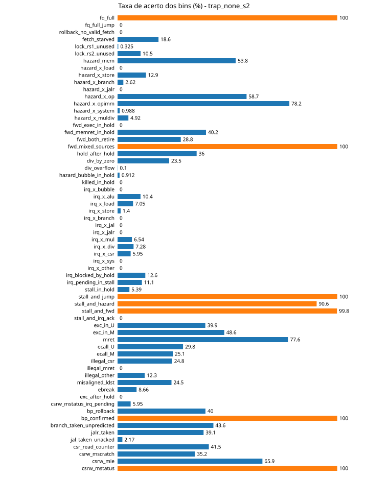

### trap_none_s3

Resumo: 0%: 13, 1-90%: 39, <1%: 3, >90%: 7, impossível: 2

| # | bin | acerto | classe |
|---|---|---|---|
| 0 | fq_full | 100.0% | >90% |
| 1 | fq_full_jump | 0.0% | 0% |
| 2 | rollback_no_valid_fetch | 0.0% | 0% |
| 3 | fetch_starved | 19.2% | 1-90% |
| 4 | lock_rs1_unused | 0.4% | <1% |
| 5 | lock_rs2_unused | 10.3% | 1-90% |
| 6 | hazard_mem | 53.1% | 1-90% |
| 7 | hazard_x_load | 0.0% | 0% |
| 8 | hazard_x_store | 12.4% | 1-90% |
| 9 | hazard_x_branch | 2.6% | 1-90% |
| 10 | hazard_x_jalr | 0.0% | 0% |
| 11 | hazard_x_op | 58.4% | 1-90% |
| 12 | hazard_x_opimm | 78.1% | 1-90% |
| 13 | hazard_x_system | 1.1% | 1-90% |
| 14 | hazard_x_muldiv | 4.6% | 1-90% |
| 15 | fwd_exec_in_hold | 0.0% | 0% |
| 16 | fwd_memret_in_hold | 40.3% | 1-90% |
| 17 | fwd_both_retire | 28.8% | 1-90% |
| 18 | fwd_mixed_sources | 100.0% | >90% |
| 19 | hold_after_hold | 36.3% | 1-90% |
| 20 | div_by_zero | 22.8% | 1-90% |
| 21 | div_overflow | 0.1% | <1% |
| 22 | hazard_bubble_in_hold | 0.8% | <1% |
| 23 | killed_in_hold | 0.0% | impossível |
| 24 | irq_x_bubble | 0.0% | 0% |
| 25 | irq_x_alu | 10.7% | 1-90% |
| 26 | irq_x_load | 6.7% | 1-90% |
| 27 | irq_x_store | 1.4% | 1-90% |
| 28 | irq_x_branch | 0.0% | 0% |
| 29 | irq_x_jal | 0.0% | 0% |
| 30 | irq_x_jalr | 0.0% | 0% |
| 31 | irq_x_mul | 7.1% | 1-90% |
| 32 | irq_x_div | 6.9% | 1-90% |
| 33 | irq_x_csr | 6.8% | 1-90% |
| 34 | irq_x_sys | 0.0% | 0% |
| 35 | irq_x_other | 0.0% | 0% |
| 36 | irq_blocked_by_hold | 12.9% | 1-90% |
| 37 | irq_pending_in_stall | 11.3% | 1-90% |
| 38 | stall_in_hold | 6.0% | 1-90% |
| 39 | stall_and_jump | 100.0% | >90% |
| 40 | stall_and_hazard | 90.3% | >90% |
| 41 | stall_and_fwd | 99.9% | >90% |
| 42 | stall_and_irq_ack | 0.0% | impossível |
| 43 | exc_in_U | 39.4% | 1-90% |
| 44 | exc_in_M | 49.6% | 1-90% |
| 45 | mret | 77.4% | 1-90% |
| 46 | ecall_U | 29.0% | 1-90% |
| 47 | ecall_M | 26.0% | 1-90% |
| 48 | illegal_csr | 26.1% | 1-90% |
| 49 | illegal_mret | 0.0% | 0% |
| 50 | illegal_other | 13.0% | 1-90% |
| 51 | misaligned_ldst | 24.6% | 1-90% |
| 52 | ebreak | 9.1% | 1-90% |
| 53 | exc_after_hold | 0.0% | 0% |
| 54 | csrw_mstatus_irq_pending | 6.8% | 1-90% |
| 55 | bp_rollback | 39.9% | 1-90% |
| 56 | bp_confirmed | 100.0% | >90% |
| 57 | branch_taken_unpredicted | 44.4% | 1-90% |
| 58 | jalr_taken | 40.4% | 1-90% |
| 59 | jal_taken_unacked | 2.2% | 1-90% |
| 60 | csr_read_counter | 40.3% | 1-90% |
| 61 | csrw_mscratch | 34.3% | 1-90% |
| 62 | csrw_mie | 66.0% | 1-90% |
| 63 | csrw_mstatus | 100.0% | >90% |

### trap_rand_s1

Resumo: 0%: 13, 1-90%: 37, <1%: 5, >90%: 7, impossível: 2

| # | bin | acerto | classe |
|---|---|---|---|
| 0 | fq_full | 100.0% | >90% |
| 1 | fq_full_jump | 0.0% | 0% |
| 2 | rollback_no_valid_fetch | 0.0% | 0% |
| 3 | fetch_starved | 22.2% | 1-90% |
| 4 | lock_rs1_unused | 0.1% | <1% |
| 5 | lock_rs2_unused | 8.8% | 1-90% |
| 6 | hazard_mem | 56.1% | 1-90% |
| 7 | hazard_x_load | 0.0% | 0% |
| 8 | hazard_x_store | 21.6% | 1-90% |
| 9 | hazard_x_branch | 3.0% | 1-90% |
| 10 | hazard_x_jalr | 0.0% | 0% |
| 11 | hazard_x_op | 65.3% | 1-90% |
| 12 | hazard_x_opimm | 77.8% | 1-90% |
| 13 | hazard_x_system | 0.7% | <1% |
| 14 | hazard_x_muldiv | 4.5% | 1-90% |
| 15 | fwd_exec_in_hold | 0.0% | 0% |
| 16 | fwd_memret_in_hold | 41.9% | 1-90% |
| 17 | fwd_both_retire | 29.6% | 1-90% |
| 18 | fwd_mixed_sources | 100.0% | >90% |
| 19 | hold_after_hold | 39.2% | 1-90% |
| 20 | div_by_zero | 24.7% | 1-90% |
| 21 | div_overflow | 0.1% | <1% |
| 22 | hazard_bubble_in_hold | 0.3% | <1% |
| 23 | killed_in_hold | 0.0% | impossível |
| 24 | irq_x_bubble | 0.0% | 0% |
| 25 | irq_x_alu | 10.6% | 1-90% |
| 26 | irq_x_load | 6.3% | 1-90% |
| 27 | irq_x_store | 0.8% | <1% |
| 28 | irq_x_branch | 0.0% | 0% |
| 29 | irq_x_jal | 0.0% | 0% |
| 30 | irq_x_jalr | 0.0% | 0% |
| 31 | irq_x_mul | 5.7% | 1-90% |
| 32 | irq_x_div | 7.0% | 1-90% |
| 33 | irq_x_csr | 8.1% | 1-90% |
| 34 | irq_x_sys | 0.0% | 0% |
| 35 | irq_x_other | 0.0% | 0% |
| 36 | irq_blocked_by_hold | 11.8% | 1-90% |
| 37 | irq_pending_in_stall | 13.0% | 1-90% |
| 38 | stall_in_hold | 5.2% | 1-90% |
| 39 | stall_and_jump | 100.0% | >90% |
| 40 | stall_and_hazard | 91.5% | >90% |
| 41 | stall_and_fwd | 99.9% | >90% |
| 42 | stall_and_irq_ack | 0.0% | impossível |
| 43 | exc_in_U | 41.5% | 1-90% |
| 44 | exc_in_M | 47.8% | 1-90% |
| 45 | mret | 77.4% | 1-90% |
| 46 | ecall_U | 31.9% | 1-90% |
| 47 | ecall_M | 24.5% | 1-90% |
| 48 | illegal_csr | 26.8% | 1-90% |
| 49 | illegal_mret | 0.0% | 0% |
| 50 | illegal_other | 14.5% | 1-90% |
| 51 | misaligned_ldst | 23.5% | 1-90% |
| 52 | ebreak | 7.9% | 1-90% |
| 53 | exc_after_hold | 0.0% | 0% |
| 54 | csrw_mstatus_irq_pending | 8.1% | 1-90% |
| 55 | bp_rollback | 40.1% | 1-90% |
| 56 | bp_confirmed | 100.0% | >90% |
| 57 | branch_taken_unpredicted | 47.8% | 1-90% |
| 58 | jalr_taken | 42.2% | 1-90% |
| 59 | jal_taken_unacked | 3.0% | 1-90% |
| 60 | csr_read_counter | 40.4% | 1-90% |
| 61 | csrw_mscratch | 36.9% | 1-90% |
| 62 | csrw_mie | 67.2% | 1-90% |
| 63 | csrw_mstatus | 100.0% | >90% |

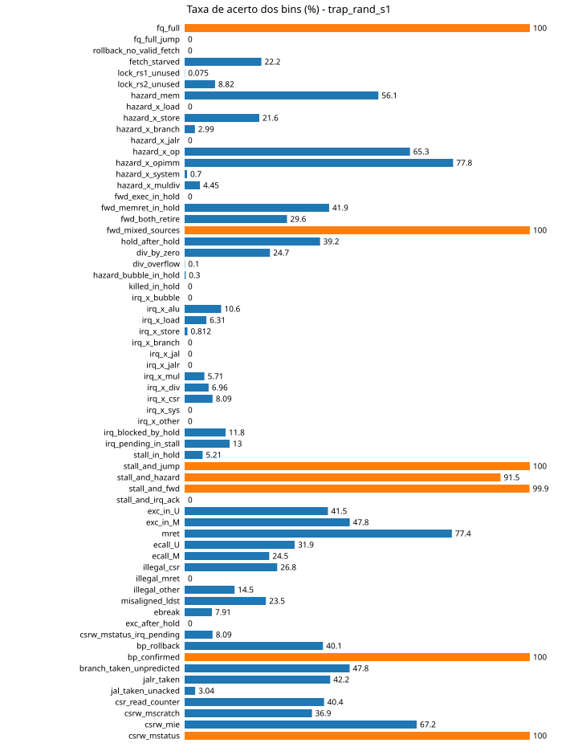

### trap_pipe_s1

Resumo: 0%: 13, 1-90%: 39, <1%: 3, >90%: 7, impossível: 2

| # | bin | acerto | classe |
|---|---|---|---|
| 0 | fq_full | 100.0% | >90% |
| 1 | fq_full_jump | 0.0% | 0% |
| 2 | rollback_no_valid_fetch | 0.0% | 0% |
| 3 | fetch_starved | 29.5% | 1-90% |
| 4 | lock_rs1_unused | 0.1% | <1% |
| 5 | lock_rs2_unused | 8.1% | 1-90% |
| 6 | hazard_mem | 62.1% | 1-90% |
| 7 | hazard_x_load | 0.0% | 0% |
| 8 | hazard_x_store | 18.9% | 1-90% |
| 9 | hazard_x_branch | 4.3% | 1-90% |
| 10 | hazard_x_jalr | 0.0% | 0% |
| 11 | hazard_x_op | 68.7% | 1-90% |
| 12 | hazard_x_opimm | 87.3% | 1-90% |
| 13 | hazard_x_system | 1.0% | 1-90% |
| 14 | hazard_x_muldiv | 5.8% | 1-90% |
| 15 | fwd_exec_in_hold | 0.0% | 0% |
| 16 | fwd_memret_in_hold | 48.6% | 1-90% |
| 17 | fwd_both_retire | 34.2% | 1-90% |
| 18 | fwd_mixed_sources | 100.0% | >90% |
| 19 | hold_after_hold | 40.0% | 1-90% |
| 20 | div_by_zero | 29.5% | 1-90% |
| 21 | div_overflow | 0.1% | <1% |
| 22 | hazard_bubble_in_hold | 1.3% | 1-90% |
| 23 | killed_in_hold | 0.0% | impossível |
| 24 | irq_x_bubble | 0.0% | 0% |
| 25 | irq_x_alu | 13.3% | 1-90% |
| 26 | irq_x_load | 7.4% | 1-90% |
| 27 | irq_x_store | 0.7% | <1% |
| 28 | irq_x_branch | 0.0% | 0% |
| 29 | irq_x_jal | 0.0% | 0% |
| 30 | irq_x_jalr | 0.0% | 0% |
| 31 | irq_x_mul | 9.1% | 1-90% |
| 32 | irq_x_div | 11.0% | 1-90% |
| 33 | irq_x_csr | 13.6% | 1-90% |
| 34 | irq_x_sys | 0.0% | 0% |
| 35 | irq_x_other | 0.0% | 0% |
| 36 | irq_blocked_by_hold | 18.2% | 1-90% |
| 37 | irq_pending_in_stall | 16.2% | 1-90% |
| 38 | stall_in_hold | 9.1% | 1-90% |
| 39 | stall_and_jump | 100.0% | >90% |
| 40 | stall_and_hazard | 95.6% | >90% |
| 41 | stall_and_fwd | 100.0% | >90% |
| 42 | stall_and_irq_ack | 0.0% | impossível |
| 43 | exc_in_U | 49.6% | 1-90% |
| 44 | exc_in_M | 55.6% | 1-90% |
| 45 | mret | 87.0% | 1-90% |
| 46 | ecall_U | 38.1% | 1-90% |
| 47 | ecall_M | 29.5% | 1-90% |
| 48 | illegal_csr | 30.8% | 1-90% |
| 49 | illegal_mret | 0.0% | 0% |
| 50 | illegal_other | 16.8% | 1-90% |
| 51 | misaligned_ldst | 28.6% | 1-90% |
| 52 | ebreak | 6.8% | 1-90% |
| 53 | exc_after_hold | 0.0% | 0% |
| 54 | csrw_mstatus_irq_pending | 13.6% | 1-90% |
| 55 | bp_rollback | 51.3% | 1-90% |
| 56 | bp_confirmed | 100.0% | >90% |
| 57 | branch_taken_unpredicted | 50.3% | 1-90% |
| 58 | jalr_taken | 39.2% | 1-90% |
| 59 | jal_taken_unacked | 4.0% | 1-90% |
| 60 | csr_read_counter | 42.4% | 1-90% |
| 61 | csrw_mscratch | 39.3% | 1-90% |
| 62 | csrw_mie | 78.2% | 1-90% |
| 63 | csrw_mstatus | 100.0% | >90% |

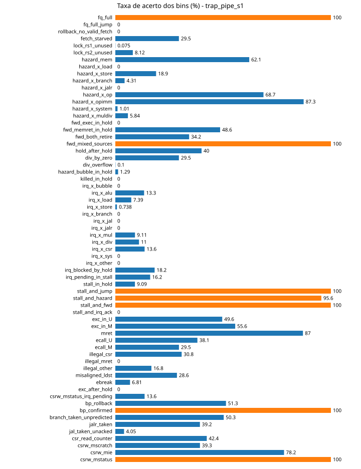

### trap_pipe_pos_s1

Resumo: 0%: 13, 1-90%: 39, <1%: 3, >90%: 7, impossível: 2

| # | bin | acerto | classe |
|---|---|---|---|
| 0 | fq_full | 100.0% | >90% |
| 1 | fq_full_jump | 0.0% | 0% |
| 2 | rollback_no_valid_fetch | 0.0% | 0% |
| 3 | fetch_starved | 28.8% | 1-90% |
| 4 | lock_rs1_unused | 1.1% | 1-90% |
| 5 | lock_rs2_unused | 8.8% | 1-90% |
| 6 | hazard_mem | 57.5% | 1-90% |
| 7 | hazard_x_load | 0.0% | 0% |
| 8 | hazard_x_store | 17.5% | 1-90% |
| 9 | hazard_x_branch | 3.8% | 1-90% |
| 10 | hazard_x_jalr | 0.0% | 0% |
| 11 | hazard_x_op | 66.0% | 1-90% |
| 12 | hazard_x_opimm | 85.8% | 1-90% |
| 13 | hazard_x_system | 1.4% | 1-90% |
| 14 | hazard_x_muldiv | 6.3% | 1-90% |
| 15 | fwd_exec_in_hold | 0.0% | 0% |
| 16 | fwd_memret_in_hold | 50.2% | 1-90% |
| 17 | fwd_both_retire | 31.9% | 1-90% |
| 18 | fwd_mixed_sources | 100.0% | >90% |
| 19 | hold_after_hold | 43.5% | 1-90% |
| 20 | div_by_zero | 27.7% | 1-90% |
| 21 | div_overflow | 0.0% | <1% |
| 22 | hazard_bubble_in_hold | 0.6% | <1% |
| 23 | killed_in_hold | 0.0% | impossível |
| 24 | irq_x_bubble | 0.0% | 0% |
| 25 | irq_x_alu | 13.3% | 1-90% |
| 26 | irq_x_load | 6.6% | 1-90% |
| 27 | irq_x_store | 0.9% | <1% |
| 28 | irq_x_branch | 0.0% | 0% |
| 29 | irq_x_jal | 0.0% | 0% |
| 30 | irq_x_jalr | 0.0% | 0% |
| 31 | irq_x_mul | 8.9% | 1-90% |
| 32 | irq_x_div | 7.9% | 1-90% |
| 33 | irq_x_csr | 15.2% | 1-90% |
| 34 | irq_x_sys | 0.0% | 0% |
| 35 | irq_x_other | 0.0% | 0% |
| 36 | irq_blocked_by_hold | 15.2% | 1-90% |
| 37 | irq_pending_in_stall | 13.3% | 1-90% |
| 38 | stall_in_hold | 7.6% | 1-90% |
| 39 | stall_and_jump | 100.0% | >90% |
| 40 | stall_and_hazard | 95.6% | >90% |
| 41 | stall_and_fwd | 100.0% | >90% |
| 42 | stall_and_irq_ack | 0.0% | impossível |
| 43 | exc_in_U | 46.7% | 1-90% |
| 44 | exc_in_M | 56.3% | 1-90% |
| 45 | mret | 85.2% | 1-90% |
| 46 | ecall_U | 35.4% | 1-90% |
| 47 | ecall_M | 29.0% | 1-90% |
| 48 | illegal_csr | 33.2% | 1-90% |
| 49 | illegal_mret | 0.0% | 0% |
| 50 | illegal_other | 15.0% | 1-90% |
| 51 | misaligned_ldst | 28.7% | 1-90% |
| 52 | ebreak | 11.1% | 1-90% |
| 53 | exc_after_hold | 0.0% | 0% |
| 54 | csrw_mstatus_irq_pending | 15.2% | 1-90% |
| 55 | bp_rollback | 52.4% | 1-90% |
| 56 | bp_confirmed | 100.0% | >90% |
| 57 | branch_taken_unpredicted | 45.8% | 1-90% |
| 58 | jalr_taken | 41.8% | 1-90% |
| 59 | jal_taken_unacked | 3.6% | 1-90% |
| 60 | csr_read_counter | 41.3% | 1-90% |
| 61 | csrw_mscratch | 37.2% | 1-90% |
| 62 | csrw_mie | 75.8% | 1-90% |
| 63 | csrw_mstatus | 100.0% | >90% |

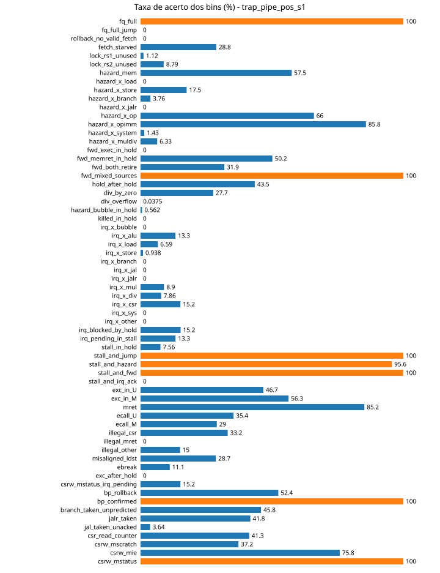

### trap_coarse_s1

Resumo: 0%: 13, 1-90%: 39, <1%: 3, >90%: 7, impossível: 2

| # | bin | acerto | classe |
|---|---|---|---|
| 0 | fq_full | 100.0% | >90% |
| 1 | fq_full_jump | 0.0% | 0% |
| 2 | rollback_no_valid_fetch | 0.0% | 0% |
| 3 | fetch_starved | 35.5% | 1-90% |
| 4 | lock_rs1_unused | 0.1% | <1% |
| 5 | lock_rs2_unused | 7.7% | 1-90% |
| 6 | hazard_mem | 59.8% | 1-90% |
| 7 | hazard_x_load | 0.0% | 0% |
| 8 | hazard_x_store | 22.0% | 1-90% |
| 9 | hazard_x_branch | 4.6% | 1-90% |
| 10 | hazard_x_jalr | 0.0% | 0% |
| 11 | hazard_x_op | 63.7% | 1-90% |
| 12 | hazard_x_opimm | 89.1% | 1-90% |
| 13 | hazard_x_system | 0.8% | <1% |
| 14 | hazard_x_muldiv | 5.1% | 1-90% |
| 15 | fwd_exec_in_hold | 0.0% | 0% |
| 16 | fwd_memret_in_hold | 49.5% | 1-90% |
| 17 | fwd_both_retire | 27.5% | 1-90% |
| 18 | fwd_mixed_sources | 100.0% | >90% |
| 19 | hold_after_hold | 41.9% | 1-90% |
| 20 | div_by_zero | 23.3% | 1-90% |
| 21 | div_overflow | 0.1% | <1% |
| 22 | hazard_bubble_in_hold | 1.4% | 1-90% |
| 23 | killed_in_hold | 0.0% | impossível |
| 24 | irq_x_bubble | 0.0% | 0% |
| 25 | irq_x_alu | 13.4% | 1-90% |
| 26 | irq_x_load | 7.2% | 1-90% |
| 27 | irq_x_store | 2.6% | 1-90% |
| 28 | irq_x_branch | 0.0% | 0% |
| 29 | irq_x_jal | 0.0% | 0% |
| 30 | irq_x_jalr | 0.0% | 0% |
| 31 | irq_x_mul | 12.2% | 1-90% |
| 32 | irq_x_div | 7.2% | 1-90% |
| 33 | irq_x_csr | 20.9% | 1-90% |
| 34 | irq_x_sys | 0.0% | 0% |
| 35 | irq_x_other | 0.0% | 0% |
| 36 | irq_blocked_by_hold | 17.8% | 1-90% |
| 37 | irq_pending_in_stall | 21.6% | 1-90% |
| 38 | stall_in_hold | 12.7% | 1-90% |
| 39 | stall_and_jump | 100.0% | >90% |
| 40 | stall_and_hazard | 96.7% | >90% |
| 41 | stall_and_fwd | 100.0% | >90% |
| 42 | stall_and_irq_ack | 0.0% | impossível |
| 43 | exc_in_U | 48.9% | 1-90% |
| 44 | exc_in_M | 62.7% | 1-90% |
| 45 | mret | 88.8% | 1-90% |
| 46 | ecall_U | 36.4% | 1-90% |
| 47 | ecall_M | 30.9% | 1-90% |
| 48 | illegal_csr | 40.5% | 1-90% |
| 49 | illegal_mret | 0.0% | 0% |
| 50 | illegal_other | 21.7% | 1-90% |
| 51 | misaligned_ldst | 34.3% | 1-90% |
| 52 | ebreak | 10.0% | 1-90% |
| 53 | exc_after_hold | 0.0% | 0% |
| 54 | csrw_mstatus_irq_pending | 20.9% | 1-90% |
| 55 | bp_rollback | 50.9% | 1-90% |
| 56 | bp_confirmed | 100.0% | >90% |
| 57 | branch_taken_unpredicted | 51.5% | 1-90% |
| 58 | jalr_taken | 42.2% | 1-90% |
| 59 | jal_taken_unacked | 2.3% | 1-90% |
| 60 | csr_read_counter | 40.6% | 1-90% |
| 61 | csrw_mscratch | 36.4% | 1-90% |
| 62 | csrw_mie | 80.2% | 1-90% |
| 63 | csrw_mstatus | 100.0% | >90% |

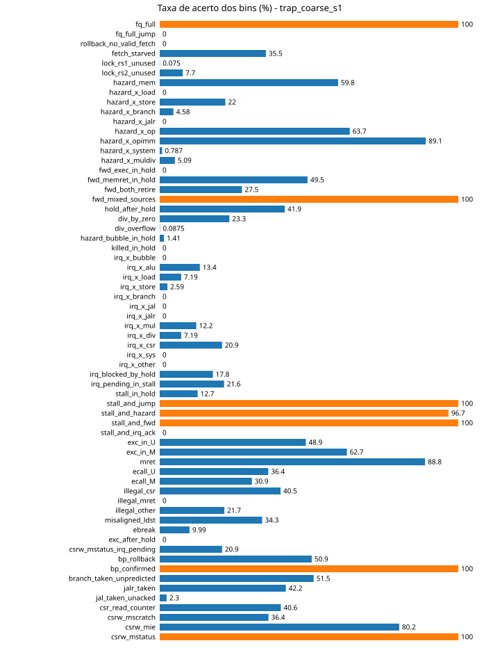

### trap_csr_s1

Resumo: 0%: 13, 1-90%: 36, <1%: 4, >90%: 9, impossível: 2

| # | bin | acerto | classe |
|---|---|---|---|
| 0 | fq_full | 100.0% | >90% |
| 1 | fq_full_jump | 0.0% | 0% |
| 2 | rollback_no_valid_fetch | 0.0% | 0% |
| 3 | fetch_starved | 19.2% | 1-90% |
| 4 | lock_rs1_unused | 0.1% | <1% |
| 5 | lock_rs2_unused | 3.5% | 1-90% |
| 6 | hazard_mem | 39.3% | 1-90% |
| 7 | hazard_x_load | 0.0% | 0% |
| 8 | hazard_x_store | 17.8% | 1-90% |
| 9 | hazard_x_branch | 1.0% | 1-90% |
| 10 | hazard_x_jalr | 0.0% | 0% |
| 11 | hazard_x_op | 58.8% | 1-90% |
| 12 | hazard_x_opimm | 91.3% | >90% |
| 13 | hazard_x_system | 0.4% | <1% |
| 14 | hazard_x_muldiv | 1.7% | 1-90% |
| 15 | fwd_exec_in_hold | 0.0% | 0% |
| 16 | fwd_memret_in_hold | 31.8% | 1-90% |
| 17 | fwd_both_retire | 30.5% | 1-90% |
| 18 | fwd_mixed_sources | 100.0% | >90% |
| 19 | hold_after_hold | 25.2% | 1-90% |
| 20 | div_by_zero | 17.6% | 1-90% |
| 21 | div_overflow | 0.1% | <1% |
| 22 | hazard_bubble_in_hold | 0.1% | <1% |
| 23 | killed_in_hold | 0.0% | impossível |
| 24 | irq_x_bubble | 0.0% | 0% |
| 25 | irq_x_alu | 11.8% | 1-90% |
| 26 | irq_x_load | 3.8% | 1-90% |
| 27 | irq_x_store | 1.6% | 1-90% |
| 28 | irq_x_branch | 0.0% | 0% |
| 29 | irq_x_jal | 0.0% | 0% |
| 30 | irq_x_jalr | 0.0% | 0% |
| 31 | irq_x_mul | 7.1% | 1-90% |
| 32 | irq_x_div | 8.9% | 1-90% |
| 33 | irq_x_csr | 29.2% | 1-90% |
| 34 | irq_x_sys | 0.0% | 0% |
| 35 | irq_x_other | 0.0% | 0% |
| 36 | irq_blocked_by_hold | 13.6% | 1-90% |
| 37 | irq_pending_in_stall | 14.6% | 1-90% |
| 38 | stall_in_hold | 5.5% | 1-90% |
| 39 | stall_and_jump | 100.0% | >90% |
| 40 | stall_and_hazard | 95.8% | >90% |
| 41 | stall_and_fwd | 100.0% | >90% |
| 42 | stall_and_irq_ack | 0.0% | impossível |
| 43 | exc_in_U | 50.1% | 1-90% |
| 44 | exc_in_M | 71.5% | 1-90% |
| 45 | mret | 91.2% | >90% |
| 46 | ecall_U | 40.0% | 1-90% |
| 47 | ecall_M | 29.4% | 1-90% |
| 48 | illegal_csr | 50.3% | 1-90% |
| 49 | illegal_mret | 0.0% | 0% |
| 50 | illegal_other | 24.5% | 1-90% |
| 51 | misaligned_ldst | 42.1% | 1-90% |
| 52 | ebreak | 15.3% | 1-90% |
| 53 | exc_after_hold | 0.0% | 0% |
| 54 | csrw_mstatus_irq_pending | 29.2% | 1-90% |
| 55 | bp_rollback | 25.7% | 1-90% |
| 56 | bp_confirmed | 100.0% | >90% |
| 57 | branch_taken_unpredicted | 51.9% | 1-90% |
| 58 | jalr_taken | 42.9% | 1-90% |
| 59 | jal_taken_unacked | 1.7% | 1-90% |
| 60 | csr_read_counter | 75.2% | 1-90% |
| 61 | csrw_mscratch | 73.2% | 1-90% |
| 62 | csrw_mie | 89.3% | 1-90% |
| 63 | csrw_mstatus | 100.0% | >90% |

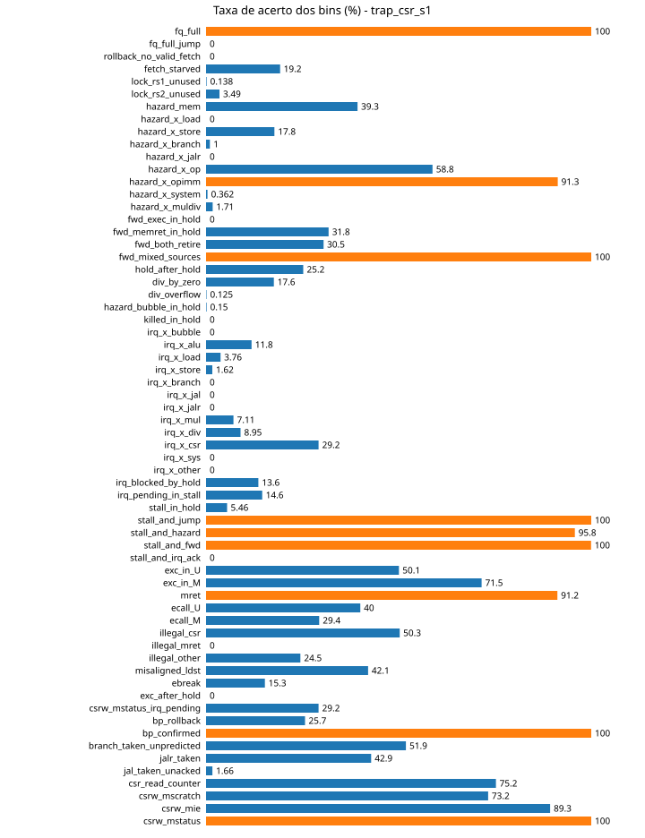

### trap_bins_s1

Resumo: 0%: 13, 1-90%: 39, <1%: 3, >90%: 7, impossível: 2

| # | bin | acerto | classe |
|---|---|---|---|
| 0 | fq_full | 100.0% | >90% |
| 1 | fq_full_jump | 0.0% | 0% |
| 2 | rollback_no_valid_fetch | 0.0% | 0% |
| 3 | fetch_starved | 29.8% | 1-90% |
| 4 | lock_rs1_unused | 0.1% | <1% |
| 5 | lock_rs2_unused | 8.7% | 1-90% |
| 6 | hazard_mem | 61.0% | 1-90% |
| 7 | hazard_x_load | 0.0% | 0% |
| 8 | hazard_x_store | 21.0% | 1-90% |
| 9 | hazard_x_branch | 3.7% | 1-90% |
| 10 | hazard_x_jalr | 0.0% | 0% |
| 11 | hazard_x_op | 65.7% | 1-90% |
| 12 | hazard_x_opimm | 86.4% | 1-90% |
| 13 | hazard_x_system | 1.1% | 1-90% |
| 14 | hazard_x_muldiv | 6.5% | 1-90% |
| 15 | fwd_exec_in_hold | 0.0% | 0% |
| 16 | fwd_memret_in_hold | 47.2% | 1-90% |
| 17 | fwd_both_retire | 33.3% | 1-90% |
| 18 | fwd_mixed_sources | 100.0% | >90% |
| 19 | hold_after_hold | 38.5% | 1-90% |
| 20 | div_by_zero | 24.7% | 1-90% |
| 21 | div_overflow | 0.2% | <1% |
| 22 | hazard_bubble_in_hold | 0.9% | <1% |
| 23 | killed_in_hold | 0.0% | impossível |
| 24 | irq_x_bubble | 0.0% | 0% |
| 25 | irq_x_alu | 12.2% | 1-90% |
| 26 | irq_x_load | 6.6% | 1-90% |
| 27 | irq_x_store | 1.3% | 1-90% |
| 28 | irq_x_branch | 0.0% | 0% |
| 29 | irq_x_jal | 0.0% | 0% |
| 30 | irq_x_jalr | 0.0% | 0% |
| 31 | irq_x_mul | 9.4% | 1-90% |
| 32 | irq_x_div | 9.1% | 1-90% |
| 33 | irq_x_csr | 14.7% | 1-90% |
| 34 | irq_x_sys | 0.0% | 0% |
| 35 | irq_x_other | 0.0% | 0% |
| 36 | irq_blocked_by_hold | 17.0% | 1-90% |
| 37 | irq_pending_in_stall | 17.1% | 1-90% |
| 38 | stall_in_hold | 8.3% | 1-90% |
| 39 | stall_and_jump | 100.0% | >90% |
| 40 | stall_and_hazard | 95.1% | >90% |
| 41 | stall_and_fwd | 100.0% | >90% |
| 42 | stall_and_irq_ack | 0.0% | impossível |
| 43 | exc_in_U | 50.0% | 1-90% |
| 44 | exc_in_M | 57.9% | 1-90% |
| 45 | mret | 85.8% | 1-90% |
| 46 | ecall_U | 37.9% | 1-90% |
| 47 | ecall_M | 29.5% | 1-90% |
| 48 | illegal_csr | 32.9% | 1-90% |
| 49 | illegal_mret | 0.0% | 0% |
| 50 | illegal_other | 18.9% | 1-90% |
| 51 | misaligned_ldst | 30.8% | 1-90% |
| 52 | ebreak | 8.9% | 1-90% |
| 53 | exc_after_hold | 0.0% | 0% |
| 54 | csrw_mstatus_irq_pending | 14.7% | 1-90% |
| 55 | bp_rollback | 48.0% | 1-90% |
| 56 | bp_confirmed | 100.0% | >90% |
| 57 | branch_taken_unpredicted | 53.5% | 1-90% |
| 58 | jalr_taken | 40.8% | 1-90% |
| 59 | jal_taken_unacked | 3.0% | 1-90% |
| 60 | csr_read_counter | 43.4% | 1-90% |
| 61 | csrw_mscratch | 41.5% | 1-90% |
| 62 | csrw_mie | 75.5% | 1-90% |
| 63 | csrw_mstatus | 100.0% | >90% |

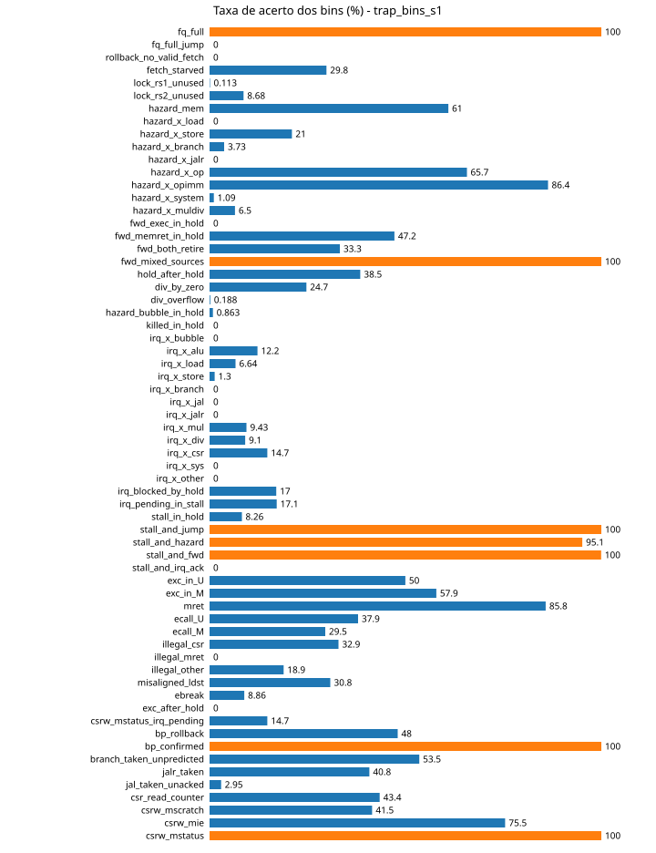

### trap_vl_s1

Resumo: 0%: 13, 1-90%: 37, <1%: 5, >90%: 7, impossível: 2

| # | bin | acerto | classe |
|---|---|---|---|
| 0 | fq_full | 100.0% | >90% |
| 1 | fq_full_jump | 0.0% | 0% |
| 2 | rollback_no_valid_fetch | 0.0% | 0% |
| 3 | fetch_starved | 25.7% | 1-90% |
| 4 | lock_rs1_unused | 0.5% | <1% |
| 5 | lock_rs2_unused | 5.4% | 1-90% |
| 6 | hazard_mem | 52.0% | 1-90% |
| 7 | hazard_x_load | 0.0% | 0% |
| 8 | hazard_x_store | 24.9% | 1-90% |
| 9 | hazard_x_branch | 2.6% | 1-90% |
| 10 | hazard_x_jalr | 0.0% | 0% |
| 11 | hazard_x_op | 66.9% | 1-90% |
| 12 | hazard_x_opimm | 75.4% | 1-90% |
| 13 | hazard_x_system | 0.2% | <1% |
| 14 | hazard_x_muldiv | 2.9% | 1-90% |
| 15 | fwd_exec_in_hold | 0.0% | 0% |
| 16 | fwd_memret_in_hold | 52.9% | 1-90% |
| 17 | fwd_both_retire | 19.3% | 1-90% |
| 18 | fwd_mixed_sources | 100.0% | >90% |
| 19 | hold_after_hold | 45.2% | 1-90% |
| 20 | div_by_zero | 22.1% | 1-90% |
| 21 | div_overflow | 0.1% | <1% |
| 22 | hazard_bubble_in_hold | 0.2% | <1% |
| 23 | killed_in_hold | 0.0% | impossível |
| 24 | irq_x_bubble | 0.0% | 0% |
| 25 | irq_x_alu | 9.9% | 1-90% |
| 26 | irq_x_load | 3.1% | 1-90% |
| 27 | irq_x_store | 0.5% | <1% |
| 28 | irq_x_branch | 0.0% | 0% |
| 29 | irq_x_jal | 0.0% | 0% |
| 30 | irq_x_jalr | 0.0% | 0% |
| 31 | irq_x_mul | 4.7% | 1-90% |
| 32 | irq_x_div | 5.0% | 1-90% |
| 33 | irq_x_csr | 14.7% | 1-90% |
| 34 | irq_x_sys | 0.0% | 0% |
| 35 | irq_x_other | 0.0% | 0% |
| 36 | irq_blocked_by_hold | 9.1% | 1-90% |
| 37 | irq_pending_in_stall | 10.2% | 1-90% |
| 38 | stall_in_hold | 3.8% | 1-90% |
| 39 | stall_and_jump | 100.0% | >90% |
| 40 | stall_and_hazard | 93.8% | >90% |
| 41 | stall_and_fwd | 100.0% | >90% |
| 42 | stall_and_irq_ack | 0.0% | impossível |
| 43 | exc_in_U | 37.6% | 1-90% |
| 44 | exc_in_M | 50.3% | 1-90% |
| 45 | mret | 75.1% | 1-90% |
| 46 | ecall_U | 24.8% | 1-90% |
| 47 | ecall_M | 25.6% | 1-90% |
| 48 | illegal_csr | 34.0% | 1-90% |
| 49 | illegal_mret | 0.0% | 0% |
| 50 | illegal_other | 16.0% | 1-90% |
| 51 | misaligned_ldst | 26.8% | 1-90% |
| 52 | ebreak | 7.8% | 1-90% |
| 53 | exc_after_hold | 0.0% | 0% |
| 54 | csrw_mstatus_irq_pending | 14.7% | 1-90% |
| 55 | bp_rollback | 39.4% | 1-90% |
| 56 | bp_confirmed | 100.0% | >90% |
| 57 | branch_taken_unpredicted | 48.1% | 1-90% |
| 58 | jalr_taken | 31.9% | 1-90% |
| 59 | jal_taken_unacked | 1.9% | 1-90% |
| 60 | csr_read_counter | 34.4% | 1-90% |
| 61 | csrw_mscratch | 32.3% | 1-90% |
| 62 | csrw_mie | 65.4% | 1-90% |
| 63 | csrw_mstatus | 100.0% | >90% |

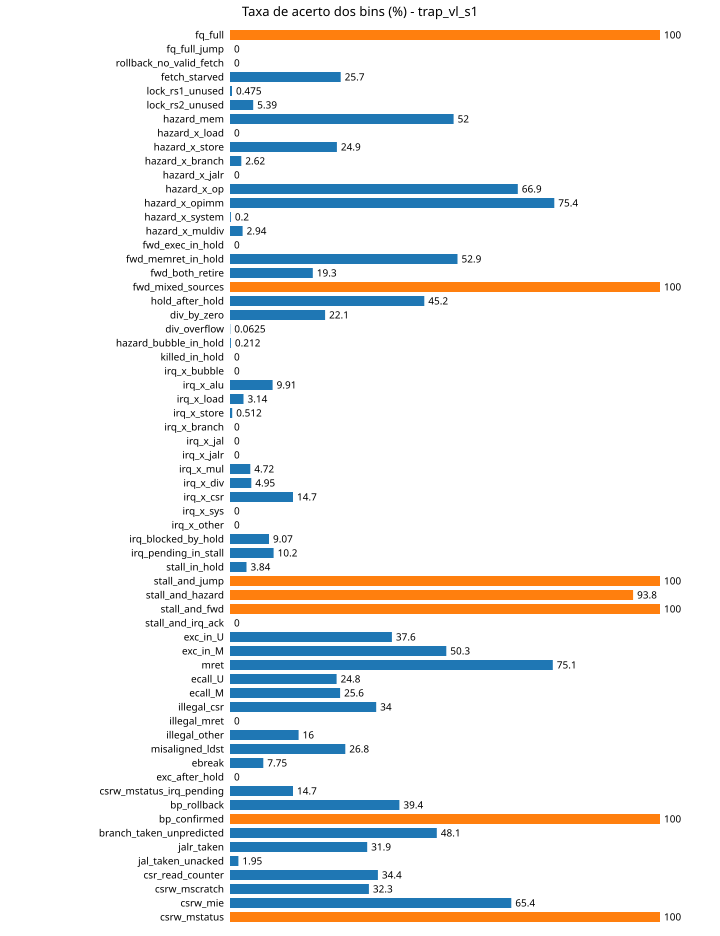

## 8. Fonte 7: escalares

| execução | escalar | máx | média dos máx por caso | mediana | casos com 0 |
|---|---|---|---|---|---|
| trap_none_s1 | fq_level_max | 3 | 3 | 3.0 | 0 |
| trap_none_s1 | hold_run_max | 35 | 21.0 | 35.0 | 1943 |
| trap_none_s1 | hazard_run_max | 36 | 1.4 | 1.0 | 637 |
| trap_none_s1 | stall_run_max | 2 | 2 | 2.0 | 0 |
| trap_none_s1 | killed_run_max | 7 | 3.2 | 3.0 | 0 |
| trap_none_s1 | irq_wait_max | 39 | 2.3 | 0.0 | 6264 |
| trap_none_s1 | fq_full_run_max | 36 | 21.8 | 34.0 | 0 |
| trap_none_s1 | snapshot_run_max | 32 | 29.9 | 32.0 | 0 |
| trap_none_s2 | fq_level_max | 3 | 3 | 3.0 | 0 |
| trap_none_s2 | hold_run_max | 35 | 21.0 | 35.0 | 1935 |
| trap_none_s2 | hazard_run_max | 36 | 1.4 | 1.0 | 630 |
| trap_none_s2 | stall_run_max | 2 | 2 | 2.0 | 0 |
| trap_none_s2 | killed_run_max | 7 | 3.2 | 3.0 | 0 |
| trap_none_s2 | irq_wait_max | 39 | 2.5 | 0.0 | 6239 |
| trap_none_s2 | fq_full_run_max | 36 | 21.8 | 34.0 | 0 |
| trap_none_s2 | snapshot_run_max | 32 | 29.9 | 32.0 | 0 |
| trap_none_s3 | fq_level_max | 3 | 3 | 3.0 | 0 |
| trap_none_s3 | hold_run_max | 35 | 20.7 | 35.0 | 1947 |
| trap_none_s3 | hazard_run_max | 36 | 1.4 | 1.0 | 638 |
| trap_none_s3 | stall_run_max | 2 | 2 | 2.0 | 0 |
| trap_none_s3 | killed_run_max | 7 | 3.2 | 3.0 | 0 |
| trap_none_s3 | irq_wait_max | 39 | 2.3 | 0.0 | 6204 |
| trap_none_s3 | fq_full_run_max | 36 | 21.5 | 34.0 | 0 |
| trap_none_s3 | snapshot_run_max | 32 | 29.9 | 32.0 | 0 |
| trap_rand_s1 | fq_level_max | 3 | 3 | 3.0 | 0 |
| trap_rand_s1 | hold_run_max | 35 | 20.9 | 35.0 | 1801 |
| trap_rand_s1 | hazard_run_max | 36 | 1.4 | 1.0 | 577 |
| trap_rand_s1 | stall_run_max | 2 | 2 | 2.0 | 0 |
| trap_rand_s1 | killed_run_max | 7 | 3.3 | 3.0 | 0 |
| trap_rand_s1 | irq_wait_max | 39 | 2.5 | 0.0 | 6230 |
| trap_rand_s1 | fq_full_run_max | 36 | 21.7 | 34.0 | 0 |
| trap_rand_s1 | snapshot_run_max | 32 | 29.9 | 32.0 | 0 |
| trap_pipe_s1 | fq_level_max | 3 | 3 | 3.0 | 0 |
| trap_pipe_s1 | hold_run_max | 35 | 24.1 | 35.0 | 1257 |
| trap_pipe_s1 | hazard_run_max | 36 | 1.6 | 1.0 | 297 |
| trap_pipe_s1 | stall_run_max | 2 | 2 | 2.0 | 0 |
| trap_pipe_s1 | killed_run_max | 7 | 3.4 | 3.0 | 0 |
| trap_pipe_s1 | irq_wait_max | 35 | 3.7 | 0.0 | 5639 |
| trap_pipe_s1 | fq_full_run_max | 36 | 24.6 | 35.0 | 0 |
| trap_pipe_s1 | snapshot_run_max | 32 | 30.3 | 32.0 | 0 |
| trap_pipe_pos_s1 | fq_level_max | 3 | 3 | 3.0 | 0 |
| trap_pipe_pos_s1 | hold_run_max | 35 | 24.2 | 35.0 | 1122 |
| trap_pipe_pos_s1 | hazard_run_max | 36 | 1.4 | 1.0 | 293 |
| trap_pipe_pos_s1 | stall_run_max | 2 | 2 | 2.0 | 0 |
| trap_pipe_pos_s1 | killed_run_max | 7 | 3.3 | 3.0 | 0 |
| trap_pipe_pos_s1 | irq_wait_max | 39 | 2.9 | 0.0 | 6032 |
| trap_pipe_pos_s1 | fq_full_run_max | 36 | 24.6 | 35.0 | 0 |
| trap_pipe_pos_s1 | snapshot_run_max | 32 | 30.3 | 32.0 | 0 |
| trap_coarse_s1 | fq_level_max | 3 | 3 | 3.0 | 0 |
| trap_coarse_s1 | hold_run_max | 35 | 24.9 | 35.0 | 1106 |
| trap_coarse_s1 | hazard_run_max | 36 | 1.7 | 1.0 | 208 |
| trap_coarse_s1 | stall_run_max | 2 | 2 | 2.0 | 0 |
| trap_coarse_s1 | killed_run_max | 7 | 3.5 | 3.0 | 0 |
| trap_coarse_s1 | irq_wait_max | 35 | 2.7 | 0.0 | 5535 |
| trap_coarse_s1 | fq_full_run_max | 36 | 25.3 | 35.0 | 0 |
| trap_coarse_s1 | snapshot_run_max | 32 | 30.5 | 32.0 | 0 |
| trap_csr_s1 | fq_level_max | 3 | 3 | 3.0 | 0 |
| trap_csr_s1 | hold_run_max | 35 | 17.1 | 4.0 | 2178 |
| trap_csr_s1 | hazard_run_max | 36 | 1.3 | 1.0 | 284 |
| trap_csr_s1 | stall_run_max | 2 | 2 | 2.0 | 0 |
| trap_csr_s1 | killed_run_max | 7 | 3.5 | 3.0 | 0 |
| trap_csr_s1 | irq_wait_max | 39 | 2.8 | 0.0 | 6199 |
| trap_csr_s1 | fq_full_run_max | 36 | 18.1 | 4.0 | 0 |
| trap_csr_s1 | snapshot_run_max | 32 | 29.3 | 27.0 | 0 |
| trap_bins_s1 | fq_level_max | 3 | 3 | 3.0 | 0 |
| trap_bins_s1 | hold_run_max | 35 | 23.6 | 35.0 | 1238 |
| trap_bins_s1 | hazard_run_max | 36 | 1.4 | 1.0 | 310 |
| trap_bins_s1 | stall_run_max | 2 | 2 | 2.0 | 0 |
| trap_bins_s1 | killed_run_max | 7 | 3.4 | 3.0 | 0 |
| trap_bins_s1 | irq_wait_max | 39 | 3.3 | 0.0 | 5701 |
| trap_bins_s1 | fq_full_run_max | 36 | 24.1 | 35.0 | 0 |
| trap_bins_s1 | snapshot_run_max | 32 | 30.3 | 32.0 | 0 |
| trap_vl_s1 | fq_level_max | 3 | 3 | 3.0 | 0 |
| trap_vl_s1 | hold_run_max | 35 | 24.8 | 35.0 | 1385 |
| trap_vl_s1 | hazard_run_max | 36 | 1.4 | 1.0 | 441 |
| trap_vl_s1 | stall_run_max | 2 | 2 | 2.0 | 0 |
| trap_vl_s1 | killed_run_max | 7 | 3.4 | 3.0 | 0 |
| trap_vl_s1 | irq_wait_max | 39 | 1.9 | 0.0 | 6651 |
| trap_vl_s1 | fq_full_run_max | 36 | 25.3 | 35.0 | 0 |
| trap_vl_s1 | snapshot_run_max | 32 | 30.5 | 32.0 | 0 |

## 9. Sobreposição: novidade em uma fonte x novidade em outra

Para cada par (A, B): dos casos que trouxeram posição nova em A, quantos também trouxeram em B. Linhas próximas de 100% em todas as colunas = A não acrescenta sinal próprio; baixas = A vê coisas que B não vê.

### trap_none_s1

| A \ B | fonte 0 | fonte 1 | fonte 2 | fonte 3 | fonte 6 |
|---|---|---|---|---|---|
| fonte 0 (4501 casos c/ novidade) | - | 5% | 3% | 21% | 0% |
| fonte 1 (285 casos c/ novidade) | 74% | - | 12% | 32% | 5% |
| fonte 2 (133 casos c/ novidade) | 99% | 26% | - | 80% | 14% |
| fonte 3 (969 casos c/ novidade) | 98% | 9% | 11% | - | 2% |
| fonte 6 (20 casos c/ novidade) | 100% | 75% | 95% | 95% | - |

### trap_none_s2

| A \ B | fonte 0 | fonte 1 | fonte 2 | fonte 3 | fonte 6 |
|---|---|---|---|---|---|
| fonte 0 (4493 casos c/ novidade) | - | 5% | 3% | 20% | 0% |
| fonte 1 (284 casos c/ novidade) | 77% | - | 13% | 33% | 4% |
| fonte 2 (128 casos c/ novidade) | 98% | 29% | - | 70% | 10% |
| fonte 3 (908 casos c/ novidade) | 97% | 10% | 10% | - | 2% |
| fonte 6 (17 casos c/ novidade) | 100% | 59% | 76% | 94% | - |

### trap_none_s3

| A \ B | fonte 0 | fonte 1 | fonte 2 | fonte 3 | fonte 6 |
|---|---|---|---|---|---|
| fonte 0 (4586 casos c/ novidade) | - | 5% | 3% | 20% | 0% |
| fonte 1 (278 casos c/ novidade) | 77% | - | 14% | 31% | 5% |
| fonte 2 (135 casos c/ novidade) | 99% | 30% | - | 77% | 12% |
| fonte 3 (950 casos c/ novidade) | 98% | 9% | 11% | - | 2% |
| fonte 6 (17 casos c/ novidade) | 100% | 76% | 94% | 100% | - |

### trap_rand_s1

| A \ B | fonte 0 | fonte 1 | fonte 2 | fonte 3 | fonte 6 |
|---|---|---|---|---|---|
| fonte 0 (3119 casos c/ novidade) | - | 5% | 4% | 25% | 1% |
| fonte 1 (223 casos c/ novidade) | 64% | - | 16% | 34% | 5% |
| fonte 2 (134 casos c/ novidade) | 87% | 26% | - | 60% | 8% |
| fonte 3 (782 casos c/ novidade) | 98% | 10% | 10% | - | 2% |
| fonte 6 (18 casos c/ novidade) | 100% | 61% | 61% | 94% | - |

### trap_pipe_s1

| A \ B | fonte 0 | fonte 1 | fonte 2 | fonte 3 | fonte 6 |
|---|---|---|---|---|---|
| fonte 0 (3288 casos c/ novidade) | - | 4% | 4% | 25% | 1% |
| fonte 1 (214 casos c/ novidade) | 68% | - | 14% | 32% | 5% |
| fonte 2 (133 casos c/ novidade) | 88% | 23% | - | 64% | 9% |
| fonte 3 (825 casos c/ novidade) | 98% | 8% | 10% | - | 2% |
| fonte 6 (17 casos c/ novidade) | 100% | 59% | 71% | 82% | - |

### trap_pipe_pos_s1

| A \ B | fonte 0 | fonte 1 | fonte 2 | fonte 3 | fonte 6 |
|---|---|---|---|---|---|
| fonte 0 (3327 casos c/ novidade) | - | 5% | 3% | 25% | 1% |
| fonte 1 (219 casos c/ novidade) | 69% | - | 15% | 34% | 5% |
| fonte 2 (123 casos c/ novidade) | 84% | 26% | - | 63% | 11% |
| fonte 3 (837 casos c/ novidade) | 98% | 9% | 9% | - | 2% |
| fonte 6 (18 casos c/ novidade) | 100% | 61% | 72% | 89% | - |

### trap_coarse_s1

| A \ B | fonte 0 | fonte 1 | fonte 2 | fonte 3 | fonte 6 |
|---|---|---|---|---|---|
| fonte 0 (3276 casos c/ novidade) | - | 5% | 3% | 25% | 1% |
| fonte 1 (228 casos c/ novidade) | 76% | - | 14% | 36% | 5% |
| fonte 2 (134 casos c/ novidade) | 83% | 23% | - | 54% | 10% |
| fonte 3 (843 casos c/ novidade) | 98% | 10% | 9% | - | 2% |
| fonte 6 (17 casos c/ novidade) | 100% | 65% | 76% | 82% | - |

### trap_csr_s1

| A \ B | fonte 0 | fonte 1 | fonte 2 | fonte 3 | fonte 6 |
|---|---|---|---|---|---|
| fonte 0 (2843 casos c/ novidade) | - | 7% | 4% | 28% | 1% |
| fonte 1 (406 casos c/ novidade) | 46% | - | 7% | 21% | 3% |
| fonte 2 (135 casos c/ novidade) | 85% | 21% | - | 64% | 10% |
| fonte 3 (808 casos c/ novidade) | 98% | 10% | 11% | - | 2% |
| fonte 6 (20 casos c/ novidade) | 95% | 70% | 70% | 90% | - |

### trap_bins_s1

| A \ B | fonte 0 | fonte 1 | fonte 2 | fonte 3 | fonte 6 |
|---|---|---|---|---|---|
| fonte 0 (3304 casos c/ novidade) | - | 4% | 3% | 25% | 1% |
| fonte 1 (218 casos c/ novidade) | 67% | - | 13% | 36% | 5% |
| fonte 2 (134 casos c/ novidade) | 86% | 22% | - | 59% | 9% |
| fonte 3 (838 casos c/ novidade) | 97% | 9% | 9% | - | 2% |
| fonte 6 (17 casos c/ novidade) | 100% | 59% | 71% | 94% | - |

### trap_vl_s1

| A \ B | fonte 0 | fonte 1 | fonte 2 | fonte 3 | fonte 6 |
|---|---|---|---|---|---|
| fonte 0 (2845 casos c/ novidade) | - | 5% | 4% | 27% | 1% |
| fonte 1 (190 casos c/ novidade) | 72% | - | 17% | 36% | 7% |
| fonte 2 (130 casos c/ novidade) | 85% | 25% | - | 63% | 10% |
| fonte 3 (789 casos c/ novidade) | 99% | 9% | 10% | - | 2% |
| fonte 6 (19 casos c/ novidade) | 100% | 74% | 68% | 95% | - |

## 9b. Sobreposição entre execuções (mesmo índice = mesma posição)

Para cada fonte: tamanho da união das posições de todas as execuções, posições comuns a todas, e, por execução, quantas posições só ela encontrou. Índices são comparáveis porque o `fuzz_cov.sv` é o mesmo.

### Fonte 0 (pipe_edges): união 22528, comum a todas 5759 (25.6% da união)

| execução | posições | só nesta execução | % da união |
|---|---|---|---|
| trap_none_s1 | 14599 | 1029 | 64.8% |
| trap_none_s2 | 14513 | 1280 | 64.4% |
| trap_none_s3 | 14603 | 1275 | 64.8% |
| trap_rand_s1 | 10553 | 215 | 46.8% |
| trap_pipe_s1 | 11124 | 274 | 49.4% |
| trap_pipe_pos_s1 | 11136 | 307 | 49.4% |
| trap_coarse_s1 | 10945 | 233 | 48.6% |
| trap_csr_s1 | 10155 | 187 | 45.1% |
| trap_bins_s1 | 11008 | 259 | 48.9% |
| trap_vl_s1 | 10193 | 151 | 45.2% |

### Fonte 1 (csr_trans): união 908, comum a todas 365 (40.2% da união)

| execução | posições | só nesta execução | % da união |
|---|---|---|---|
| trap_none_s1 | 658 | 7 | 72.5% |
| trap_none_s2 | 648 | 15 | 71.4% |
| trap_none_s3 | 680 | 15 | 74.9% |
| trap_rand_s1 | 552 | 1 | 60.8% |
| trap_pipe_s1 | 513 | 4 | 56.5% |
| trap_pipe_pos_s1 | 526 | 3 | 57.9% |
| trap_coarse_s1 | 581 | 5 | 64.0% |
| trap_csr_s1 | 812 | 63 | 89.4% |
| trap_bins_s1 | 560 | 5 | 61.7% |
| trap_vl_s1 | 498 | 0 | 54.8% |

### Fonte 2 (verilator): união 1052, comum a todas 1052 (100.0% da união)

| execução | posições | só nesta execução | % da união |
|---|---|---|---|
| trap_none_s1 | 1052 | 0 | 100.0% |
| trap_none_s2 | 1052 | 0 | 100.0% |
| trap_none_s3 | 1052 | 0 | 100.0% |
| trap_rand_s1 | 1052 | 0 | 100.0% |
| trap_pipe_s1 | 1052 | 0 | 100.0% |
| trap_pipe_pos_s1 | 1052 | 0 | 100.0% |
| trap_coarse_s1 | 1052 | 0 | 100.0% |
| trap_csr_s1 | 1052 | 0 | 100.0% |
| trap_bins_s1 | 1052 | 0 | 100.0% |
| trap_vl_s1 | 1052 | 0 | 100.0% |

### Fonte 3 (pipe_coarse): união 2457, comum a todas 1217 (49.5% da união)

| execução | posições | só nesta execução | % da união |
|---|---|---|---|
| trap_none_s1 | 1914 | 51 | 77.9% |
| trap_none_s2 | 1888 | 45 | 76.8% |
| trap_none_s3 | 1913 | 62 | 77.9% |
| trap_rand_s1 | 1614 | 9 | 65.7% |
| trap_pipe_s1 | 1688 | 17 | 68.7% |
| trap_pipe_pos_s1 | 1697 | 21 | 69.1% |
| trap_coarse_s1 | 1715 | 18 | 69.8% |
| trap_csr_s1 | 1638 | 18 | 66.7% |
| trap_bins_s1 | 1685 | 31 | 68.6% |
| trap_vl_s1 | 1640 | 9 | 66.7% |

### Fonte 6 (bins): união 49, comum a todas 49 (100.0% da união)

| execução | posições | só nesta execução | % da união |
|---|---|---|---|
| trap_none_s1 | 49 | 0 | 100.0% |
| trap_none_s2 | 49 | 0 | 100.0% |
| trap_none_s3 | 49 | 0 | 100.0% |
| trap_rand_s1 | 49 | 0 | 100.0% |
| trap_pipe_s1 | 49 | 0 | 100.0% |
| trap_pipe_pos_s1 | 49 | 0 | 100.0% |
| trap_coarse_s1 | 49 | 0 | 100.0% |
| trap_csr_s1 | 49 | 0 | 100.0% |
| trap_bins_s1 | 49 | 0 | 100.0% |
| trap_vl_s1 | 49 | 0 | 100.0% |

## 9c. Posições exclusivas em relação à referência

Referência: a união das posições de trap_none_s1, trap_none_s2, trap_none_s3 (24000 casos). Para cada execução, quantas das suas posições nenhum programa da referência atingiu. Uma execução que faz parte da referência é comparada com a união das **outras** execuções de referência.

### Fonte 0 (pipe_edges)

| execução | posições | também na referência | exclusivas | % exclusivas | exclusivas vistas 1x |
|---|---|---|---|---|---|
| trap_none_s1 (ref.) | 14599 | 12532 | 2067 | 14.2% | 1706 |
| trap_none_s2 (ref.) | 14513 | 12506 | 2007 | 13.8% | 1705 |
| trap_none_s3 (ref.) | 14603 | 12544 | 2059 | 14.1% | 1709 |
| trap_rand_s1 | 10553 | 9960 | 593 | 5.6% | 333 |
| trap_pipe_s1 | 11124 | 10414 | 710 | 6.4% | 293 |
| trap_pipe_pos_s1 | 11136 | 10368 | 768 | 6.9% | 361 |
| trap_coarse_s1 | 10945 | 10275 | 670 | 6.1% | 387 |
| trap_csr_s1 | 10155 | 9611 | 544 | 5.4% | 444 |
| trap_bins_s1 | 11008 | 10333 | 675 | 6.1% | 326 |
| trap_vl_s1 | 10193 | 9659 | 534 | 5.2% | 433 |

### Fonte 1 (csr_trans)

| execução | posições | também na referência | exclusivas | % exclusivas | exclusivas vistas 1x |
|---|---|---|---|---|---|
| trap_none_s1 (ref.) | 658 | 618 | 40 | 6.1% | 33 |
| trap_none_s2 (ref.) | 648 | 600 | 48 | 7.4% | 38 |
| trap_none_s3 (ref.) | 680 | 629 | 51 | 7.5% | 41 |
| trap_rand_s1 | 552 | 538 | 14 | 2.5% | 12 |
| trap_pipe_s1 | 513 | 504 | 9 | 1.8% | 8 |
| trap_pipe_pos_s1 | 526 | 516 | 10 | 1.9% | 8 |
| trap_coarse_s1 | 581 | 560 | 21 | 3.6% | 13 |
| trap_csr_s1 | 812 | 717 | 95 | 11.7% | 10 |
| trap_bins_s1 | 560 | 536 | 24 | 4.3% | 20 |
| trap_vl_s1 | 498 | 488 | 10 | 2.0% | 6 |

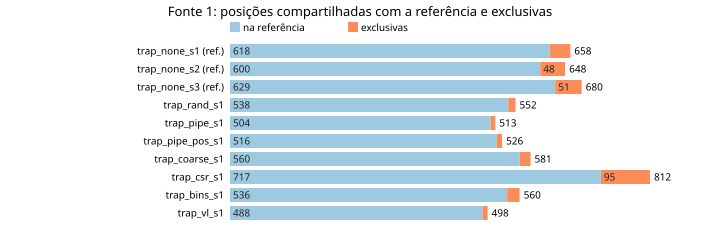

### Fonte 2 (verilator)

| execução | posições | também na referência | exclusivas | % exclusivas | exclusivas vistas 1x |
|---|---|---|---|---|---|
| trap_none_s1 (ref.) | 1052 | 1052 | 0 | 0.0% | 0 |
| trap_none_s2 (ref.) | 1052 | 1052 | 0 | 0.0% | 0 |
| trap_none_s3 (ref.) | 1052 | 1052 | 0 | 0.0% | 0 |
| trap_rand_s1 | 1052 | 1052 | 0 | 0.0% | 0 |
| trap_pipe_s1 | 1052 | 1052 | 0 | 0.0% | 0 |
| trap_pipe_pos_s1 | 1052 | 1052 | 0 | 0.0% | 0 |
| trap_coarse_s1 | 1052 | 1052 | 0 | 0.0% | 0 |
| trap_csr_s1 | 1052 | 1052 | 0 | 0.0% | 0 |
| trap_bins_s1 | 1052 | 1052 | 0 | 0.0% | 0 |
| trap_vl_s1 | 1052 | 1052 | 0 | 0.0% | 0 |

### Fonte 3 (pipe_coarse)

| execução | posições | também na referência | exclusivas | % exclusivas | exclusivas vistas 1x |
|---|---|---|---|---|---|
| trap_none_s1 (ref.) | 1914 | 1777 | 137 | 7.2% | 116 |
| trap_none_s2 (ref.) | 1888 | 1784 | 104 | 5.5% | 82 |
| trap_none_s3 (ref.) | 1913 | 1772 | 141 | 7.4% | 117 |
| trap_rand_s1 | 1614 | 1581 | 33 | 2.0% | 21 |
| trap_pipe_s1 | 1688 | 1639 | 49 | 2.9% | 19 |
| trap_pipe_pos_s1 | 1697 | 1640 | 57 | 3.4% | 25 |
| trap_coarse_s1 | 1715 | 1657 | 58 | 3.4% | 20 |
| trap_csr_s1 | 1638 | 1586 | 52 | 3.2% | 37 |
| trap_bins_s1 | 1685 | 1608 | 77 | 4.6% | 37 |
| trap_vl_s1 | 1640 | 1594 | 46 | 2.8% | 38 |

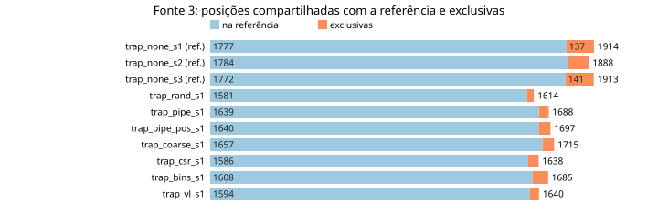

### Fonte 6 (bins)

| execução | posições | também na referência | exclusivas | % exclusivas | exclusivas vistas 1x |
|---|---|---|---|---|---|
| trap_none_s1 (ref.) | 49 | 49 | 0 | 0.0% | 0 |
| trap_none_s2 (ref.) | 49 | 49 | 0 | 0.0% | 0 |
| trap_none_s3 (ref.) | 49 | 49 | 0 | 0.0% | 0 |
| trap_rand_s1 | 49 | 49 | 0 | 0.0% | 0 |
| trap_pipe_s1 | 49 | 49 | 0 | 0.0% | 0 |
| trap_pipe_pos_s1 | 49 | 49 | 0 | 0.0% | 0 |
| trap_coarse_s1 | 49 | 49 | 0 | 0.0% | 0 |
| trap_csr_s1 | 49 | 49 | 0 | 0.0% | 0 |
| trap_bins_s1 | 49 | 49 | 0 | 0.0% | 0 |
| trap_vl_s1 | 49 | 49 | 0 | 0.0% | 0 |

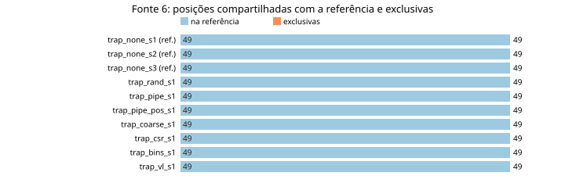

## 10. Gerador e corpus

| execução | corpus final | casos com score>0 | aleatórios | mutados | operadores | novas pos. fonte 0 por caso (aleat / mut) | idem fonte 6 |
|---|---|---|---|---|---|---|---|
| trap_none_s1 traps | 0 | 0 | 8000 | 0 | random=8000 | 1.82 / 0.00 | 0.01 / 0.00 |
| trap_none_s2 traps | 0 | 0 | 8000 | 0 | random=8000 | 1.81 / 0.00 | 0.01 / 0.00 |
| trap_none_s3 traps | 0 | 0 | 8000 | 0 | random=8000 | 1.83 / 0.00 | 0.01 / 0.00 |
| trap_rand_s1 traps | 7986 | 0 | 1628 | 6372 | point=1846 random=1628 insert=950 delete=900 splice=900 swap=889 data=887 | 3.83 / 0.68 | 0.03 / 0.00 |
| trap_pipe_s1 traps | 3637 | 3637 | 1579 | 6421 | point=1853 random=1579 insert=948 splice=929 delete=926 swap=885 data=880 | 3.82 / 0.79 | 0.03 / 0.00 |
| trap_pipe_pos_s1 traps | 3312 | 3312 | 1620 | 6380 | point=1853 random=1620 delete=929 insert=927 splice=911 data=892 swap=868 | 3.81 / 0.78 | 0.03 / 0.00 |
| trap_coarse_s1 traps | 1224 | 1224 | 1582 | 6418 | point=1873 random=1582 insert=926 splice=926 delete=924 data=888 swap=881 | 3.74 / 0.78 | 0.03 / 0.00 |
| trap_csr_s1 traps | 652 | 652 | 1616 | 6384 | point=1869 random=1616 delete=943 insert=917 swap=903 data=877 splice=875 | 3.88 / 0.61 | 0.03 / 0.00 |
| trap_bins_s1 traps | 3651 | 3651 | 1631 | 6369 | point=1876 random=1631 delete=953 swap=923 insert=917 data=851 splice=849 | 3.69 / 0.78 | 0.03 / 0.00 |
| trap_vl_s1 traps | 472 | 472 | 1647 | 6353 | point=1803 random=1647 delete=934 swap=923 splice=905 insert=896 data=892 | 3.91 / 0.59 | 0.03 / 0.00 |

Blocos gerados (trap_none_s1): trap=4119, mem=4078, alu=4060, csr=4022, branch=4002, muldiv=3999, loop=3982, irq=3978, mix=3960, jump=3932, umode=3896

## 11. Casos que não passaram

- trap_none_s1: mismatch=25
  - `fz-000051` mismatch (ciclos 283)
  - `fz-000139` mismatch (ciclos 262)
  - `fz-000208` mismatch (ciclos 289)
  - `fz-000385` mismatch (ciclos 410)
  - `fz-000782` mismatch (ciclos 405)
  - `fz-002115` mismatch (ciclos 513)
  - `fz-002685` mismatch (ciclos 335)
  - `fz-003152` mismatch (ciclos 394)
  - `fz-003308` mismatch (ciclos 259)
  - `fz-003388` mismatch (ciclos 299)
- trap_none_s2: mismatch=30
  - `fz-000313` mismatch (ciclos 349)
  - `fz-000569` mismatch (ciclos 429)
  - `fz-000582` mismatch (ciclos 693)
  - `fz-000630` mismatch (ciclos 296)
  - `fz-000706` mismatch (ciclos 562)
  - `fz-001196` mismatch (ciclos 382)
  - `fz-001319` mismatch (ciclos 296)
  - `fz-001418` mismatch (ciclos 545)
  - `fz-001690` mismatch (ciclos 628)
  - `fz-002424` mismatch (ciclos 448)
- trap_none_s3: mismatch=33
  - `fz-000022` mismatch (ciclos 313)
  - `fz-000123` mismatch (ciclos 440)
  - `fz-000435` mismatch (ciclos 450)
  - `fz-001516` mismatch (ciclos 524)
  - `fz-001854` mismatch (ciclos 479)
  - `fz-002146` mismatch (ciclos 476)
  - `fz-002193` mismatch (ciclos 639)
  - `fz-002800` mismatch (ciclos 280)
  - `fz-002901` mismatch (ciclos 505)
  - `fz-002984` mismatch (ciclos 380)
- trap_rand_s1: mismatch=14
  - `fz-000405` mismatch (ciclos 263)
  - `fz-001540` mismatch (ciclos 474)
  - `fz-002160` mismatch (ciclos 485)
  - `fz-002525` mismatch (ciclos 402)
  - `fz-002816` mismatch (ciclos 305)
  - `fz-003788` mismatch (ciclos 367)
  - `fz-003817` mismatch (ciclos 392)
  - `fz-004525` mismatch (ciclos 517)
  - `fz-004550` mismatch (ciclos 440)
  - `fz-005517` mismatch (ciclos 281)
- trap_pipe_s1: mismatch=27
  - `fz-000172` mismatch (ciclos 262)
  - `fz-000245` mismatch (ciclos 338)
  - `fz-000487` mismatch (ciclos 363)
  - `fz-000758` mismatch (ciclos 333)
  - `fz-000966` mismatch (ciclos 318)
  - `fz-001039` mismatch (ciclos 319)
  - `fz-001216` mismatch (ciclos 412)
  - `fz-001886` mismatch (ciclos 337)
  - `fz-002899` mismatch (ciclos 522)
  - `fz-002982` mismatch (ciclos 524)
- trap_pipe_pos_s1: mismatch=17
  - `fz-000181` mismatch (ciclos 262)
  - `fz-001131` mismatch (ciclos 623)
  - `fz-001579` mismatch (ciclos 574)
  - `fz-001591` mismatch (ciclos 590)
  - `fz-002546` mismatch (ciclos 455)
  - `fz-003258` mismatch (ciclos 478)
  - `fz-003615` mismatch (ciclos 393)
  - `fz-003623` mismatch (ciclos 285)
  - `fz-004364` mismatch (ciclos 719)
  - `fz-004873` mismatch (ciclos 461)
- trap_coarse_s1: mismatch=34
  - `fz-000174` mismatch (ciclos 262)
  - `fz-000250` mismatch (ciclos 480)
  - `fz-000396` mismatch (ciclos 410)
  - `fz-000458` mismatch (ciclos 361)
  - `fz-000491` mismatch (ciclos 363)
  - `fz-000720` mismatch (ciclos 656)
  - `fz-000754` mismatch (ciclos 336)
  - `fz-001038` mismatch (ciclos 405)
  - `fz-001586` mismatch (ciclos 598)
  - `fz-001776` mismatch (ciclos 544)
- trap_csr_s1: mismatch=131
  - `fz-000114` mismatch (ciclos 482)
  - `fz-000176` mismatch (ciclos 262)
  - `fz-000374` mismatch (ciclos 406)
  - `fz-000417` mismatch (ciclos 447)
  - `fz-000492` mismatch (ciclos 363)
  - `fz-000568` mismatch (ciclos 400)
  - `fz-000593` mismatch (ciclos 461)
  - `fz-000603` mismatch (ciclos 320)
  - `fz-000725` mismatch (ciclos 697)
  - `fz-000756` mismatch (ciclos 320)
- trap_bins_s1: mismatch=24
  - `fz-000276` mismatch (ciclos 475)
  - `fz-000499` mismatch (ciclos 363)
  - `fz-000586` mismatch (ciclos 480)
  - `fz-001476` mismatch (ciclos 606)
  - `fz-001836` mismatch (ciclos 607)
  - `fz-002420` mismatch (ciclos 508)
  - `fz-002880` mismatch (ciclos 473)
  - `fz-003904` mismatch (ciclos 428)
  - `fz-004082` mismatch (ciclos 369)
  - `fz-004253` mismatch (ciclos 593)
- trap_vl_s1: mismatch=19
  - `fz-000122` mismatch (ciclos 482)
  - `fz-000242` mismatch (ciclos 477)
  - `fz-000498` mismatch (ciclos 363)
  - `fz-000599` mismatch (ciclos 435)
  - `fz-000908` mismatch (ciclos 263)
  - `fz-001670` mismatch (ciclos 422)
  - `fz-003623` mismatch (ciclos 335)
  - `fz-003821` mismatch (ciclos 278)
  - `fz-004295` mismatch (ciclos 436)
  - `fz-004485` mismatch (ciclos 465)

