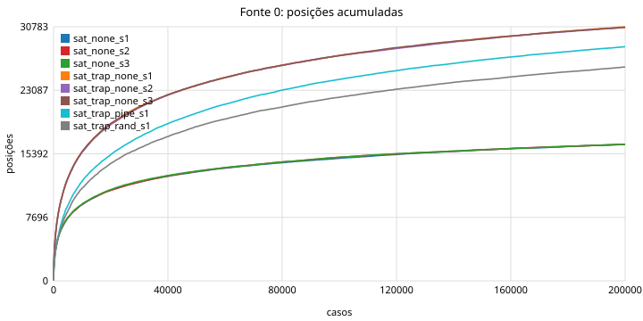
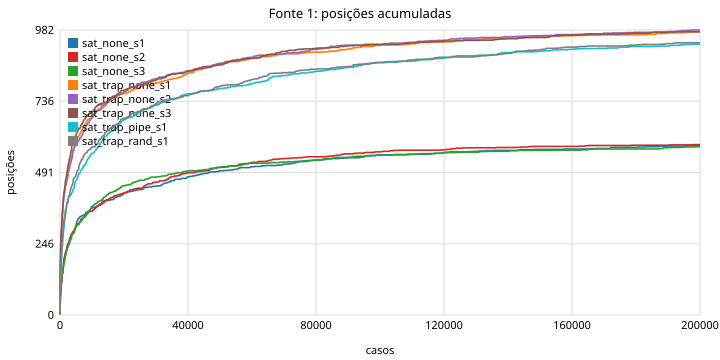
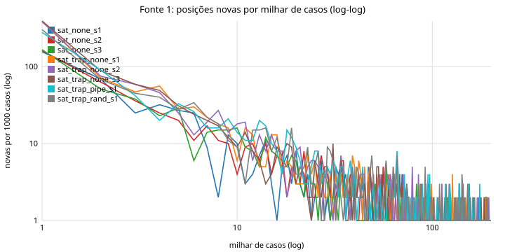
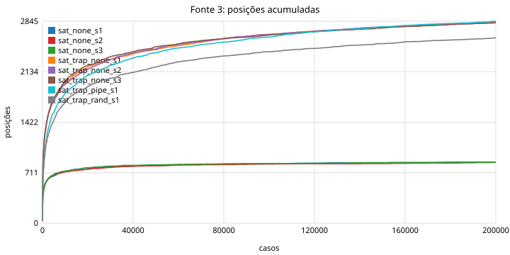
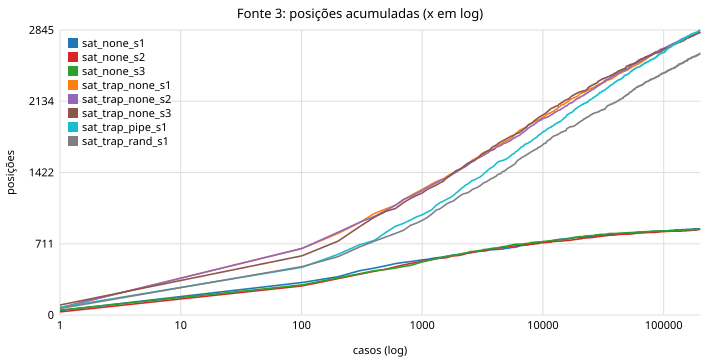
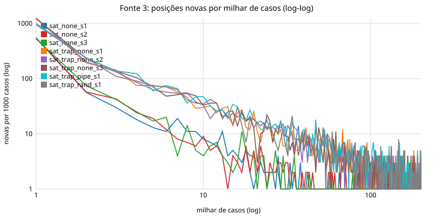
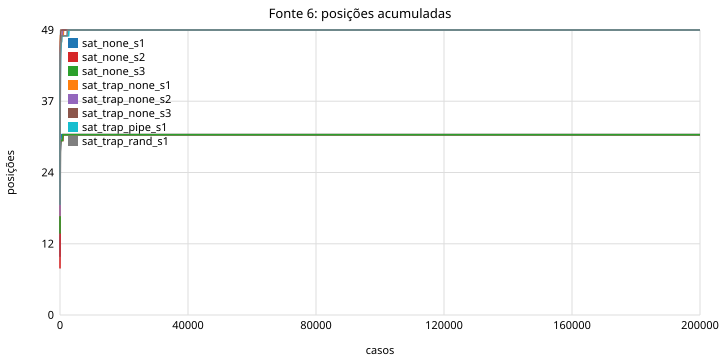
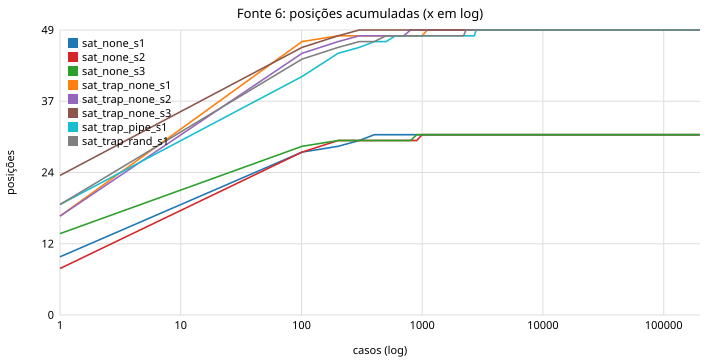
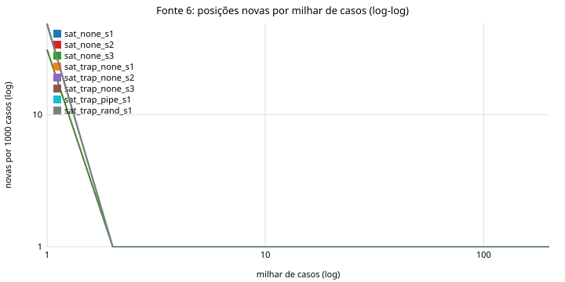

# Saturação das fontes

Rodadas: sat_none_s1 (200000 casos, pass=200000), sat_none_s2 (200000 casos, pass=200000), sat_none_s3 (200000 casos, pass=200000), sat_trap_none_s1 (200000 casos, mismatch=750 pass=199250), sat_trap_none_s2 (200000 casos, mismatch=733 pass=199267), sat_trap_none_s3 (200000 casos, mismatch=790 pass=199210), sat_trap_pipe_s1 (200000 casos, mismatch=820 pass=199180), sat_trap_rand_s1 (200000 casos, mismatch=327 pass=199673)

## Fonte 0 (pipe_edges)

| rodada | posições | 50% | 90% | 99% | novas 1º milhar | milhar do meio | último milhar | últimos 10k | Chao1 | vistas/Chao1 | f1 (1 caso) | f2 (2 casos) | Good-Turing f1/massa |
|---|---|---|---|---|---|---|---|---|---|---|---|---|---|
| sat_none_s1 | 16531 | 6511 | 100947 | 185811 | 4448 | 31 | 13 | 119 | 18445 | 90% | 2218 | 1285 | 0.0001 |
| sat_none_s2 | 16551 | 6620 | 97116 | 187803 | 4403 | 23 | 12 | 133 | 18678 | 89% | 2280 | 1222 | 0.0001 |
| sat_none_s3 | 16525 | 6489 | 95858 | 185213 | 4333 | 16 | 10 | 103 | 18411 | 90% | 2201 | 1284 | 0.0001 |
| sat_trap_none_s1 | 30783 | 9500 | 108445 | 188148 | 6713 | 64 | 28 | 252 | 35350 | 87% | 4905 | 2634 | 0.0002 |
| sat_trap_none_s2 | 30713 | 9559 | 107716 | 188157 | 6614 | 38 | 28 | 253 | 35182 | 87% | 4842 | 2623 | 0.0002 |
| sat_trap_none_s3 | 30713 | 9429 | 107084 | 186644 | 6575 | 51 | 21 | 238 | 35237 | 87% | 4852 | 2602 | 0.0002 |
| sat_trap_pipe_s1 | 28373 | 15955 | 121298 | 190232 | 4351 | 50 | 37 | 295 | 29285 | 97% | 1576 | 1361 | 0.0001 |
| sat_trap_rand_s1 | 25920 | 15365 | 122481 | 191419 | 4172 | 68 | 36 | 308 | 28644 | 90% | 3245 | 1933 | 0.0001 |

Entre sementes do mesmo grupo:

| grupo | sementes | posições por semente | união | interseção | Jaccard médio | exclusivas por semente | % exclusivas |
|---|---|---|---|---|---|---|---|
| sat_none | 3 | 16531 / 16551 / 16525 | 18814 | 14366 | 0.84 | 816 / 792 / 779 | 4.8% |
| sat_trap_none | 3 | 30783 / 30713 / 30713 | 35771 | 25975 | 0.81 | 1806 / 1745 / 1757 | 5.8% |

## Fonte 1 (csr_trans)

| rodada | posições | 50% | 90% | 99% | novas 1º milhar | milhar do meio | último milhar | últimos 10k | Chao1 | vistas/Chao1 | f1 (1 caso) | f2 (2 casos) | Good-Turing f1/massa |
|---|---|---|---|---|---|---|---|---|---|---|---|---|---|
| sat_none_s1 | 584 | 4557 | 73866 | 180791 | 156 | 0 | 0 | 2 | 611 | 96% | 37 | 25 | 0.0001 |
| sat_none_s2 | 587 | 4408 | 61908 | 162085 | 161 | 2 | 0 | 2 | 606 | 97% | 31 | 25 | 0.0001 |
| sat_none_s3 | 580 | 4520 | 57932 | 188236 | 166 | 0 | 0 | 4 | 597 | 97% | 30 | 26 | 0.0001 |
| sat_trap_none_s1 | 975 | 2562 | 57005 | 183416 | 386 | 1 | 0 | 3 | 999 | 98% | 53 | 58 | 0.0000 |
| sat_trap_none_s2 | 982 | 2428 | 56923 | 176561 | 384 | 1 | 0 | 6 | 1046 | 94% | 70 | 38 | 0.0000 |
| sat_trap_none_s3 | 976 | 2127 | 56178 | 164914 | 392 | 1 | 0 | 2 | 1018 | 96% | 58 | 40 | 0.0000 |
| sat_trap_pipe_s1 | 933 | 5198 | 80186 | 177667 | 278 | 0 | 0 | 6 | 991 | 94% | 69 | 41 | 0.0000 |
| sat_trap_rand_s1 | 938 | 4192 | 77250 | 177801 | 303 | 0 | 0 | 3 | 978 | 96% | 55 | 38 | 0.0000 |

Entre sementes do mesmo grupo:

| grupo | sementes | posições por semente | união | interseção | Jaccard médio | exclusivas por semente | % exclusivas |
|---|---|---|---|---|---|---|---|
| sat_none | 3 | 584 / 587 / 580 | 615 | 555 | 0.93 | 13 / 12 / 9 | 1.9% |
| sat_trap_none | 3 | 975 / 982 / 976 | 1031 | 922 | 0.93 | 17 / 17 / 17 | 1.7% |

## Fonte 3 (pipe_coarse)

| rodada | posições | 50% | 90% | 99% | novas 1º milhar | milhar do meio | último milhar | últimos 10k | Chao1 | vistas/Chao1 | f1 (1 caso) | f2 (2 casos) | Good-Turing f1/massa |
|---|---|---|---|---|---|---|---|---|---|---|---|---|---|
| sat_none_s1 | 860 | 289 | 18603 | 142160 | 550 | 0 | 0 | 1 | 880 | 98% | 27 | 18 | 0.0000 |
| sat_none_s2 | 856 | 369 | 22388 | 172129 | 537 | 0 | 0 | 4 | 903 | 95% | 29 | 9 | 0.0000 |
| sat_none_s3 | 857 | 340 | 17432 | 136609 | 528 | 0 | 1 | 2 | 876 | 98% | 23 | 14 | 0.0000 |
| sat_trap_none_s1 | 2832 | 1808 | 69496 | 180464 | 1254 | 2 | 2 | 13 | 3047 | 93% | 242 | 136 | 0.0000 |
| sat_trap_none_s2 | 2823 | 1830 | 65097 | 174392 | 1241 | 1 | 1 | 10 | 2976 | 95% | 210 | 144 | 0.0000 |
| sat_trap_none_s3 | 2824 | 1781 | 61730 | 178735 | 1217 | 3 | 0 | 13 | 3037 | 93% | 237 | 132 | 0.0000 |
| sat_trap_pipe_s1 | 2845 | 3330 | 83124 | 182175 | 1000 | 3 | 2 | 20 | 2943 | 97% | 118 | 71 | 0.0000 |
| sat_trap_rand_s1 | 2611 | 3136 | 78217 | 184654 | 944 | 1 | 1 | 19 | 2729 | 96% | 153 | 99 | 0.0000 |

Entre sementes do mesmo grupo:

| grupo | sementes | posições por semente | união | interseção | Jaccard médio | exclusivas por semente | % exclusivas |
|---|---|---|---|---|---|---|---|
| sat_none | 3 | 860 / 856 / 857 | 885 | 838 | 0.96 | 13 / 12 / 10 | 1.4% |
| sat_trap_none | 3 | 2832 / 2823 / 2824 | 3062 | 2586 | 0.89 | 77 / 75 / 79 | 2.7% |

## Fonte 6 (bins)

| rodada | posições | 50% | 90% | 99% | novas 1º milhar | milhar do meio | último milhar | últimos 10k | Chao1 | vistas/Chao1 | f1 (1 caso) | f2 (2 casos) | Good-Turing f1/massa |
|---|---|---|---|---|---|---|---|---|---|---|---|---|---|
| sat_none_s1 | 31 | 4 | 99 | 364 | 31 | 0 | 0 | 0 | 31 | 100% | 0 | 0 | 0.0000 |
| sat_none_s2 | 31 | 4 | 76 | 918 | 31 | 0 | 0 | 0 | 31 | 100% | 0 | 0 | 0.0000 |
| sat_none_s3 | 31 | 2 | 47 | 859 | 31 | 0 | 0 | 0 | 31 | 100% | 0 | 0 | 0.0000 |
| sat_trap_none_s1 | 49 | 3 | 47 | 1071 | 48 | 0 | 0 | 0 | 49 | 100% | 0 | 0 | 0.0000 |
| sat_trap_none_s2 | 49 | 3 | 73 | 771 | 49 | 0 | 0 | 0 | 49 | 100% | 0 | 0 | 0.0000 |
| sat_trap_none_s3 | 49 | 2 | 34 | 216 | 49 | 0 | 0 | 0 | 49 | 100% | 0 | 0 | 0.0000 |
| sat_trap_pipe_s1 | 49 | 3 | 181 | 2776 | 48 | 0 | 0 | 0 | 49 | 100% | 0 | 0 | 0.0000 |
| sat_trap_rand_s1 | 49 | 4 | 107 | 2223 | 48 | 0 | 0 | 0 | 49 | 100% | 0 | 0 | 0.0000 |

Entre sementes do mesmo grupo:

| grupo | sementes | posições por semente | união | interseção | Jaccard médio | exclusivas por semente | % exclusivas |
|---|---|---|---|---|---|---|---|
| sat_none | 3 | 31 / 31 / 31 | 31 | 31 | 1.00 | 0 / 0 / 0 | 0.0% |
| sat_trap_none | 3 | 49 / 49 / 49 | 49 | 49 | 1.00 | 0 / 0 / 0 | 0.0% |

